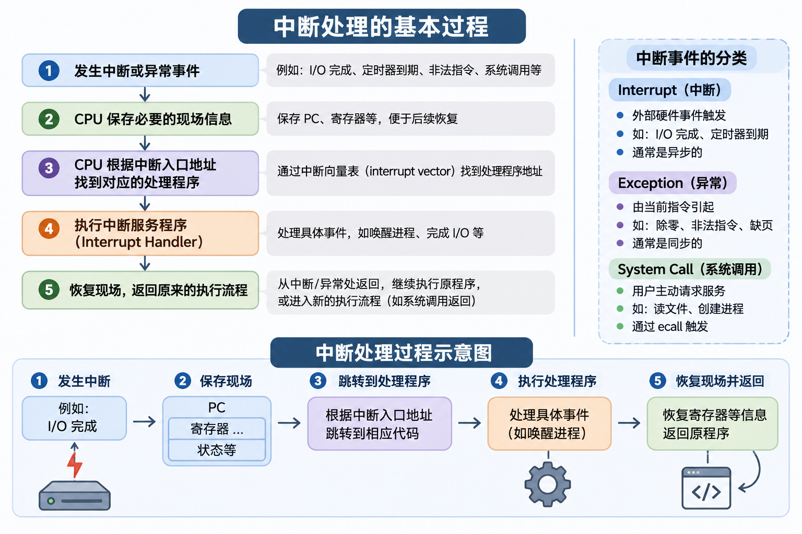

# 0. 本章知识结构

本章主要回答四个问题：

1. **What is OS?** 操作系统是什么？它有什么作用？
2. **How does OS work?** 操作系统是如何运行和控制计算机的？
3. **How does OS manage resources?** 操作系统如何管理计算机资源？
4. **What are the main components of OS?** 操作系统主要由哪些管理模块组成？

知识结构：

- **1. 操作系统概述（Overview）**
  - 操作系统的定义与作用
  - 计算机系统的组成
  - 操作系统的基本特征
  - 操作系统的分类
  - 计算机启动
- **2. 操作系统的运行机制（OS Operations）**
  - 中断与异常（Interrupt & Exception）
  - I/O 结构
  - 双模式运行（Dual-mode）
- **3. 操作系统的基本管理机制**
  - 多道程序与多任务
  - 进程管理
  - 内存管理
  - 存储管理
- **4. 操作系统的主要组成部分（Main Parts）**
  - Process Management
  - Memory Management
  - Storage Management
  - Mass-storage Management
  - I/O Subsystem

---

# 1. 操作系统概述（Overview）

## 1.1 什么是操作系统？

### 1.1.1 计算机系统的组成

计算机系统可以分为四个层次：

1. Hardware：硬件
2. Operating System：操作系统
3. System Programs & Application Programs：系统程序和应用程序
4. Users：用户

操作系统位于硬件和应用程序之间，为应用程序提供运行环境，并管理底层硬件资源。





### 1.1.2 操作系统的定义

OS 是一个 **Resource Allocator（资源分配器）** 和 **Control Program（控制程序）**。

- Resource Allocator：负责管理和分配 CPU、内存、存储设备、I/O 设备等资源。
- Control Program：控制程序的执行，管理程序对硬件的访问，防止错误和不合理的资源使用。

因此：

**操作系统是控制和管理整个计算机系统软硬件资源，合理组织和调度计算机工作，并为用户和其他软件提供方便接口与功能的程序集合。**

### 1.1.3 OS 与 Kernel 的区别

- **Kernel（内核）**：操作系统最核心的部分，是计算机启动后持续运行、负责资源管理和硬件控制的核心程序。
- **Operating System（操作系统）**：广义上不仅包括内核，还可以包括系统工具、系统服务等。

注意：日常交流中经常把 Kernel 直接称为 OS，但严格来说二者不完全等同。

### 1.1.4 操作系统的基本作用

可以概括为三个方面：

- **Abstraction（抽象）**：隐藏硬件细节，为上层程序提供统一、方便的接口。
- **Isolation（隔离）**：隔离不同进程和用户的资源，避免相互干扰。
- **Sharing（共享）**：让多个程序能够共同使用计算机资源。

---

## 1.2 操作系统的基本特征

操作系统有四个基本特征：

1. 并发（Concurrency）
2. 共享（Sharing）
3. 虚拟（Virtual）
4. 异步（Asynchrony）

其中，并发和共享是两个最基本的特征，二者关系密切。

### 1.2.1 并发（Concurrency）

指多个程序在一段时间内交替执行，宏观上表现为同时运行。

注意：

- 并发不等于并行。
- 并发：多个任务在同一时间段内交替执行。
- 并行：多个任务在同一时刻真正同时执行，通常需要多个处理器或执行单元。

### 1.2.2 共享（Sharing）

指多个进程可以共同使用系统中的资源。

共享的两种方式：

- 互斥共享：同一时间只允许一个进程使用资源。
- 同时访问：允许多个进程在一段时间内共同访问资源（例如可共享的只读文件）。

### 1.2.3 并发与共享的关系

- 并发使多个程序能够交替执行，因此需要共享 CPU、内存等资源。
- 资源共享需要处理多个程序之间的访问关系，进而要求操作系统支持并发管理。

二者相互依存、相互促进。

### 1.2.4 虚拟（Virtual）

通过某种技术，将一个物理资源抽象成多个逻辑资源。

例如：

- 虚拟内存：让进程拥有独立的虚拟地址空间。
- 虚拟处理器：通过 CPU 调度，让多个进程感觉自己拥有 CPU。

### 1.2.5 异步（Asynchrony）

指进程的执行不是一直连续进行的，而是以不可预知的速度向前推进。

例如：

- 进程可能因为 I/O 请求而阻塞。
- 进程可能因为时间片用完而被调度出去。
- 进程可能因为中断而暂停当前执行。

---

## 1.3 操作系统的分类

### 1.3.1 批处理系统（Batch System）

用户将作业提交给系统，系统按照一定方式组织和处理作业，不需要用户持续参与执行过程。

**单道批处理系统（Single-programming Batch System）**

- 内存中一次只装入一道作业。
- 当前作业执行完毕后，再执行下一道作业。
- 作业等待 I/O 时，CPU 可能空闲。

**多道批处理系统（Multiprogrammed Batch System）**

- 内存中同时存放多道作业。
- 当一个作业等待 I/O 时，CPU 可以切换去执行其他作业。
- 主要目标：提高 CPU 利用率和系统吞吐量。

核心思想：让 CPU 尽量不要因为某个作业等待 I/O 而闲置。

### 1.3.2 分时系统（Time-sharing System）

- 多个用户可以同时使用一台计算机。
- CPU 将时间划分成很短的时间片（Time Slice）。
- 多个进程轮流使用 CPU。
- 主要目标：提高交互响应速度，让用户感觉自己独占计算机。

例如：多个用户同时登录一台服务器。

### 1.3.3 实时系统（Real-time System）

- 系统需要在规定时间内对外部事件作出响应。
- 不仅要求结果正确，还要求在规定时间内完成。
- 主要目标：满足实时性要求。

例如：工业控制、汽车控制系统。

实时系统可以使用不同的调度策略，并不是简单地以是否使用时间片来区分。

### 1.3.4 三种系统对比

| 类型 | 核心特点 | 主要目标 |
|---|---|---|
| 批处理系统 | 作业批量执行 | 自动处理作业 |
| 多道批处理 | 多道作业驻留内存 | 提高资源利用率 |
| 分时系统 | 多用户轮流使用 CPU | 快速交互响应 |
| 实时系统 | 在规定期限内响应 | 满足实时性 |

---

## 1.4 多道程序与多任务

这两个概念和操作系统的发展密切相关。

### 1.4.1 Multiprogramming（多道程序设计）

把多个程序加载到内存中，让 CPU 在它们之间切换运行。

核心目的：提高 CPU 利用率。

例如：

- P1 正在执行。
- P1 需要进行 I/O，进入等待状态。
- CPU 切换执行 P2。
- P1 的 I/O 完成后，可以重新参与调度。

### 1.4.2 Multitasking（多任务处理）

操作系统允许多个任务交替执行，让用户感觉多个任务似乎在同时运行。

例如：

- 打开浏览器。
- 播放音乐。
- 下载文件。

操作系统通过 CPU 调度，让这些任务轮流执行。

两者的区别：

| 概念 | 侧重点 | 主要目的 |
|---|---|---|
| Multiprogramming | 多个程序驻留内存 | 提高 CPU 利用率 |
| Multitasking | 多个任务交替执行 | 支持多个任务并发运行 |

关系：

Multiprogramming 是现代 Multitasking 的重要基础。现代多任务系统通常还会使用时间片、抢占式调度等机制。

### 1.4.4 其他相关概念

- Multiprocessing：多处理器处理，使用多个 CPU 或 CPU 核心执行任务。
- Multithreading：多线程处理，一个进程中存在多个线程。

注意：这几个概念不是同一维度的分类。

---

## 1.5 计算机启动（Computer Startup）

- Boot：计算机启动过程。
- Bootstrap Program：启动程序。

计算机启动时，需要先执行一段启动代码，完成基本硬件初始化，并将操作系统内核加载到内存，最终将控制权交给操作系统。

---

# 2. 操作系统的运行机制（OS Operations）

操作系统需要控制程序的执行、处理外部设备请求，并保护系统资源。

为此，计算机提供了中断机制和不同的运行模式。

## 2.1 中断（Interrupt）与异常（Exception）

### 2.1.1 为什么需要中断？

CPU 在执行程序时，可能遇到各种需要操作系统处理的事件：

- I/O 设备完成操作。
- 定时器到期，需要进行调度。
- 程序执行出现错误。
- 用户程序请求操作系统服务。

这些事件需要让 CPU 暂停当前执行流程，转而执行相应的处理程序。

### 2.1.2 中断处理的基本过程

1. 发生中断或异常事件。
2. CPU 保存必要的现场信息。
3. CPU 根据中断入口地址找到对应的处理程序。
4. 执行中断服务程序（Interrupt Handler）。
5. 恢复现场，返回原来的执行流程或进入新的执行流程。





### 2.1.3 中断事件的分类

从一般操作系统教材的角度：

**Interrupt（中断）**

- 通常指由外部硬件事件触发。
- 例如：I/O 设备完成操作、定时器到期。
- 通常是异步发生的，CPU 不需要事先知道具体发生时间。

**Exception（异常）**

- 通常指由当前正在执行的指令引起。
- 例如：除零、非法指令、缺页异常。
- 通常是同步发生的。

**System Call（系统调用）**

- 用户程序主动请求操作系统提供服务。
- 例如：请求读取文件、创建进程。
- 通常通过专门的指令触发。

### 2.1.4 RISC-V 中的 Trap

注意 RISC-V 的术语与一般教材中的分类有所不同。

RISC-V 将导致控制流转入特权级陷阱处理程序的事件统称为 **Trap**。

主要分为：

- Interrupt：中断，异步事件。
- Exception：异常，同步事件。

例如：

| 事件 | RISC-V 分类 |
|---|---|
| 定时器中断 | Interrupt |
| 外部设备中断 | Interrupt |
| 非法指令 | Exception |
| 访问非法地址 | Exception |
| ecall | Exception |

其中：

- `ecall`：环境调用指令，用于主动请求更高特权级的软件服务。
- 系统调用通常通过 `ecall` 实现。





---

## 2.2 I/O Structure（输入输出结构）

I/O 操作可以分为同步和异步两种方式。

### 2.2.1 同步 I/O（Synchronous I/O）

- 发出 I/O 请求后，调用者需要等待 I/O 操作完成。
- 完成后才继续执行后续操作。
- 对调用者而言，执行过程表现为阻塞等待。

### 2.2.2 异步 I/O（Asynchronous I/O）

- 发出 I/O 请求后，不必等待操作完成就可以继续执行其他工作。
- 操作系统需要记录尚未完成的 I/O 请求。
- I/O 完成后，通过中断等机制通知系统。

### 2.2.3 两者对比

| 对比 | 同步 I/O | 异步 I/O |
|---|---|---|
| 是否等待完成 | 是 | 否 |
| 发出请求后 | 等待操作完成 | 可以继续其他工作 |
| 完成通知 | 返回调用者 | 通过通知机制告知 |

异步 I/O 可以提高 CPU 和 I/O 设备的并行工作效率。

---

## 2.3 Dual-mode Operation（双模式运行）

### 2.3.1 为什么需要双模式？

操作系统需要保护自身和计算机资源。

如果用户程序能够随意执行特权操作，就可能：

- 修改操作系统关键数据。
- 随意访问其他进程的内存。
- 直接控制硬件设备。

因此，需要区分用户程序和操作系统的权限。

### 2.3.2 两种运行模式

**User Mode（用户模式）**

- 用户程序运行的模式。
- 权限受限。
- 不能直接执行某些特权操作。

**Kernel Mode（内核模式）**

- 操作系统内核运行的模式。
- 拥有更高权限。
- 可以执行特权指令，管理硬件资源。

### 2.3.3 Mode Bit（模式位）

硬件通过模式位区分当前 CPU 所处的运行模式。

通常可以抽象为：

- User Mode：受限权限。
- Kernel Mode：特权权限。

### 2.3.4 用户程序如何请求操作系统服务？

通过 System Call（系统调用）。

基本过程：

1. 用户程序在 User Mode 下运行。
2. 用户程序执行系统调用指令（例如 RISC-V 的 `ecall`）。
3. CPU 进入相应的特权级，转入内核处理程序。
4. 内核完成请求。
5. 返回用户模式，继续执行用户程序。

注意：`ecall` 本身是可以在用户态执行的指令，但执行后会产生同步异常，触发特权级切换。

---

# 3. 操作系统的基本管理机制

这一部分开始讨论操作系统如何管理和调度资源。

## 3.1 Process Management（进程管理）

### 3.1.1 Program 与 Process

- Program（程序）：被动实体，是存储在磁盘上的指令和数据。
- Process（进程）：主动实体，是程序的一次执行过程。

简单理解：

程序是静态的，进程是动态的。

### 3.1.2 进程管理的主要任务

- 创建和删除进程。
- 暂停和恢复进程。
- CPU 调度。
- 进程同步与互斥。
- 进程通信。
- 死锁处理。

### 3.1.3 多线程（Multithreading）

一个进程可以包含多个线程。

每个线程拥有自己的：

- 程序计数器（PC）。
- 寄存器集合。
- 栈（Stack）。

同一进程内的线程共享进程的代码、数据以及其他进程资源。

### 3.1.4 进程同步（Process Synchronization）

多个进程或线程可能同时访问共享数据。

如果缺少适当的同步机制，就可能发生 Race Condition（竞态条件）。

因此，需要通过同步机制协调进程之间的执行顺序。

常见概念：

- Critical Section：临界区。
- Mutual Exclusion：互斥。
- Progress：进展。
- Bounded Waiting：有限等待。
- Mutex Lock：互斥锁。
- Semaphore：信号量。

---

## 3.2 Memory Management（内存管理）

操作系统负责管理主存（Main Memory）。

主要任务：

- 记录内存中哪些区域正在使用。
- 决定哪些进程可以加载到内存。
- 为进程分配和回收内存。
- 管理剩余可用内存。
- 实现虚拟内存（Virtual Memory）。

### 3.2.1 Virtual Memory（虚拟内存）

通过地址转换等机制，使进程使用独立的虚拟地址空间。

主要作用：

- 提供进程之间的地址空间隔离。
- 使程序不必全部加载到物理内存中。
- 提高内存利用率。

---

## 3.3 Storage Management（存储管理）

主要讨论文件系统（File System）。

### 3.3.1 File System（文件系统）

文件系统负责管理磁盘上的文件和目录。

主要任务：

- 创建和删除文件。
- 创建和删除目录。
- 文件读写。
- 文件组织和存储空间管理。
- 文件访问权限管理。

可以把文件系统理解为：操作系统对持久化数据进行组织、管理和访问的一套机制。

---

# 4. 操作系统的主要组成部分（Main Parts）

**1. Process Management（进程管理）**

负责进程和线程的生命周期管理、CPU 调度、同步互斥、通信等。

**2. Memory Management（内存管理）**

负责主存的分配、回收、地址转换以及虚拟内存管理。

**3. File-System Management（文件系统管理）**

负责文件和目录的组织、访问、读写和权限管理。

**4. Mass-Storage Management（大容量存储管理）**

主要负责磁盘等大容量存储设备的管理。
例如：Disk Scheduling（磁盘调度）
* 多个进程同时提出磁盘访问请求时，操作系统需要决定请求的处理顺序，以提高磁盘访问效率。

**5. I/O Subsystem（I/O 子系统）**
* 操作系统需要隐藏不同硬件设备的具体实现细节，为上层程序提供统一的 I/O 接口。
* 主要功能：
  * I/O 内存管理
    - Buffering（缓冲）：在数据传输过程中，临时存储数据，以协调不同设备或程序之间的速度差异。
    - Caching（缓存）：将部分数据保存在访问速度更快的存储区域中，以提高访问性能。
    - Spooling（假脱机）：利用磁盘作为缓冲区，对设备请求进行排队，使不同作业的输入输出能够与其他工作重叠执行。
  * 设备驱动程序接口：
    * 提供通用的设备驱动程序接口，使操作系统能够以统一方式管理不同设备。
  * Device Drivers（设备驱动程序）
    * 针对具体硬件设备编写的驱动程序，负责与设备进行交互。

---

# 5. 本章知识框架总结

| 层次 | 核心问题 | 关键概念 |
|---|---|---|
| OS Overview | 操作系统是什么 | Resource Allocator、Control Program |
| OS Characteristics | 操作系统有什么特点 | 并发、共享、虚拟、异步 |
| OS Types | 操作系统有哪些类型 | 批处理、分时、实时 |
| OS Operations | 操作系统如何运行 | Interrupt、Exception、I/O、Dual-mode |
| Process Management | 如何管理 CPU 执行任务 | Process、Thread、Scheduling、Synchronization |
| Memory Management | 如何管理主存 | Allocation、Virtual Memory |
| Storage Management | 如何管理文件 | File System |
| Mass-storage Management | 如何管理磁盘 | Disk Scheduling |
| I/O Subsystem | 如何管理外部设备 | Buffering、Caching、Spooling、Device Driver |
