# 0. Intro

交互性和处理效率如何兼得？
* 交互性：希望操作是碎片化执行，这样相应才及时
* 效率：大段大段地执行，不要老被打断

——使用多线程。

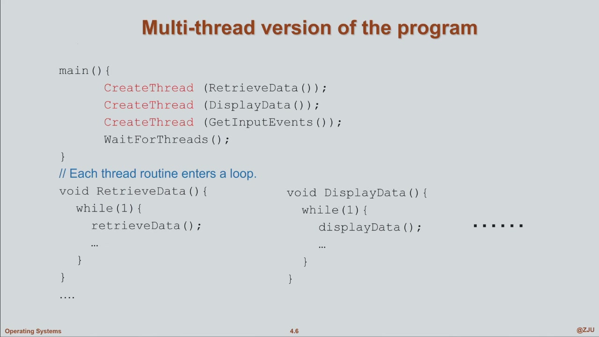
* 每个线程都是一个loop，且互相独立
* 线程可以自行Block到等到完成操作

图示：

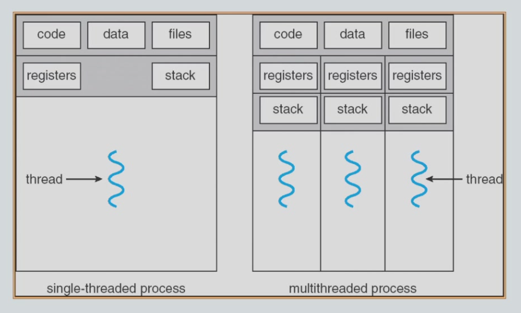
* multithread中：有独立的上下文、可以独立调用函数，因此各thread有自己的registers和stack
* 全局的数据（对process来说全局）对各thread是共享的

多个线程想要share memory要怎么做？——它们天然就共享内存空间，不用再分配共享空间。如果想分配的话要注意设置为全局，不要在线程内定义。

multithreads的好处：
* Responsiveness,响应性好
* Resource sharing,资源共享
* Economy,经济性：create一个process是很昂贵的，而分配线程就便宜得多
  * 因为分配process时要分配一堆resource，而create thread时直接复用这些资源就好了
* Utilization of MP Arch,方便多核架构
  * 多线程的concurrency(并发度)更好--？？不是并行性吗

Concurrency vs. Parallelism
* 并发性：同时处理多个进程（即使物理上是单核，也可以通过调度实现并发，而在某一时刻并不一定是多任务）
* 并行性：物理上就是并行的

见下图

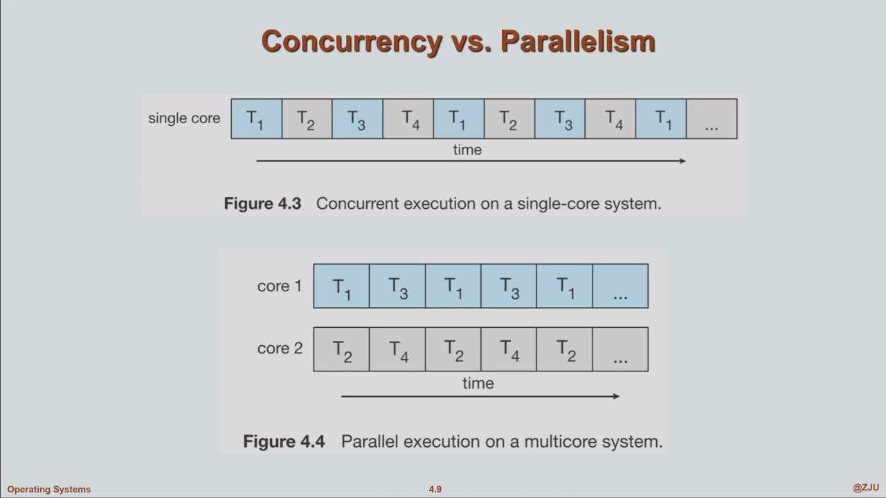

# 1.

## 1.1 User Threads,用户线程

由U模式库(library)管理多线程。OS不知道多线程的事.若发生I/O中断，OS会把整个进程block住，从而所有线程都不能运行

操作由以下这些库提供：
pthread_join？？

>Linux中调用pthread_create，Kernel其实是能看到线程的

## 1.2 Kernel Threads,内核线程

OS知道每个进程里有多个线程。从而调度也由OS直接完成

>Kernel Thread是主流实现

# 2 Multithreading Model

* Many-to-one
* One-to-one
* Many-to-many

形象类比：
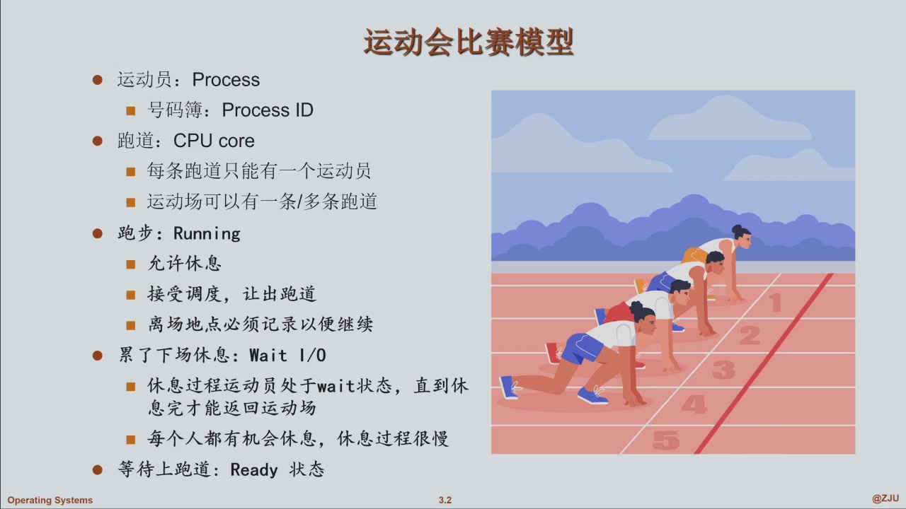

## 2.1 Many-to-One model

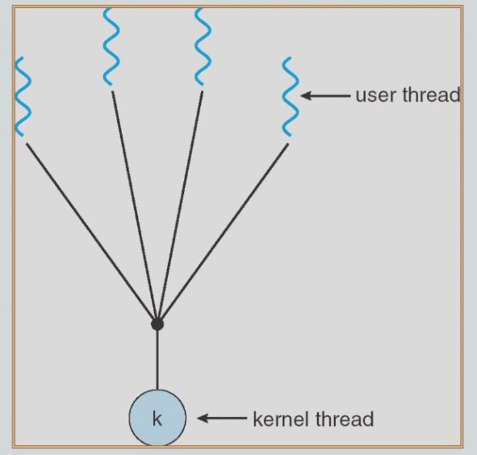

内核看不到user thread.好处：
* 适用于老旧系统的多线程，直接用library来操作user thread

某一时刻只有一个user thread占用kernel thread在跑。若有任一线程发生syscall，kernel thread就会被挂起，从而整个进程都被挂起

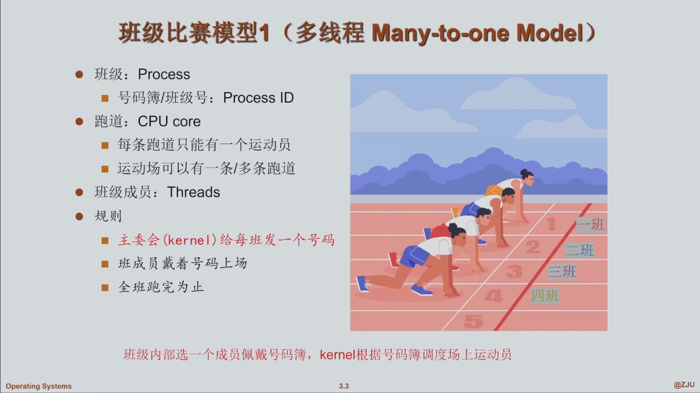
* 拿到号码就相当于user thread占用kernel thread来运行

## 2.2 One-to-One model

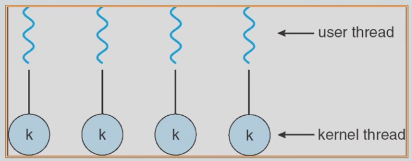

应用中创建任意一个user thread，kernel都会给创建一个对应的kernel thread.

对kernel thread的调度等价于对user thread的调度

一个user挂起了，只有它对应的kernel thread被挂起

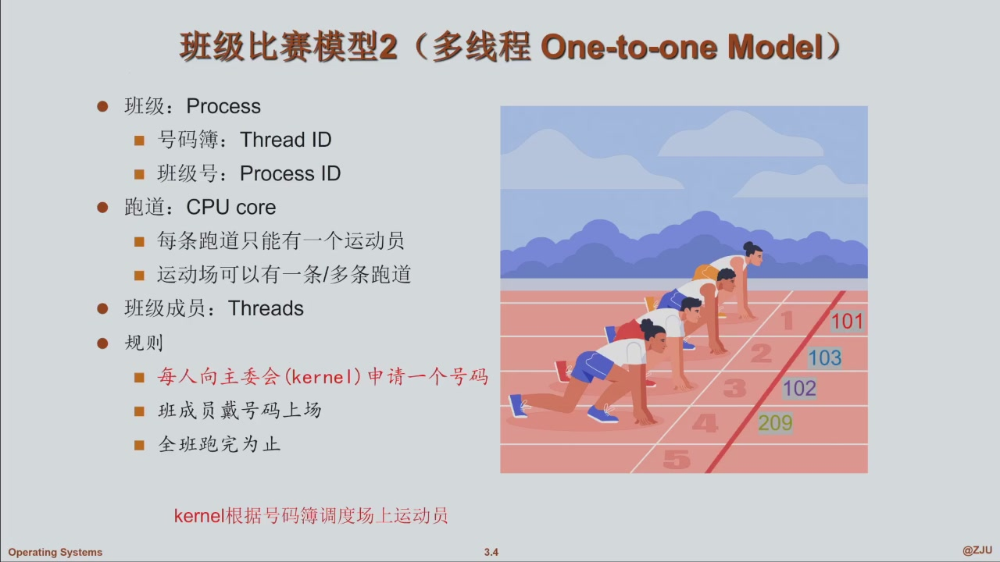

## 2.3 Many-to-Many model

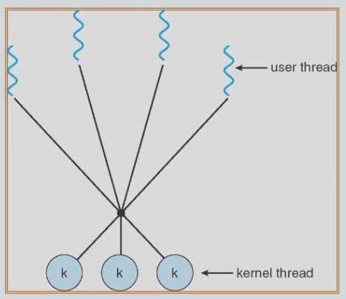

m个user thread，n个kernel thread.一般来说m>n

这特么是干啥的？？

为了应对user thread太多的情况。这个模型下kernel thread只会创建有限个

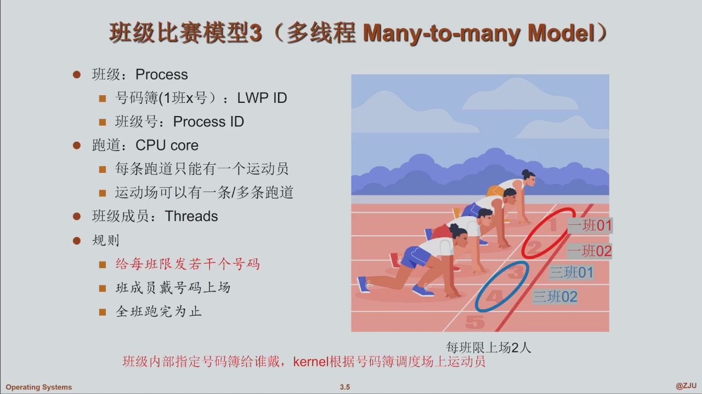
* LWP：Light weight process.

## 2.4 Two-Level model

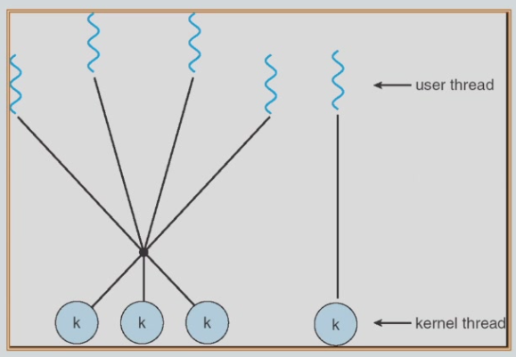

