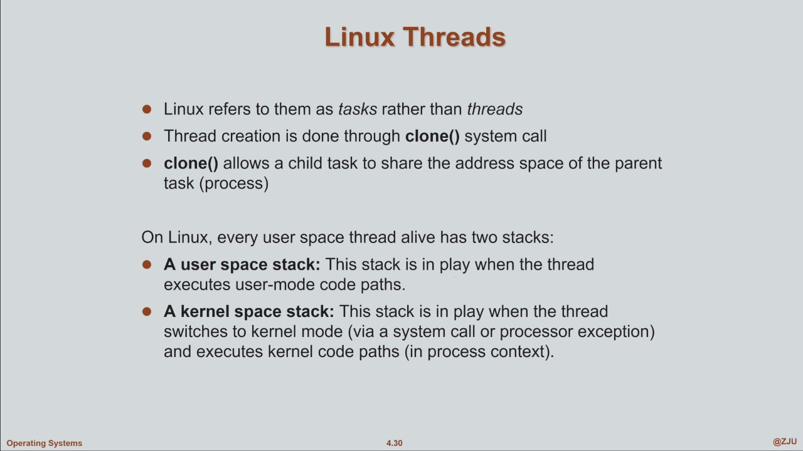
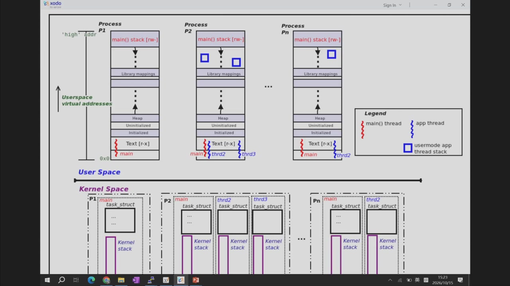
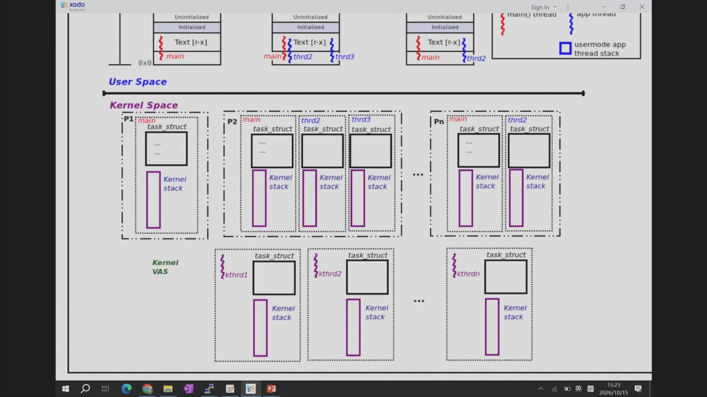

# 0. Intro

交互性和处理效率如何兼得？
* 交互性：希望操作是碎片化执行，这样相应才及时
* 效率：大段大段地执行，不要老被打断

——使用多线程。

* 每个线程都是一个loop，且互相独立
* 线程可以自行Block到等到完成操作

图示：

* multithread中：有独立的上下文、可以独立调用函数，因此各thread有自己的registers和stack
* 全局的数据（对process来说全局）对各thread是共享的

多个线程想要share memory要怎么做？——它们天然就共享内存空间，不用再分配共享空间。如果想分配的话要注意设置为全局，不要在线程内定义。

multithreads的好处：
* Responsiveness,响应性好  
  * 运行长操作时，一部分Block住了，其他的也可以继续运行并响应 
* Resource sharing,资源共享
* Economy,经济性：create一个process是很昂贵的，而分配线程就便宜得多
  * 因为分配process时要分配一堆resource，而create thread时直接复用这些资源就好了（只需要进行context switch和一些进程内分配）
* Utilization of MP Arch,方便多核架构
  * 多线程的concurrency(并发度)更好--？？不是并行性吗

>multiprogramming vs. multiprocessing？？

Concurrency vs. Parallelism
* 并发性：同时处理多个进程，可以是一个core/多个core，每个进程都可以取得进展，但不在意时间上它们是否会有交叠（即使物理上是单核，也可以通过调度实现并发，而在某一时刻并不一定是多任务）
* 并行性：物理上就是并行的，在任意时刻都在同时执行
* 并行要求更高，必须是多核上

见下图

# 1. 两种特权级的Thread

## 1.1 User Threads,用户线程

由U模式线程库(thread library)管理多线程。OS不知道多线程的事.若发生I/O中断，OS会把整个进程block住，从而所有线程都不能运行

>Linux中调用pthread_create，Kernel其实是能看到多个线程的

特点：
- 线程的创建、调度、切换都在用户态完成，不需要陷入内核，效率高。
- 调度器不知道User thread的存在，只知道Process。所以它只会根据Kernel thread来调度，User thread要映射到Kernel thread上才能被调度

## 1.2 Kernel Threads,内核线程

OS知道每个进程里有多个线程。从而调度也由OS直接完成，并发性好，能利用多核；但是线程的创建/切换要进入S-mode，开销比U-mode大

>Kernel Thread是主流实现

# 2 Multithreading Model

这里介绍将User thread映射到Kernel thread的模型。

* Many-to-one
* One-to-one
* Many-to-many

形象类比：

## 2.1 Many-to-One model

内核看不到user thread.好处：
* 适用于老旧系统的多线程，直接用library来操作user thread

某一时刻只有一个user thread占用kernel thread在跑。若有任一线程发生syscall，kernel thread就会被挂起，从而整个进程都被挂起

* 拿到号码就相当于user thread占用kernel thread来运行

## 2.2 One-to-One model

应用中创建任意一个user thread，kernel都会给创建一个对应的kernel thread.

对kernel thread的调度等价于对user thread的调度

一个user挂起了，只有它对应的kernel thread被挂起

## 2.3 Many-to-Many model

m个user thread，n个kernel thread.一般来说m>n

这特么是干啥的？？

为了应对user thread太多的情况。这个模型下kernel thread只会创建有限个

* LWP：Light weight process.

## 2.4 Two-Level model

# 3 Threading Issues，多线程的一些问题

fork()时，复制父进程的所有、还是仅复制调用进程？
* 如果接下来马上exec()，整个子进程被替换，就只剩新程序的主线程了
* 看具体情况

Thread cancellation，线程取消：
* 异步取消：立即终止
* 同步取消：线程自己决定何时退出

Signal Handling,信号处理：信号送给哪个线程？
* 送给信号适用的那个线程（比如除零错误送给出错线程）。
* 送给进程里的每个线程。
* 送给进程里某些特定线程。
* 指定一个专门的线程来接收所有信号。

Thread pool,线程池：创建一批进程并让它们等待工作
* 对于大数据流应用，request太多，需要创建很多线程，而create的开销不小——所以不如直接预制一些thread，有任务来了直接挑出一个来执行
* 执行完了也不退出，继续放回pool中等待
* 若pool中没有free thread了，新的request就必须等待

Thread Specific Data,线程特有数据
* 除了它们各自的stack之外，开这个数据区的作用：stack用来放局部变量那些的，但有些数据是想要在整个thread中使用的（如线程编号thread-id）
* 所以设置Thread-Local Storage
  * 访问方式：基址（存在一个reg中）+ offset

Scheduler Activations,调度器激活：涉及到user library
？？待补充

Pthreads：同时是user-level和kernel-level library

## Linux Threads

* linux中管thread叫task.
* linux中没有严格的线程/进程的区分。由clone()出的task，父子俩共用一块addr space，那么这个孩子就可以算是父亲的thread

user space中各进程隔离，互相看不见；而kernel space中互相可见

？？所以这段是个啥。从15:15(time)开始看吧
