# 1.Basic Concepts

为了multiprogramming，让多道程序都能占用CPU。

CPU utilization,CPU利用率

>利用率并非越高/低越好，要看使用目标。效率or响应速度

## 1.1 CPU burst和I/O burst

CPU Burst和I/O burst
* CPU burst：一堆指令连续运行，主要在使用CPU
* I/O burst：主要在进行I/O，并没有运行指令

CPU burst图例：

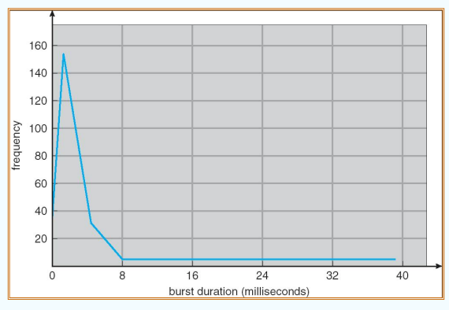

>特点：短时间内高频使用，后续长时间低频使用

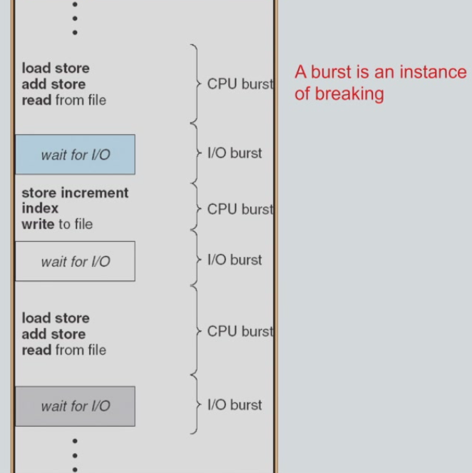

进程的整个生命周期就是这俩交替出现。

由于要分配资源给不同进程的burst，所以我们需要关注burst的时长。
* 一般burst都很短，所以scheduler要频繁运行，把资源从这个burst完的进程调度给其他进程

## 1.2 抢占式/非抢占式调度

考虑schedule的时机，有以下情况
1. 进程running-->waiting(e.g.发生I/O请求)
2. 进程running-->ready(e.g.发生中断)
3. 进程waiting-->ready state(e.g. I/O结束)
4. 进程terminate了

其中情况1和4是必须进行调度的；2和3在有些系统上可能是不schedule的。只在1和4下调度的系统为非抢占式系统(nonpreemptive)；4种都调度的则为抢占式系统(preemptive)

也就是说，非抢占式是只允许进程**主动放弃**处理器；而抢占式能让进程**被动放弃**处理器

速记：抢占式特有的一定要是变成ready state的。也就是ready queue来新人儿的时候

## 1.3 Dispatcher

Dispatch,指派（也就是调度）
* context switch时save state和restore state产生的延时称为dispatch latency(指派延时)

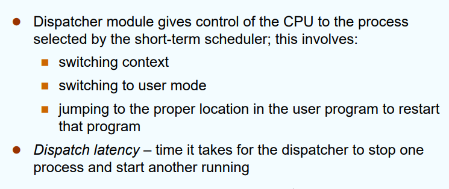

切换到U-mode是为了隔离性，user code只能在U mode下运行

# 2.Scheduling Criteria

>调度的衡量标准

CPU utilization,CPU利用率：根据需求来，不一定高/低就一定好

Throughput,吞吐率：单位时间内能完成多少processes(直接用完成的进程数➗时间)

Turnaround time,周转时间：从提交一个进程到它完成的时间（并不一定是完整的，中间被中断、切换的时间都算上）

Waiting time,等待时间：一个进程在ready queue中等待的时间（也就是它处在ready state的时间）
* 注意，是指在整个生命周期中在ready queue中的累计时间（中断了回到ready queue的那些时间也要算上）

Response time,响应时间：从提交一个request到第一个响应出现的时间
* 并不是到它的结果output出现的时间，那种prompt也是算的
* 每一轮交互都会有一个自己的response time.

优化方向/目标：
* 增大CPU利用率
* 增大吞吐率
* 减小周转时间/等待时间/响应时间

# 3.Scheduling Algorithm

## 3.1 FCFS,First Come First Served

先来先服务。直接按顺序服务，不管它们的属性。见下图：

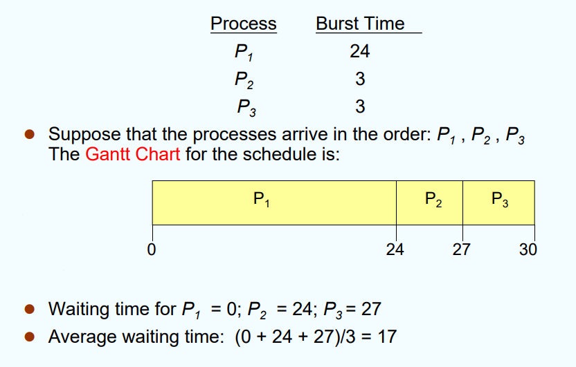

>Gantt Chart,甘特图：常用于表示调度方式

turn around time for P1=24 P2=27 P3=30 (提交时间就是一开始t=0)

显然把短的放前面能减少avg waiting time,这种调度不太聪明

Convoy effect(护航效应)：一个CPU-bound进程和n个I/O-bound进程，那个CPU time长的进程P1运行时其他进程就是在ready queue里面挂着；

且由于那些是I/O-bound，它们使用CPU的时间很短，然后就去I/O了，完成后又在ready queue里面等。不再次分配到CPU的话它们I/O也做不了，这样I/O设备就空闲着，利用率很低

## 3.2 SJF,Short Job First

### Non-preemptive SJF

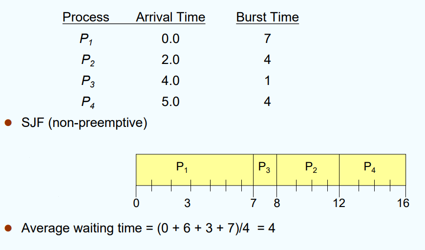

需要关注arrival time，是为了检测某时刻ready queue里到底有哪些进程。若只有一个那当然直接把它放上去执行，如图中的P1

注意waiting time，要用开始执行时间减去arrival time

### Preemptive SJF，又叫SRTF

SRTF,shortest remaining time first

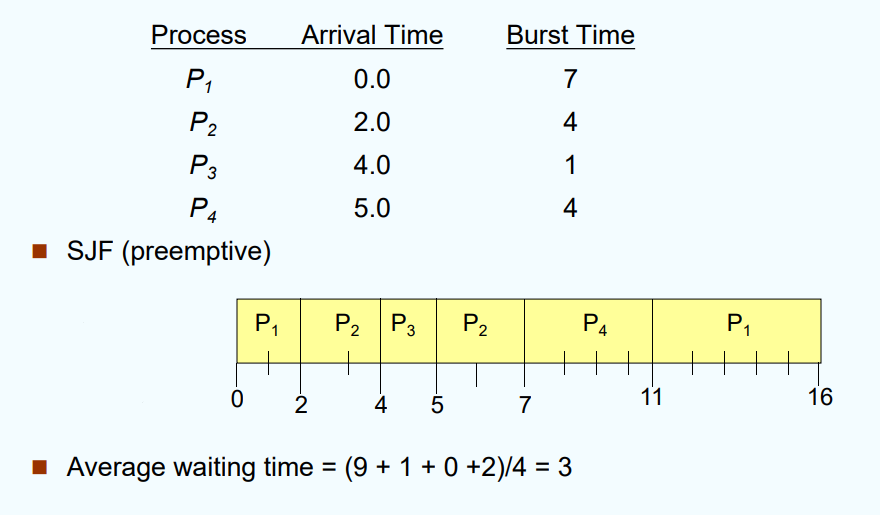

t=2时，将P1和P2比较，P1还剩5时间，P2为4时间；从而直接让P2抢占处理器。

>这里的抢占时机是：有进程waiting-->ready了

**SJF在waiting time方面是最优调度策略(optimal)**

### Determining Length of Next CPU Burst time

因为SJF要根据burst time来调度，但是我们没法预知下一个burst time具体是多少。

可以根据之前的Burst来估计下一个Burst time的长度。

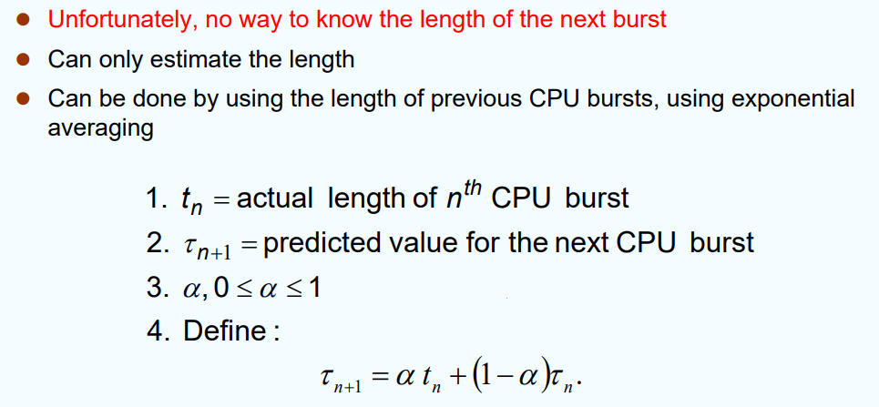

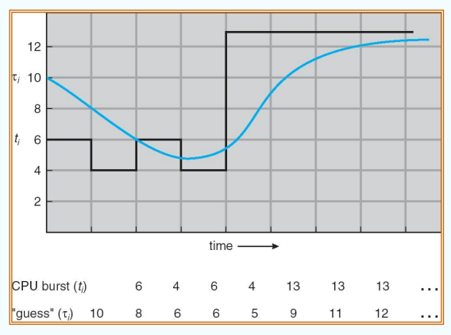

使用指数平均拟合出的蓝线 vs. 实际的burst time黑线

## 3.3 Priority Scheduling,优先级调度

每个进程有一个优先级号（整数），越小优先级越高。

也可分为抢占式/非抢占式

>SJF事实上是优先级调度的一个特例（将burst time作为优先级标准的版本）

**Starvation(饥饿)：有些低优先级的进程可能一直执行不了。**
解决方式：Aging(变老)——随着进程等待时间的延长，逐步提升它的优先级。这样它就有机会执行了

## 3.4 RR,Round Robin(轮转算法)

定义一个最小CPU时间片(time quantum)，然后让ready queue里的进程轮流占用处理器一个time quantum。（不用完也行，结束了直接terminate之后会触发调度，就接着往下轮转了）

>一般平均周转时间比SJF长，但响应性更好

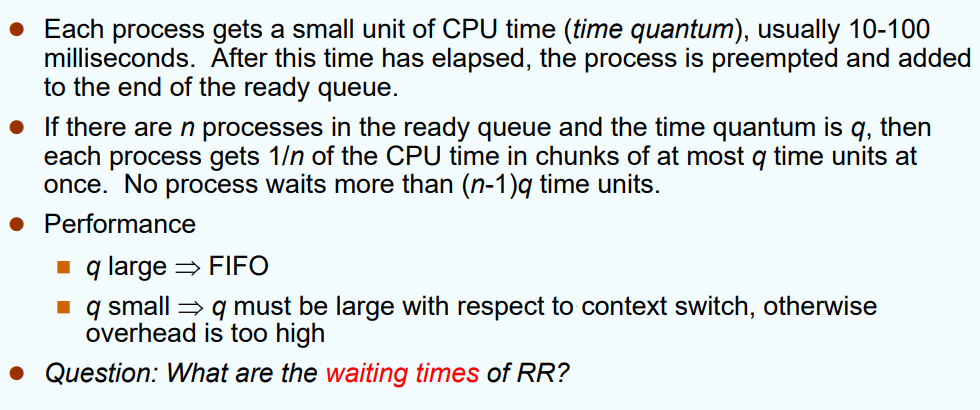

q大小的讲究？
* q大：若q超过了最大burst time-->退化成FCFS
* q小：context switch太频繁，overhead is too high

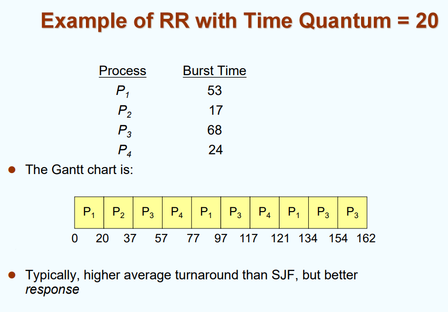

P1的waiting time = 134 - burst time of P1

## 3.5 Multilevel Queue

进程之间是有区别的，有些我们更关注交互性，有些我们更希望其整块执行

所以可以把ready queue分成多条queue，每个queue各自用一种合适的调度算法

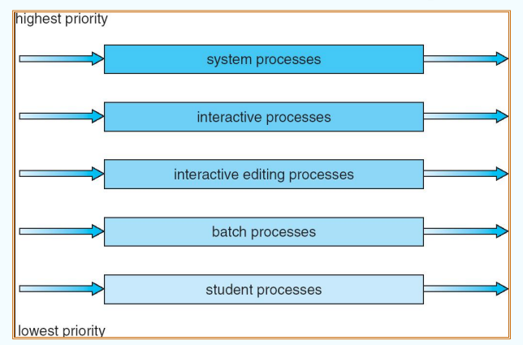

会优先执行优先级高的queue。然后每个queue内部又有自己的调度算法（当然，应该确保每个进程都能得到服务）

### Multilevel Feedback Queue

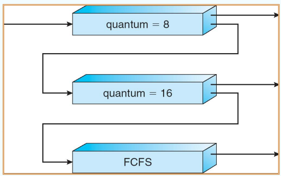

一进程P1，若在q=8的一个q中未完成，就把它降级到q=16的queue（也就是说它的交互性没那么强），最后来到底层的纯粹计算型的FCFS，给其分配更多的CPU时间

若下层队列中有进程对交互性要求较高，也可以将其升级到上方的RR调度

# 4.Multiple-Peocessor Scheduling

## SMP 和 AMP

Asymmetric Multiprocessing,非对称多处理：把跟kernel相关的操作只交给一个core，其他的core只跑User code

SMP,Symmetric Multiprocessing:对称多处理

对应的，对称多处理就是可以多个core一起运行kernel code 或 user code.由于此时要处理并行访问kernel内容的问题，会比非对称的复杂

## Real-time Scheduling

Hard real-time system，硬实时操作系统：能在一个规定时间内完成工作的系统（不一定要很快，不timeout就行）
* 若timeout了呢？——系统故障了，需要检修

Soft real-time system，软实时操作系统：不一定能在要求时间内完成。它只能保证比较关键的进程能分配到更高的优先级

## Thread Scheduling

在linux中，线程就是进程，前面那些方法都适用

调度在哪个层面上完成？——user-level调度 vs. kernel-level调度
* user-level：本地调度。在一个进程内部线程争用CPU
* kernel-level：使用one-to-one model，那就是在kernel level下的全局调度

# 课堂测验讲评



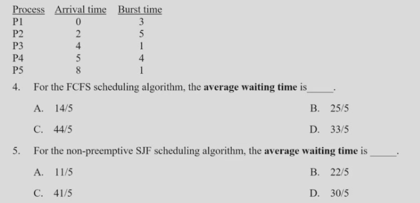

4.A  5.A

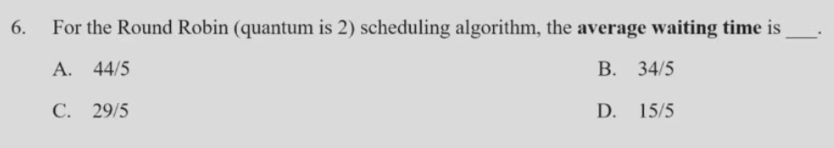

6. 画一下ready queue.在t=4时刻，刚刚换下的p2要在新加入的p3之后。因此正确的调度顺序应为：

>P1 P2 P1 P3 P2 P4 P5 P2 P4. 答案为选项D

一个简化的例子：

-|Arrival|burst
-|-|-
P1|0|4
P2|2|3

为了维护RR的自洽性，ready-queue中新加入的进程要放在刚换下的进程之前





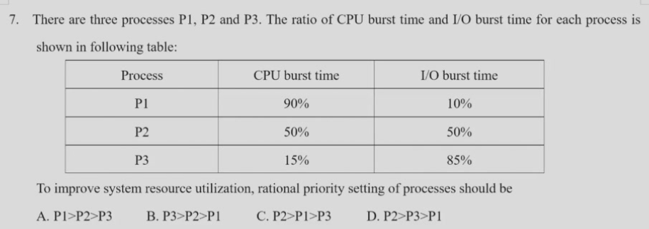

这里priority指的是CPU调度的优先级。让I/O-bound进程优先级高，因为它只需要用一点点CPU就会去I/O了；反之，I/O-bound进程就得一直护航CPU-bound进程，I/O设备闲置，整个系统的utilization就不高

>简单理解：交互性强的肯定要优先级高，不然体验感拉完了





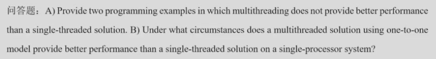

A) 考虑多线程的好处，然后反其道行之：好处是并行性好。那么反例就是步骤间依赖性强的、难以并发的task（如shell程序）

B) 当前线程发生Block时，one-to-one中可调度其他线程继续跑





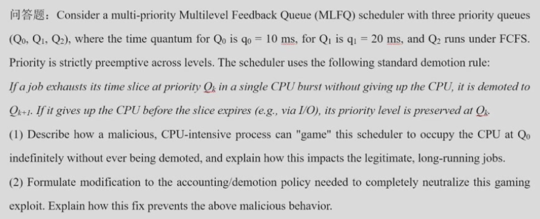
* demote：降级
* neutralize：

Priority is strictly preemptive across levels：只要Q0有task，下面的就运行不了

（1）在时间片完结之前进行一个空写操作
（2）可以统计一个进程在Q0内总计花费的时间（无论它I/O与否），如果超出10ms就把它降级。降级之后本级的计时器清零
