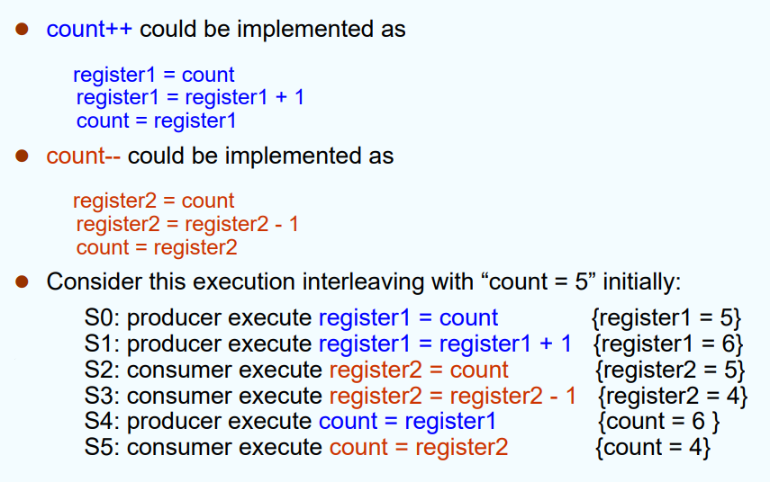
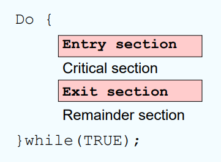
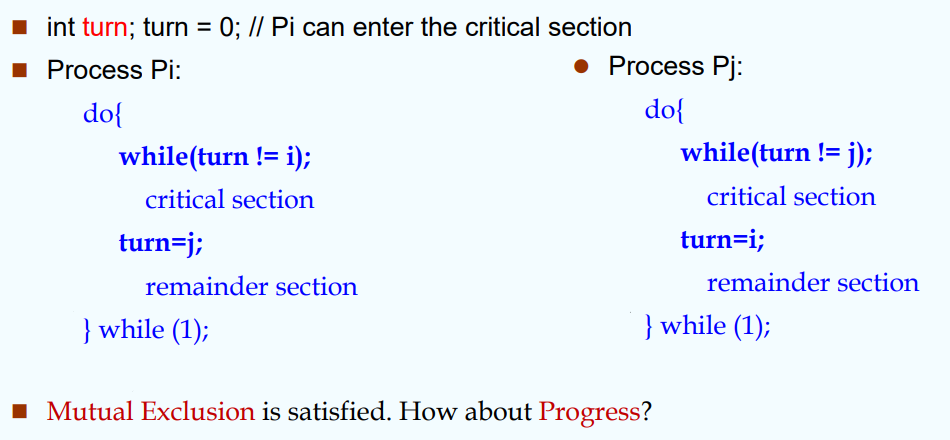
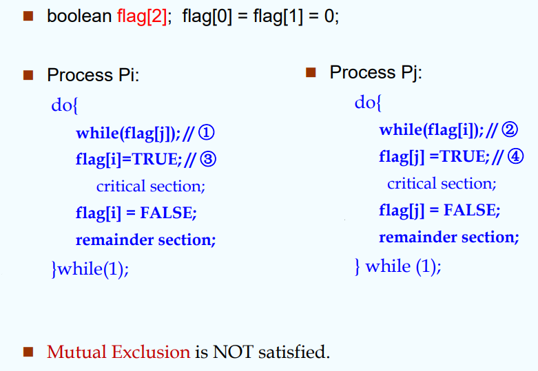
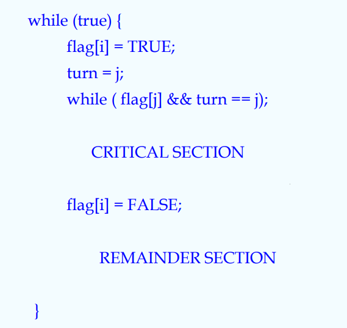

# 1. Backgound

并发访问可能会造成共享数据的不一致性。

>eg：银行并发存取钱（数据库那时讲的例子）

* 不一致：指的是和业务逻辑的不一致
* 维护一致性：程序按规则有序执行

Serial vs. Serializable
* 串行：
* 可串行化：

## Intro:Producer vs. Consumer

Producer：

Consumer：

指令实现：

* count++/--并不是原子操作，而是可以分为多条指令。
* 由于指令执行的顺序不同，count可能有4、5、6三种取值。（但合理的结果只有5）
* 这就是Race Condition，竞态条件

**“竞态条件”更严谨的定义：** 多个进程或线程同时访问、操作共享数据，最终结果取决于它们执行指令的先后顺序 这一情况
  * 注意，至少有一个是写操作。若多个都是只读，那其实也不影响一致性

# 2. the Critical-Section Problem，临界区问题

## 2.1 临界区模型

* 其实任何代码都可以大致这样划分（从同步的角度）
* Entry/Exit部分：分别代表进入/退出前要做的动作

## 2.2 对临界区的Solution

1. **Multual Exclusion（互斥）：** 当一个进程P在其临界区中运行时，其他进程不允许进入它们的临界区
2. **Progress（空闲让进）：** 当临界区空闲时，“选择一个等待临界区的进程P放进来”这一动作不能无限推迟
3. **Bounded Waiting（有限等待）：** 在一个进程提出进入其临界区的请求之后到准入之前，其他进程被允许进入其临界区的次数必有限。
   * 即，不许无限插队

### 三个反例

Algorithm 1：

* Mutual Exlcusion：turn初值为0，下面两个进程分别为P0和P1.显然，它俩不可能同时进临界区
* Progress：不满足。第一次Pj在remainder中block住，turn=i，此时是可以进的；但退出之后turn=j，第二次就进不去了

Alogorithm 2：

Progress：不满足，解释如下：假设 Pi 和 Pj 几乎同时想进入临界区。

按照下面的顺序执行：
执行顺序|	Pi	|Pj
:-:|-|-
1	|flag[i] = true	
2	|	|flag[j] = true
3	|检查 flag[j]，发现为 true	
4	|	|检查 flag[i]，发现为 true
5	|一直等待	|一直等待

双方都在等对方的flag变为false，双双卡死。

Algorithm 3：

Mutual不满足。若两个while(flag[x])近乎同时执行，此时两个都可以进临界区：
执行顺序|	Pi	|Pj
:-:|-|-
1	|while
2	|	|while
3	|flag[i]=TRUE|	
4	|	|flag[j]=TRUE
5	|进入临界区	|
6   |   |进入临界区

# 3. Peterson's Solution(2 Processes)

假设LOAD/STORE都是atomic的（也就是说，下面的赋值不会有竞态）；turn表示当前是放谁进临界区；flag[i]=True表示i准备好进入临界区

Pi和Pj的代码：（两者是完全对称的）

* 互斥：满足，turn只能取一个值
* Progress：满足。因为用了两个量来做while，可以考察以下执行顺序：

执行顺序|	Pi	|Pj
:-:|-|-
1	|flag[i]=1|
2	|	|flag[j]=1
3	|turn = j |	
4	|	|turn = i
5	|while不满足，进入临界区| while(turn==i&&flag[i])
6   | flag[i] = 0|进入临界区
7   |...|...

若Pi的前三条全先于Pj执行，那么Pi的while中flag[j]=0，Pi就直接进临界区了。后面Pj把turn置成i，也刚好能防止自己进临界区。

* 有限等待：满足。因为先进临界区的那个退出之后把自己的flag置0，就防止自己再次进入，排队的那个进程就可以进临界区了。其实在这个双进程的例子中，最多等一轮就行了。

# 4. Synchronization Hardware

# 5. Semaphores

# 6. Classic Problems of Synchronization

# 7. Synchronization eg