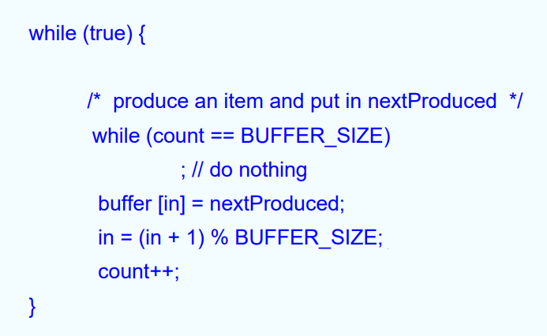
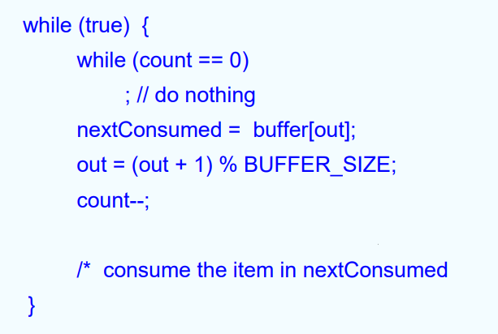
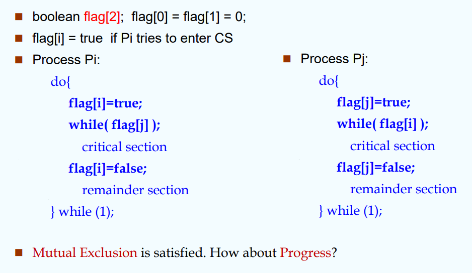
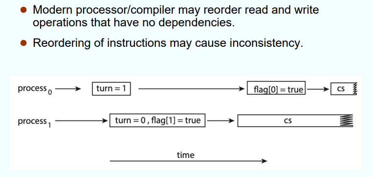
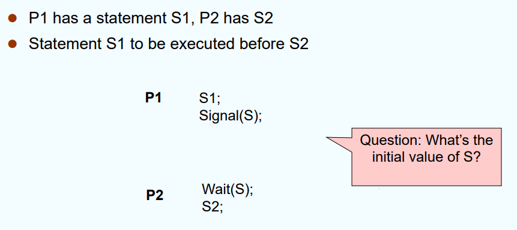
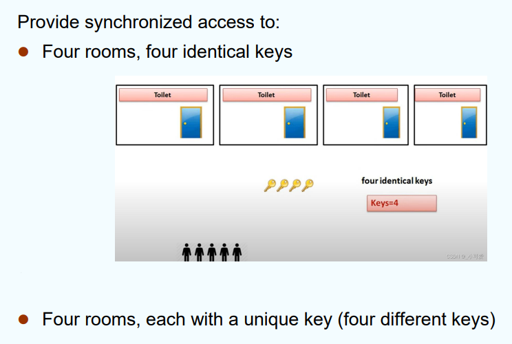
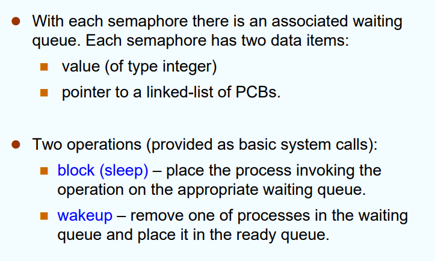

# 1. Backgound

并发访问可能会造成共享数据的不一致性。

>eg：银行并发存取钱（数据库那时讲的例子）

* 不一致：指的是和业务逻辑的不一致
* 维护一致性：程序按规则有序执行

Serial vs. Serializable
* 串行：
* 可串行化：

## Intro:Producer vs. Consumer














* count++/--并不是原子操作，而是可以分为多条指令。
* 由于指令执行的顺序不同，count可能有4、5、6三种取值。（但合理的结果只有5）
* 这就是Race Condition，竞态条件

**“竞态条件”更严谨的定义：** 多个进程或线程同时访问、操作共享数据，最终结果取决于它们执行指令的先后顺序 这一情况
  * 注意，至少有一个是写操作。若多个都是只读，那其实也不影响一致性

# 2. the Critical-Section Problem，临界区问题

## 2.1 临界区模型

临界区的def：访问共享资源的代码段




* 其实任何代码都可以大致这样划分（从同步的角度）
* Entry/Exit部分：分别代表进入/退出前要做的动作

## 2.2 对临界区的Solution

1. **Multual Exclusion（互斥）：** 当一个进程P在其临界区中运行时，其他进程不允许进入它们的临界区
2. **Progress（空闲让进）：** 当临界区空闲时，“选择一个等待临界区的进程P放进来”这一动作不能无限推迟
3. **Bounded Waiting（有限等待）：** 在一个进程提出进入其临界区的请求之后到准入之前，其他进程被允许进入其临界区的次数必有限。
   * 即，不许无限插队

### 三个反例

三个算法的特性对比：













* Mutual Exlcusion：turn初值为0，下面两个进程分别为P0和P1.显然，它俩不可能同时进临界区
* Progress：不满足。第一次Pj在remainder中block住，turn=i，此时是可以进的；但退出之后turn=j，第二次就进不去了

Progress：不满足，解释如下：假设 Pi 和 Pj 几乎同时想进入临界区。

按照下面的顺序执行：
执行顺序|	Pi	|Pj
:-:|-|-
1	|flag[i] = true	
2	|	|flag[j] = true
3	|检查 flag[j]，发现为 true	
4	|	|检查 flag[i]，发现为 true
5	|一直等待	|一直等待

双方都在等对方的flag变为false，双双卡死。

Mutual不满足。若两个while(flag[x])近乎同时执行，此时两个都可以进临界区：
执行顺序|	Pi	|Pj
:-:|-|-
1	|while
2	|	|while
3	|flag[i]=TRUE|	
4	|	|flag[j]=TRUE
5	|进入临界区	|
6   |   |进入临界区

# 3. Peterson's Solution(2 Processes)

假设LOAD/STORE都是atomic的（也就是说，下面的赋值不会有竞态）；turn表示当前是放谁进临界区；flag[i]=True表示i准备好进入临界区

Pi和Pj的代码：（两者是完全对称的）



* 互斥：满足，turn只能取一个值
* Progress：满足。因为用了两个量来做while，可以考察以下执行顺序：

执行顺序|	Pi	|Pj
:-:|-|-
1	|flag[i]=1|
2	|	|flag[j]=1
3	|turn = j |	
4	|	|turn = i
5	|while不满足，进入临界区| while(turn==i&&flag[i])
6   | flag[i] = 0|进入临界区
7   |...|...

若Pi的前三条全先于Pj执行，那么Pi的while中flag[j]=0，Pi就直接进临界区了。后面Pj把turn置成i，也刚好能防止自己进临界区。

* 有限等待：满足。因为先进临界区的那个退出之后把自己的flag置0，就防止自己再次进入，排队的那个进程就可以进临界区了。其实在这个双进程的例子中，最多等一轮就行了。

## 存在的问题

处理器/编译器可能会把互不依赖的读写指令位置调换。见下图





把flag赋值和turn赋值的顺序调换了，后面二者flag=true之后都可以进入临界区。导致不互斥了。

# 4. Synchronization Hardware

>通过硬件保证互斥性

Uniprocessors（单处理器）：关中断
* 防止当前程序在临界区中被抢占
* 缺点：
  * 对于多处理器来说，一个CPU关中断阻止不了其他CPU访问临界区（？？那都关怎么就阻止了？？本来也是不同的进程不是吗）

现代处理器：Specific Atomic hardware inst（特殊原子硬件指令）
* 有两类：
  * Test and Set：检查并set new value一个内存字
  * Swap：原子地交换两个内存字的内容

## 4.1 原子指令

### TestAndSet



```c
boolean TestAndSet (boolean *target)  //target init as false
 {
 boolean rv = *target;
 *target = TRUE;
 return rv:
 }
```



把target置成1，但返回值有不同情况。在并发情况下，返回false的那个是第一个读写成功的进程。

那么，可以把这个想法用来做共享锁：



```c
while (true) {
 while ( TestAndSet (&lock ))
    ; // do nothing
 
 // critical section

lock = FALSE;
 // remainder section 
}
```



一直循环，直到读到lock=FALSE，才能进入临界区。这种做法的表现如何？
* 不满足有限等待：可能饥饿。这里并没有措施防止TestAndSet被插队

### Swap



```c
void Swap (boolean *a, boolean *b) 
{
  boolean temp = *a; 
  *a = *b; 
  *b = temp: }
```



同样，用来做共享锁：



```c
while (true) {
  key = TRUE;
  while ( key == TRUE)  //若换到了锁的FALSE值，就表示它上锁成功了
  Swap (&lock, &key );
 
      // critical section
  lock = FALSE;
      // remainder section 
 }
```



同样，也是没法防止饥饿。

### compare_and_swap



```c
int compare_and_swap(int *value, int expected, int new_value) 
{ int temp = *value; 
  if (*value == expected) 
    *value = new_value; 
  return temp; 
} 
```



这个也算是TestAndSet。查看temp值就可以知道之前的value，即上锁状态。见下方：



```c
while (true)
{ 
  while (compare_and_swap(&lock, 0, 1) != 0) 
    ; /* do nothing */ 
  
    /* critical section */ 
  lock = 0; 
    /* remainder section */ 
  } 
```



但是它也无法解决饥饿问题。能解决饥饿问题的扩展方案如下：



```c
while (true) { 
  waiting[i] = true; 
  key = 1; 
  while (waiting[i] && key == 1) 
    key = compare_and_swap(&lock,0,1); 
  waiting[i] = false; 
    /* critical section */ 
  j = (i + 1) % n; 
  while ((j != i) && !waiting[j]) 
    j = (j + 1) % n; 
  if (j == i) 
    lock = 0; 
  else 
    waiting[j] = false; /* remainder section */ }
```



## 4.2 Mutex Locks，互斥锁

OS提供的更方便的接口：加锁/解锁
* 进入临界区之前获取锁（若获取失败就卡住，不断循环等待锁释放
* 离开后释放锁

上锁/解锁的acquire和release都是原子的。

由于循环等待的特性，这种锁又叫Spinlock.（之前的Swap）

自旋锁 vs. 普通阻塞锁
- Spinlock：获取不到锁，就一直占用 CPU 循环等待。
  - 好处：若上锁时间很短，那么自旋开销比Block和Awake小多了
- Blocking Mutex：获取不到锁，就让当前进程阻塞，让 CPU 去执行其他进程；等锁可用时再唤醒它。
  - 要进行上下文切换，有一定开销。

代码示意：但是acquire要用之前的原子指令来实现。试一试？？（其实就弄一下available就行了吧）


```c
acquire() {
while (!available)
 ; /* busy wait */
available = false;
}
release() {
available = true;
}
```



# 5. Semaphores，信号量

>一种更通用的同步工具

## 5.1 概述&建模

Semaphore：使用整数，可以表示可用资源的数量，更灵活
* 对于可能有竞态的进程，它们要共享信号量。

对信号量的两个原子操作wait()和signal()，建模如下：（这种是Counting Semaphore）



```c
wait(S) {
    while (S <= 0)  //没有可用资源
        ;  // no-op
    S--;  //申请走一个资源
}

signal(S) {
    S++;  //释放一个资源
}
```



下面，把S的值限制为0和1，就是Binary semaphore（也就是mutex lock）。见下例：



```c
Semaphore S; //init as 1
wait(S);
  Critical Section
signal(S);
```



>同步：一系列事情按一个规定的时序发生。











* 本例中，S要初始化为0。若为正数，则S2就可以先运行

* 情况一：一个信号量即可
* 情况二：四个不同信号量。但选择房间的策略，或许仍应商榷（搞不好会利用率降低）

## 5.2 实现

* 如何保证没有多个进程同时对同一个信号量 wait 或 signal？
  * 把 wait 和 signal 本身作为临界区。前后加上Entry和Exit，可以用前面讲的那些方法（如Mutex Lock）。
  * 但忙等待很浪费CPU时间。如何设计没有忙等待的实现？（非忙的等待）





Implementation of wait:


```c
wait (S){ 
  value--;  //大家都是先--，所以value能到负数
  if (value < 0) { 
  // add this process to waiting queue 
  block(); 
    } }
```



Implementation of signal:


```c
Signal (S){ 
  value++; 
  if (value <= 0) //必然有进程在等
  { 
    // remove a process P from the waiting queue 
    wakeup(P); 
    } }
```



同样的，wait和signal也要包装成临界区（防止同时访问信号量）。单核可关中断，多核可用acquire和release。但是acquire和release现在的时间可以非常短，因为不耗费真正的等待时间，而是放入waiting queue就完事了。这样的忙等待代价是可以接受的。

这种阻塞锁是Sleep Lock。
* 通常用于context switch开销远小于等待时间的场景。

总之，Sleep Lock和Spin Lock的优劣刚好相反。

# 6. Classic Problems of Synchronization

# 7. Synchronization eg