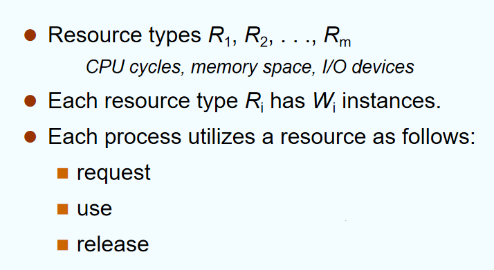
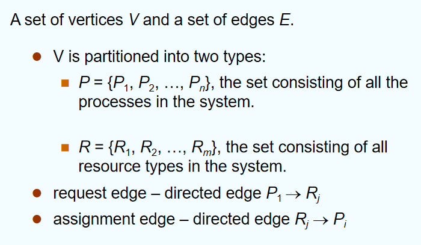
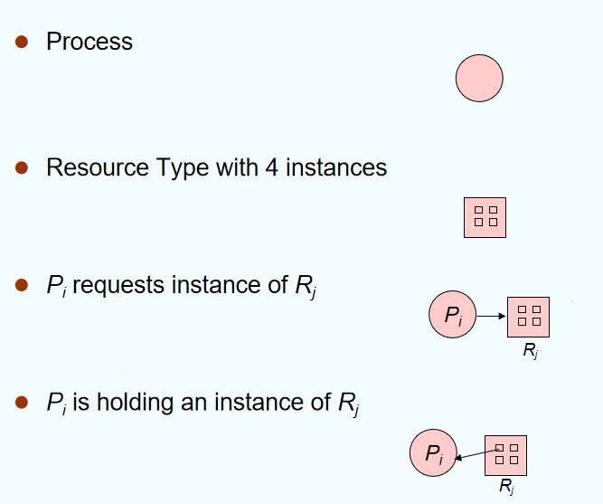
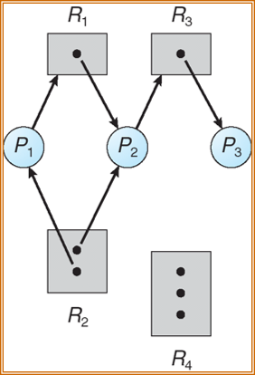
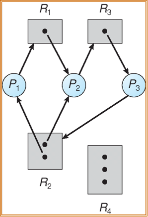
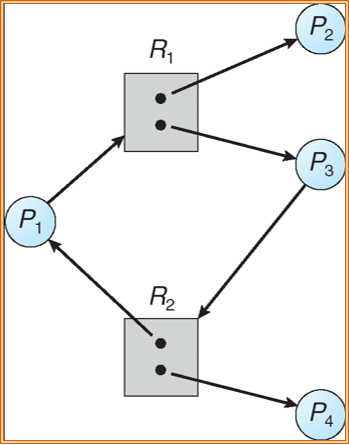

# 1. Deadlock Problem

def：

## 1.1 System Model

>instance，实例

# 1.2 Deadlock Characterization

发生deadlock的四个因素：（同时具备时，就可能死锁）
- Mutual Exclusion，互斥性：互斥才需要等。如果不互斥直接就用了
- Hold and Wait，拥有等待：持有一些资源，但还在等别的被占用的资源
- No preemption，非抢占：拿到资源必须是别人主动释放出来的。
- Circular wait，循环等待：进程之间存在一条等待的环路，等一圈

>以上条件是必要的，是否充分？

## 1.3 Resource-Allocation Graph

定义：

图例：

示例：

有deadlock的情况：

- P3等R2，P2等P3（的R3），P1等P2（的R1）

有Circle但没有deadlock的情况：

- P2可以释放R1给P1
- P4也可以释放R2给P3
- 事实上：
  - 没有环路：必然没有deadlock
  - 有环路：
    - 每个src只有一个instance，会deadlock
    - 每个src有多个instance，可能deadlock

# 4. Methods for Handling Deadlocks

三种方案：
- 预防产生deadlock
- 允许进入并从deadlock恢复
- 忽视风险，继续访问！（Unix

## 4.1 Deadlock Prevention (预防)

>主要想把之前说到的那四个条件破坏掉

- Multual Exclusion
  - 共享资源不用互斥；非共享则必须互斥
- Hold and Wait：那么必须保证进程在请求新资源时，不持有其它任何资源
- No Preemption
- Circular Wait

## 4.2 Deadlock Avoidance (避免)

## 4.3 Deadlock Detection

## 4.4 Recovery from Deadlock 