# 1. Address & Binding

Processing-in-Memory？？

Base and Limit reg:
* 每个进程有自己的地址空间
* 用base和limit register来定义此地址空间的基址和范围；前者指向最低地址，limit代表总大小

## Address Given in Different Ways:

* Symbolic Addr,符号地址：在源代码中的函数名字、变量等，程序员可读到？？
* Relocatable Addr,可重定位地址：一个模块名字＋一个offset 组成。此模块可移动，确定了模块的地址，由各变量的offset可算出具体地址
* Absolute Addr,绝对地址：在mem中的数字编号地址。linker或loader把relocatable addr绑定到absolute addr

## Multistep Processing of a User Program

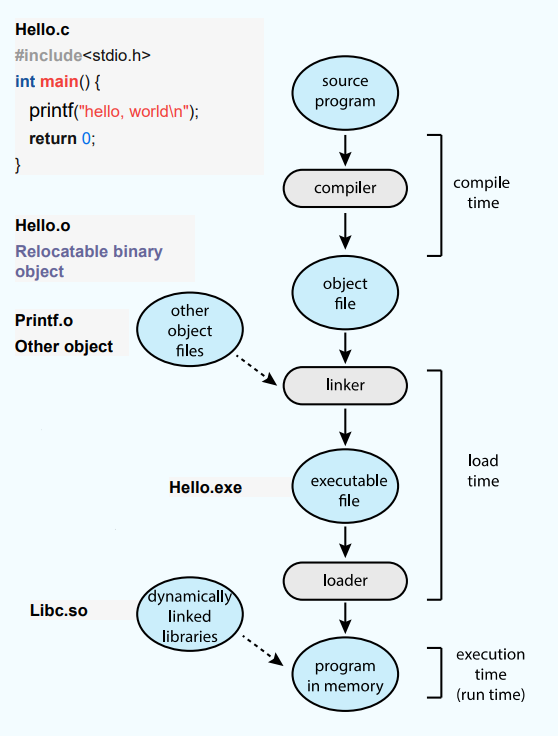

* 编译输出obj文件（即.o文件）
* 链接器linker是一个system program，功能是将多个obj（和一些库）连接起来，生成可执行文件（.exe）
* 通常可执行文件中存的仍然是虚拟地址，等其被装载（load到内存中）才绑定absolute addr

## Binding of Inst&Data to Memory

把程序中的地址映射为物理内存的地址，称为addr binding.根据其binding时间的不同，可分为以下三种（具体时间段见上一张图）

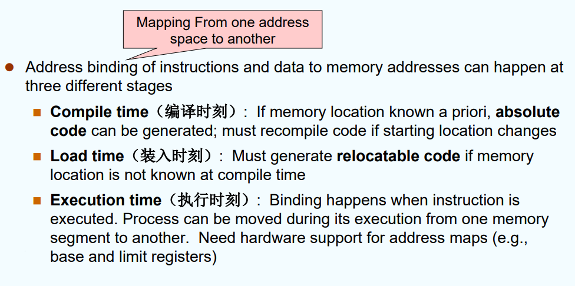

* load time:编译、链接时都不知道物理地址，所以仍生成relocatable addr。
* exe time:由硬件负责支持虚拟地址到物理地址的映射。如使用base和limit registers

优缺点：
* compile time:不灵活，想改地址又要重编译
* load time:也不够灵活，运行时地址不能搬动（e.g.整个进程挪动一个offset，它就做不到）
* exe time:额外要俩寄存器。现在主流都用这个

## Logical vs. Physical Addr Space

对进程而言，会看到连续的逻辑地址空间[0,MAXVA].其中MAXVA由limit寄存器来给出。

compile和load-time binding不对这俩地址进行区分，因为CPU和memory unit看到的都是物理地址

而exe-time binding，这俩地址是要映射的，并不等价

### MMU,Memory-Management Unit

用来做VA和PA之间的映射的一个元件

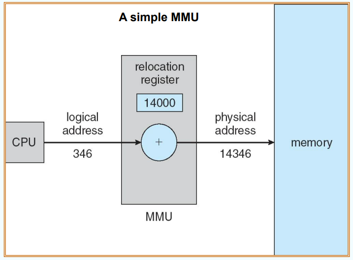

* relocation register(也就是base register)：当CPU发出一个LA时，它就作为offset被加上relocation reg的值，然后得到PA.
* 为了实现进程的隔离，不同进程的relocation reg的值是不一样的

## Dynamic Loading,动态装载

>是否需要把所有program的code一次性装载到mem中？——不必，可以用dynamic loading

当一段代码(routine)被调用时，它才会被load到mem中。

好处：
* load速度快，因为东西少
* 节省了mem的空间，且utilization(利用率)也更好
* 可以由OS来提供此服务，也可以直接由user code完成

## Dynamic Linking,动态链接

对一个库函数地址的链接可以推迟到exe time.从而exe time才确定函数的真实地址

桩函数stub：（假设它锚定的是`printf()`）OS提供的一个入口，可以把它嵌在主程序中，链接时链的是桩函数。运行中第一次调用对应的函数时桩会起作用，将`printf()`的库load进来。接着`printf()`的地址会代替stub那个占位假地址

被这样链接过来的库称为动态库/共享库(shared library)

动态链接的优点：
* 减小了exe文件的大小
* 减少了load时所用的内存空间（link是在load time进行的）
* 系统升级时，由于stub的存在，不用把新升级的library再链接一遍（app更新后不会不能用）

# 2.Contiguous Memory Allocation

>Contiguous:空间上的相邻、连续

内存通常分为两大块：低地址用来放kernel，高地址用来放user process

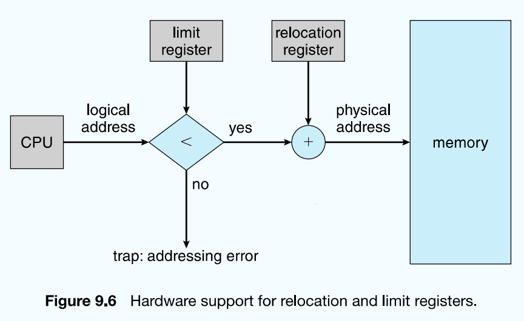

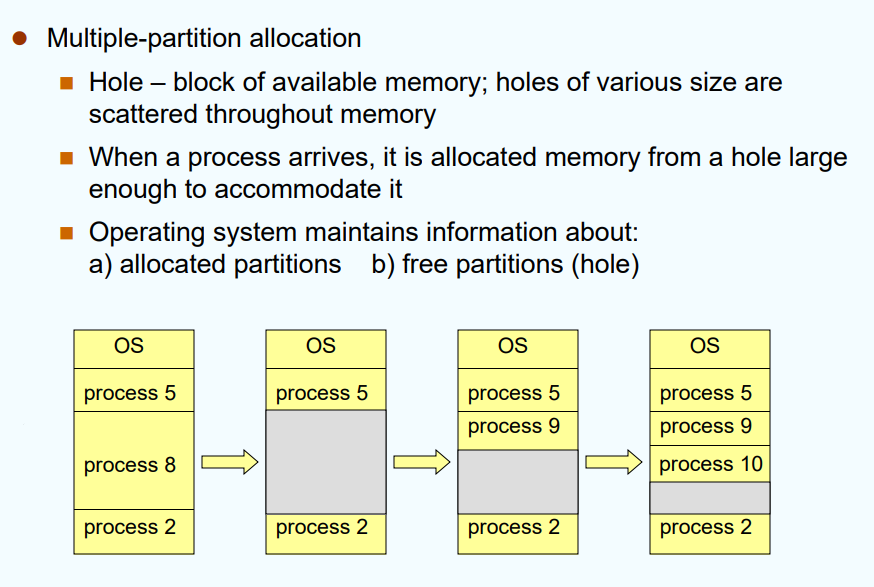

可能会出现多个空洞。考虑如何找一个合适的空洞给新的进程，有以下方法：
* First-fit:分配所有足够大的洞里的第一个
* Best-fit:分配所有足够大的洞里最小的那个（需要遍历所有洞）
* Worst-fit:分配所有足够大的洞里最小的那个（也需要遍历所有洞）

很难说到底谁好谁坏，要看具体的workload.后面两种，Best-fit可能剩下那种小得用不了的洞，Worst-fit剩下的大洞可能能用上，etc.

## Fragmentation，碎片化

**External Fragmentation(外部碎片)：** 分散的小空洞，可能总空间很大，但还是用不上。

**Internal Fragmentation(内部碎片)：** OS可能给进程分配比所需的更大的空间，由于永远都用不上，所以会浪费掉。这是进程内部的浪费。

>也就是说，外部碎片是unallocated的，内部碎片是allocated但unused的

**解决外部碎片：**
1. 尝试把空洞连起来——compaction,内存压缩。把进程连到一起。此时要用MMU移动进程的地址空间（这样会导致进程block住）
   1. 限制：这种方法只能用于exe-time dynamic relocation（这种进程才允许在执行中移动）
   2. 如果进程正在I/O：进程可能在访问disk（DMA，Direct Memory Access），DMA的过程中CPU没有参与。如果此时disk传回数据，就不知道该传到哪了（进程已经被移走了）。为了解决这个问题，应该把I/O中的task锁住
2. 使用non-contiguous的allocation：

# 3. Paging

>一种 Non-contiguous memory allocation. 并且是exe-time binding的。可消除外部碎片。
>但是无法消除内部碎片（当进程所需空间并非page size的整数倍时，最后一个page就可能用不完）

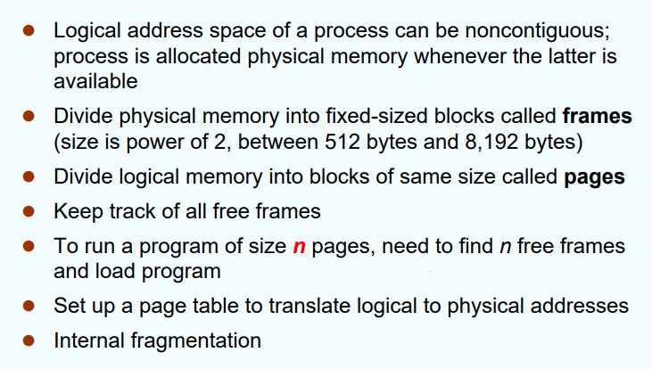

## 3.1 Paging Hardware

CPU的address格式：

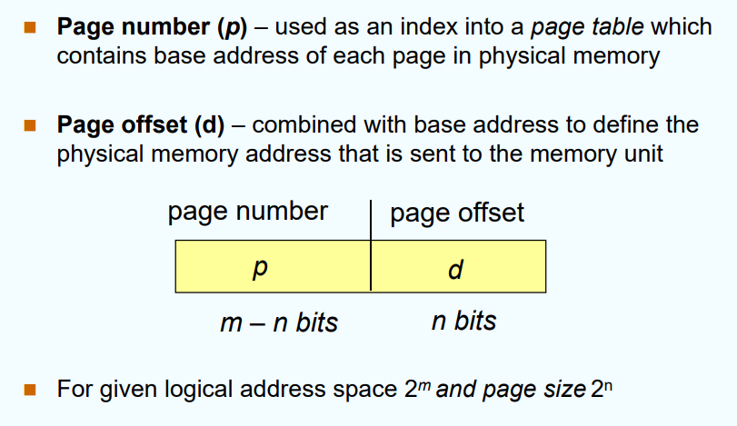

Hardware：

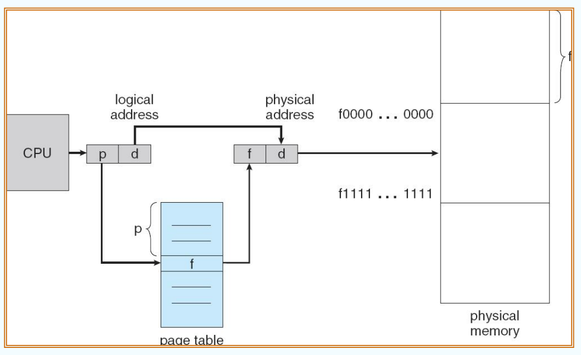

* pagetable entry : [page number-->frame number]
* 整个进程的VA size = pagetable entry数 * page size
* context switch时，page table register也要换。从而不同进程的页表是隔离的

Page table放在main memory中。维护两个重要reg：
* Page-table base reg(PTBR)
  * satp存了page table的物理地址
* Page-table length reg(PTLR)

为了拿到mem中的data/inst，要访两次mem：一次访问page table，一次取回data/inst

为了省掉额外的访存，设计一个Page table的cache——TLB

## 3.2 TLB

把常用的页表项(PTE) cache到TLB中。（访问TLB这个cache比访存快多了）

TLB项：{Page Number(key), Frame Number(value)}

可以实现parallel key search？？


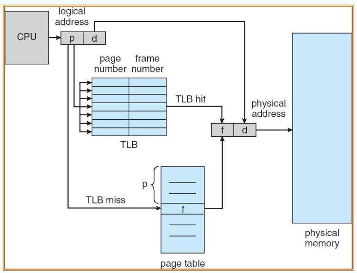


ASID，用于在TLB中区分不同进程的页表项

### Effective Access Time(EAT)

设命中率为α，访问TLB开销为ε，访存一次开销为1

命中时访存（data或inst）用时为 (1+ε)；miss时用时为 (ε+1+1)

从而有如下公式

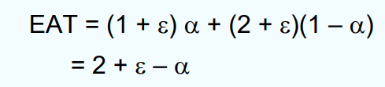

$$
EAT = (1+ε)\alpha + (ε+1+1)(1-\alpha)
$$

这个结果是比较接近1的，由于访存的局部性，α其实还蛮高的

## Free Frame Management

维护一个free-frame list

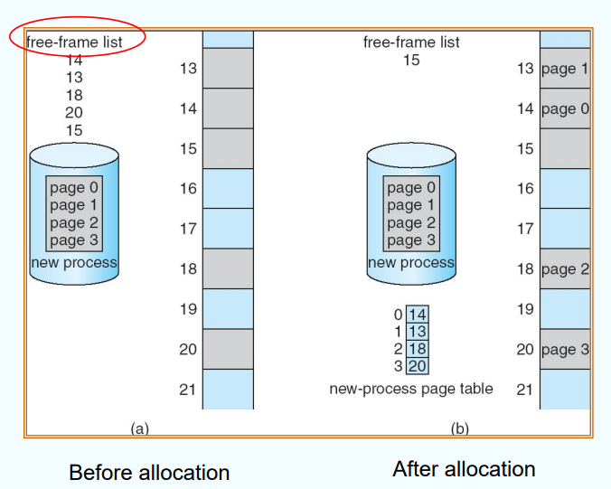

## 3.3 Memory Protection

因为可能进程不需要page table那么多页，有些PTE是无用的。我们增加一个valid bit，表示当前这个page是否在当前进程的逻辑地址空间中。


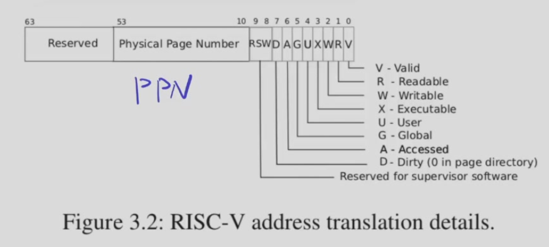
* PPN其实就是frame number
* sv39中，逻辑地址是39bits，VPN是27bits（何意味？？怎么比PPN短那么多）


## 3.4 Shared Pages

shared code：只读的代码可以进程间共享

>为什么shared code被映射到的逻辑地址也要相同？——为了保证jump指令跳转地址正确。
>相应的，如果代码中不允许出现绝对地址，只能由可重定位的地址，就没有上方那种约束了。（这样的代码称为position independent code）

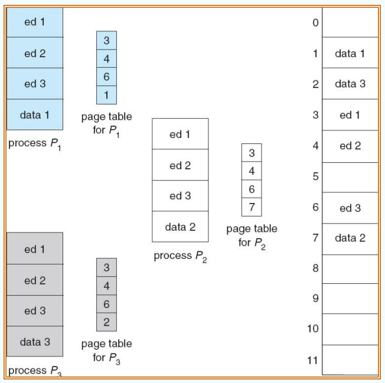

* 上图中，frame346是code。

## 3.5 Structure of PageTable

### Hierarchical Paging，分层页表

* 如果地址太长，页表本身太大无法容纳在一页内，就需要对页表进行分页
* 用一个外层页表来管理这堆子页表（内层页表）

外层页表的PTE：{Page Number,Frame Number}
* 此处的Frame Number存的是子页表的PPN

这里就需要对CPU逻辑地址进行一个改造：


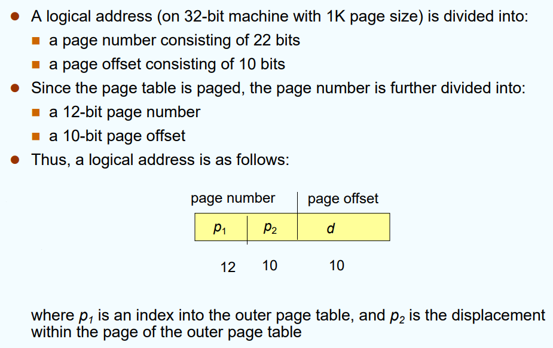

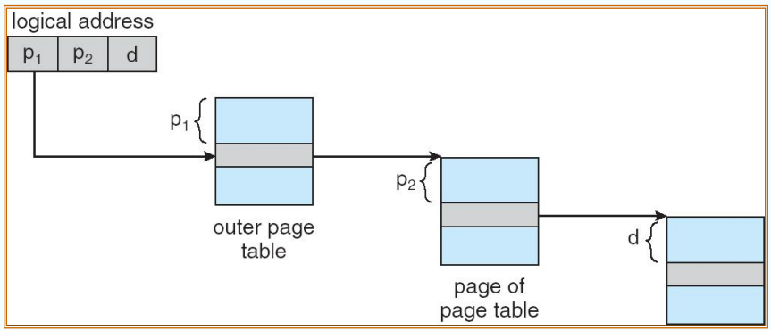

* P1和P2分别为在页表中的页号（key）


优点：
* 减小了页表所用内存空间。因为页号范围减小，页表所需装的PTE个数也小了

### Hashed Page Tables

> hash function的特点：可以把很大的空间映射到一个固定、有限的空间中。若发生hash碰撞，就把新值链到已有值之后

把VPN hash到一个hash table中。一般碰撞次数不会太多，hash过去之后顺着链表查找一下，代价也是能接受的。


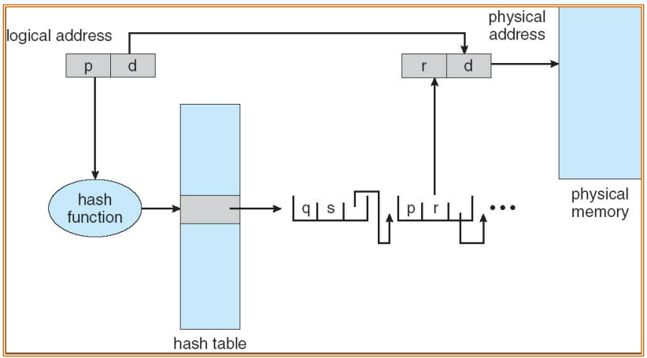


同样，设置一个TLB以避免hash要访两次存的麻烦。

### Inverted Page Table

在整个mem中只有一个页表。其entry为：{pid,VPN}
* pid是进程号
* VPN是对应页号

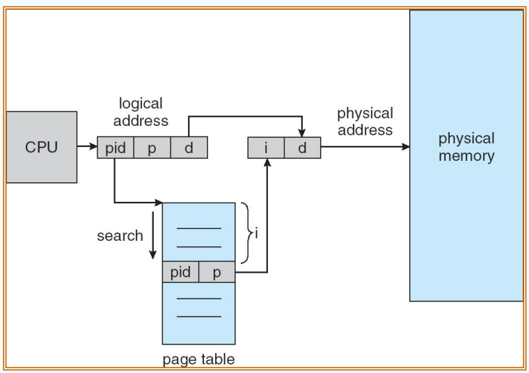

* 是先根据PTE找到项，再得到所需项相对表头偏移i（这个i就是内存中的frame number，就可以直接去取出frame了）
* 但是遍历page table的开销很大，所以并不是一个很好的办法

## 3.6 Swapping，换入换出

>说的是切换进程时，要将进程从mem中换出到外存中

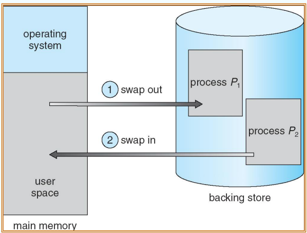

有了paging机制后，可以只换出一部分page

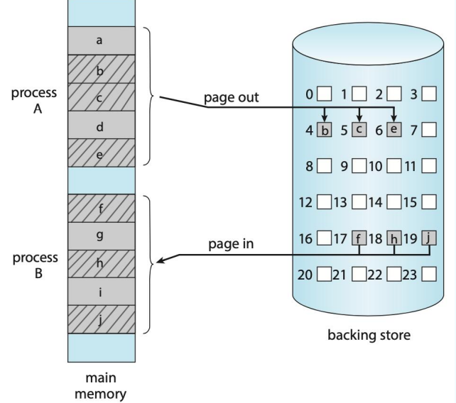

# 6. Segmentation，分段式管理

段：指的是如stack,function,main program等实体单位

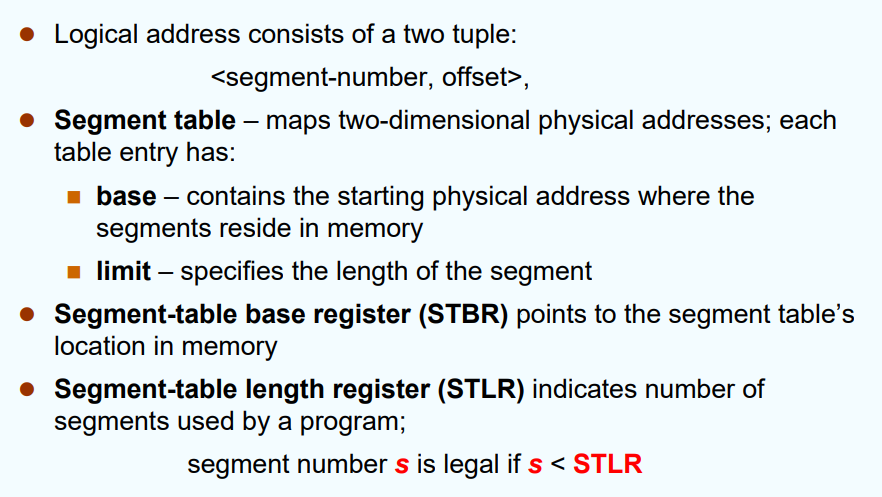
* 注意这个length表示的是段的个数

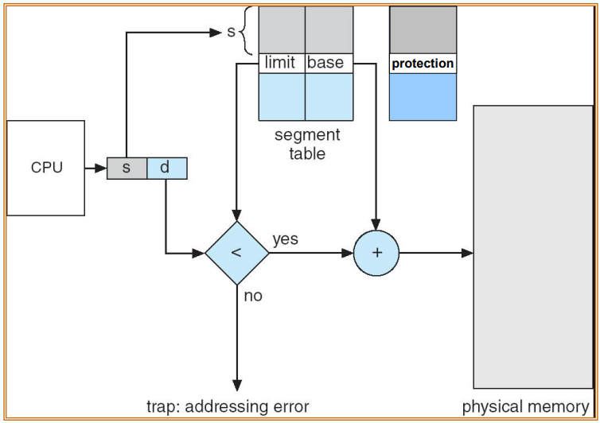

优点：
* 与程序员视图对应得很好

## 段页式管理

Pentium的先段后页式管理：

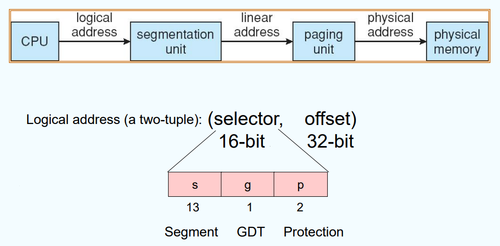

* 先段，对程序员视图友好
* 后页，方便管理物理内存，防止出现内部碎片

# 7. eg:The Intel Pentium

# 讲评

## Q1

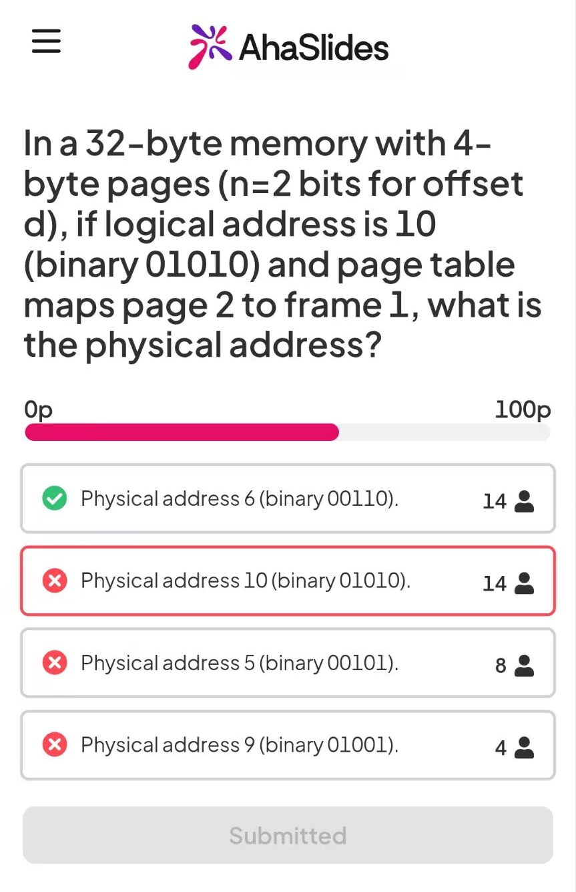

低两位是page offset。题目说对应到frame 1，那么就是00110

## Q2

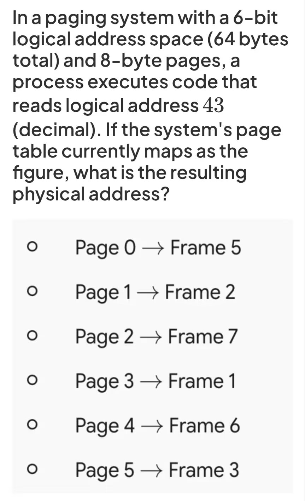

十进制地址43，一个Page 8B，43/8=5，从而在Page5，偏移量为3

对应Frame3，偏移量为3，则物理地址为3*8+3=27