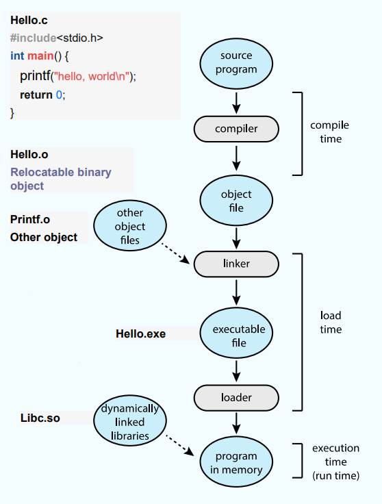
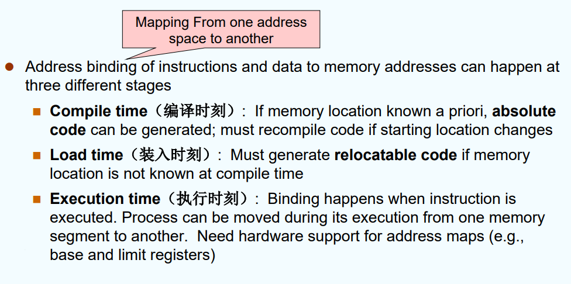
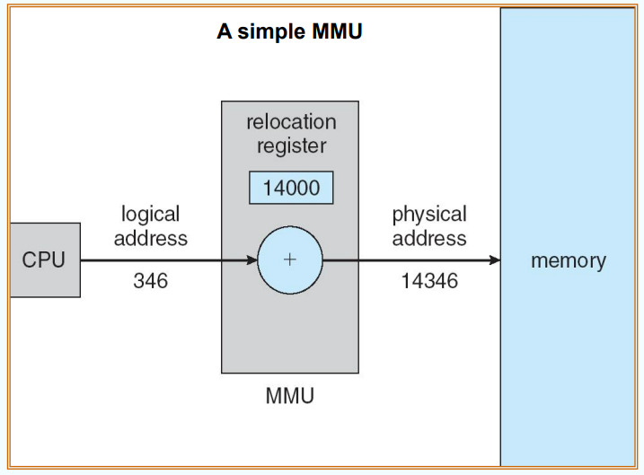
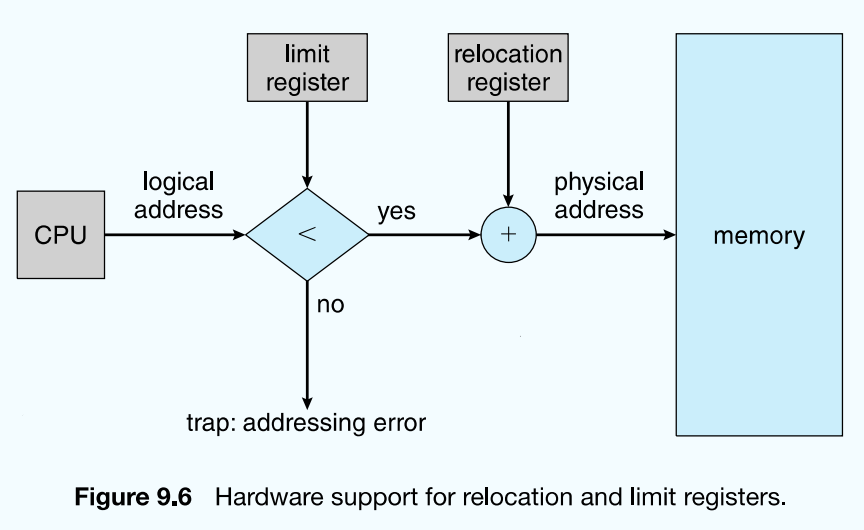
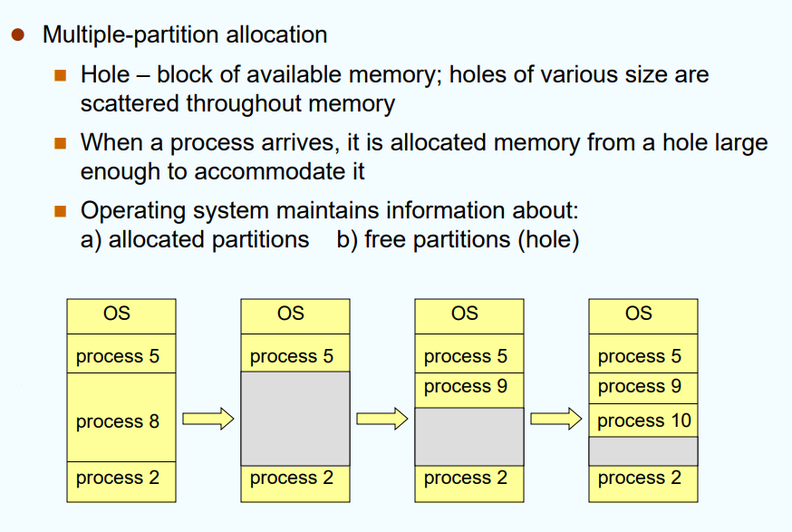

# 1. Background

Processing-in-Memory？？

Base and Limit reg:
* 每个进程有自己的地址空间
* 用base和limit register来定义此地址空间的基址和范围；前者指向最低地址，limit代表总大小

## Address Given in Different Ways:

* Symbolic Addr,符号地址：在源代码中的函数名字、变量等，程序员可读到？？
* Relocatable Addr,可重定位地址：一个模块名字＋一个offset 组成。此模块可移动，确定了模块的地址，由各变量的offset可算出具体地址
* Absolute Addr,绝对地址：在mem中的数字编号地址。linker或loader把relocatable addr绑定到absolute addr

## Multistep Processing of a User Program

* 编译输出obj文件（即.o文件）
* 链接器linker是一个system program，功能是将多个obj（和一些库）连接起来，生成可执行文件（.exe）
* 通常可执行文件中存的仍然是虚拟地址，等其被装载（load到内存中）才绑定absolute addr

## Binding of Inst&Data to Memory

把程序中的地址映射为物理内存的地址，称为addr binding.根据其binding时间的不同，可分为以下三种（具体时间段见上一张图）

* load time:编译、链接时都不知道物理地址，所以仍生成relocatable addr。
* exe time:由硬件负责支持虚拟地址到物理地址的映射。如使用base和limit registers

优缺点：
* compile time:不灵活，想改地址又要重编译
* load time:也不够灵活，运行时地址不能搬动（e.g.整个进程挪动一个offset，它就做不到）
* exe time:额外要俩寄存器。现在主流都用这个

## Logical vs. Physical Addr Space

对进程而言，会看到连续的逻辑地址空间[0,MAXVA].其中MAXVA由limit寄存器来给出。

compile和load-time binding不对这俩地址进行区分，因为CPU和memory unit看到的都是物理地址

而exe-time binding，这俩地址是要映射的，并不等价

### MMU,Memory-Management Unit

用来做VA和PA之间的映射的一个元件

* relocation register(也就是base register)：当CPU发出一个LA时，它就作为offset被加上relocation reg的值，然后得到PA.
* 为了实现进程的隔离，不同进程的relocation reg的值是不一样的

## Dynamic Loading,动态装载

>是否需要把所有program的code一次性装载到mem中？——不必，可以用dynamic loading

当一段代码(routine)被调用时，它才会被load到mem中。

好处：
* load速度快，因为东西少
* 节省了mem的空间，且utilization(利用率)也更好
* 可以由OS来提供此服务，也可以直接由user code完成

## Dynamic Linking,动态链接

对一个库函数地址的链接可以推迟到exe time.从而exe time才确定函数的真实地址

桩函数stub：（假设它锚定的是`printf()`）OS提供的一个入口，可以把它嵌在主程序中，链接时链的是桩函数。运行中第一次调用对应的函数时桩会起作用，将`printf()`的库load进来。接着`printf()`的地址会代替stub那个占位假地址

被这样链接过来的库称为动态库/共享库(shared library)

动态链接的优点：
* 减小了exe文件的大小
* 减少了load时所用的内存空间（link是在load time进行的）
* 系统升级时，由于stub的存在，不用把新升级的library再链接一遍（app更新后不会不能用）

## Contiguous Allocation

>Contiguous:空间上的相邻、连续

内存通常分为两大块：低地址用来放kernel，高地址用来放user process

可能会出现多个空洞。考虑如何找一个合适的空洞给新的进程，有以下方法：
* First-fit:分配所有足够大的洞里的第一个
* Best-fit:分配所有足够大的洞里最小的那个（需要遍历所有洞）
* Worst-fit:分配所有足够大的洞里最小的那个（也需要遍历所有洞）

很难说到底谁好谁坏，要看具体的workload.后面两种，Best-fit可能剩下那种小得用不了的洞，Worst-fit剩下的大洞可能能用上，etc.

## Fragmentation，碎片化

**External Fragmentation(外部碎片)：** 分散的小空洞，可能总空间很大，但还是用不上。

**Internal Fragmentation(内部碎片)：** OS可能给进程分配比所需的更大的空间，由于永远都用不上，所以会浪费掉。这是进程内部的浪费。

**解决外部碎片：**
1. 尝试把空洞连起来——compaction,内存压缩。把进程连到一起。此时要用MMU移动进程的地址空间（这样会导致进程block住）
   1. 限制：这种方法只能用于exe-time dynamic relocation（这种进程才允许在执行中移动）
   2. 如果进程正在I/O：进程可能在访问disk（DMA，Direct Memory Access），DMA的过程中CPU没有参与。如果此时disk传回数据，就不知道该传到哪了（进程已经被移走了）
2. 使用non-contiguous的allocation：

# 2. Swapping

# 3.Contiguous Memory Allocation

# 4. Paging

# 5. Structure of the Page Table

# 6. Segmentation

# 7. eg:The Intel Pentium