# 1. 概述

VM指的是管理virtual addr和physical addr的一种抽象机制，并不是一个实在的物品

VM将逻辑和物理地址分离，让CPU能看到的逻辑地址比实际上的物理地址空间（这里“物理”只是指Main Memory）大得多。

>有点像皇帝出巡，地方故意在皇帝周围做出很丰饶的景象（但实际上没那么好）

还能轻松实现多个进程共享一块空间

能让进程创建更高效。（有些资源可以留到要用时才去加载）

## 1.1 Virtual-addr Space

VAS中的空洞（与ch8的调度相关的不是一个东西）

由于实际上的stack，heap等这些段很小，所以中间会出现巨大的无法合理访问的hole

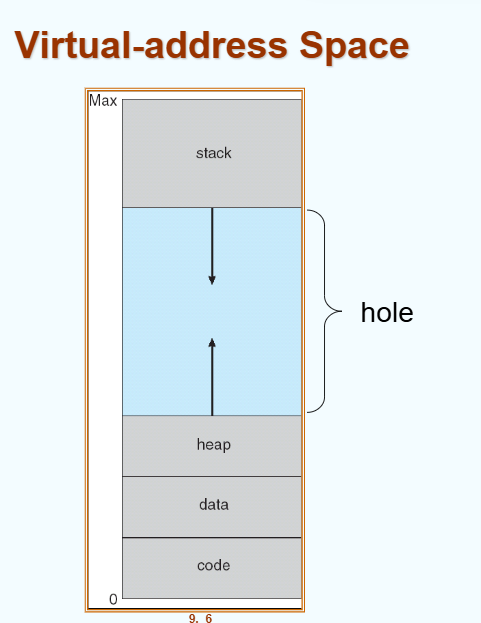

# 2. Demand Paging，请求式调页

## 2.1 Def

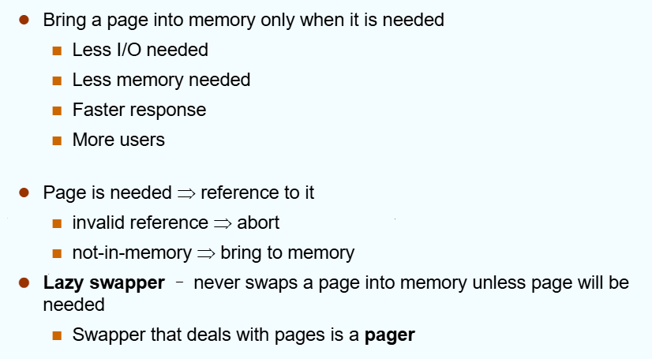

* 使用一个Lazy swapper：当一页被需要时才被swap入memory中
* 发生page fault时会trap，然后调页要I/O并更新页表的frame number，当前进程会挂起。
* 这些做完了之后中断恢复，进程回到ready queue中
* 此时valid bit的含义可能不同，由OS查询此页情况
  * 情况一：根本没有给进程分配这个page，访存超出了它应有的logical addr space，这是一次非法访问
  * 情况二：只是表示这个page not in memory，让swapper去换进来就好了

>faster response和more users是指？？

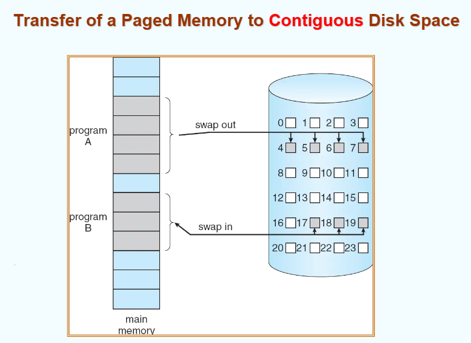

* 为了方便disk顺序I/O，一般分配/换出连续的Pages

步骤：
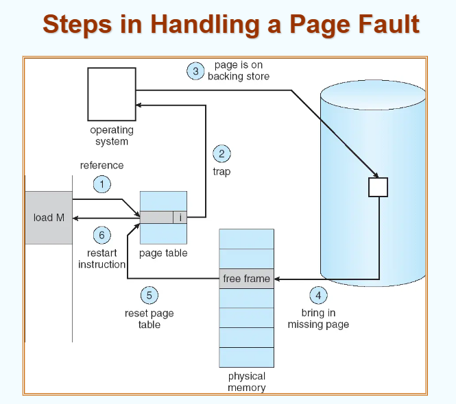

## 2.2 Performance of Demand Paging

在这种机制下，EAT的算法又要加入一个新的参数：page fault rate（缺页比例）

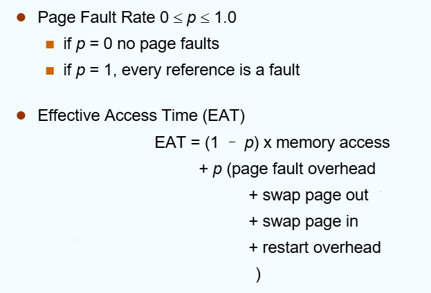
* 其中swap in占大头
* TLB miss penalty那些的全部隐含到memory access中了

不过Demand Paging只是把一开始要干的活儿均摊到后面来了，所以这些代价其实还是可以接受的。

# 3. COW,Copy-on-Write

创建子进程时，子进程直接把父进程的页表复制一份，从而指向同一批pages：

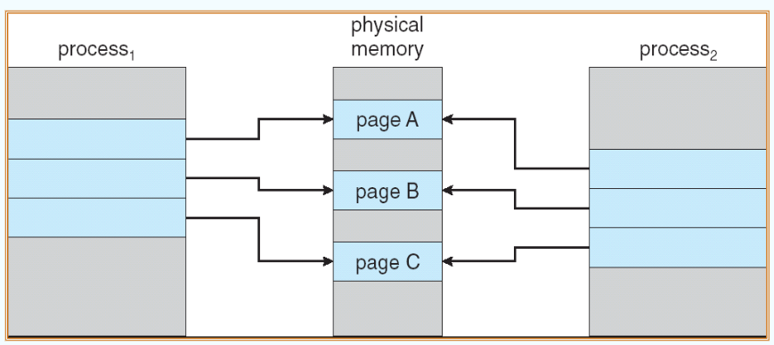

一般进程是隔离的，我们不希望p1对共享资源的modify影响到p2，从而让p1复制一份：

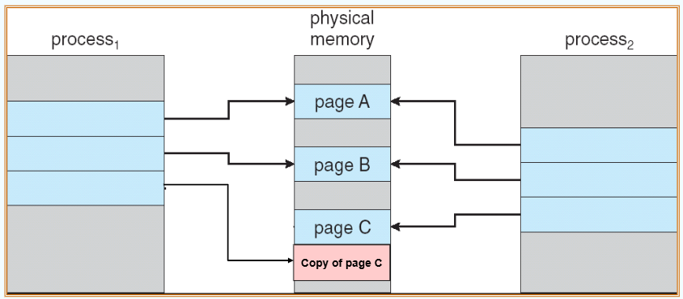
* 当发现要写的时候，会陷入OS，然后由OS复制一份给这个进程p1

如果p2已经copy了A，那么p1和p2的操作就已经隔离了，p1写时就不用再copy一份A了。（总之，就是先写的那个p会copy一份出来）

# 4. Page Replacement

如果内存中没有free page了，就选出没在用的page给它换到disk中。
 
加设一个Dirty bit：有一些page从disk中进到mem之后没被Modifiy过，是clean的，可以直接覆写它。

步骤：
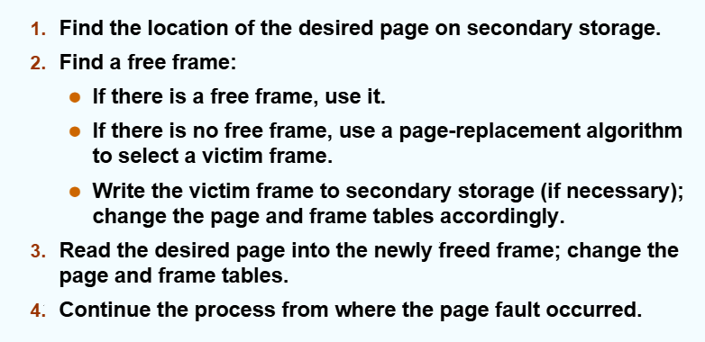
* 注意，被覆写/换出的victim在页表中的valid bit要改成invalid

>resident page：驻留在mem中的page
>evict：驱逐。把page换出mem外
>prefetch：预取，基于一定的预测，提前把一些尚未请求的页面从disk调入mem中
>到底哪里是page哪里是frame：进程的逻辑地址空间VAS中叫page，对应的物理内存（mem+disk）中的叫frame

## 4.1 Page Repalcement Algorithms

希望尽量减少由此导致的page fault.

建模：

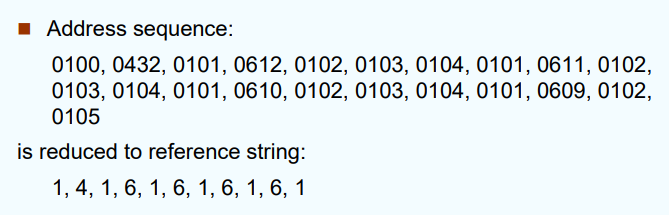
* 把中间连续重复的去掉（这里不可能产生page fault）

### FIFO Algorithm

策略：替换当前所有frame中待得最久的那个

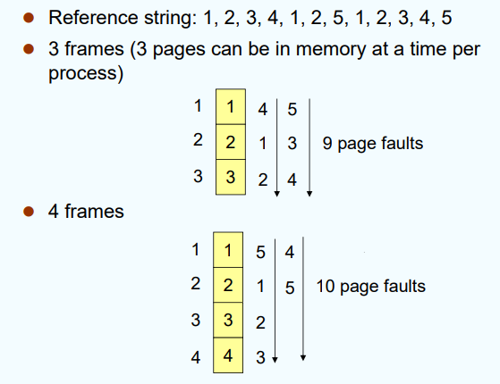
* 这种表示法还挺好的，栈右边的列表示它们被替换的次序，也是新栈的内容

一个恶意序列攻击：若循环的序列长度恰好比栈大小多一个page。从而使得内存frame越多，fault越多，这种现象称为 **Belady's Anomaly**

这个栈可以**看成** 是倒排页表的内容（entry为[idx,frame num]）。总之它不是页表

### Optimal Algorithm

策略：把将来最长时间不会用到的page替换掉。（若有平手，则使用FIFO来决定）

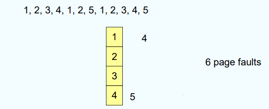

如何预知未来是否使用？——不可能预知。因此这只是个理想方法

### LRU Algorithm

>既然无法往未来看，我们就改成往回看。反正都是利用时间局部性

策略：把最久没用到的那个page替换掉

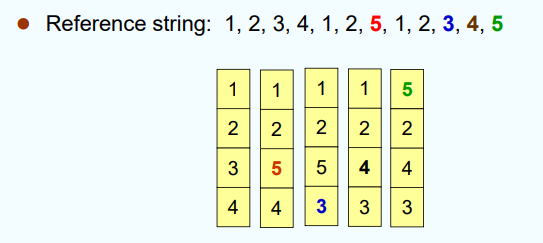

实现1：Counter
* 为每个page维护一个Counter，每次page被访问，就把当前clock时间写入Counter中。替换时选时间最早的。
* 但每次替换都要scan所有page的counter，线性代价，可能不是特别好

实现2：Stack
* 把所有page num用双向链表组成一个stack。把LRU的放到栈顶，最新使用的放到栈底
* 每次移动链表中的Page都要修改一大堆指针（因为可能是从中间随便抽出来一个），代价也不太好

实现3：近似方法——reference bit
* 为每页设置一个reference bit。初始置0
* 若其被访问，则置为1
* 设置一个定时器，到时就全员置0
* 替换这个bit为0的那些page

实现4：reference bit升级版
* 每次到时就把ref bit右移一位

实现5：second chance
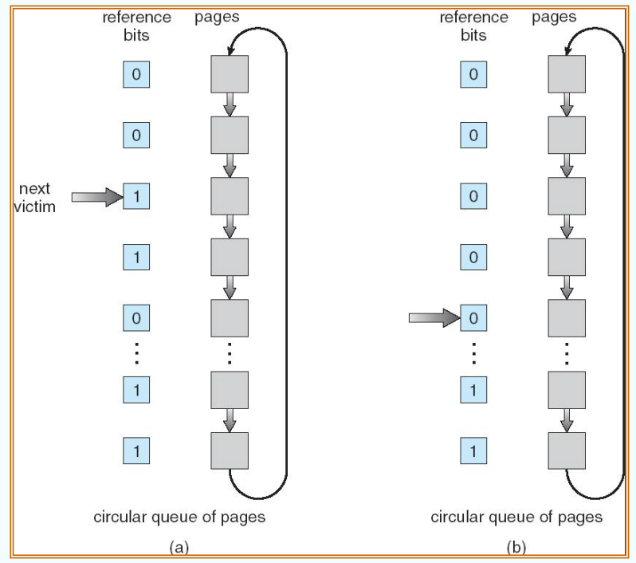
* 维护一个循环队列，不断沿着队列往下扫描
* 同样设置ref bit，访问了则置1
* 如果遇到ref bit = 1的，就把它置0（消耗复活甲）
* 如果遇到ref bit = 0的，就替换它（至少一圈没被访问了，可以替换）
加强版：

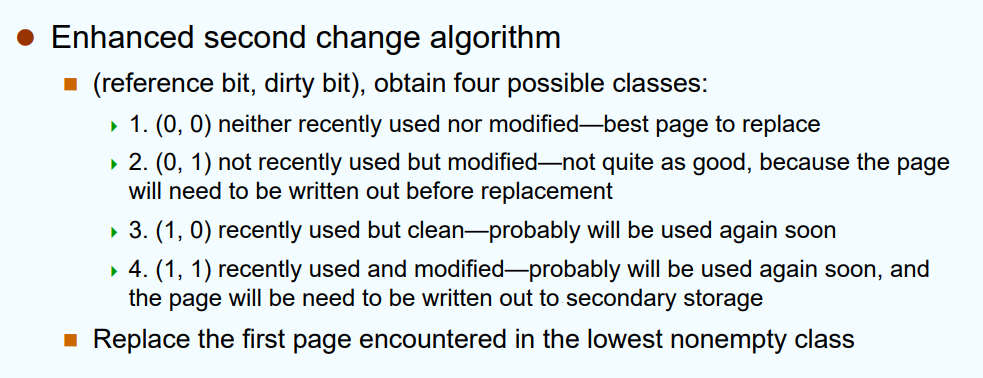

### Counting-Based Algorithm

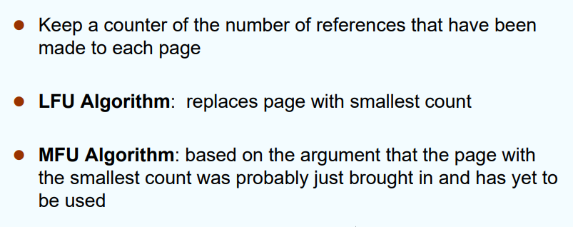

# 5. Allocation of Frames

>多进程时，如何安排给进程们的Frames？

策略可分为：Fixed / Priority allocation

根据做替换时能不能替换别的进程的page，又可以把替换算法分为：
* Global replacement：可以干涉别的进程
* Local replacement：只能替换自己进程的frame（前面算法中举的例子都是local的，因为都没有p_id，只有page number）

# 6. Thrashing，颠簸

若一进程没有足够多的frame容量，就总会page fault。那么总是要去disk调页（I/O操作）。

从而，waiting queue里的进程就很多，而ready queue很空。CPU利用率也会降低

为了提高CPU利用率，OS会再调入一些process，但根源不在此，所以利用率并不会提高。如下图，后面那段下降就是thrashing了

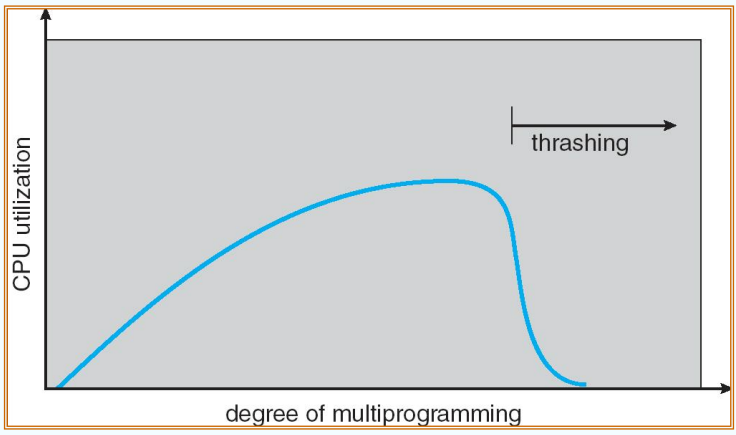

Thrashing：一个进程一直在忙于swap in/out pages

发生原因：提供给进程的frame太少，不足以覆盖locality的范围。无法利用局部性就老是page fault了

## Working-Set Model，工作集模型

如何确定一个frame的locality？或者说，啥时候会发生thrashing？

使用一个时间窗口来统计用到的frame

# 7. Memory-Mapped Files

# 8. Allocationg Kernel Memory

# 9. Other Considerations
