内容约等于图灵《理论计算机》去掉一些复杂度理论分析

考核：
* 课后作业 20
  * 共两次
* quiz 10
* 期末 70

研究脉络：
* 问题怎么描述？（对应编码）
* 如何计算问题？（对应各种计算模型，例如电路、自动机与图灵机）
* 所有问题都可以被计算吗？（对应可计算性）
* 对于可计算的问题，计算它们需要多少资源？（对应复杂度理论，函数复杂类）

# 1. set

>离散里面的内容

proper subset 真子集
差和对称差：对称差是A∪B-A∩B
划分：分出来的子集不相交，且并起来后得原集合

# 2. relations and functions

## relations

## functions

## 特殊的binary relations

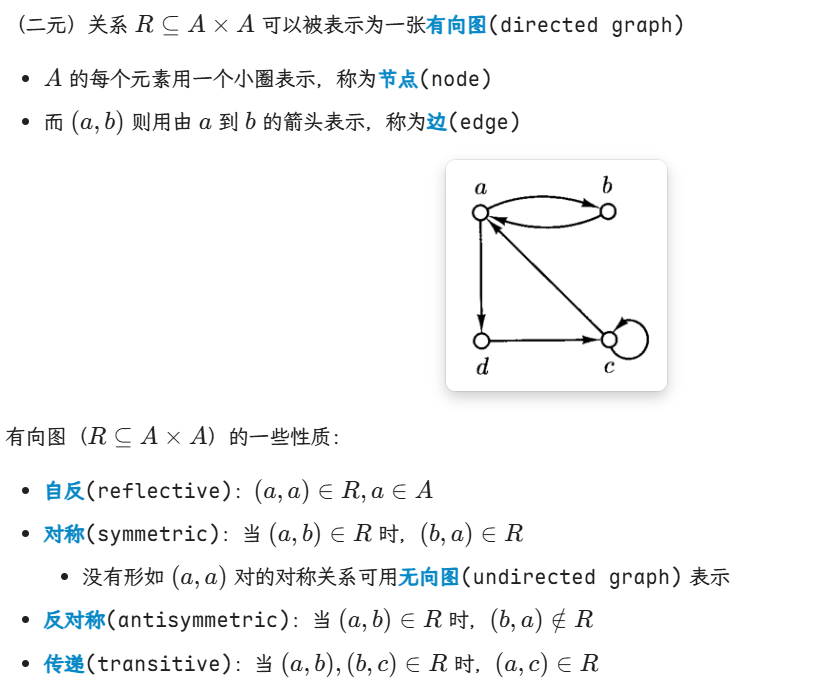

* 自反要求对所有元素a都有(a,a)∈R
* 对称、反对称不关心是否自反，只对a≠b的情况讨论

有没有同时满足symmetric和antisymmetric的？-->空集即可

equivalence relation:同时满足自反、对称、传递的关系R被称为等价关系。

partial order(偏序):同时满足自反、反对称、传递的关系。
* 感性理解，就是有序对(a,b)只能以固定顺序存在，不能是(b,a)

total order(全序):在偏序的基础上，任意两元素都可比。即对于任意a,b，要么有(a,b)要么有(b,a)

minimal(极小)：自己这条上极小
least(最小)：跟全员可比且最小

# 3. Finite & Infinite Set

equinumerous:等势(等基数的)

等势集之间至少存在一个双射(bijective function)

等势是一种等价关系：
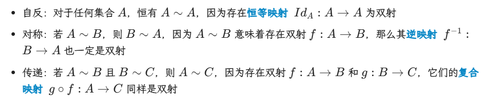

cardinality:基数，set中元素个数，也叫做势

可数集&不可数集
* 可数无限(countably infinite),与自然数集N等势
* 不可数无限(uncountably infinite)，基数大于N
  * 反证法，证明无法构造一一对应
* 有限和可数无限都是可数的

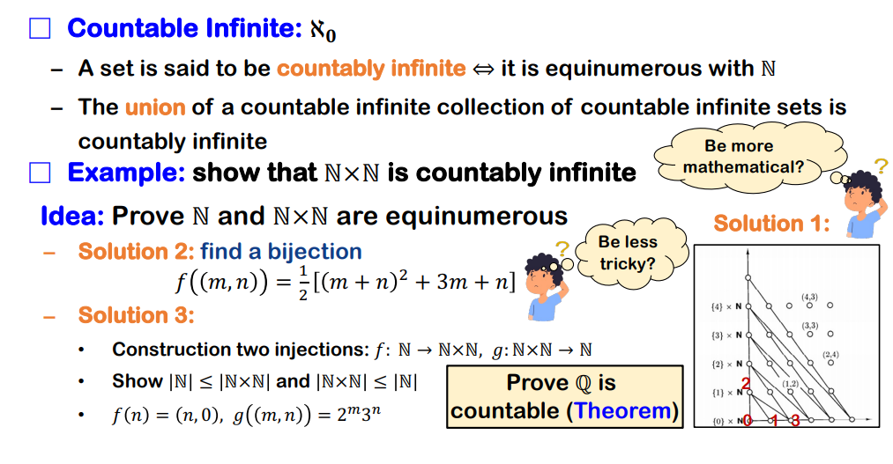

连续统假设(Continuum hypothesis):没有set的基数严格介于自然数集($|N|=\alef_0$)和实数集($|R|=\alef_1$)之间
* 往N_0中加入有限个数得到N_1，N_1仍可与N_0建立双射。

Cantor's Theorem：任意集合A的基数严格小于其幂集的基数

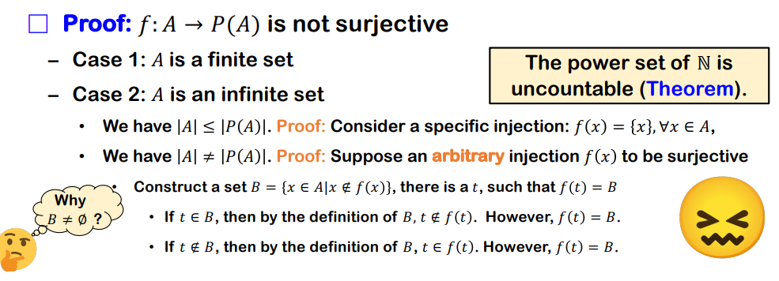
* B包含所有不属于其映射到的集合的x

# 4. 基本的证明方法

## 数学归纳法

## 鸽巢原理

例题：
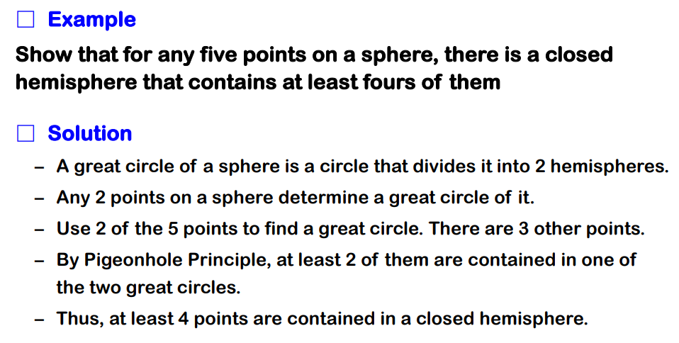
* 直接用两个点来确定一个分割圆

## 对角化原理

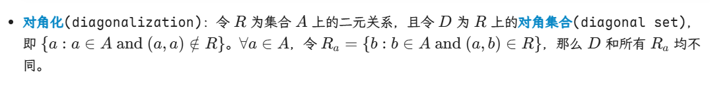

D这个对角集合的性质，在应用中表现为小数d的每一位都与对角线上的数不同

# 5. Closure

闭包：给一个原始对象添加最少的额外元素，使其具备某个我们期望的性质

# 6. Alphabet and Language

$\Sigma^*$不会是空集，因为它至少有空字符串这个元素

此处详见NoughtQ笔记

反转：
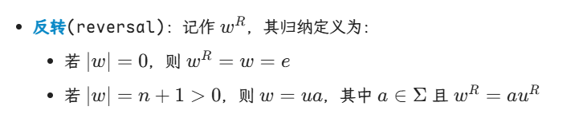

无限语言的形式化描述：（由于字符串是无限个，列举不可行，所以我们用性质来表述）
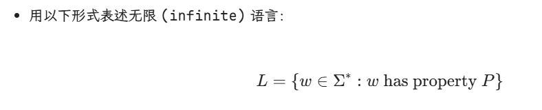

若字母表$\Sigma$是有限的，则语言$\Sigma^*$是可数无限的：
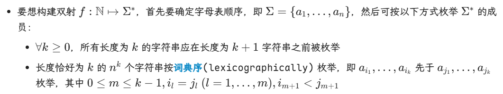
* 能枚举就直接逐个对应到自然数上即可

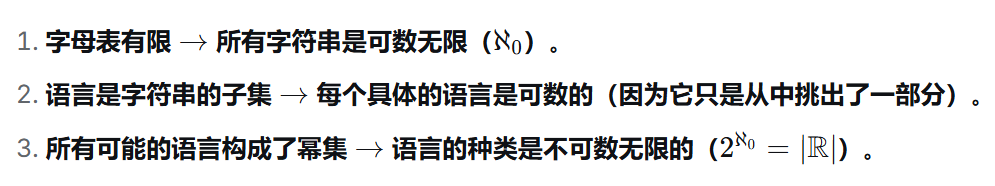

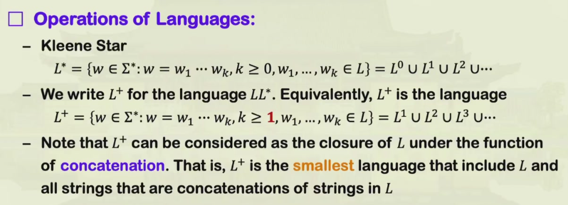
* L是一个语言
* $L^k$是从L中挑k个（允许重复）字符串拼接而得的所有字符串
* $L^*$表示把L中的字符串拼接任意次（包括 0 次）所能得到的所有字符串
* $L^+$排除了空串，至少要挑1个字符串来拼接

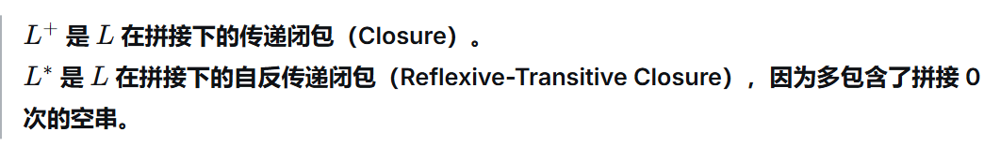

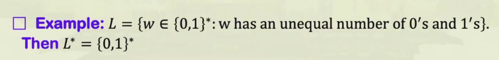
* 通过拼接补足缺失串，L^* 可覆盖{0,1}^*的全部字符串

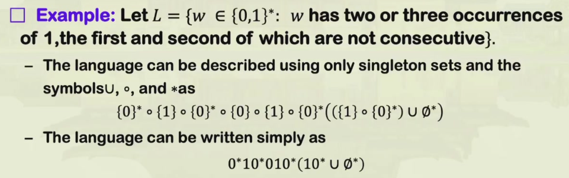
？？

**regular expressions**，正则表达式

归纳定义：
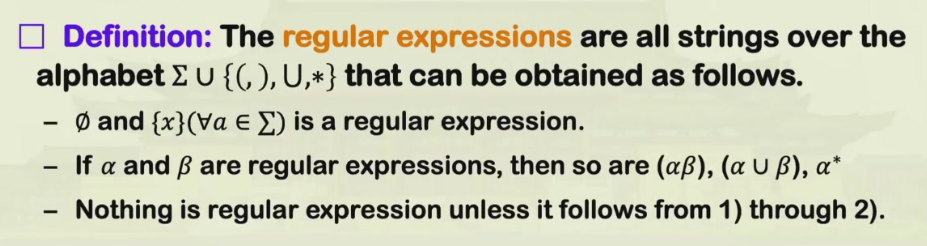
* 正则表达式：一种定义，一种公式，用来筛选/生成字符串
* 正则语言：由一个正则表达式产生的字符串集合

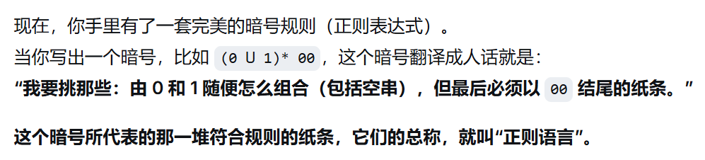

**正则语言生成函数L：**

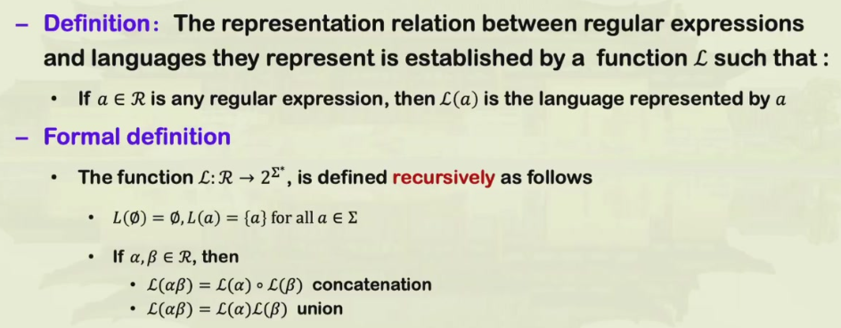

生成函数运算律：
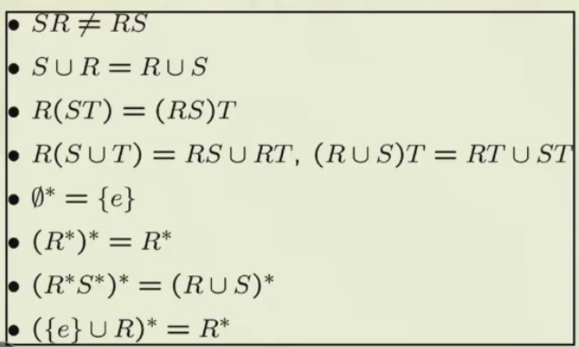
* cat不可交换
* 并可交换
* 结合律
* 分配律
* Kleene star的相关性质

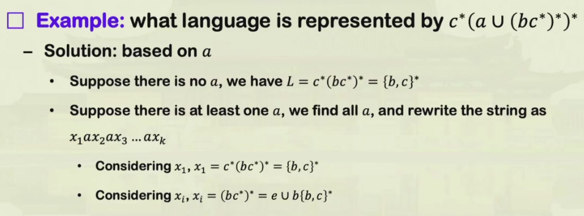

表示语言的方式：
* 语言识别器(Language Recognition Device)
* 语言生成器(Language Generators):正则表达式

连续“1”识别器：用状态机记录当前连续遇到1的个数即可

