# 1. DFA,确定性有限自动机

## 1.1 定义

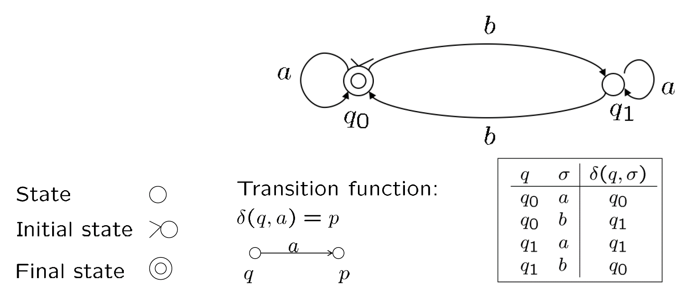

def: 有限自动机(finite automata) 接收字符串输入并以输入纸带(input tape) 的形式传递，之后仅输出一个关于是否认为输入可接受(acceptable) 的指示。

>“确定性”的体现：只要当前状态和输入符号确定了，下一步去哪是唯一确定的，没有模棱两可的情况。

操作细节：
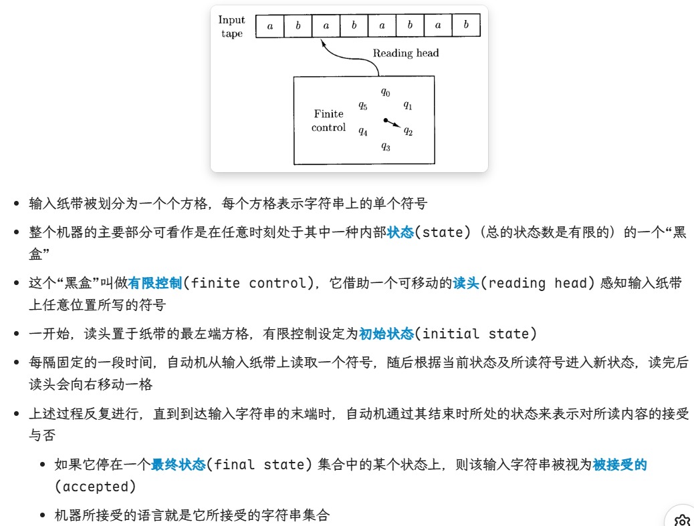
* 注意最终是落在“最终状态”集合中，才是accepted

**形式化定义：**
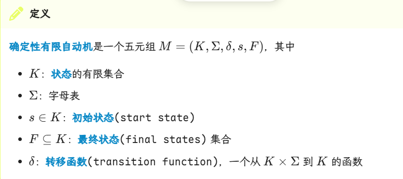
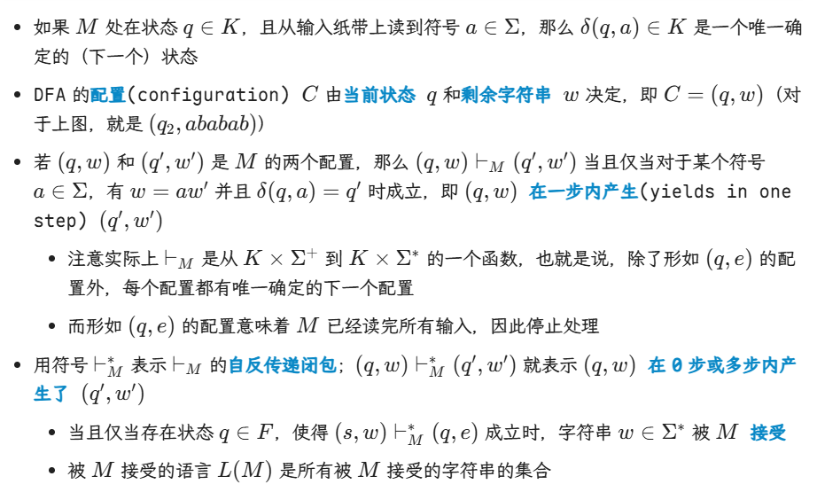
* 一步内产生：w=aw'意思是后面剩余字符串w'的第一个字母是a.
* (q,e)的配置：e是空字符串。所以这个配置代表读入完毕
* 所有M接受的字符串组成的语言L(M)就是机器M识别的语言

一些例题：
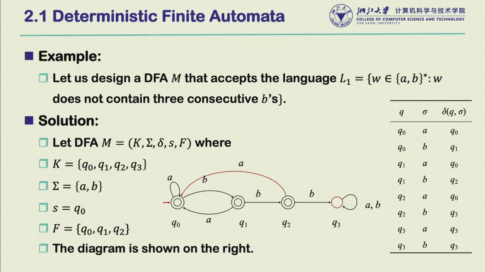
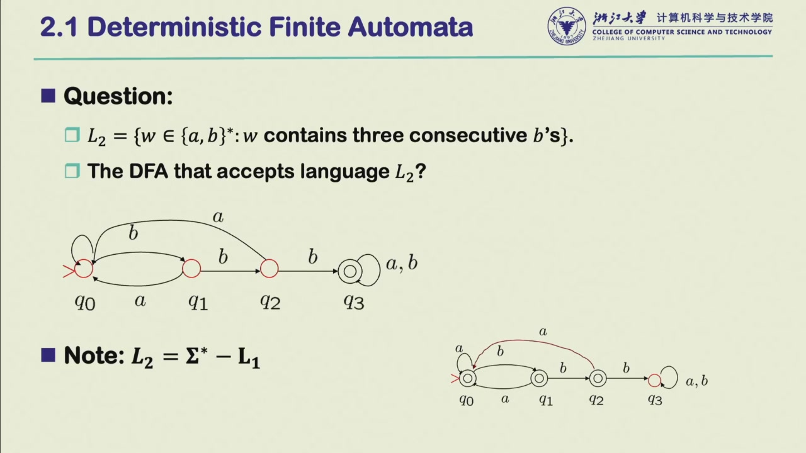

## 1.2 DFA最小化

任意能被DFA表示的语言都存在唯一的最小化DFA。最小化DFA步骤：
1. 删除不可达状态（冗余）
2. 合并等价状态：将状态划分为若干等价类
   1. 接受和非接受不等价
   2. 从{K-F,F}——即划分为所有非接受状态K-F和所有接受状态F——开始，迭代细化
   3. 迭代的规则：两个状态p和q，对于同一个输入符号（如a），看其转移到的状态是否属于当前划分下的同一类。若不属于，则p和q是可区别的，划分为不同类

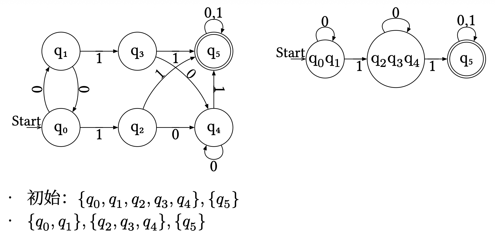
* 其中q5是接受状态
* q2,q3,q4接受输入1，都会跳转到q5.因此他们仨等价
* 剩下的q0和q1接受相同输入跳转到的类相同，他俩等价

# 2. NFA,非确定性有限自动机

def：与DFA相对的，对于给定的当前状态和输入符号，允许下一状态不唯一；自动机可能会选择这些合法的下一状态中的任意一个，而这个选择不受模型的影响。

例子：考虑一个自动机M，能接受语言$L=(ab∪aba)^*$。

这个语言意思是选择ab或aba然后进行重复拼接0到若干次（克林闭包）.

对应的DFA：

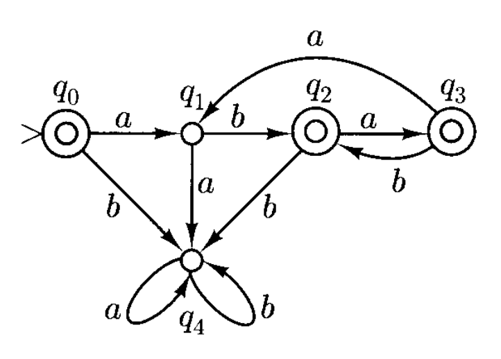

对应的NFA：

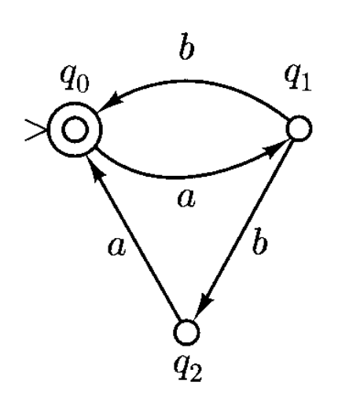
* q1状态下，接受输入b，下一状态可以是走向ab，也可以是aba
* 从q0出发，输入为b时没有可进入的状态
  * 这是NFA的另一个特点：在某些状态和输入符号的组合下也可能没有任何可行的转移路径

另外，我们允许 NFA 上有带空字符串e的箭头，这能让自动机在不读取任何输入的情况下实现状态转移。

形式化定义：
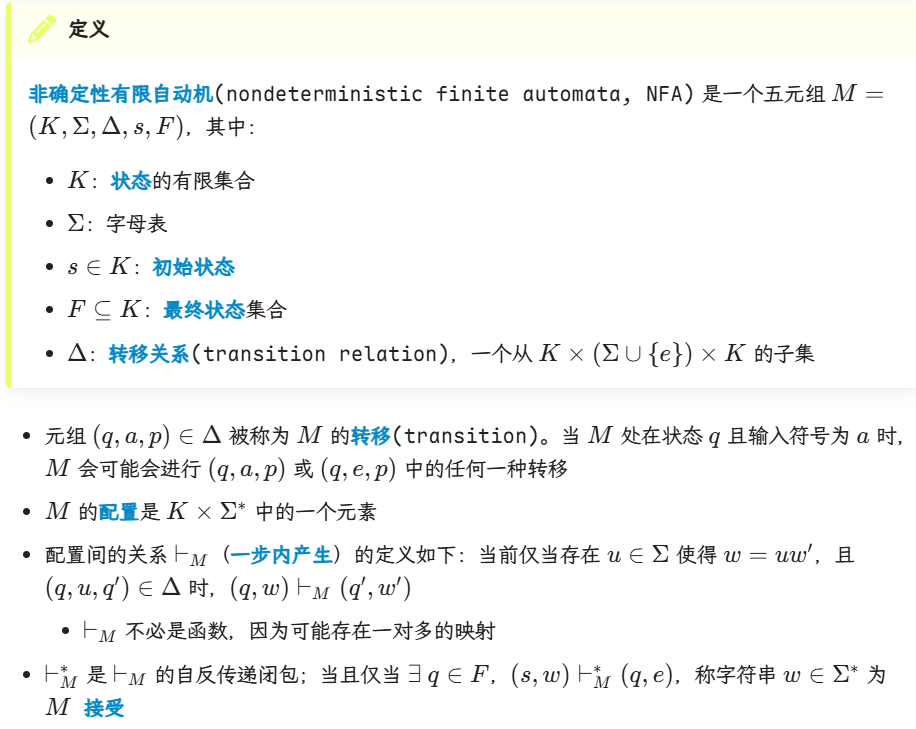
* 第一条，当输入为a时，可以做(q,a,p)转移；也可以不消耗这个a，直接进行(q,e,p)转移（如果$\Delta$中允许这个转移的话）
* **NFA中，一个字符串可以走任意转移路径，只要最终能到Final State，它就被接受了。**

DFA是NFA的特例：即不允许(q,e,p)的转移，对于同一个配置只有唯一确定的下一状态，NFA此时就称为DFA

等价有限自动机：对于两有限自动机M1,M2（无论是NFA还是DFA），当且仅当L(M1)=L(M2)时二者等价。

## 定理：对于每一个 NFA，存在一个等价的 DFA。

如何根据一个NFA构造一个DFA？

main idea : 将 NFA 看作在任何时刻，不只占据一个状态，而是占据一个状态集合——即，通过到目前为止读取的输入，所有可以从初始状态到达的状态的集合

$\epsilon$-闭包：E(q)是集合{q}在关系：*不读取任何输入就能到达*下的闭包
* 也就是说，任何E(q)中的集合在此关系下能到达的集合都在E(q)中
* 这样就把空转移打包到集合中了

现在我们有确定性的转移关系$\delta'(Q,a)=∪{E(p)|(q,a,p)∈\Delta for some q∈Q and p∈K}$

现在接收一个确定的状态集合Q，读取输入a，可以到达一个确定的状态集合.

现在要证明这样的DFA和NFA等价，只需证明L(M')=L(M)

证明的核心：M沿着路径w能走到状态p，当且仅当M'沿着w能走到包含p的状态集

为什么说明DFA走到包含p的状态集即可？——因为DFA的接受集是包含任意NFA的最终态的所有集合，所以被NFA接受的字符串w必然被此DFA所接受。

>详细证明见NoughtQ笔记.结合ds的解释，讲得挺好的。关键就是看路径的构造，使用归纳假设

# 3. Regular Expressions,正则表达式

计算理论的核心：用有限的规则去描述无限的语言。

从而，我们用正则表达式来描述语言。正则表达式是递归定义的：
* 空集是正则表达式；字母表$\Sigma$里的单个成员也是正则表达式
* 若$\alpha$和$\beta$是正则表达式，那么它们的拼接 $(\alpha\beta)$ ,并集 $(\alpha ∪ \beta)$ 以及kleene闭包$\alpha^*$也是正则表达式
* 只有上述规则组合出来的才是正则表达式

函数L：把正则表达式映射成具体的字符串集合
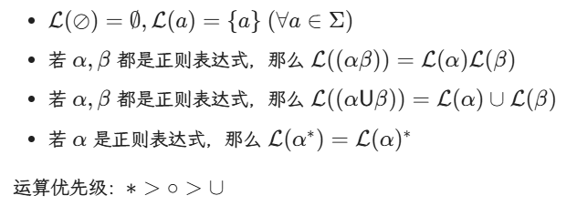

# 4. Regular Languages

正则语言的另一种定义：被FA，有限自动机接受的语言

证明FA接受的语言类对于以下运算是封闭的即可：
* 并
* 拼接
* kleene star
* 补
* 交

>证明见NoughtQ笔记

## 定理：当且仅当为FA所接受时，语言是正则的

FA->RL：证明被FA接受的、从起始状态到结束状态集所使用的任意字符串的集合 是正则的。

用归纳假设证明即可。

## 一些结论

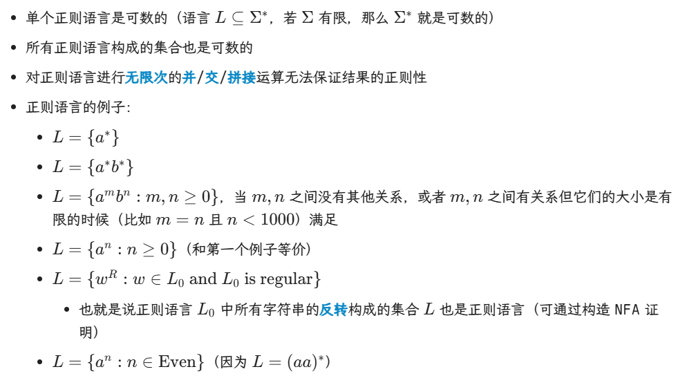

* 语言可数：字符串个数可数。（可以按字符串长度列举）
* 正则语言对有限次的并、交、拼接封闭，但对无限次的这些运算，不一定封闭。
* 第三条，当m,n没有关系时他俩可以无限大，此时退化成{a* b*}，若他俩有关系就不能无限大，FA无法记住任意大的数量并逐一匹配
* 字符串的反转：就是把一个字符串倒过来写。abcd变成dcba
* 注意，正则表达式的拼接顺序决定了字符串的结构，而*表示允许每一段重复任意多次（包括0次）

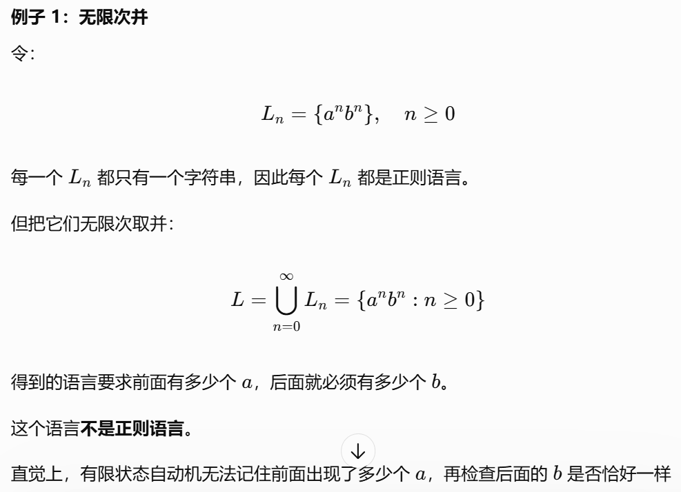

* 正则语言的 Kleene star 仍然正则，是因为我们能用有限自动机的循环来实现任意有限次重复，并用接受状态和 \(\varepsilon\) 转移处理重复 0 次及各轮之间的衔接

一个总结：
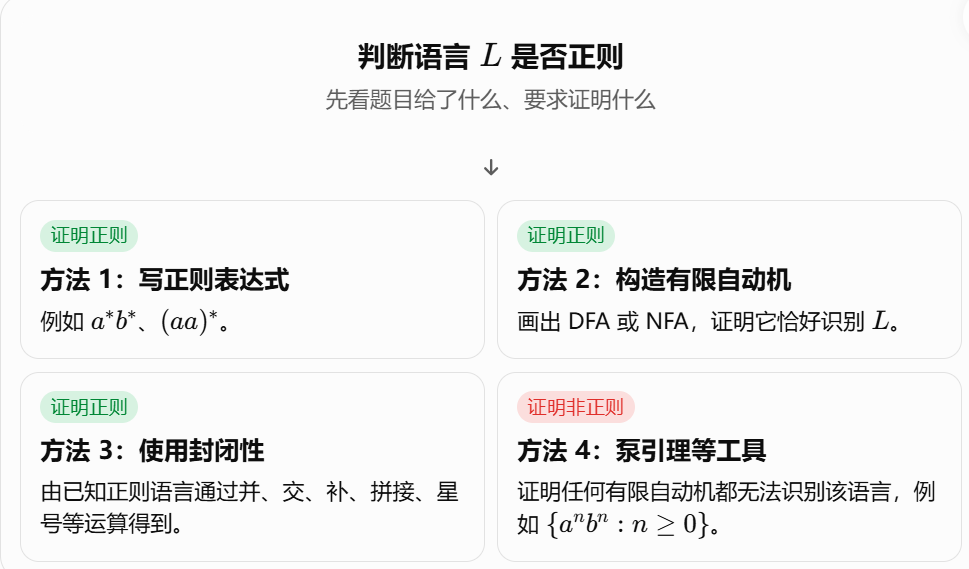

# 5. Languages that Are and Are Not Regular

下面给出两条为正则语言所具备的，但某些非正则语言不具备的性质：
* 当从左到右扫描字符串时，用于最终判断该字符串是否属于某语言所需的内存容量必须是有限的、预先固定的，并且依赖于该语言本身，而非特定的输入字符串。
* 具有无限数量字符串的正则语言通过带有循环的自动机以及包含克林星号的正则表达式来表示
  * 也就是说，它必然具有某种简单重复结构（源于相应正则表达式中的Kleene Star或FA中的循环）

下面给出一个更精确的证明语言非正则的定理：

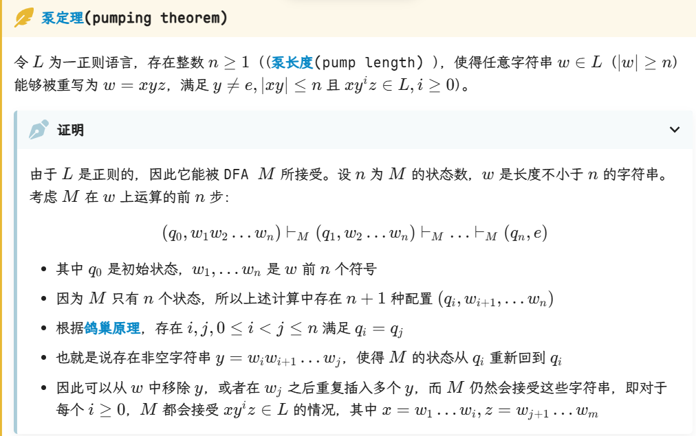

定理可以简单翻译为：w中间的某个子串重复任意次（包括0次），仍属于此正则语言

泵定理是正则语言的必要不充分条件，常用于证明一个语言是非正则的。

例题：

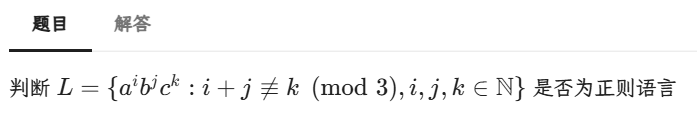

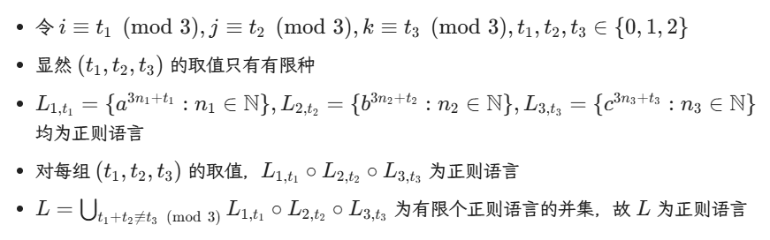

这里利用了正则语言的闭包性。把余数按情况分类，然后利用连接、有限并集的闭包保证，证明结果是闭包的。

正则语言在以下运算中是封闭的：并、拼接、Kleene Star、补、交

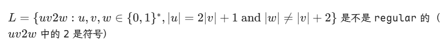

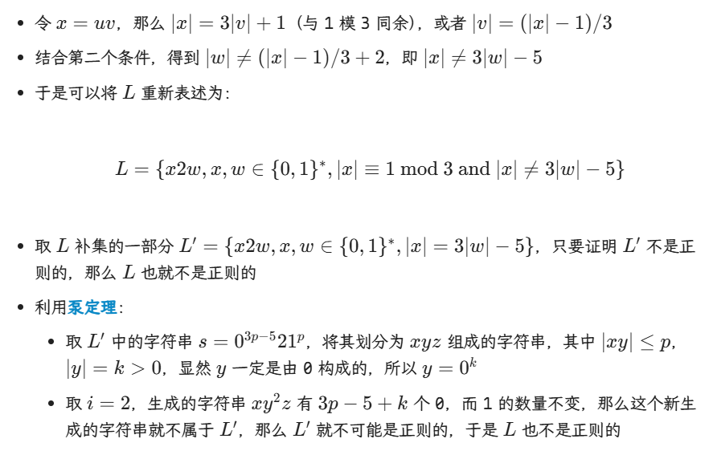

更严谨一点的说，要先构造一个正则的全集U={...,|x|=1mod3}，然后写出它的正则表达式（以证明其是正则的）。

再假设L是正则的，那么由差运算的封闭性，L'= U-L也应该是正则的。再用泵定理证明L'不是正则的即可。

复习的时候做一下PPT末尾的例题。