# 1. CFG，Context Free Grammar

规则：把某符号对应到某字符（串）的一个表示、一个对应关系

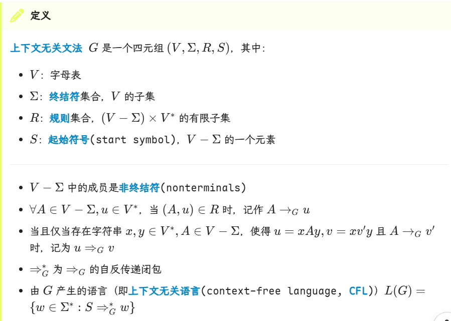

* V*是字母表V对应的语言（字符串集合）
* L(G)就是从start symbol走到终结符的一个逐步展开得到的字符串
  * 注意，start symbol是一个字符（非终结符中的一个），而不是集合
  * 所以非终结符集永远nonempty，至少有个S

通过这个例子可以简单理解CFG表示句子的方式：

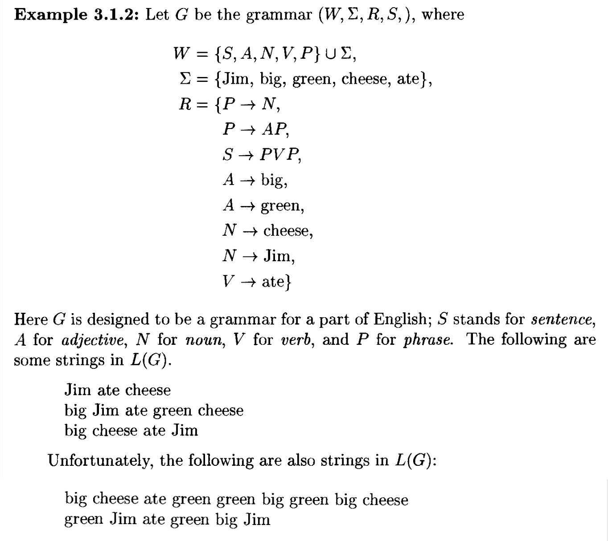

* 起始是S，推出PVP，然后再根据R中的规则任意展开。后面那个诡异的句子就是一直把V后那个P展开成AP

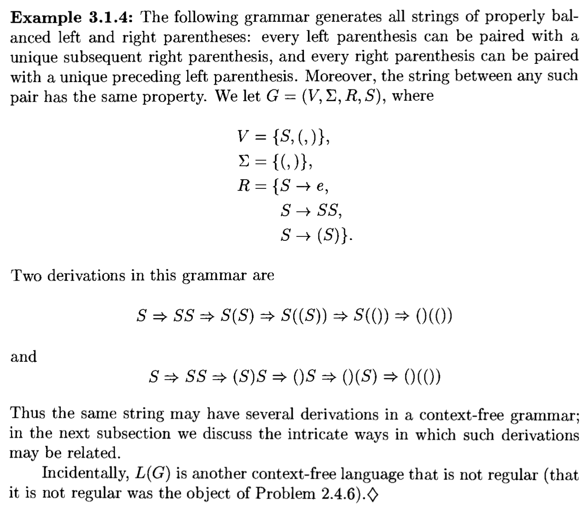

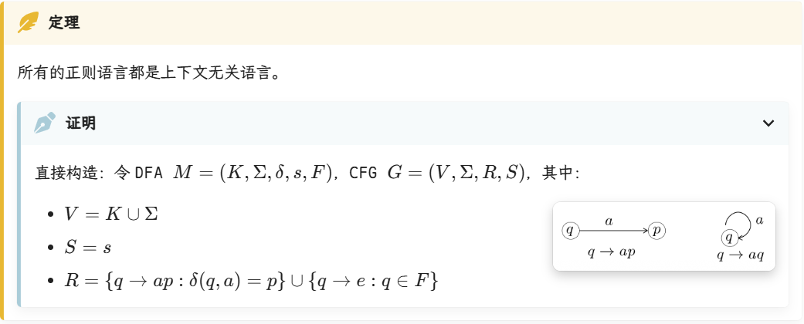
* 然后通过说明这个M接受的语言L(M)能通过某个CFG的规则展开形成
* 形式化证明问ai

RL是右线性文法，只允许A→aB（终结符只能在左边）；而CFG允许出现A→aBc这种，放松了限制。

# 2. Parse Tree，语法树/解析树

## 2.1 概述，推导的等价性、相似性

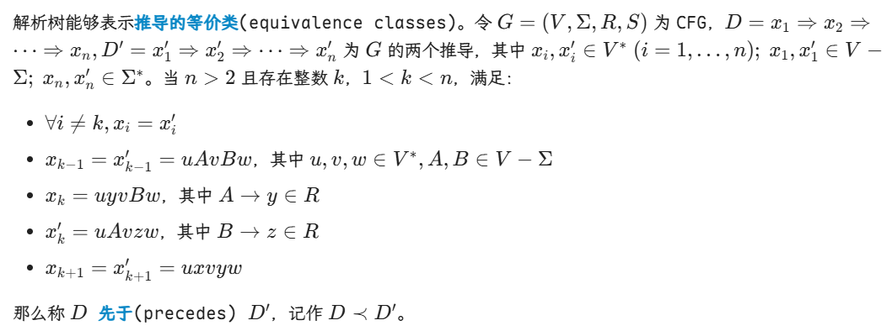
* 这里就是先展开A还是先展开B的区别。
* 先展开前面的A的是D，因此说D先于D'
* 记号是偏序符号

但是这种序不具有传递性。相邻可比的只能有一个中间态不同。见下例：D1和D3。

>也可以理解为，“先于”关系是两个推导可以经过交换一次两个相邻独立步骤互相转化

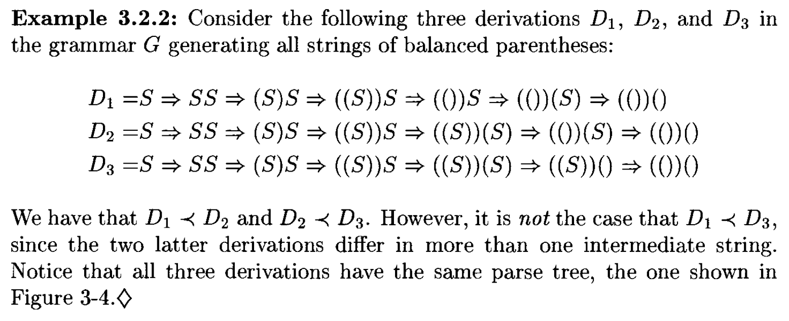

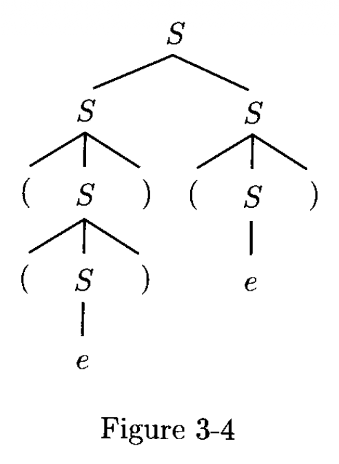

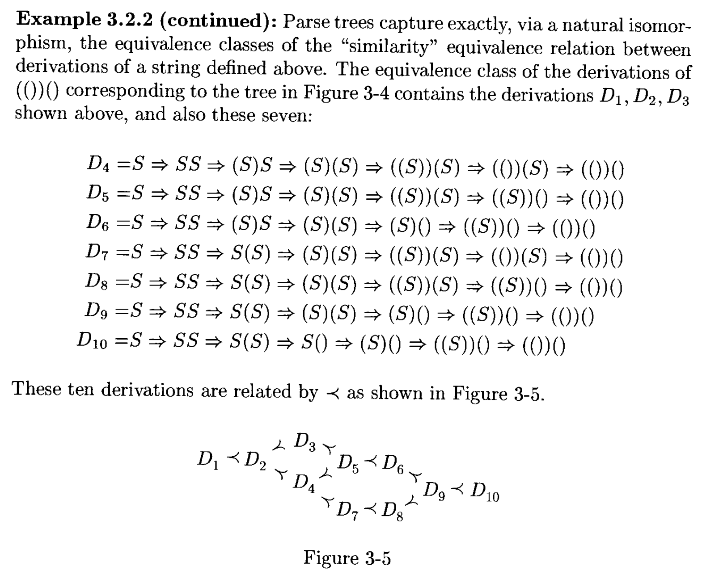
* 从而，等价的推导关系就对应着同一棵语法树；而一棵语法树，就对应着唯一一种推导结果（也就是一个等价类）。集合中不同的推导的区别仅仅是每一步左子树还是右子树先往下长而已。


“闭包”的本质就是：原来的关系网有漏洞，我帮你强制打补丁，直到它满足某个特定的规则为止。

如某关系是{(1,2),(3,4)}，它的自反闭包就是{(1,2),(3,4)}∪{(1,1),(2,2),(3,3),(4,4)}

从而，“先于”关系的自反对称传递闭包而形成的关系R就是：
1. 自反的闭包：允许自己跟自己满足R
2. 对称的闭包：原本有先后，现在不论先后
3. 传递的闭包：原本“先于”只允许交换一次，现在可以连续交换。

从而，所有能通过“交换”展开顺序互相转化的推导满足关系R


上述的关系R，就是推导之间的“相似”关系。相似就是一种等价关系（这里的等价要求必须有相同的语法树）。

最左推导：等价类内最先的推导。解析树一直沿左子树展开到底，再回来递归展开右子树即可得到。

最右推导：等价类内不先于任何推导的推导。

每一棵解析树有且仅有一个最左推导和一个最右推导。

判断某一步是不是最左推导的一部分的形式化表述：

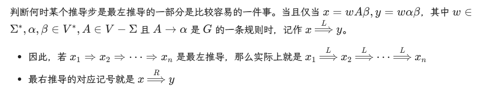
* 简单来讲就是，判断展开的是不是最左的非终态字符。
* 这里β属于V*，就是说它是任意字符，不管是不是终态

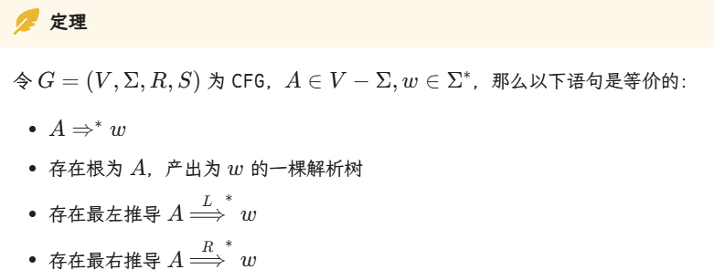

这个$\Rightarrow^*$就表示是推导任意多步的意思

## 2.2 Ambiguity，二义性

如果一个语法G中存在这样的字符串，它能来自多棵解析树，那么就称G是二义的。

二义的G生成的L(G)中的每个字符串意义不唯一。（只要证明它可以对应不同的解析树即可）

消除二义性：引入新的非终结符T,F，给运算定个序。

内在二义性：存在语言CFL，无论怎么改进，产生他们的CFG注定是二义的。


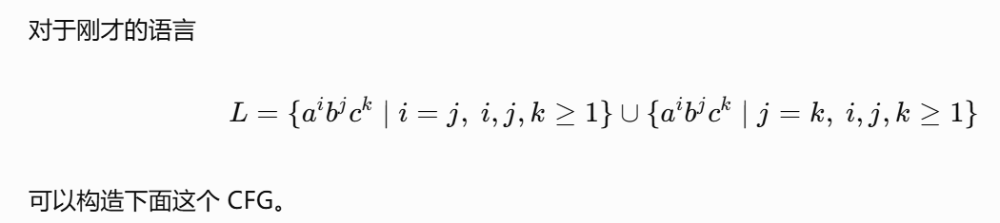
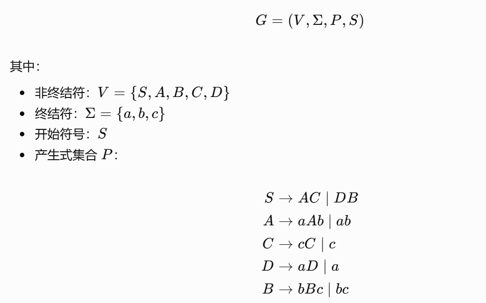
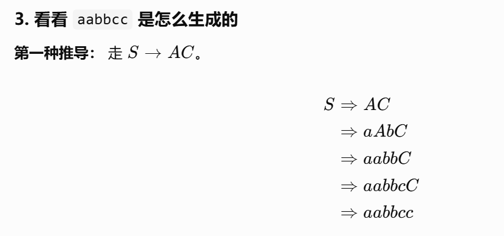
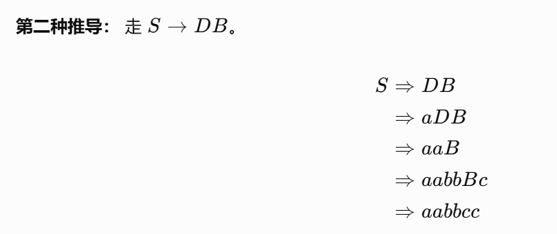


# 3. PDA，Pushdown Automata：下推自动机

CFL比正则语言大。（允许同时展开两边，不是右线性的）因此FA不够用于表示CFL

我们用一种有记忆的非确定性自动机。比如一个非正则语言${ww^R:w∈{a,b}^*}$（回文对称语言）。我们使用一个stack来存储，每次读取一个符号就压栈；猜测到达中心就弹栈逐个比对，如果全能对上就说明接受了！

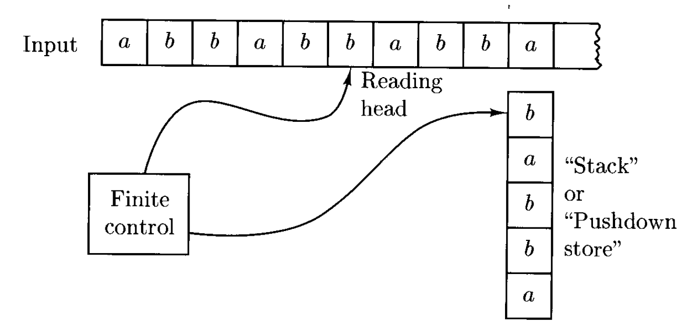

>这里，非确定性跟ads中的非确定性图灵机是一样的，有分身能力、上帝视角、并行运行能力。只要有一条路能走通就接受。

>可以将PDA简单理解为带有栈的NFA。为了记录栈的状态，我们要给PDA加一个元素：“栈符号字母表”

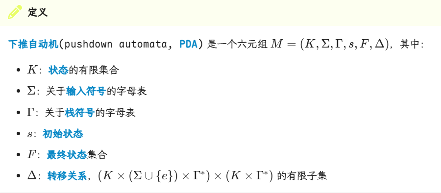

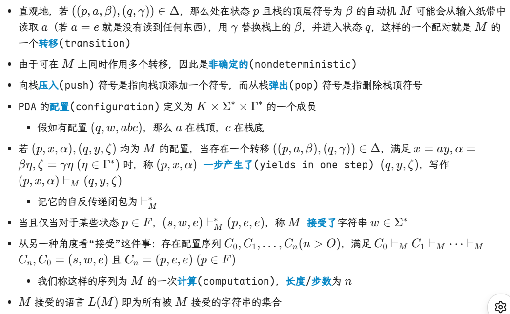
* 第二点，说的其实是读入一个符号，可能产生多种不同的下一配置
* “接收”：不仅要求状态处于终态，还要待读入字符串和栈都是空才行。
* 当PDA处于初始态时，它可以以不确定的方式决定下一步是保持状态并把next字母压栈，还是不消耗输入而切换到终态f


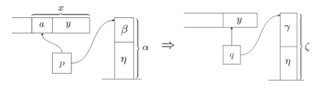



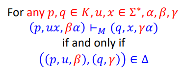
* 这里表示读入输入，替换栈顶。
* 注意，栈符号并不一定与输入符有关。只是在构造与CFG对应的PDA时会使用“把输入压栈”这种行为概念

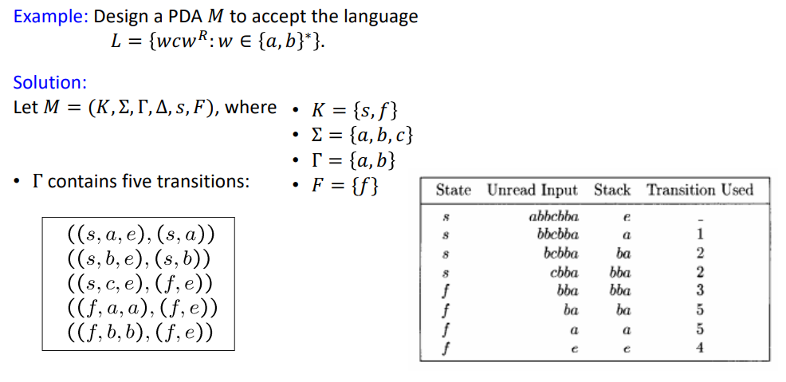
* 这里的栈行为就是模仿C语言那种，先移栈指针再压/弹栈。所以只是栈顶空了（弹出来了），不代表整个栈是空的


# 4. PDA与CFL等价

**定理：被PDA接受的语言类就是CFL**

两条引理：
1. 每个CFL都能被某些PDA所接受
2. 若某语言能被PDA接受，那么它是CFL

>见NoughtQ笔记

note：simple PDA，非终结符<q,A,p>

# 5. Language that Are and Aren't CF

## 5.1 CFL的封闭性

