语言强度图示：

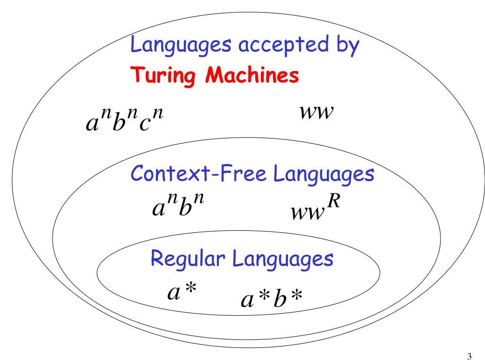

前面学的RL有一定局限性，现在我们来学一个升级版：CFL

# 1. CFG，Context Free Grammar

规则：把某符号对应到某字符（串）的一个表示、一个对应关系

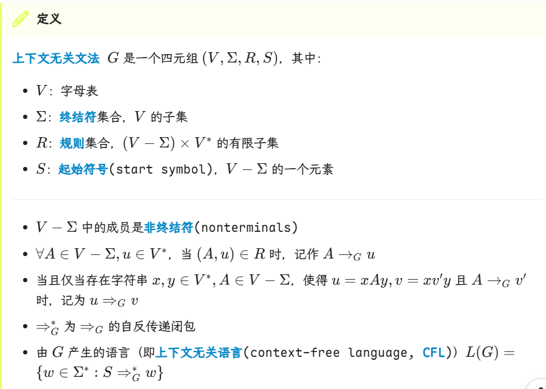

* V*是字母表V对应的语言（字符串集合）
* L(G)就是从start symbol走到终结符的一个逐步展开得到的字符串
  * 注意，start symbol是一个字符（非终结符中的一个），而不是集合
  * 所以非终结符集永远nonempty，至少有个S

通过这个例子可以简单理解CFG表示句子的方式：

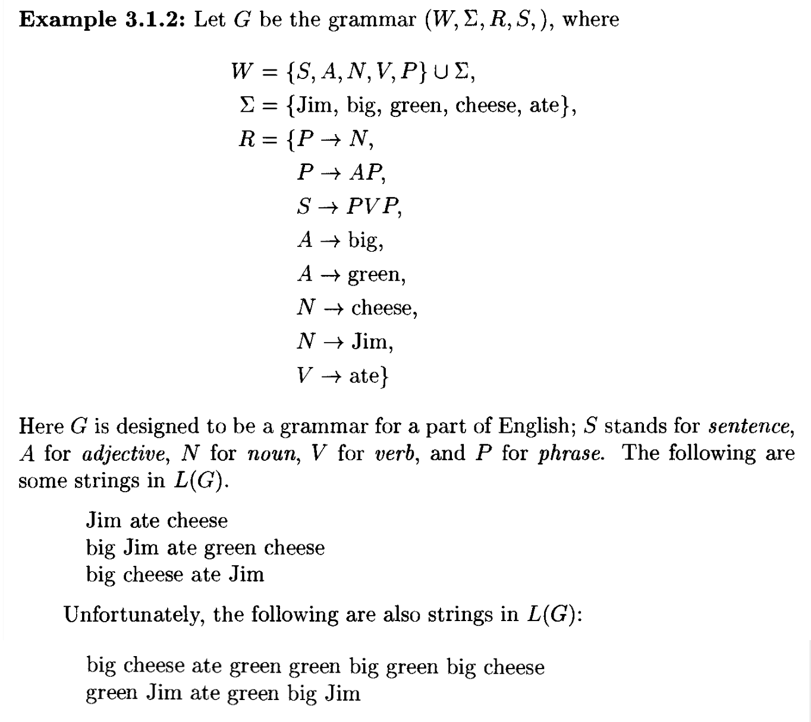

* 起始是S，推出PVP，然后再根据R中的规则任意展开。后面那个诡异的句子就是一直把V后那个P展开成AP

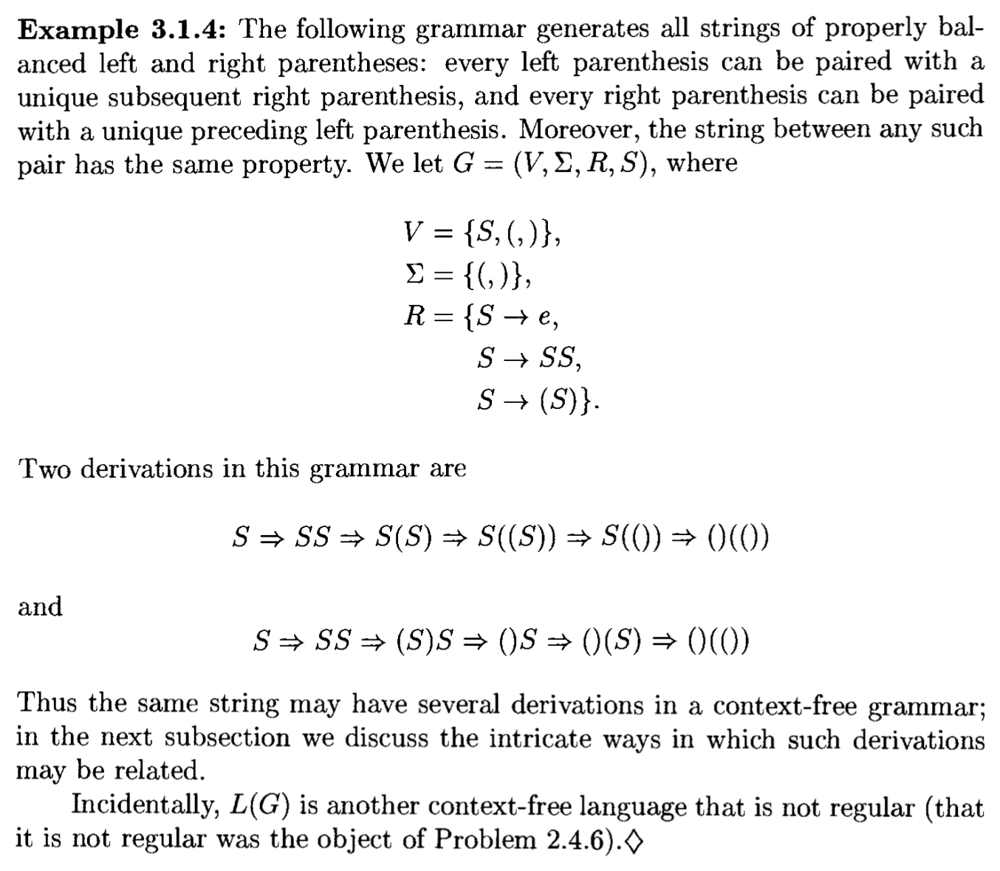

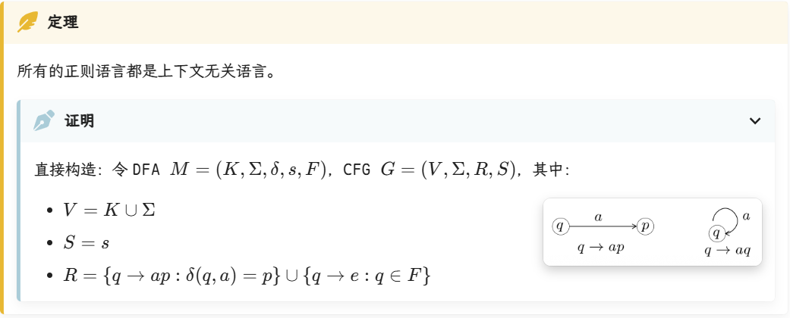
* 然后通过说明这个M接受的语言L(M)能通过某个CFG的规则展开形成
* 形式化证明问ai

RL是右线性文法，只允许A→aB（终结符只能在左边）；而CFG允许出现A→aBc这种，放松了限制。

# 2. Parse Tree，语法树/解析树

## 2.1 概述，推导的等价性、相似性

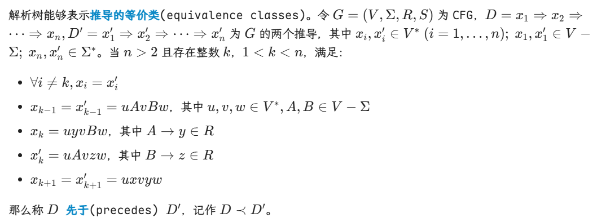
* 这里就是先展开A还是先展开B的区别。
* 先展开前面的A的是D，因此说D先于D'
* 记号是偏序符号

但是这种序不具有传递性。相邻可比的只能有一个中间态不同。见下例：D1和D3。

>也可以理解为，“先于”关系是两个推导可以经过交换一次两个相邻独立步骤互相转化

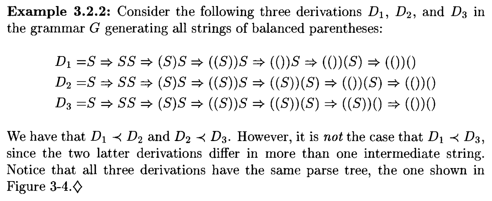

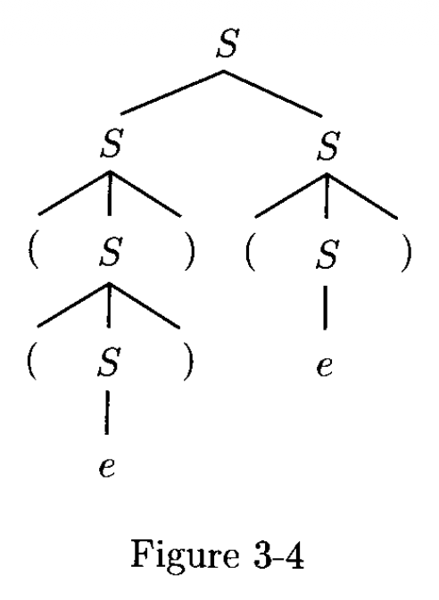

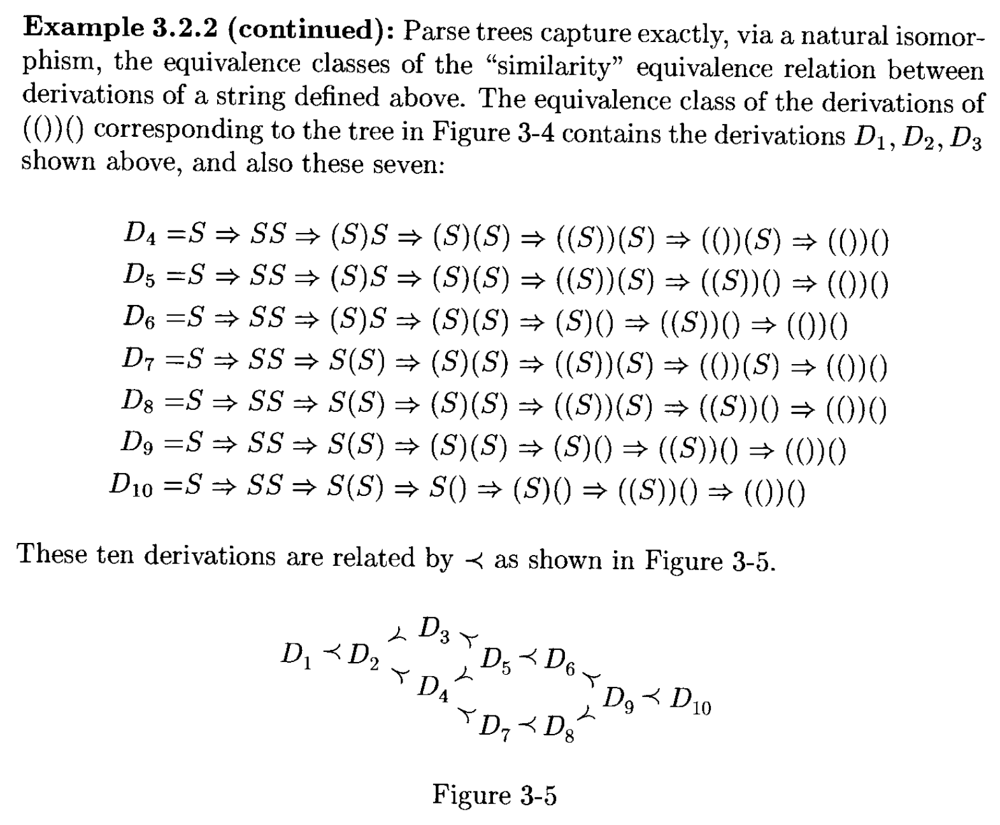
* 从而，等价的推导关系就对应着同一棵语法树；而一棵语法树，就对应着唯一一种推导结果（也就是一个等价类）。集合中不同的推导的区别仅仅是每一步左子树还是右子树先往下长而已。


“闭包”的本质就是：原来的关系网有漏洞，我帮你强制打补丁，直到它满足某个特定的规则为止。

如某关系是{(1,2),(3,4)}，它的自反闭包就是{(1,2),(3,4)}∪{(1,1),(2,2),(3,3),(4,4)}

从而，“先于”关系的自反对称传递闭包而形成的关系R就是：
1. 自反的闭包：允许自己跟自己满足R
2. 对称的闭包：原本有先后，现在不论先后
3. 传递的闭包：原本“先于”只允许交换一次，现在可以连续交换。

从而，所有能通过“交换”展开顺序互相转化的推导满足关系R


上述的关系R，就是推导之间的“相似”关系。相似就是一种等价关系（这里的等价要求必须有相同的语法树）。

最左推导：等价类内最先的推导。解析树一直沿左子树展开到底，再回来递归展开右子树即可得到。

最右推导：等价类内不先于任何推导的推导。

每一棵解析树有且仅有一个最左推导和一个最右推导。

判断某一步是不是最左推导的一部分的形式化表述：

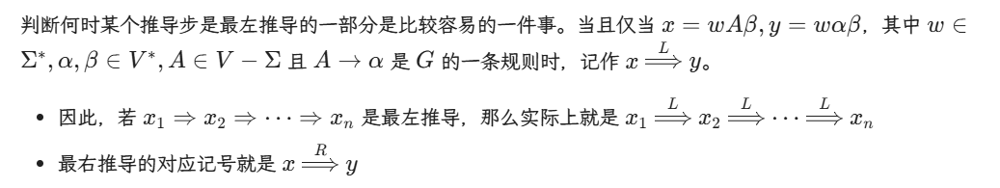
* 简单来讲就是，判断展开的是不是最左的非终态字符。
* 这里β属于V*，就是说它是任意字符，不管是不是终态

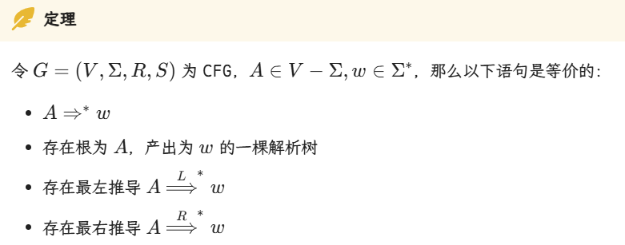

这个$\Rightarrow^*$就表示是推导任意多步的意思

## 2.2 Ambiguity，二义性

如果一个语法G中存在这样的字符串，它能来自多棵解析树，那么就称G是二义的。

二义的G生成的L(G)中的每个字符串意义不唯一。（只要证明它可以对应不同的解析树即可）

消除二义性：引入新的非终结符T,F，给运算定个序。

内在二义性：存在语言CFL，无论怎么改进，产生他们的CFG注定是二义的。


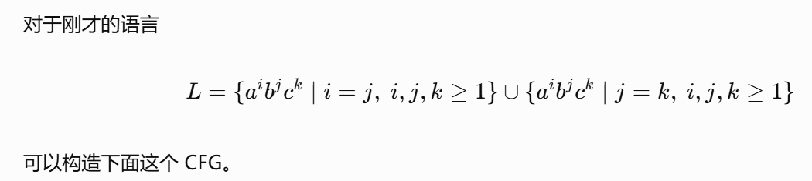
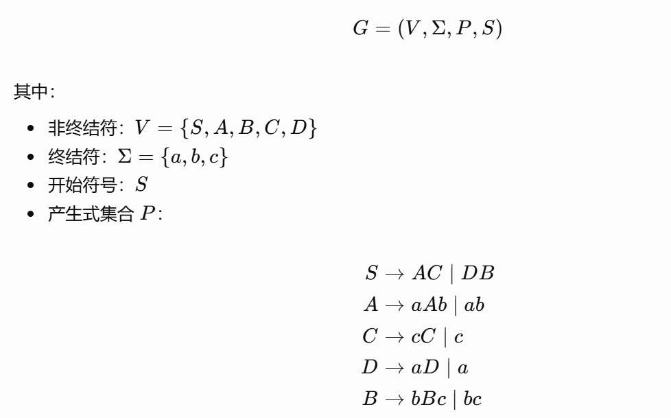
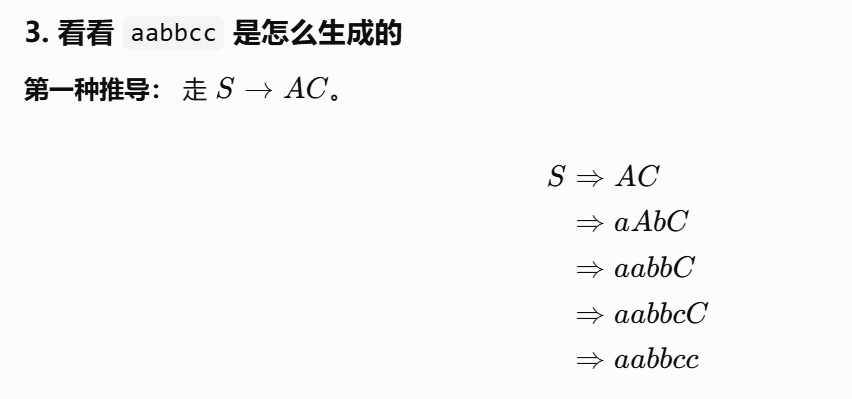
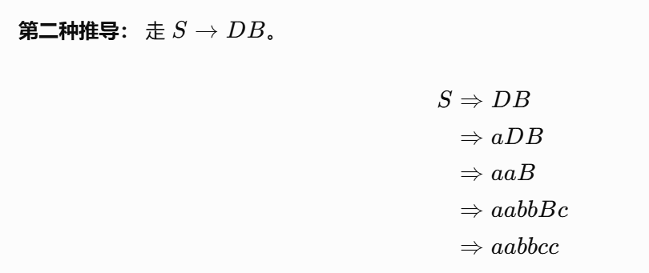


# 3. PDA，Pushdown Automata：下推自动机

CFL比正则语言大。（允许同时展开两边，不是右线性的）因此FA不够用于表示CFL

我们用一种有记忆的非确定性自动机。比如一个非正则语言${ww^R:w∈{a,b}^*}$（回文对称语言）。我们使用一个stack来存储，每次读取一个符号就压栈；猜测到达中心就弹栈逐个比对，如果全能对上就说明接受了！

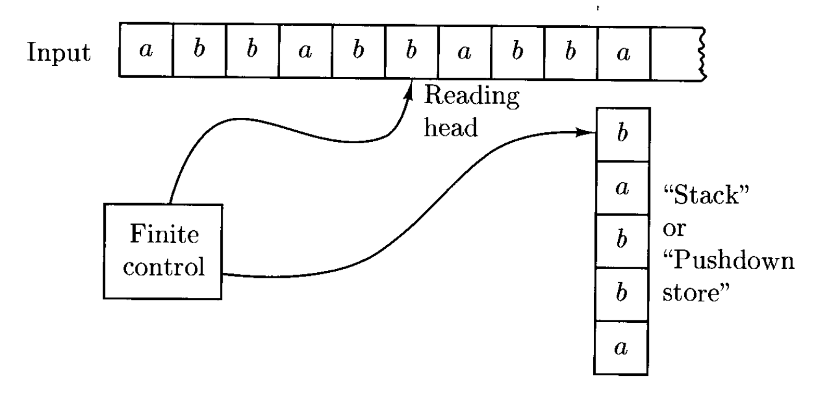

>这里，非确定性跟ads中的非确定性图灵机是一样的，有分身能力、上帝视角、并行运行能力。只要有一条路能走通就接受。

>可以将PDA简单理解为带有栈的NFA。为了记录栈的状态，我们要给PDA加一个元素：“栈符号字母表”

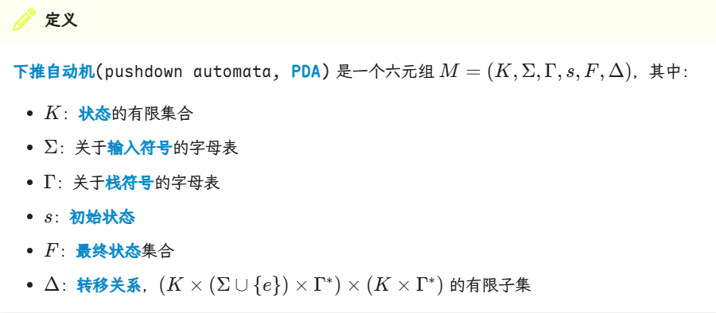

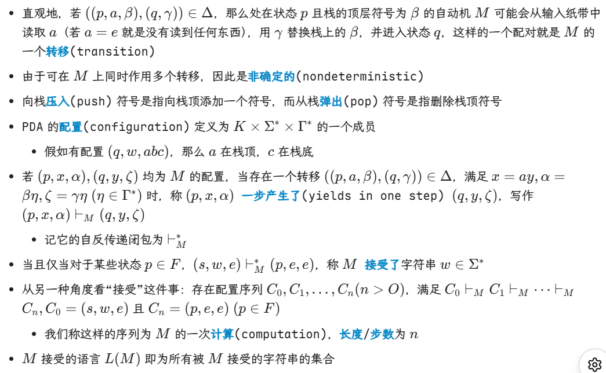
* 第二点，说的其实是读入一个符号，可能产生多种不同的下一配置
* “接收”：不仅要求状态处于终态，还要待读入字符串和栈都是空才行。
* 当PDA处于初始态时，它可以以不确定的方式决定下一步是保持状态并把next字母压栈，还是不消耗输入而切换到终态f


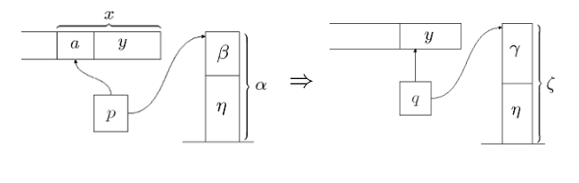



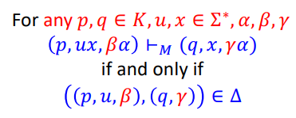
* 这里表示读入输入，替换栈顶。
* 注意，栈符号并不一定与输入符有关。只是在构造与CFG对应的PDA时会使用“把输入压栈”这种行为概念

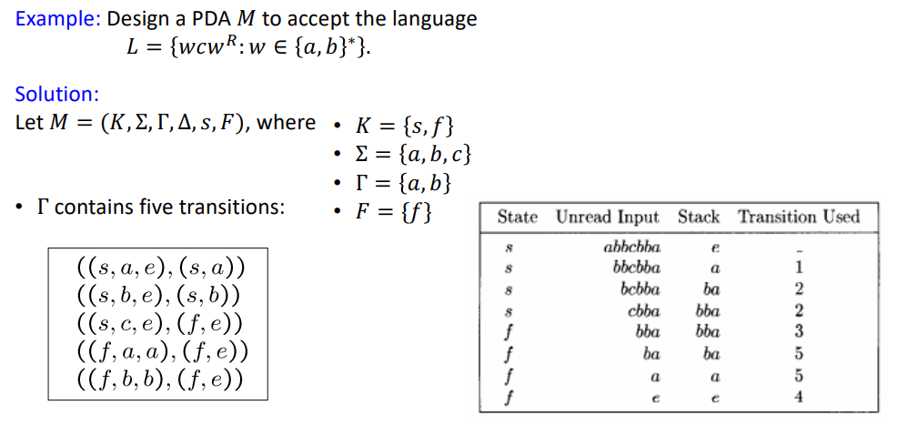
* 这里的栈行为就是模仿C语言那种，先移栈指针再压/弹栈。所以只是栈顶空了（弹出来了），不代表整个栈是空的



由于栈的LIFO性质，它其实只能匹配特定性质的语言。对于如
$$
\[
L=\{wcw:w\in\{a,b\}^*\}
\]
$$


这样的语言，它就识别不了了。同样的，我们也没法用有限语言写出它的CFG。若考虑如下CFG规则：

$$
\[
\boxed{S\rightarrow ScS}
\]
\[
S\rightarrow a\mid b\mid\epsilon
\]
$$

第一条规则其实相当于：

$$
\[
L(S)\cdot\{c\}\cdot L(S)
\]
$$

所以它并不对应wcw这样的语言。
可以总结出，PDA可识别语言的特定性质包括：
* 轴对称
* 前半和后半字符个数有一定的数量关系

# 4. PDA与CFL等价

>CFG是语言的生成器，PDA是语言的识别器

**定理：被PDA接受的语言类就是CFL**

两条引理：
1. 每个CFL都能被某些PDA所接受
2. 若某语言能被PDA接受，那么它是CFL

>见NoughtQ笔记

note：simple PDA，非终结符<q,A,p>

# 5. Language that Are and Aren't CF

## 5.1 CFL的封闭性

证明并、拼接、Kleene Star封闭，即写出他们对应的CFG即可。只需创建一个新的始态并分别做如下构造：（待补充）

例外：
* 交不封闭：找反例，用pumping Lemma，见后文
* 补不封闭：用德摩根定律，转换为证明交不封闭即可。

## 5.2 CFL与RL的交集

结论：一个CFL和一个RL的交集仍是CFL。

证明：
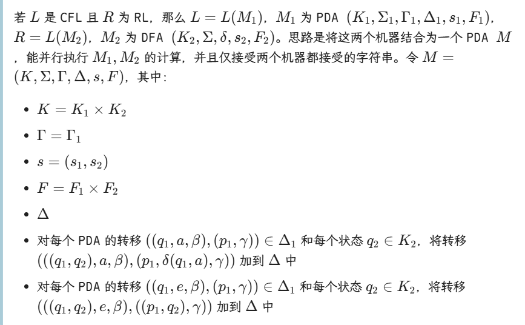
* 构造一个复合PDA，同时执行原PDA和DFA的功能。
* 只有复合终态的两个分量都是自动机的终态才接受
* 那么，这个自动机接受的就是同时被这俩接受的字符串，满足交的规则。

## 5.3 Pumping Theorem for CFL，泵定理

类比于RL的泵定理，也是证明CFL中足够长的字符串必然存在可以重复的部分。也是**必要不充分**条件。

设：$\[G=(V,\Sigma,R,S)\]$是一个 CFG。那么，存在一个长度界限 $N$，使得对于任意满足 $w\in L(G),\quad |w|>N$的字符串，都可以分解为：
$${w=uvxyz}$$
并满足两个条件：
* 条件一：$v,y$ 至少有一个不是空串。即
$$|vy|\geq 1$$

* 条件二：无论把 $\(v,y\)$ 同时重复多少次，得到的新字符串仍然属于这个语言。
$$uv^ixy^iz\in L(G),\quad \forall i\geq0$$

例如：
- i=0,uxz
- i=1,uvxyz
- i=2,uvvxyyz

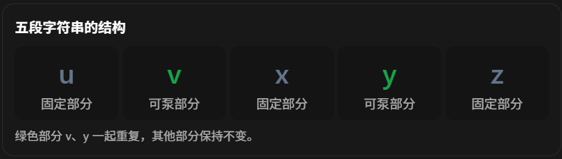

### 证明

我们从Parse Tree来理解泵定理：如果一棵树足够高，那么从根节点到叶子的一条路径上，一定会出现重复的非终结符。
* 因为Parse Tree的推导路径的中间节点都是非终结符，而叶子才是终结符。
* 若路径总长大于非终结符基数，则有鸽巢原理，必有重复
  * 这里我们选取的是最简Parse Tree，即不存在这样的推导: $B\Rightarrow^*vBy$，其中v和y都是e
* 那么，对于重复的同一个非终结符B，其展开可以重复任意多次（泵的过程）。
* 由于B所处位置不确定，因此泵的串头尾还有个u和z（这俩可以为e）

### 解答：树高和扇出的关系

上述证明中用到的“足够高”的高度是多少？这个定理可以解答。（跟计算多叉树的叶子数和树高的关系很类似）

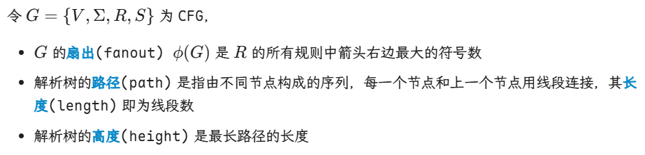
* 这个扇出也就是说一个非终结符一步最多能展开成多长

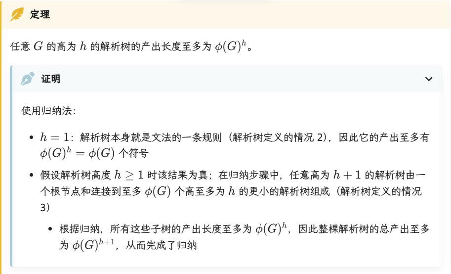
* 从而我们就得到了泵定理树高的下界：$N=\phi(G)^{|V-\Sigma|}$。也就是说，大于这个长度的CFL字符串必然满足泵定理的那两个条件（即可以写成uvxyz；v和y可以泵任意多次，仍属于当前这个CFL）

>注意，能找到写成uvxyz的办法就行。所以我们要尽量全面地分析所有可能的分解。

# 6. Algorithms for CFG

1. CFG 和 PDA 能不能互相转换？
2. 能不能把任意 CFG 转换成一种标准形式？
3. 给定一个 CFG 和字符串 w，能不能判断 w 是否属于这个 CFG 生成的语言？
其中最重要的是 Chomsky Normal Form（CNF，乔姆斯基范式） 和后面的字符串成员判定算法。

## 6.1 CNF,Chomsky Normal Form

将CFG的规则规范化：

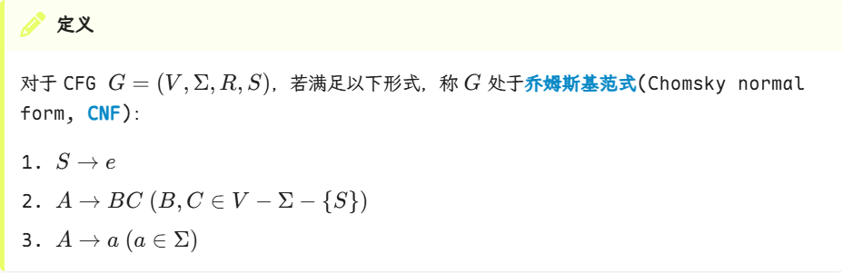

这样，Parse Tree就是一棵很规整的二叉树：（这对后面使用动态规划判断字符串是否能被 CFG 生成非常有用）
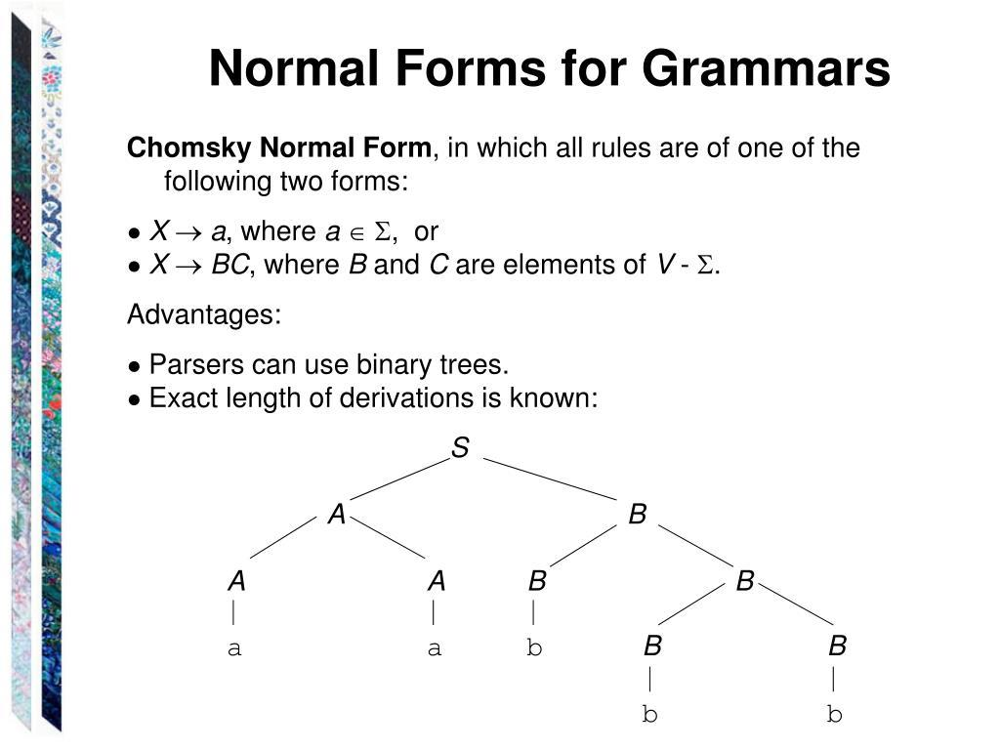

### 把CFG转化为CNF

把不符合 CNF 的产生式分成三类：
1. Long rules：右侧太长。
2. Empty rules：空产生式。
3. Short rules：单个非终结符产生式。

Solutions：
**长规则：引入新的非终结符来做中间态，逐步展开**

右边有n个符号的产生式，要拆成n-1个二元规则。那么，也就是对每条规则遍历一次右侧，复杂度为$O(n)$

**空规则：**
  - 通过任意步推导能得到e的都是可空非终结符
  - 然后通过以下规则删除空产生式：
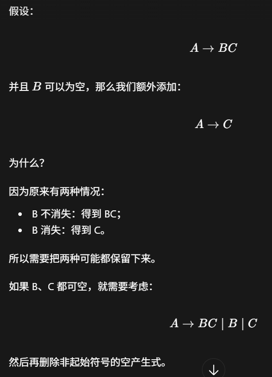

找集合：
```
E := emptyset

while there is a rule A -> alpha
      with alpha in E*
      and A not in E:

    add A to E
```

对每个符号遍历一次规则，复杂度约为$O(n^2)$

**短规则：**
  - 一个非终结符A->一个非终结符B 的规则称为“单元产生式”
  - 主要思想：把通过单元产生式能够到达的 Nonterminal 所拥有的“非单元产生式”，转移给前面的 Nonterminal

找A能通过任意多步单元推导得出的闭包：

```
D(A) := {A}
while there is a rule B -> C with B in D(A) and C not in D(A) do
    add C to D(A)
```

然后，对规则A->BC右侧后续可能有的单元推导B->D，C->E，把规则改成A->DE，然后删掉那两条单元推导。这样递归地做，最后得到A->XY，右边就清理干净了（不存在从X或Y出发的单元推导了）。

若一开始有一条S->A，那么需要删掉并添加一条S->XY（防止启动失败）。

上面找闭包那块的复杂度为$O(n^2)$。

**故做一次转换，总复杂度为O(n^2)**

结论：如果一个 CNF 生成的字符串长度为n，且 n>=1 ，那么它恰好需要2n-1步推导
- 直接数叶子个数为n的满二叉树的内部结点数即可。

### 判断一个字符串是否属于CFG

使用动态规划的方法。