# 0. 本章目标

# 1. 基本概念

功能：
* 位置：
  * 是连接计算机的具体物理设备吗？——包含但不全是
  * 是负责信号传输的具体物理媒体吗？——同上
* 功能：如何在连接各计算机的传输媒体上**传输数据比特流**
  * 数据链路层将数据比特流传送给物理层
  * 物理层将比特流按照传输媒体的需要进行编码
  * 然后将信号通过传输媒体传输到下一个节点的物理层
* 作用：尽可能屏蔽掉不同传输媒体和通信手段的差异——提供一个统一的服务给数据链路层

传输媒体：
* 导引型传输媒体（双绞线、光纤）
* 非导引型传输媒体（微波通信）

物理层协议的主要任务：规定DTE/DCE接口的特性。
* DTE，数据终端设备
* DCE，数据电路终结设备：


* **机械特性：** 接口的物理结构
  * 形状和尺寸
  * 引脚数目和排列
  * 固定和锁定装置
* **电气特性：**
  * 指明在接口电缆的各条线上的电路特性、负载要求、传输速率、连接距离等
* **功能特性：**
  * 描述接口执行的功能、每一引脚的作用
  * 指明某条线上出现某电平的电压表示何种含义
  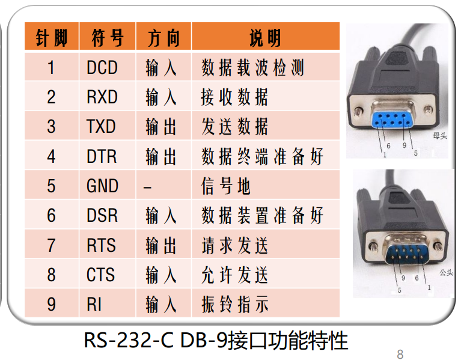
* **过程特性：** 规定在信号线上传输比特流的一组操作过程，包括各信号间的时序关系
  * 即，指明对于不同功能的各种可能事件的出现顺序


# 2. 数据通信基础

主要内容：研究信号在通信信道上传输时的数学表示及其所受到的限制

傅里叶分析：
* 在网络通信中，信息是以电磁信号（或简称信号）的形式传输的
* 电磁信号是时间的函数（时域观）
* 也可以表示成频率的函数（频域观）
* 对于理解数据传输来讲，信号的频域观比时域观更重要。
  * 因为信号在网线里传输时，网线对不同的频率的“阻碍”是不一样的（有的高频信号传着传着就衰减没了）。所以，研究信号包含哪些频率成分，比单纯看它随时间怎么变，更能帮我们理解数据传输的限制。

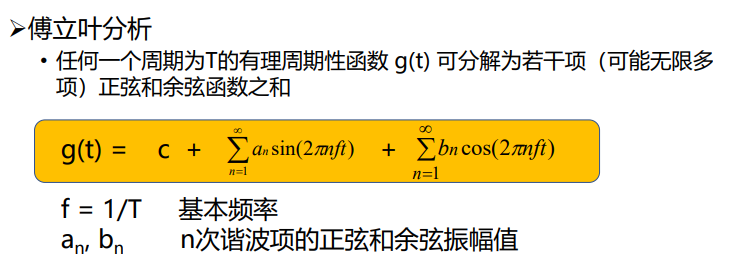
* 任何波都可以拆成一个直流分量（常数c）和一堆正弦波、余弦波
* 基本频率：g(t)的频率
* 谐波：频率为基本频率的整数倍的那些波

频谱：一个信号所包含的频率范围带
绝对带宽：信号频谱的宽度
有效带宽：信号的主要能量集中在相对窄的频带内，这就是有效带宽

有限带宽信号：
* 传输时信道对不同傅里叶分量的衰减不同，引起输出失真
* 截止频率f_c：0~f_c的振幅衰减较弱，f_c以上衰减较大
* 通过信道的谐波次数越多，拟合越好

波特率(baud)和比特率(bit)的关系
* 波特率：每秒钟信号变化的次数，也称调制速率
* 比特率：每秒传送的bit数
* 关系：取决于信号值用多少位bit来表示。若一个信号为0001，则比特率是波特率的4倍

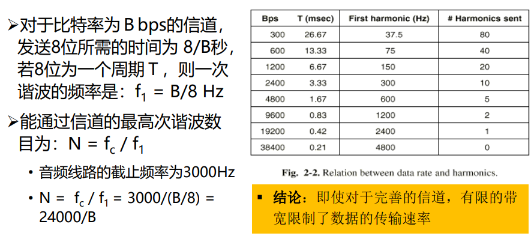

* 低次谐波决定了波的大致形状
* 高次谐波用来完善细节（如刻画数字信号的直角转角）

## 信道的极限容量

### 课堂给出

#### 奈奎斯特

信道的最大数据传输速率——奈奎斯特定理（无噪声）
* 最大数据传输率=$2H\log_2 V(bps)$
* 任意信号通过一个带宽为Ｈ的低通滤波器，则每秒采样2H次就能完整地重现该信号，信号电平分为V级

#### 香农

信息量：一条消息包含信息的多少称为信息量
* 信息量的大小与消息所描述事件的出现概率有关
* 信息量I与概率p的关系：$I=\log_a \frac{1}{p}$
  * a表示进制：a=2时I的单位是bit，a=e时I的单位是奈特
  * 信息量也就是不确定度。见下方例题：
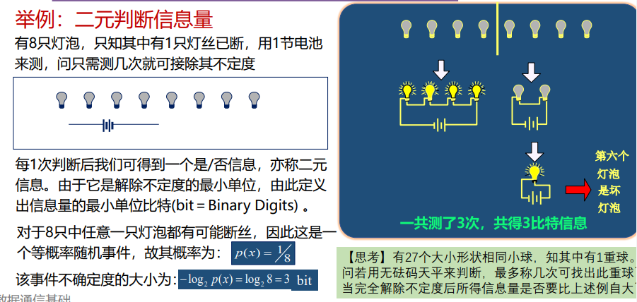

### 课外补充

* 码间串扰：码元之间失去清晰界限

**奈奎斯特定理(Nyquist)：**在假定的理想条件下，为避免码间串扰，码元传输速率是有上限的
* 理想低通信道的最高码元传输速率 = 2W Baud = 2W 码元 / 秒
* 理想带通信道的最高码元传输速率 = W Baud
* W：信道的频率带宽（单位为 Hz）
* Baud：波特，即码元 / 秒

>码元传输速率又称为波特率、调制速率等。

实际的信道所能传输的最高码元传输速率，要明显低于奈奎斯特定理给出的上限值。因为奈是理想情况

**香农公式：**带宽受限且有高斯白噪声干扰的信道的极限信息传输速率

在信道的频率带宽W一定的情况下，根据奈奎斯特定理和香农公式，要想提高信息的传输速率，就必须采用多元制（更复杂的调制技术），并努力提高信道中的信噪比。

只需关心某种调制技术能调制出多少个不同的码元即可。

计算时别忘了：不同的码元数量为X，则一个码元能携带的bit数量为$log_2X$

# 3. 传输方式

传输方式：
* 串行和并行
* 点到点和点到多点
* 同步和异步
* 单工、半双工、全双工

## 3.1 串行和并行

* 注意远距离传输是串行
* 串行需要并/串转换和串/并转换？？

## 3.2 点到点和点到多点

二者的连接方式不同，取决于具体需要
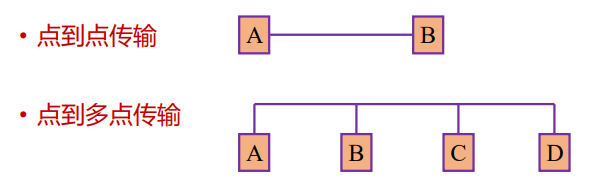

## 3.3 同步和异步

**同步传输：**

字节之间没有间隔，是挨在一起的

如果双方时钟频率存在微小差别，这种累计误差会导致后来接收方采样直接采到相邻bit上

时钟同步方法：
* 外同步：在收发双方之间增加一条时钟信号线
* 内同步：发送端将时钟信号编码到发送数据中一起发送（例如曼彻斯特编码）

**异步传输：**

异步指的是字节之间的时间间隔不固定
但字节中的每个bit仍要同步

## 3.4 单工、半双工和全双工

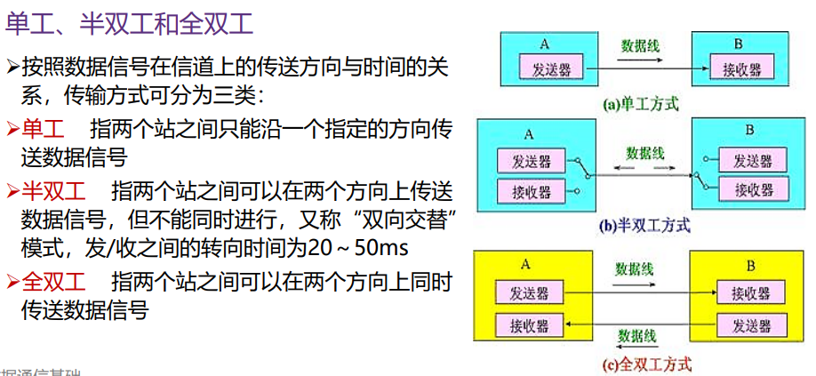

## 3.5 基带传输和频带传输

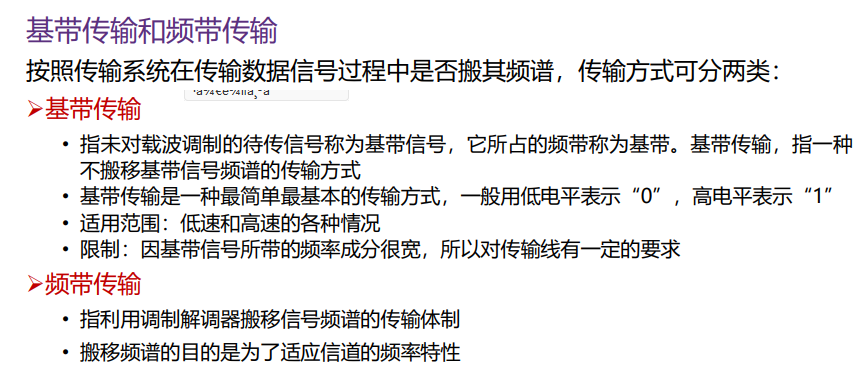

# 4. 编码与调制

数据通信系统模型
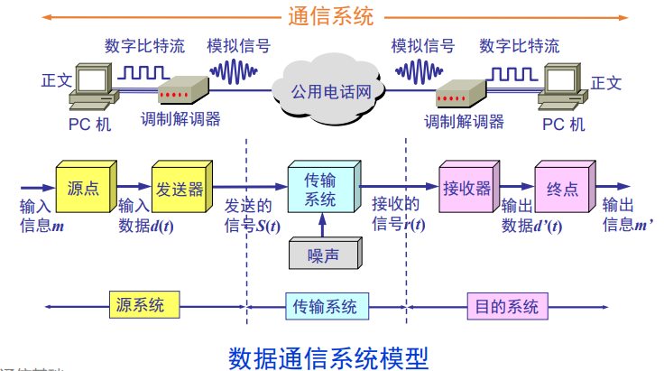

把运送消息的实体(text等)转为比特信号

* 编码：在不改变信号性质的前提下，对波形进行变换
* 调制：把数字基带信号搬到较高频段，产生模拟信号

数字数据-->模拟信号：
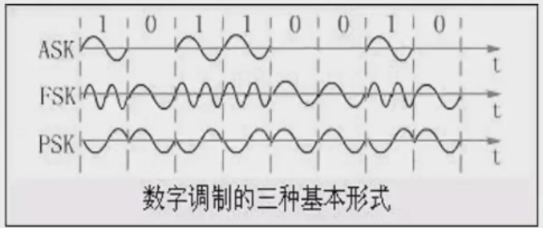
* ASK，调幅
* FSK，调频
* PSK，调相

模拟数据-->数字信号：
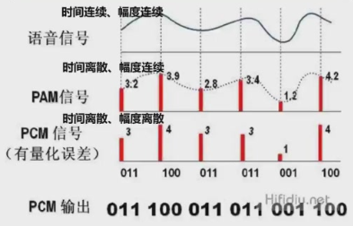
* PAM和PCM？？

码元：在使用时间域的波形表示信号时，**代表不同离散数值的基本波形。**

## 常用编码

**不归零编码(NRZ,not return to zero)：** 存在如何分辨一个长时间电平是几个码元的问题，即时钟频率同步问题，如图
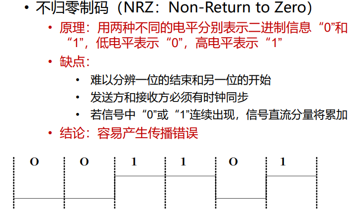
  * 直流分量将累加是何意味？？

**归零编码：** 每个码元传输结束后都要归零（归到零电平），因此接收方在归零后采样即可。
  * 缺点：浪费资源给零电平了

**曼彻斯特编码：**

* 码元中间时刻的电平跳变既表示时钟信号（用于同步），也表示数据
* 正跳变表示 1 还是 0，负跳变表示 0 还是 1，可以自行定义
* 问题：带宽开销增大了一倍（两个码元（也就是两个电平）表示一比特数据，因此比特率只有波特率的一半）

**差分曼彻斯特编码：**

* 码元中间时刻的电平跳变仅表示时钟信号，而不表示数据
* 数据的表示在于每一个码元开始处是否有电平跳变：无跳变表示 1，有跳变表示 0
* 优点：
  * 在传输大量连续 1 或连续 0 的情况下，差分曼彻斯特编码信号比曼彻斯特编码信号的变化少
  * 在噪声干扰环境下，检测有无跳变比检测跳变方向更不容易出错，因此差分曼彻斯特编码信号比曼彻斯特编码信号更易于检测
  * 在传输介质接线错误导致高低电平翻转的情况下，差分曼彻斯特编码仍然有效

**反向不归零NRZI：** 在每位开始时，逢1跳变，逢0不变（无时钟同步信息）

**4B/5B编码：** 把4位原始数据bit映射成5位，保证线路上有足够多的跳变，方便同步时钟
  * 5bit中至少有2个1
  * 禁止连续的3个0
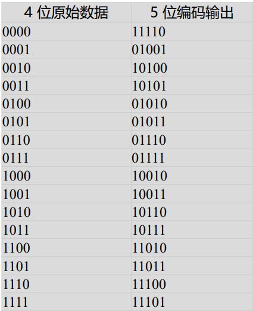

## 频带传输

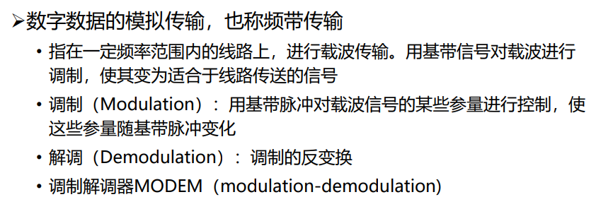

### 基本调制方法

基本调制方法包括：调幅ASK，调频FSK，调相PSK

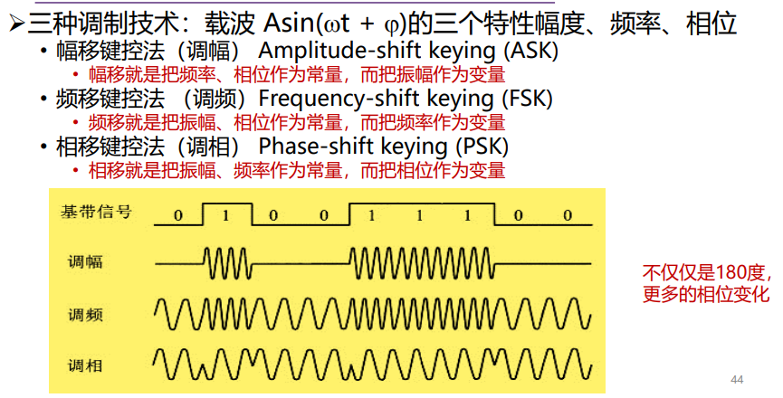

使用基本调制方法，一个码元只能包含一个bit，因此我们引入混合调制方法：**正交振幅调制QAM**（振幅与相位联合调制）

QAM16：16种码元

* 从而一个码元可以表示4bit
* 如何安排各码元对应的bit信息？--使用格雷码

* 任意两个相邻码元只有一位不同。这样可以减少解调错误时错误的位数

# 5. 性能度量

带宽：在通信领域是频带的宽度。（在计算机中才是数据传输能力）
* 数据信号保密性、抗干扰性好，但占用较多带宽，信道利用率低

模拟信道容量：用香农定律
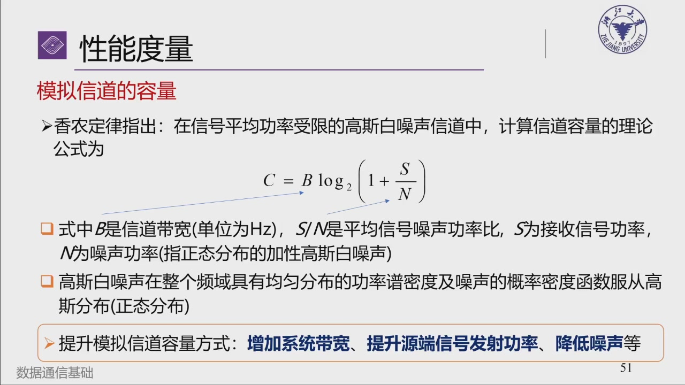

数字信道容量：奈奎斯特定律
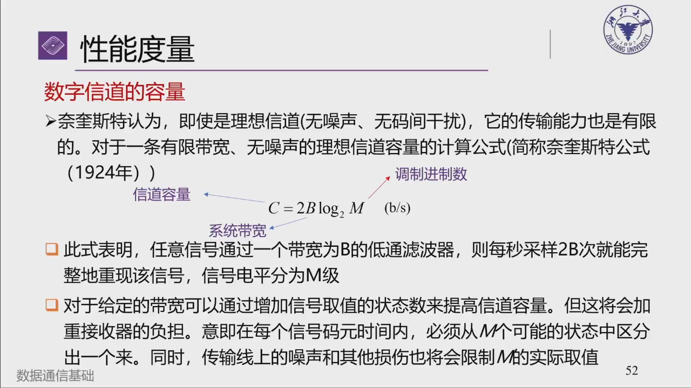

传输速率：单位时间内传输的信息量
* 数据信号速率（比特率）
* 调制速率（波特率）

频带利用率：波特率（或比特率）与带宽之比

信噪比SNR：信道上某一点的信号功率$P_s$和噪声功率$P_N$之比(一般用对数表示)
* 谁是信号/噪声，要看分析的用户。（信号并不是指全部有信息的东西）

平均误码率：单位是界内接收到的出错码元数占比

# 6. 传输介质

导引型和非导引型两类

>详细信息见PPT，懒得截图了

导引型：
* 双绞线
* 同轴电缆
* 光纤
* 电力载波

非导引型：

1. 短波传输（无线电波）：主要利用电离层的F层反射。由于阳光的影响，一般短波设计为夜间频率低于白天频率
  * 多径传播：短波通过若干条路径/不同传播模式，路径长度不同而引起的收信时间不同的现象
  * 多径时散：不同路径的时延差
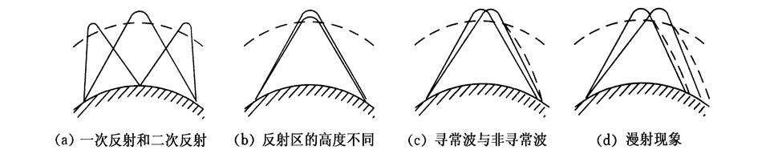
  * 衰落：指在短波传输过程中，收信电平出现忽高忽低随机变化的现象
2. 散射传输（无线电波）：利用大气层中传输媒体的不均匀性对无线电波的散射作用进行的通信
3. 微波通信
4. 光波传输
   1. 光源特性的不同——激光/非激光通信
   2. 传输媒体的不同——大气激光/光纤通信
   3. 传输波段的不同——可见光/红外线/紫外线通信

# 7. 无线与卫星通信

>见PPT

# 8. 多路复用技术

>此处简要讲解。ch3也还会回顾一下

复用技术：允许用户使用共享信道进行通信，同时避免相互干扰，以提高信道利用率

需要解决的问题：寻址+保密（也就是隔离）

## FDM，频分复用

Frequency-Division Multiplexing

将多路基带信号调制到不同频率载波上，再叠加成复合信号

所有用户在同样的时间内占用不同的带宽资源（指的是频率带宽）

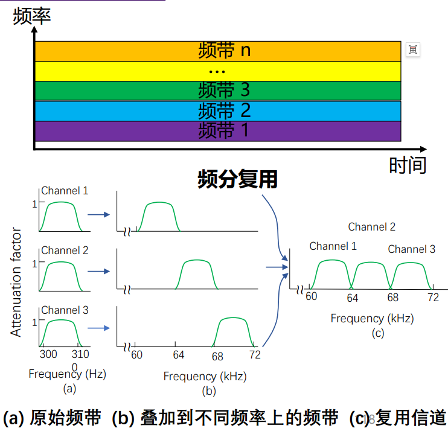

## TDM，时分复用

Time Division Multiplexing

将时间划分为一段段等长的时分复用帧（TDM帧），每个用户在一个TDM帧中占用特定序号的时隙

TDM信号也称为等时信号。

所有用户在不同时间占用相同的频带宽度

**TDM的drawback**：由于计算机数据的突发性（不均匀性），子信道的利用率一般不高（无数据发送时，该时隙内整个信道都空闲，见下图）

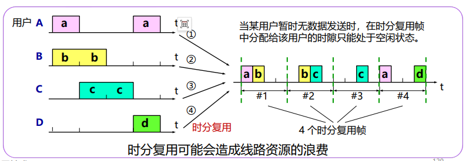

### STDM，统计时分复用

Statistical Time Division Multiplexing

分析业务特征后，动态地按需分配时隙。也就是说STDM帧内的时隙数不固定

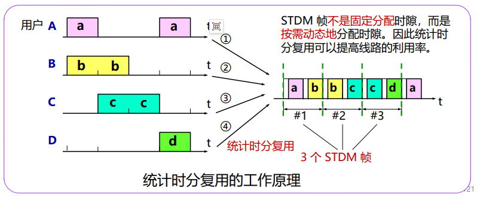

第三帧并不直接对应t=3那里，最后a和d可以先进缓存再按调度顺序发送

## WDM，波分复用

Wavelength Division Multiplexing

利用多个激光器在一条光纤上同时发送不同波长激光的技术（其实就是光波的频分复用，因为光的频率和波长相关）

## CDMA，码分多址

Code Division Multiple Access

利用不同的地址码来区分发送站地址。码片相互正交

一个bit时间发送一个m bit的码片。发送码片本身表示发送bit 1，发送反码表示发送bit 0

收到一串码片B，要判断其是否为站点A发送、发送了什么值，就拿B和A做内积。
* 内积结果为1表示A发送了1；
* 为-1表示A发送了0；
* 为0表示A没有发送

>详细的可见ch3

最终收到的码片序列是大家发送的东西按位加，见下图

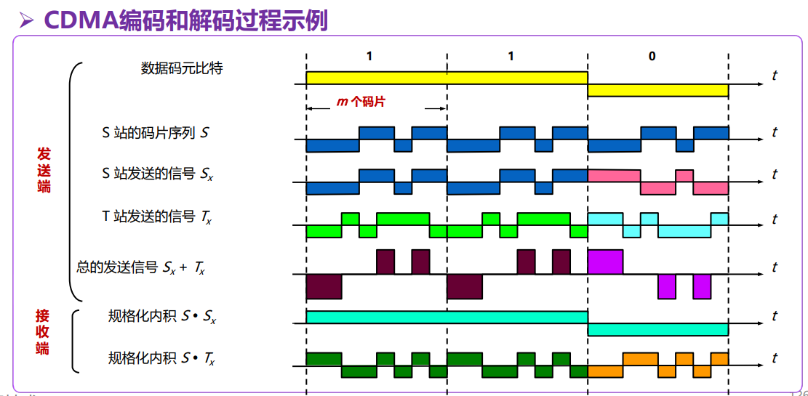