# 1. 概述

PPT目录：
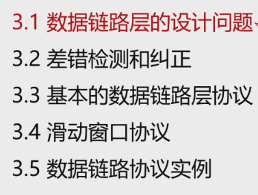

* 链路(link)：一个结点到相邻结点的物理线路，中间没有交换结点
* 数据链路(data link)：把实现通信协议的硬件和软件加到链路上，就构成了数据链路
* 本层以帧(frame)为单位传输和处理数据

本层的功能：逻辑链路控制LLC和介质访问控制MAC
* 向下：利用物理层提供的bit flow服务
* 向上：向网络层提供well-defined的服务接口

## 1.1 本层功能

### 封装成帧

数据链路层为上层交付下来的 PDU 添加帧首部和帧尾部，使之成为帧。

### 差错控制

* 帧在传输的过程中可能出现误码
* 发送方在发送之前基于待发data和检错算法计算出检错码，并封装在帧尾
* 接收方根据**检错码**检测出帧是否出现了误码

接收方收到有误码的帧后会直接丢弃。之后会分两种处理方式：
* 不可靠传输服务：仅仅丢弃有误码的帧，其他什么也不做
* 可靠传输服务：实现发送方发送什么，接收方最终都能正确收到

以上是点对点的传输中的问题。如果是广播信道，还会涉及到：
* 编址的问题（即辨识源和目标主机）
* 碰撞检测

### 流量控制

确保发送方的发送速率不大于接收方的处理速率——避免接收缓冲区溢出。

## 1.2 本层提供的服务

* 无确认无连接服务：接收方不回馈ACK信号
  * 适用于误码率低的可靠信道；实时通信
* 有确认无连接服务：每一帧都要单独确认
  * 适用于不可靠信道
* 有确认有连接服务：要事先建立一条独占的通信连接，再进行可靠传输
  * 适用于长延迟的不可靠信道

# 2. 封装成帧

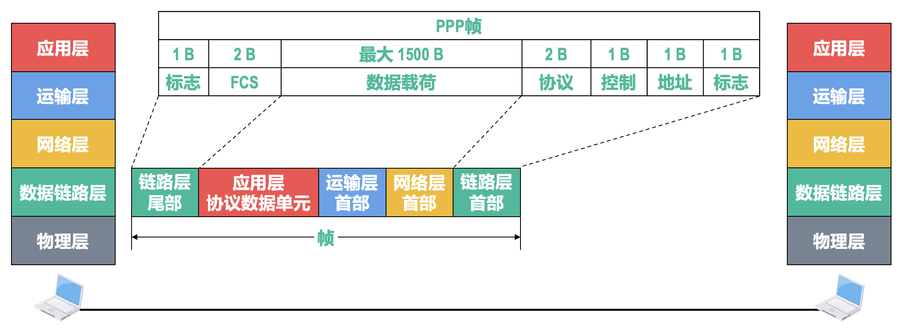

* 帧头帧尾的作用：帧定界
  * 接收方通过此标志从比特流中提取一个个的帧

关键：接收方能从比特流中明确区分出一帧的开始和结束。这个问题被称为**帧同步/帧定界**。

成帧方式：
1. 字节计数法
2. 带字节填充的定界符法
3. 带比特填充的定界符法
4. 物理层编码违例

## 2.1 字节计数法

第一个字节用来标识本帧长度。无差错传输的情况如下：

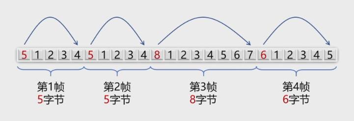

由于是连续传输，会有差错累积的情况，前面的定界错了后面会全错。

> 特例：以太网V2的MAC帧
> * 它在数据链路层不加入定界标志，而是在物理层加入前导码
> * 并且规定帧间间隔为96bit时间
> * 也就是用前导码和后time interval作为定界

## 2.2 字节/比特填充的定界符法

**透明传输**：使数据链路层对上层交付的 PDU 的内容没有任何限制，就好像数据链路层不存在一样
* 如果上层的内容中包含帧定界标志，接收方就无法正确接收该帧了，怎么办？
  * 解决方式：链路层对数据进行扫描，在内含的定界标志前插入转义字符，将其作为数据而非标志
  * 若数据中既有定界符又有转义符，也是一样的做法——在转义符前也插入转义符即可

不同的填充方式：
* 面向字节的物理链路使用字节填充（或称字符填充）
* 面向bit的物理链路使用比特填充
  * 使用零比特填充法


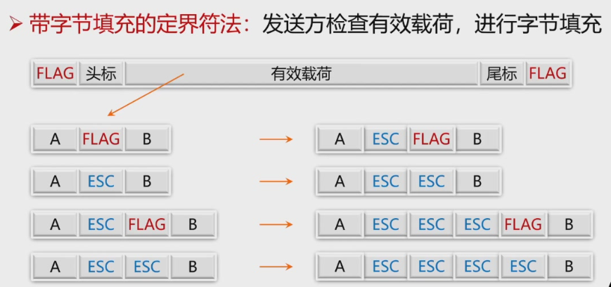

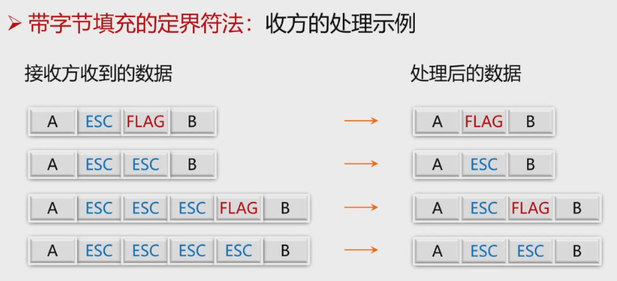

* 由于需要以Byte为单位处理，收齐8bit后一次性比对，对硬件不是特别友好，需要一个buffer



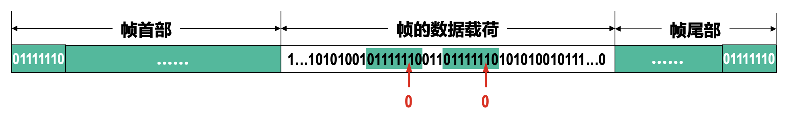
* 发送方的处理：对帧的数据载荷进行扫描（一般由硬件完成），每出现 5 个连续的比特 1，则在其后填充一个比特 0
* 接收方的处理：对帧的数据载荷进行扫描，每出现 5 个连续的比特 1 时，就把其后的一个比特 0 删除


**为了提高传输帧的效率，应当使帧的数据载荷的长度尽可能地大于首部和尾部的长度。**

考虑到对缓存空间的需求以及差错控制等诸多因素，每一种数据链路层协议都规定了帧的数据载荷的长度上限，即**最大传送单元（maximum transfer unit，MTU）**。

## 2.3 物理层编码违例

idea：选定的定界符不允许在数据中出现。

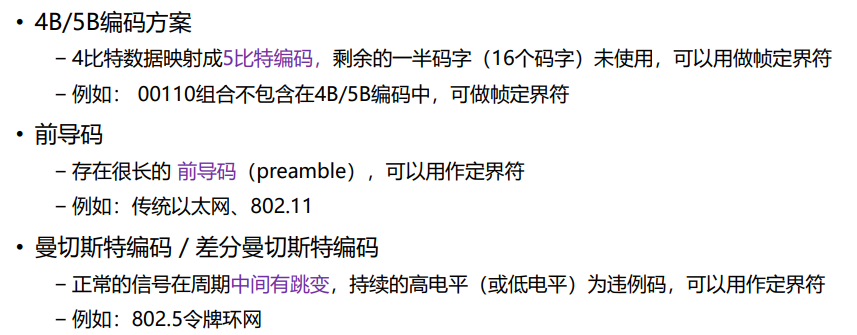

# 3. 差错检测

* 在一段时间内，传输错误的比特数量占所传输比特总数的比率称为**误码率（bit error rate，BER）**
* 使用差错检测码检查是否有误码



通常采用增加冗余信息（校验信息）的策略。但我们希望能减少所需的冗余信息量。需要考虑以下问题：信道特征及传输需求、冗余信息的计算方法、计算的复杂度。

两种主要策略：
* 检错码：只能使接收方知道是否发生错误，但不知道具体的错误。可以请求重传
  * 主要用在高可靠的信道上，如光纤
* 纠错码：使接收方能判断具体错误位置并纠正
  * 常用于无线链路（可靠性低，错误频繁）
  * 使用纠错码的技术称为前向纠错（FEC，Forward Error Correction）





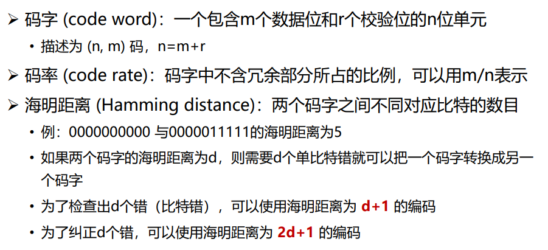

* 检查出d个错：因为错误范围为d没有合法编码
* 纠正d个错：使得相邻码字的d纠错范围不重叠，海明距离应为2d+1

例子：
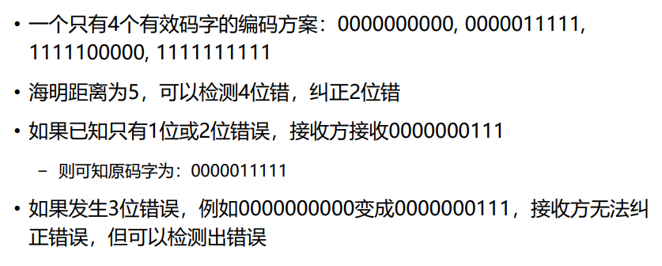


## 3.1 奇偶校验

* 奇校验是在待发送的数据后面添加 1 个校验位，使得添加该校验位后的整个数据中**比特 1 的个数为奇数**
* 偶校验是在待发送的数据后面添加 1 个校验位，使得添加该校验位后的整个数据中**比特 1 的个数为偶数**

若产生两位误码，奇偶性不变，也会检验不出来，称为漏检。

二维奇偶校验：行和列都设置校验位。也会出现漏检的情况。

这种方法只能检错不能纠。

## 3.2 校验和

【考点】

TCP/IP体系中主要的校验方法。

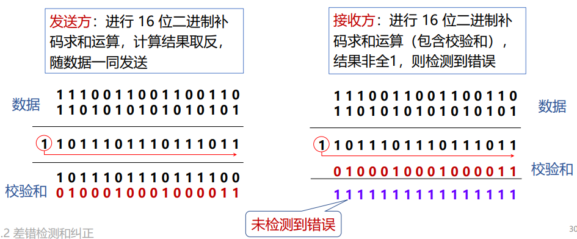

## 3.3 循环冗余校验CRC（Cyclic Redundancy Check）

> 数据链路层广泛使用这一漏检率极低的技术，因为虽然计算比较复杂，但非常易于用硬件实现

* 收发双方约定好一个生成多项式 $G(x)$
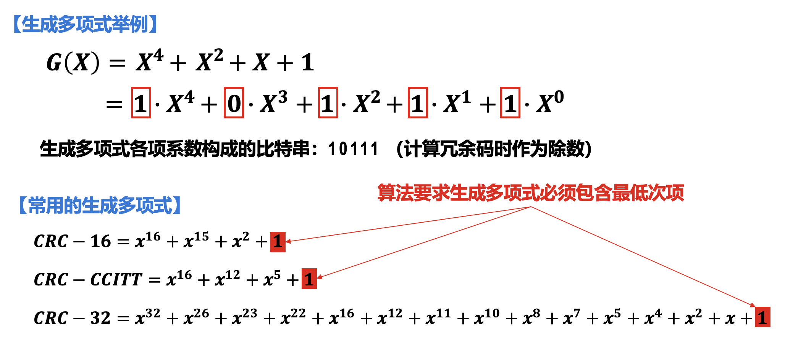

* 发送方基于待发数据和 $G(x)$ 计算出差错检测码（冗余码，长度为生成多项式的最高次数），将冗余码添加到待发送数据的**后面（低位）**一起传输
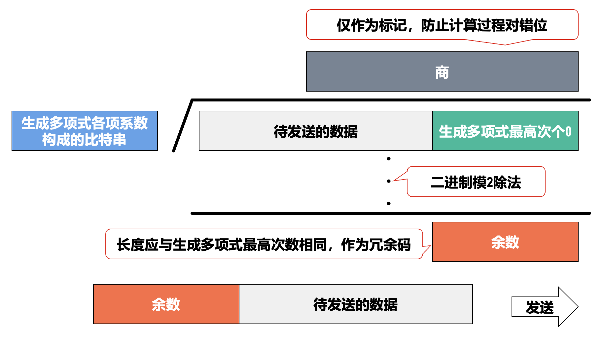

* 接收方收到数据和冗余码后，也做除法：
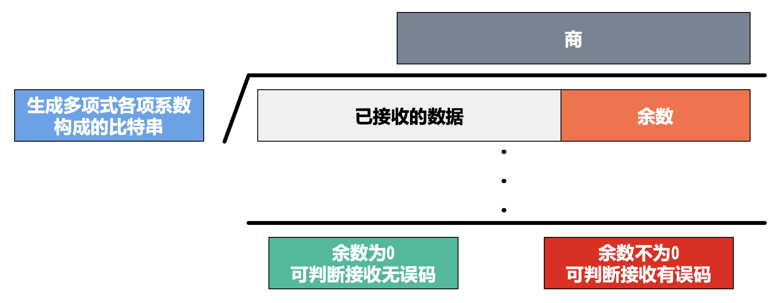
  * 构造被除数：接收到的信息作为被除数
  * 构造除数：生成多项式各项系数构成的比特串作为除数
  * 检查余数：余数为 0，可认为传输过程无误码；余数不为 0，可认为传输过程产生了误码

注意，CRC中用的是mod2多项式除法（不是普通除法），加减法规则如下：
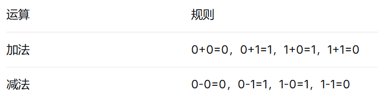
恰好是异或的规则。
mod2除法够不够除：看被除数当前最高位是不是1，是1就够除。

一些tips：
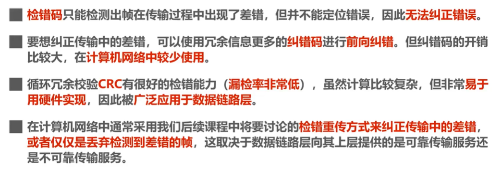

# 4. 流量控制

方案：
* 基于反馈：接收方反馈，发送方调整发送速率
* 基于速率：发送方根据内建机制，自行限速

# 5. 可靠传输

## 5.1 概述

* 一般情况下，有线链路的误码率比较低，因此为了减小开销，并不要求数据链路层向其上层提供可靠传输服务；即使出现了误码，可靠传输的问题由其上层处理
* 无线链路易受干扰，误码率比较高，因此要求数据链路层必须向其上层提供可靠传输服务

传输差错（后三种情况出现在数据链路层本层，而不会出现在其上层）：
* 误码（比特差错）：前面刚介绍过
* 分组丢失：输入队列快满了，主动丢弃收到的分组
* 分组失序：分组到达顺序与发送顺序不同
* 分组重复：路由器繁忙，分组在输入队列中滞留，导致发送端超时重发，最终接收端收到多个相同分组

可靠传输不仅局限于数据链路层，其他各层均可选择用来实现可靠传输，见下例：

可靠传输的实现比较复杂，开销比较大，是否使用可靠传输取决于应用需求。

> 实现可靠传输的三个机制：
> * 确认：接收方校验并发送ACK应答
> * 定时器：发送方启动定时器，超时重传，防止丢失
> * 顺序号：接收方检查序号，防止乱序/重复

## 5.2 协议模型：定义与假设



大致的架构：

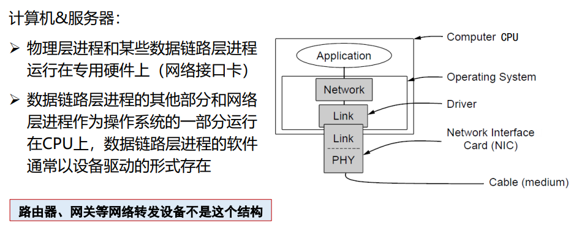

关键假设：为了简化对通信协议的分析，进行以下假设

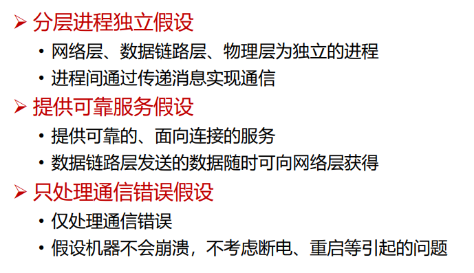



接口定义：

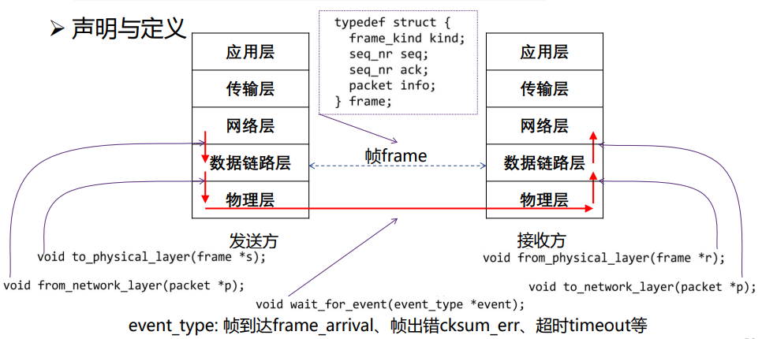

> control plane 禁止使用指针操作；forward plane 读写开销大，故使用指针操作

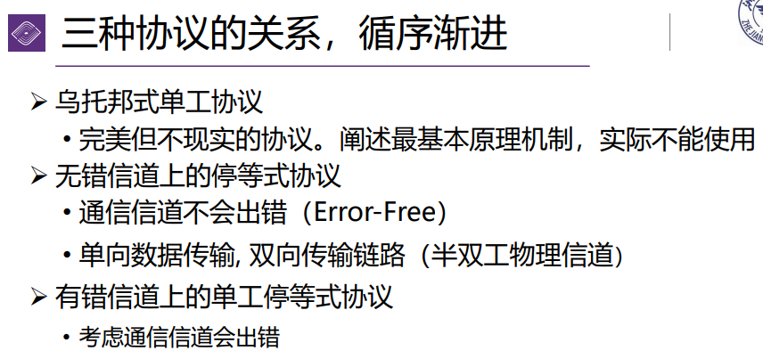

## 5.3 乌托邦式单工协议

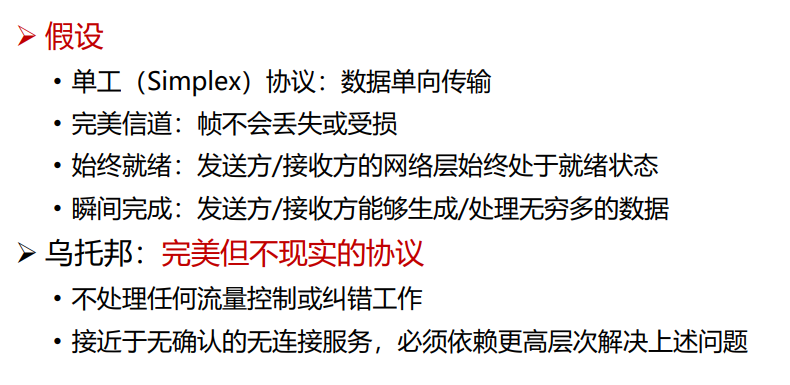

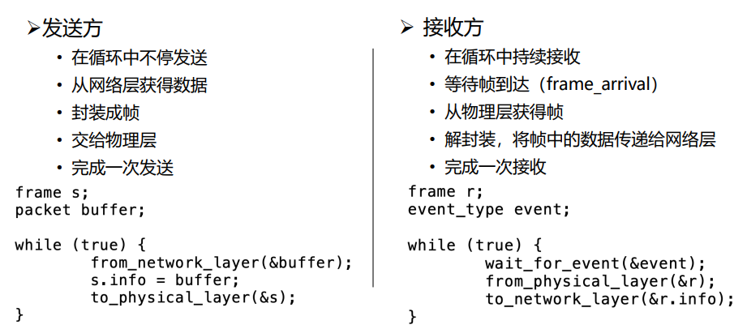

## 5.4 停等协议SW（stop-and-wait）

**无错信道上的停等协议：**
* 此时认为发送方是能以高于接收方处理的速度发送帧，但仍假设通信信道不出错
* 数据传输（同一时刻内）只能单向，但链路是双向的（为了确认）

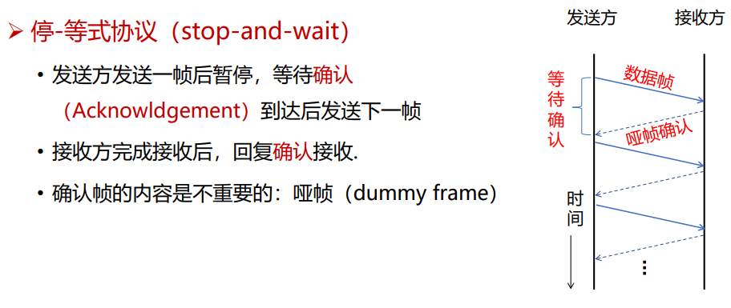

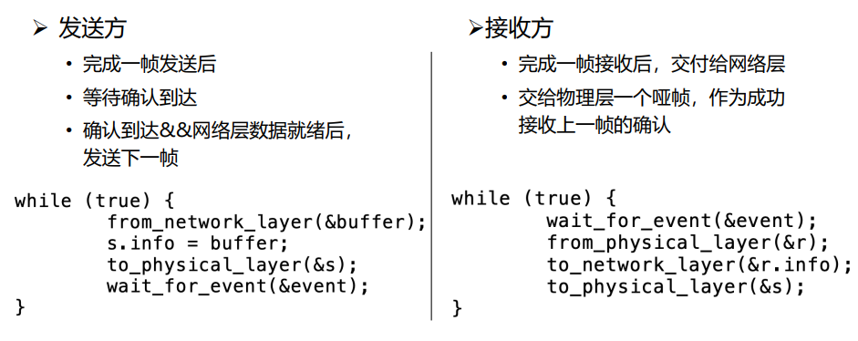

**有错信道上的停等协议：**
* 假设信道可能出错，导致数据包差错/丢失
* 给发送方增加一个计时器，超时重传


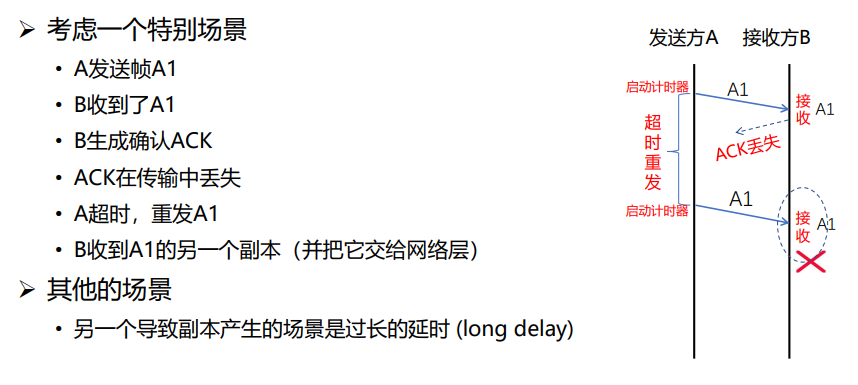
* 若接收方不能分辨包的新旧，就会重复接收
* 因此我们给包添一个序号SEQ。注意到我们只需要辨别相邻的包，可以只用一个bit来标记。这样冗余信息量最小

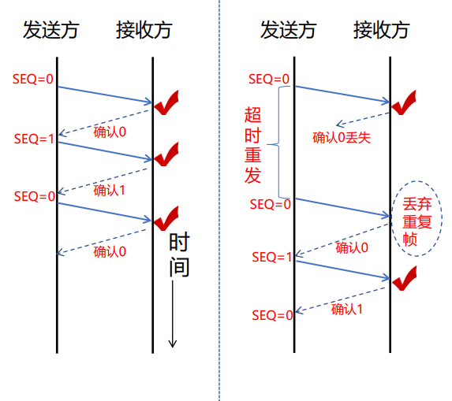


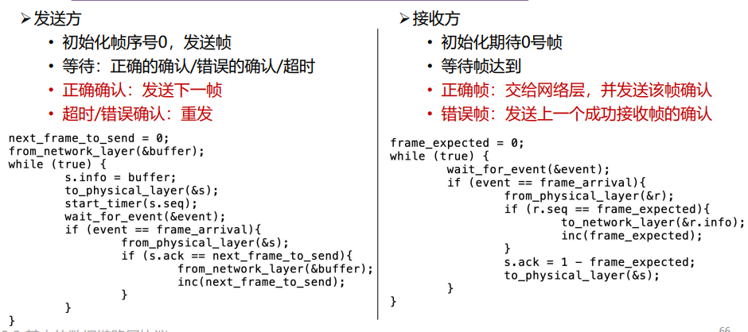

**停等协议的错误情况（网课补充）：**
* 基于互联网，而非点对点
* 下图依次展示了：**发送误码、发送丢失、确认分组丢失、确认分组迟到**的情况
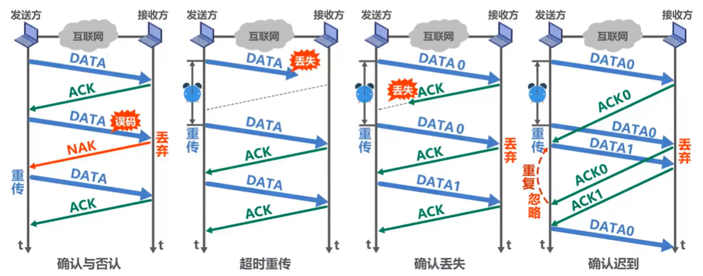
* 发送方需等到收到接收方的ACK信号后，才能将已确认的分组从缓存中删除
* 对于数据链路层的点对点信道，往返时间比较固定，不会出现情况4
* 编号：由于停等特性，我们只需要区别开相邻的两个分组，所以编号只用0和1

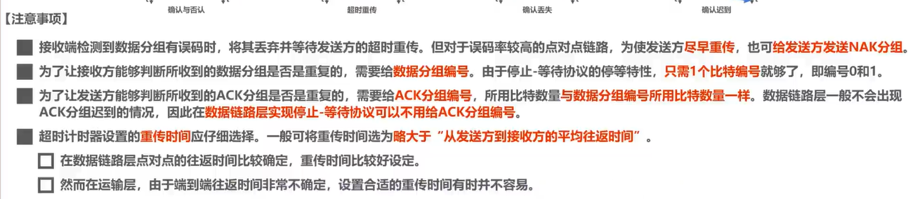

**信道利用率分析：**
* 利用率 = 实际发送数据量 / 此时间内最大可发数据量
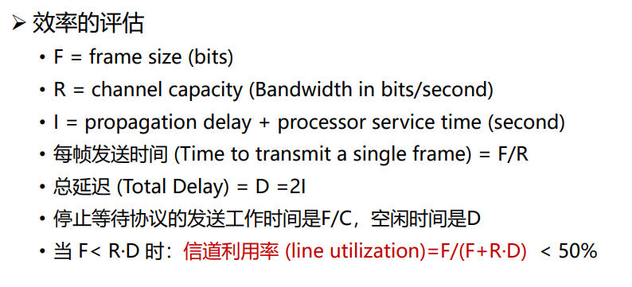

$T_D$ 是发送时延，RTT 是往返用时，$T_A$ 是确认分组的发送时延，一般远小于 $T_D$，可忽略
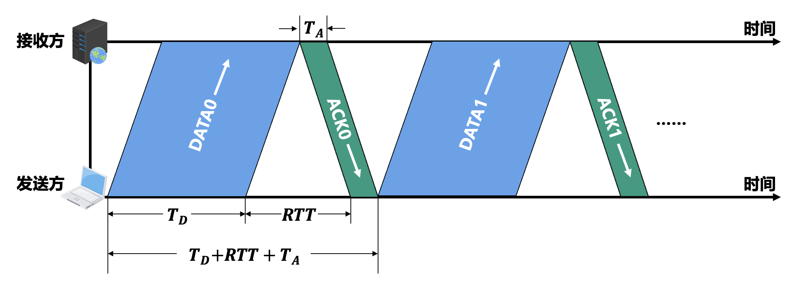

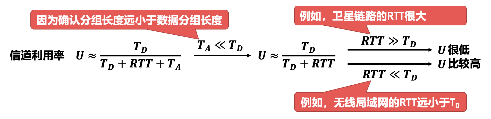

* 长肥网络（LFN，long fat network）：发送时延很长的那种网络，如卫星链路
* 为了提高信道利用率，我们可以使用更大的frame，但这样出错的概率也更大，导致更多的重传，所以也不是越大越好

> 为克服SW信道利用率低的问题，催生了后续的滑动窗口协议。

## 5.5 滑动窗口协议

窗口机制：发送方和接收方都有缓冲区（窗口），发送方在收到确认前可以连续发送多个帧

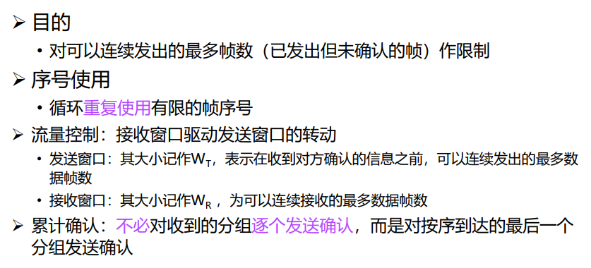

### 回退N帧协议GBN（go-back-N）

> 采用流水线式传输

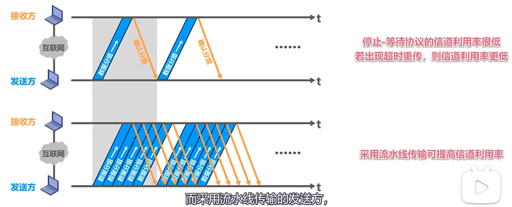

但不能无限制地连续发送，否则可能导致丢包。回退N帧协议就是在流水线式发送的基础上，利用**发送窗口**来限制发送方连续发送数据分组的数量，是一种**连续ARQ协议**。

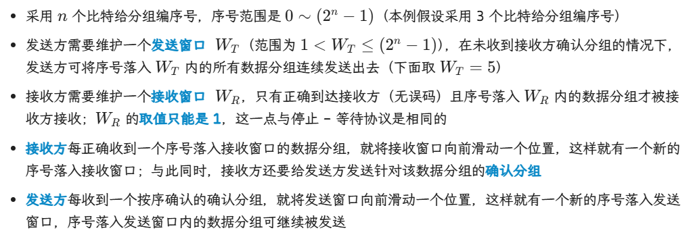

**无差错情况：**
发送方的发送窗口和接收方的接收窗口按上述规则不断向前滑动（因此该类协议又称为滑动窗口协议）。

**累积确认：**
* 接收方不必对收到的每一个数据分组都发送一个确认分组，而是可以在收到几个序号连续的数据分组后，对按序到达的最后一个数据分组发送确认分组
* 接收方何时发送累积确认分组，由具体实现决定
* 确认分组 ACKn 表明序号为 n 及之前的所有数据分组都已正确接收
* **优点：** 即使确认分组丢失，也可能不必重传数据分组
* **缺点：** 不能向发送方及时准确地反映出接收方已正确接收的所有数据分组的数量

**有差错情况：**
* 若56701分组依次到达接收窗口（此时位于序号5），而5号分组有误码，那么这一堆会全被丢弃
* 接收方会连续发送ACK4，个数为丢弃的包数
* 发送方重传56701，这就是"回退N帧"的含义
  * 讲得严谨一点：发送窗口内某个已发送的分组产生超时重传，其后续在发送窗口内且已发送的数据分组也必须全部重传

若发送窗口 $W_T > 2^n - 1$，则会导致接收方无法分辨新旧分组，造成分组重复。

当通信线路质量不好时，总是需要大批量重传，信道利用率并不比SW好到哪去。

### 选择重传协议SR（selective repeat）

概述：
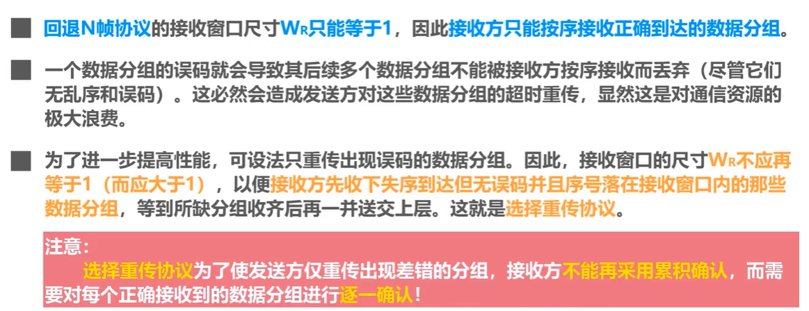

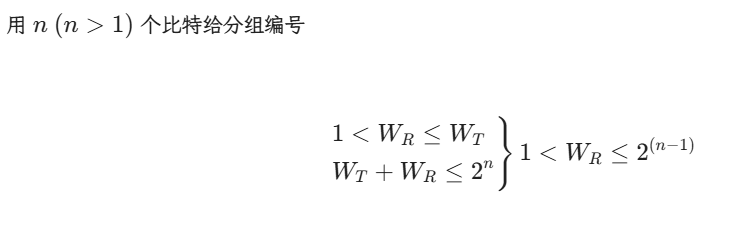

取这个范围也是为了避免接收方无法区分新旧分组，出现分组重复的差错。（自己画个图推一遍就好）

一般取 $W_R = W_T$。

发送方：
* 可在未收到接收方确认分组的情况下，将序号落入发送窗口内的多个数据分组全部发送出去
* 只有按序收到对已发送数据分组的确认分组时，发送窗口才能向前滑动到相应位置
* 如果收到未按序到达的确认分组，应对其进行记录，以防止其相应数据分组的超时重发，但发送窗口不能向前滑动

接收方：
* 可接收未按序到达但没有误码并且序号落入接收窗口内的数据分组
* 为了使发送方**仅重传出现差错的分组**，接收方不再采用累积确认，而需要对每一个正确接收到的数据分组进行**逐一确认**
* 只有在按序接收数据分组后，接收窗口才能向前滑动到相应位置

小结：
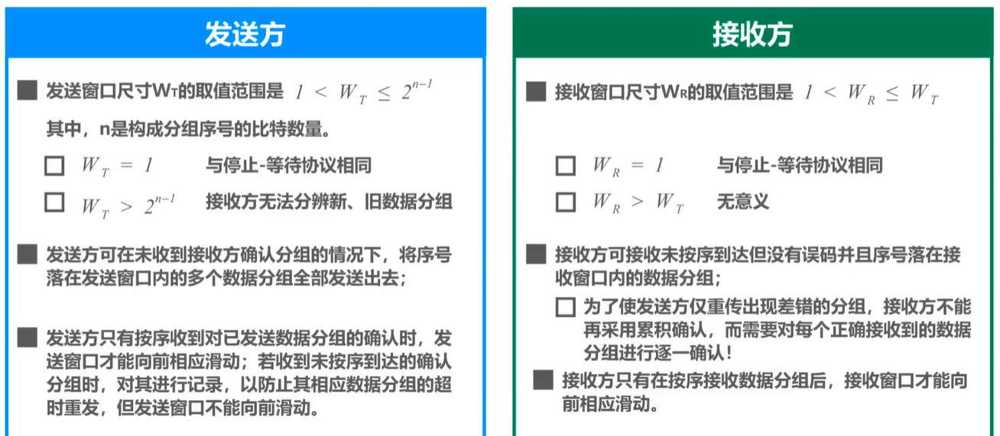

# 6. 点到点协议PPP

> 用户接入到ISP所使用的数据链路协议就是PPP。它也广泛应用于广域网路由器之间的专用线路

由以下三部分构成：
* 对各种协议数据报的封装方法：封装成帧
* 链路控制协议LCP：用于建立、配置以及测试数据链路的连接
* 一套网络控制协议群NCPs：其中每一个协议支持不同的网络层协议

能在多种类型的点对点链路上运行：
* 面向字节的异步链路
* 面向比特的同步链路

PPP帧格式：
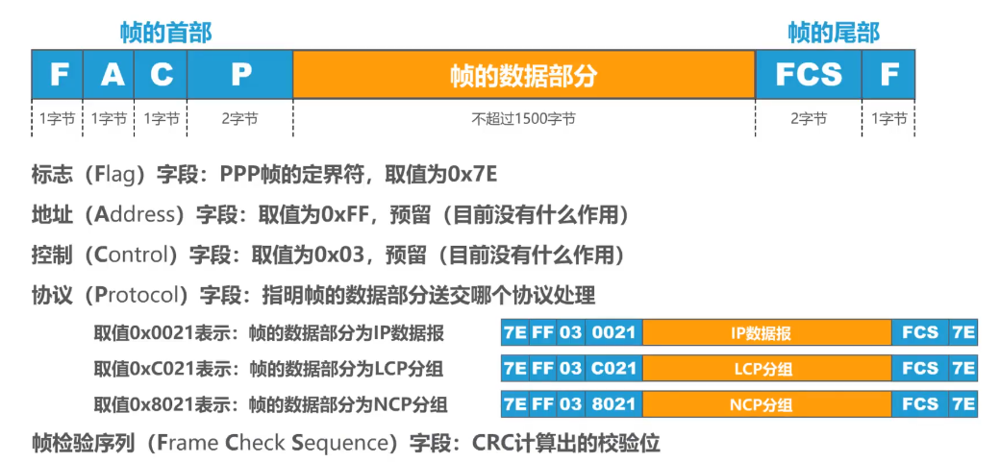

## 6.1 透明传输的实现

帧的数据部分出现定界符，如何处理？——针对不同链路有不同处理，就是插入转义/bit0。

**字节填充法：**
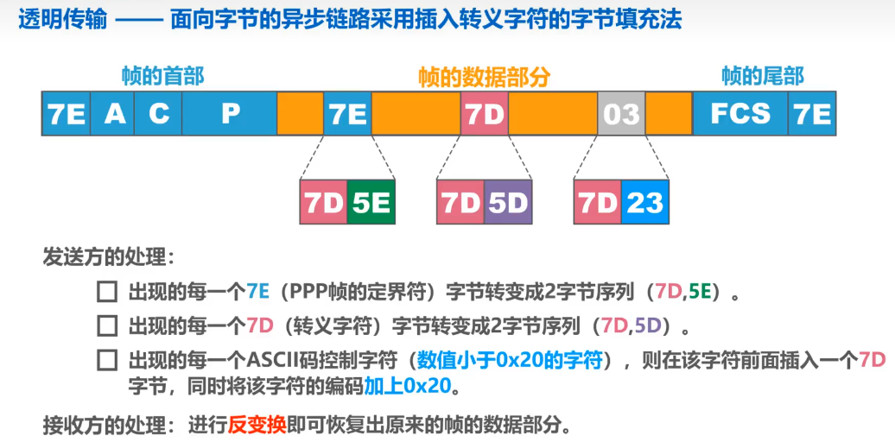

**比特填充法：**
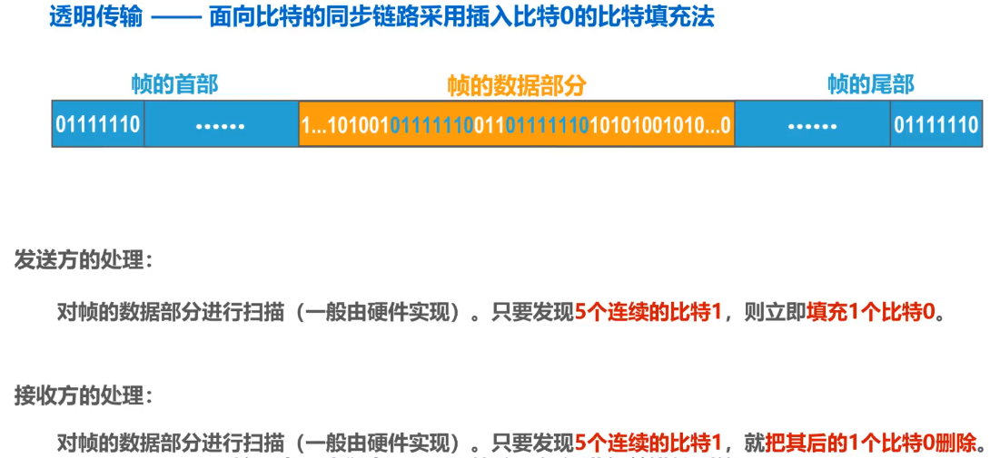

**差错检测：** 对FCS字段使用CRC
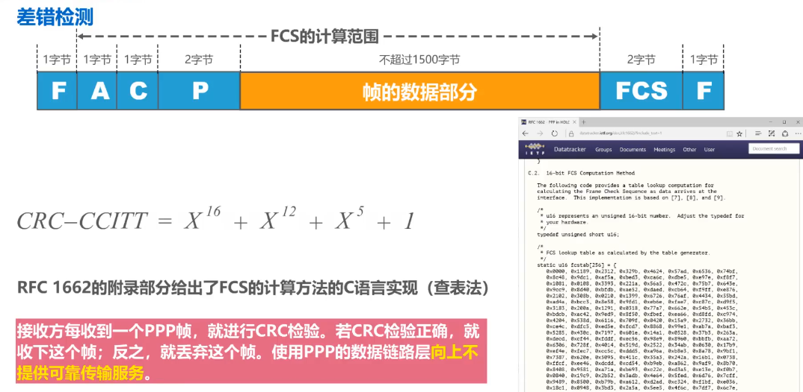

**工作状态：** 状态机如下图
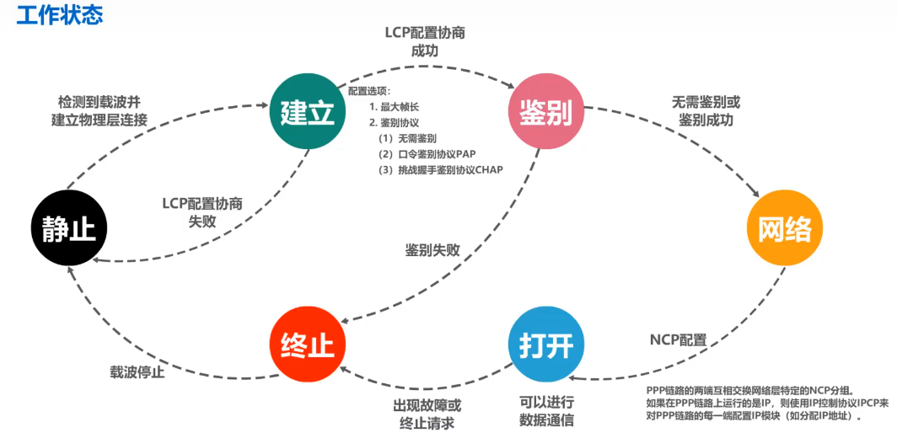
* 静止状态：不存在物理层连接
* 建立：建立连接，协商配置

# 7. 媒体接入控制MAC（Medium Access Control）

## 7.1 基本概念

> 防止多站点共享线路时信号碰撞而发送失败

def：共享信道要着重考虑如何协调多个发送和接收站点对一个共享传输媒体的占用。

分类：
* 静态划分信道：预先分配好固定信道。对于突发性传输信道利用率很低；通常用于物理层而非数据链路层
  * 频分多址
  * 时分多址
  * 码分多址
* 动态接入控制
  * 受控接入：（已被淘汰
    * 集中控制：一个主站轮询每个站点有无data发送，轮询到的才能发送。最大缺点是单点故障
    * 分散控制：各站点平等，连接成一个环形；只有持有令牌的站点才能发送data
  * 随机接入：如何尽量避免冲突、冲突后如何尽快恢复通信

交换式局域网、共享式局域网？？

## 7.2 静态划分信道

* 复用：通过一条物理线路同时传输多路用户的信号
  * 当一条线路的带宽大于多条信道传输的总通信量时，可使用复用技术在一条线路上建立多条通信信道来充分利用带宽
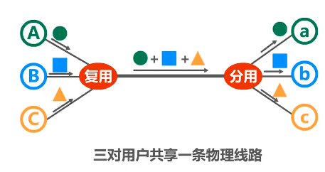

常见复用技术：频分复用FDM，时分复用TDM，波分复用WDM，码分复用CDM。前面已经讲过

## 7.3 动态接入控制

可分为随机接入和受控接入。受控接入网课里没讲，所以下面这两种都是随机接入的范畴

### CSMA/CD协议（有线信道）

多址接入MA：多个站点接入同一条总线，竞争使用

载波监听CS：发送帧前先检查总线是否被占用（先听后说）
* 监听：站点检测自己的接收端有无信号到达
* 若检测到bus空闲96比特时间，就发送（为了使大家都有机会抢到bus资源）
* 若检测到busy，则等待并继续检测

> 1比特时间：发送1bit所用时间。96比特时间是帧间最小间隔

碰撞检测CD：每个正在发送的站边发送边检测碰撞（边说边听）
* 一旦出现碰撞，则停止发送并隔一段随机时间后再次发送

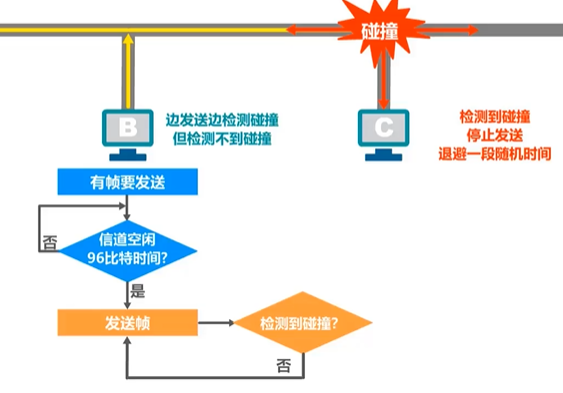
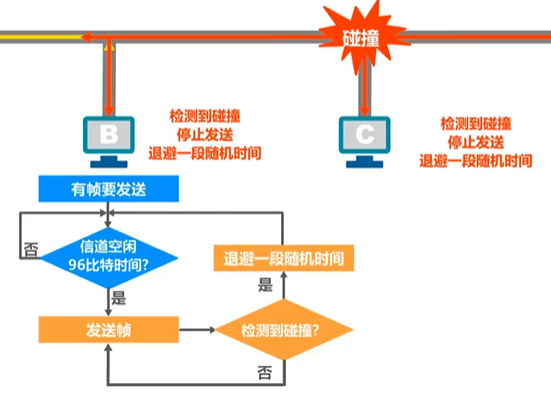

> 强化碰撞：加入人为干扰信号，使大家都能检测到碰撞信号

**争用期/碰撞窗口**：主机发送信号后一段时间内由于碰撞信号的传播时延，不能确定是否发生了碰撞。这段时间的上界为 $2\tau$，其中 $\tau$ 是以太网单程端到端时延（最远两站之间）。见下图：
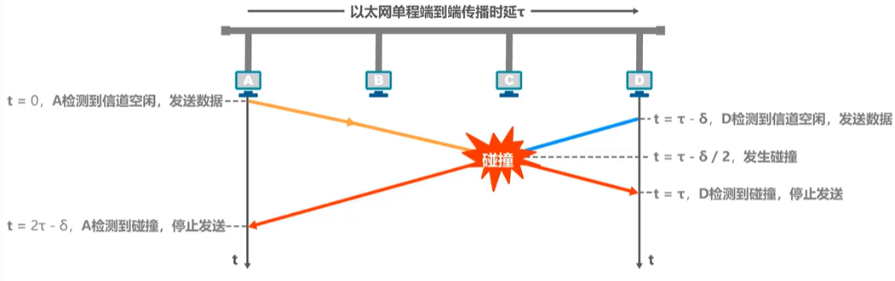

**最小帧长：** 为避免帧太短，发送时间小于争用期，则会提前停止监听。这样即使发生了碰撞发送方也不知道，它就不会重发了
* 以太网规定最小64B。数据量不够就加入填充字节补到64B
* 从而长度小于64B的都是碰撞了的无效帧

**最大帧长：** 避免长时间占用，或接收端缓冲区爆

**退避时间：** 检测到碰撞后随机退避的时间。计算方法为**截断二进制指数退避算法**
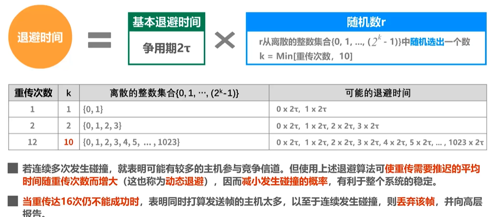

此协议的信道利用率：
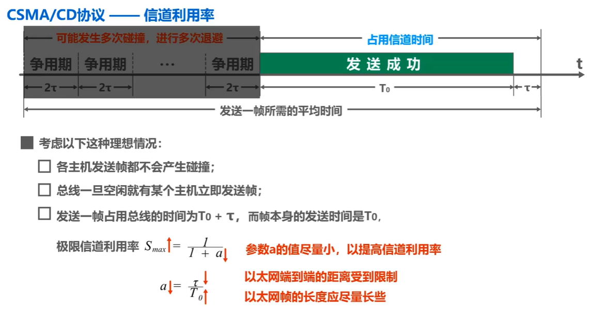

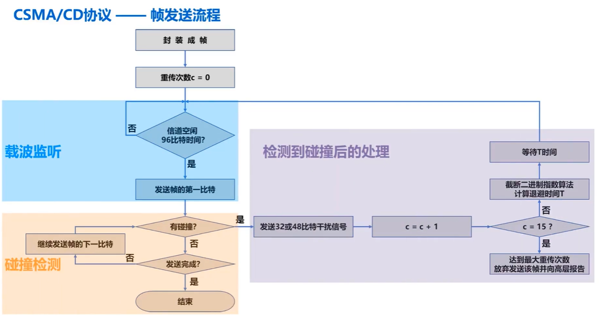
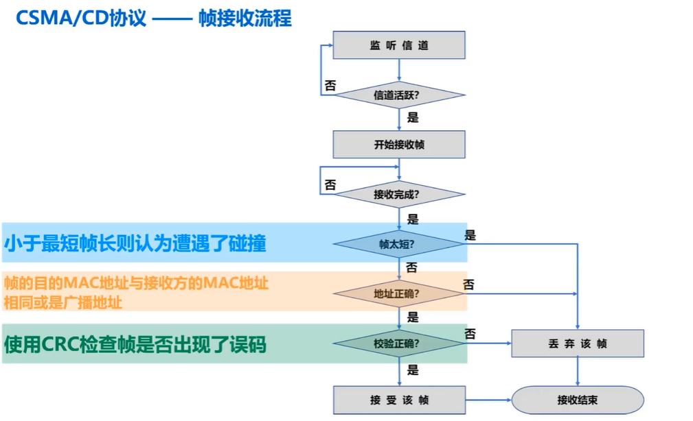
* 广播地址：表示这一帧是发给同一个局域网内所有站点的

现在的以太网不再使用CSMA/CD协议。

### CSMA/CA协议（无限信道）

载波监听多址接入/碰撞避免

无线局域网中无法使用CD。因为无线信道接收信号强度远弱于发送站，也可能由于作用范围不够而检测不到

#### 工作原理

源站等待DIFS时间的原因：考虑到可能有高优先级的帧要发送
目的站等待SIFS时间的原因：这是一次对话内各帧之间必须的间隔，要让源站能从发送状态转为接收状态

* DIFS：DCF中的帧间间隔，较长
* SIFS：最短帧间间隔

不使用退避算法的情况：
* 检测到信道空闲
* 准备发的这个帧不是本站成功发完上一个之后立即连续发送的帧

使用退避算法的情况：
* 检测到忙状态
* 每次重传一个数据帧时
* 每次成功发完一个要连续发下一个时（为了避免一个站点长时间占用信道）

退避算法：

#### 信道预约和虚拟载波监听

RTS，请求发送

CTS，允许发送

这里比较多、杂，听听上课讲到哪吧

# 8. MAC地址，IP地址和ARP协议

MAC地址（数据链路层）：以太网的MAC子层使用的地址

IP地址（网络层）：是TCP/IP体系结构的网络层使用的地址
  * ARP协议属于TCP/IP的网络层。作用是根据IP地址查找到对应的MAC地址

## 8.1 MAC地址

MAC地址：用于媒体接入控制(MAC)的地址，也称为硬件地址/物理地址（但它并不属于物理层）

作用：使用点对点信道的数据链路层不需要使用地址。而使用广播信道的用地址来区分各主机
  * 严格来说，一个MAC地址对应一个网络接口（而并非一个设备）

发送的帧中要标注源&目的主机的MAC地址。

格式：

类型：（本地管理优先级高于全球管理）

* 广播帧可以被多个主机接收
* 多播：某主机可以有一个多播组列表，组内有对应的多播地址，发给表中的地址的帧都可以被此主机接收

地址发送顺序：
  * 字节发送顺序：1-6
  * 字节内的bit发送顺序：b0-b7

## 8.2 IP地址

>属于网络层，此处引入是为了阐述与MAC地址的关系

IP地址用来标识网络和同一网络内的不同主机（或路由器各接口）

IP地址由网络编号和主机编号构成。

如果只有一个网络，可以只用MAC地址。

MAC地址和IP地址封装位置：

数据包发送过程中地址变化情况：

* IP地址始终不变
* MAC地址随每一跳变化

但是上述过程中，主机知道下一跳的IP地址，但不知道MAC地址。这就要用到ARP（地址解析）协议——

## 8.3 ARP协议

地址解析协议ARP：用于由IP地址获取对应的MAC地址

每台主机有一个ARP高速缓存表，存放有最近获取的IP-MAC映射关系

如果表中没有要求的地址，主机就会广播ARP请求报文:
* 包含自己的IP地址，MAC地址，目的IP地址
* 封装在MAC帧中
* 广播，因此目的地址为FF-FF-...-FF

收到的主机将报文交给上层的ARP进程处理，如果是对应的，会做两件事：
* 将源主机的映射关系更新到自己的ARP缓存表中
* 向源主机单播响应告知自己的MAC地址

响应报文内容：
* 自己的IP地址和MAC地址
* 目的地址是源主机。由于是单播，目的地址不匹配的主机收到了会直接丢弃该帧
* 源主机收到后会更新自己的缓存表

ARP缓存表的条目分为动态和静态：
* 动态：主机自动获取，生命有限（会自动删除）
* 静态：手工配置，不同系统的生命周期不同

注意：ARP协议不能跨网络使用，如下，要逐跳进行

>ARP没有安全验证机制，可能被欺骗

# 9. 集线器与交换器

VLAN是什么？？

## 交换机自学习和转发帧的流程

* 交换机用的是MAC地址
* 泛洪：当帧交换表中没有所需信息时，向所有端口转发的行为
* 上例中，由G发给A的帧是从接口1进入交换机的，所以他不会再从1发出去给A，直接丢弃

summary：

## 交换机的生成树协议STP

