内容/目标：


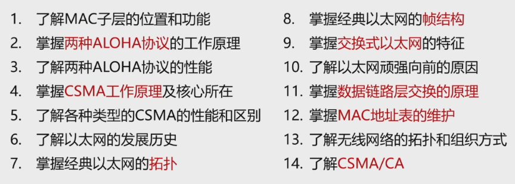

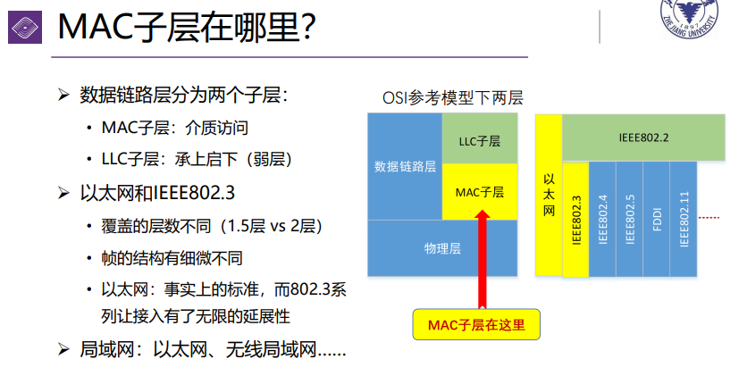


其实这里算是数据链路层的细化

# 1. 信道分配问题

## 1.1 局域网信道

集线器和交换机：
* 集线器：半双工。广播式共享介质
* 交换机：全双工。点对点转发（由MAC地址表）

>为了讨论机制，此处我们都默认是集线器

## 1.2 静态分配

静态分配方法：TDM（时分复用），FDM（频分复用），统计时分复用（statistical multiplexing）


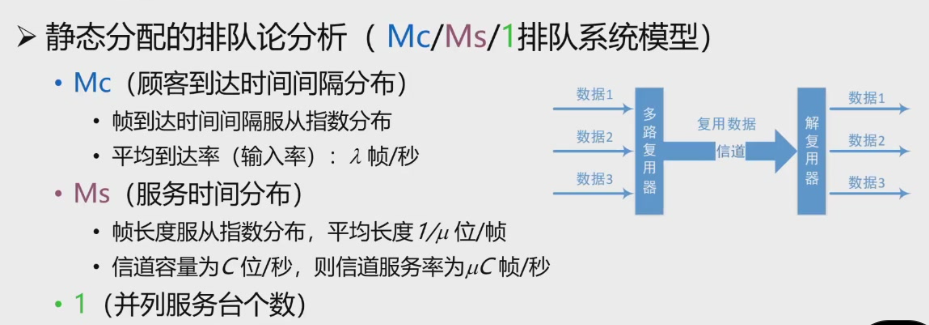

* 系统稳定性：当平均到达率λ<服务率μC时，队列才不会无限长
* 信道利用率=λ/(μC)
* 单信道平均逗留时间 = 1/(μC-λ)
* 信道N等分后每个子信道：

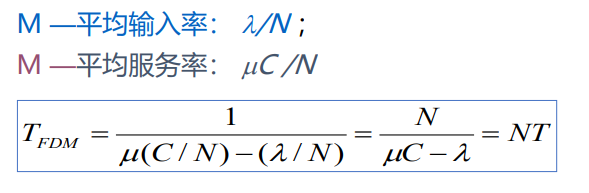


>以上这些不太考

# 2. 多路访问协议


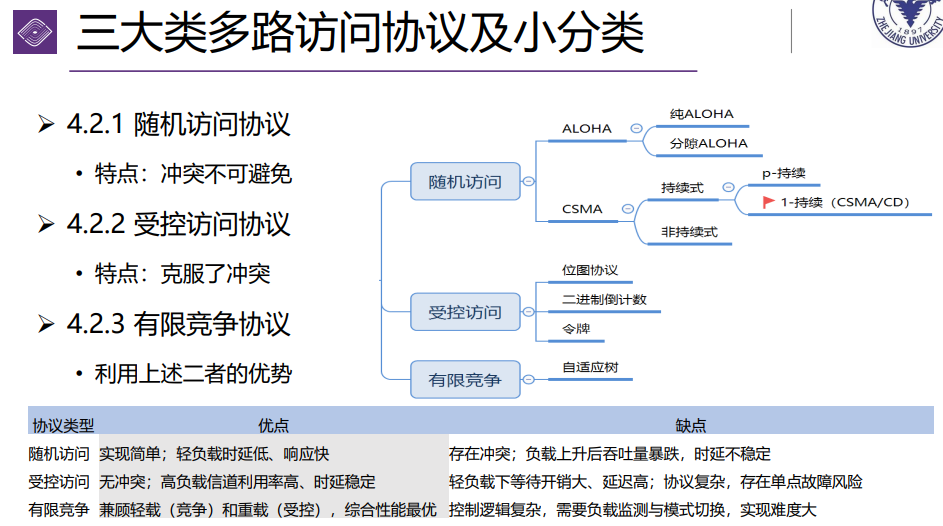


## 2.1 随机访问

### 纯ALOHA协议


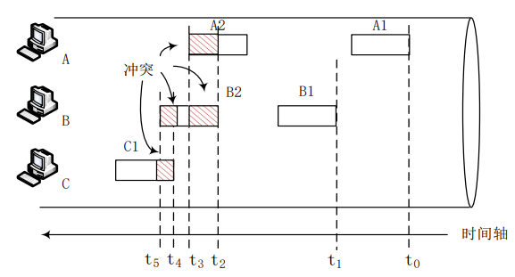


* 原理：想发就发，不检测
* 特点：
  * 随时可能冲突
  * 冲突的帧完全破坏，需要重传


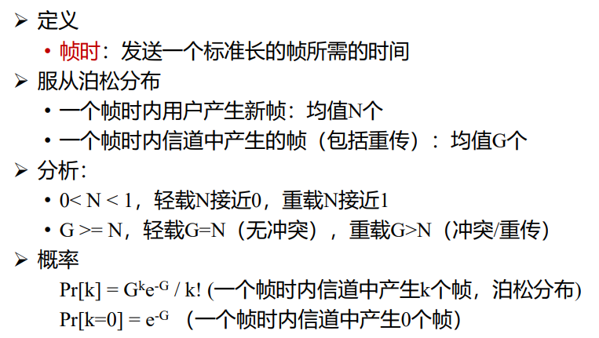
* 信道接入多个用户。
* “产生新帧”：指平均一个帧时内所有人产生的新帧的到达率
* G是总负载，是实际在信道上出现的帧数（新的+重传的）


性能分析：
* 吞吐量：一个帧时内发送成功的平均帧数S（0< S < 1）
* 载荷（网络负载）G：时间T内总共发送的帧数均值（包括新发和重发的）
  * 显然G>=S。（当且仅当不冲突时取等号）当重负载时，冲突频繁
* 一帧发送成功的概率P0。则有S = G*P0


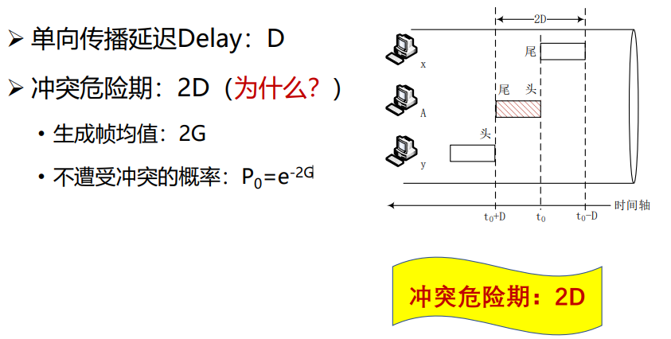


危险期是2D，其实就是CSMA/CD里面那个窗口期。x开始发一帧，要经过2D才能知道y有没有成功接收。（在这2D内x要持续监听）

### 分时ALOHA


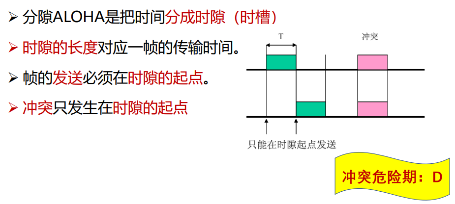


两者对比：


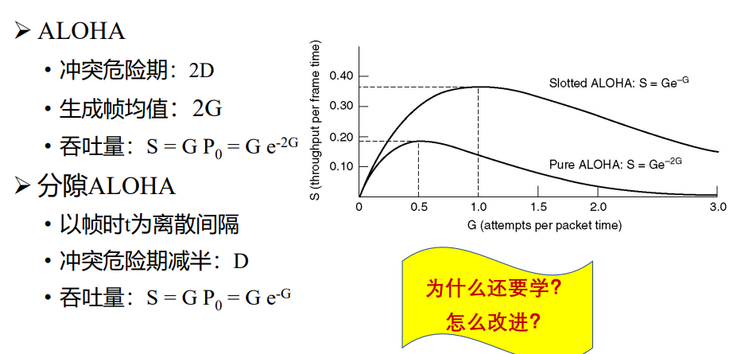


### CSMA协议（载波监听）

* 特点：先听后发。
* 分类：
  * 非持续式
  * 持续式
    * p-持续式
    * 1-持续

#### 非持续式CSMA

特点：
* 侦听，若信道空闲则发送
* 若信道忙，等待一个随机时间（这里就是非持续的体现）

#### 持续式CSMA

**1-持续**

特点：先听后发，边发边听
* 侦听，空闲则发送
* 信道忙，则持续侦听。一旦空闲立即发送
* 若冲突，等待一个随机时间再重复step1

此时，若两个以上的站在侦听，则信道一旦空闲就一定会冲突

**p-持续：**
* 侦听，空闲则以p概率发送，以(1-p)概率延迟一个时间单元发送
* 信道忙，则持续侦听。一旦空闲则重复step1
* 若已等待一个时间单元，再重复step1

#### 性能分析

由于传播延迟时间，信号没有来到本主机的话，本主机会以为信道空闲。如图：


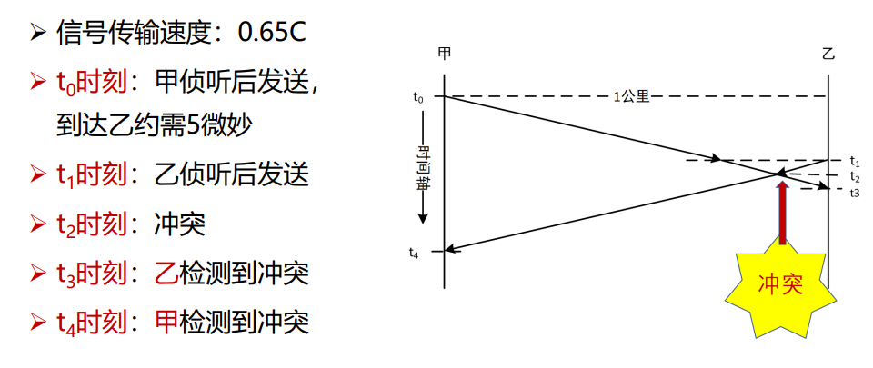


一旦检测到冲突，会向对方发送Jam（强化）信号，使大家都能检测到碰撞信号。

**争用期/碰撞窗口**：主机发送信号后一段时间内由于碰撞信号的传播时延，不能确定是否发生了碰撞。这段时间的上界为 $2\tau$，其中 $\tau$ 是以太网单程端到端时延（最远两站之间）。见下图：

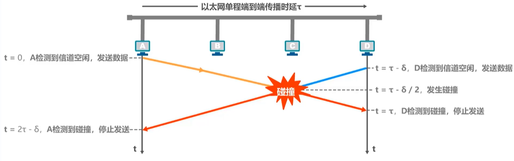


**最小帧长：** 为避免帧太短，发送时间小于争用期，则会提前停止监听。这样即使发生了碰撞发送方也不知道，它就不会重发了
* 以太网规定最小64B。数据量不够就加入填充字节补到64B
* 从而长度小于64B的都是碰撞了的无效帧

**最大帧长：** 避免长时间占用，或接收端缓冲区爆


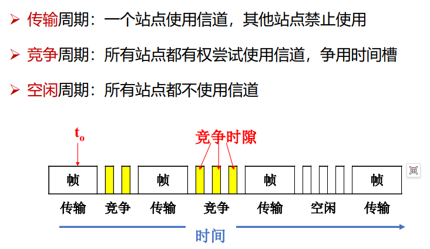


## 2.2 受控访问

### 位图协议


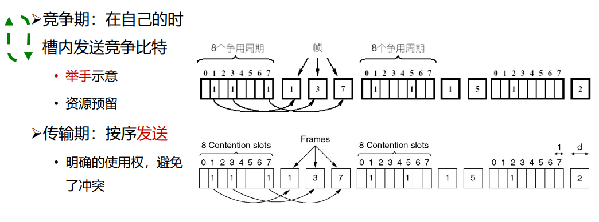

* 争用周期是静态分配的，每个人都给分配一个举手slot。（这里是纯overhead了，没有有效传输行为）
* 传输期是动态分配的，判断需要分配几个帧，然后按序分配发送


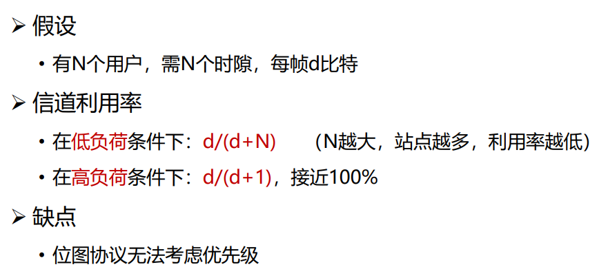


### 二进制倒计数协议

### 令牌协议

## 2.3 有限竞争

### 自适应树搜索协议

>见PPT。想来应该不太重要，如果做题遇到再补吧。

# 3. 以太网


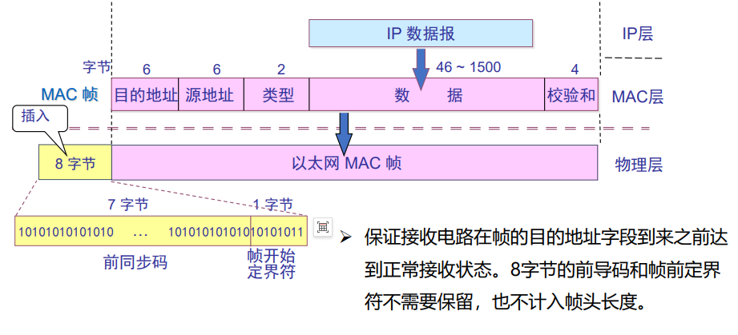

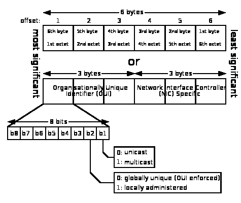


特殊地址：
* 广播帧可以被多个主机接收
* 多播：某主机可以有一个多播组列表，组内有对应的多播地址，发给表中的地址的帧都可以被此主机接收

地址发送顺序：
  * 字节发送顺序：1-6
  * 字节内的bit发送顺序：b0-b7

适配器检查MAC地址：
* 所有适配器都至少能识别单播和广播


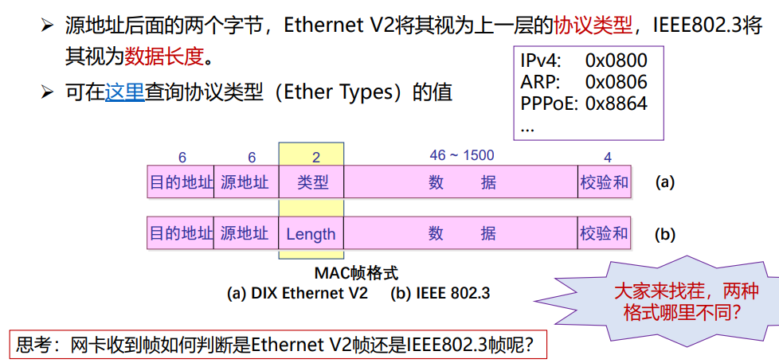

* 由于类型字段的值都大于1500，也就是说，Type和Length定义域不重叠。所以是可以判断出是哪种帧的
* 按照这个设置，我们可以得到最大/最小帧长分别为1518B和64B。
  * 若data field不足46B，则要进行填充(Padding)整数字节（一般全填0）
  * 若超出1500，就分片
* 检查出无效的MAC帧就丢弃，以太网不负责重传。


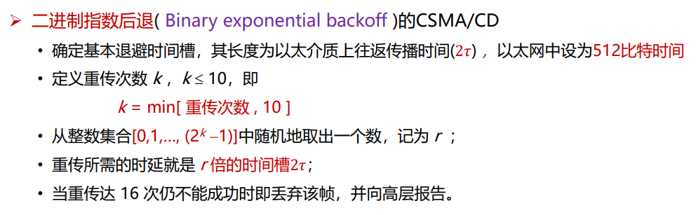

* 注意，这里的k只是用来计算退避窗口大小的一个指数。
* 随着重传次数增加，k会增大，但最大就到10

## 交换式以太网

### HUB，集线器

集线器HUB，所有端口内部互通，属于同一冲突域。

工作在半双工模式下。

混杂模式：接收监听到的所有帧（regardless of dest MAC addr）。一般用于网络性能分析。

### Switch，交换机

工作在数据链路层，采用存储转发方式，根据目的MAC地址，使用内部的高速背板（交换矩阵）进行转发。（根据一个MAC-port映射表进行。此表的维护问题？）

交换机为全双工模式，端口可以同时收发。

可以实现并行传输。


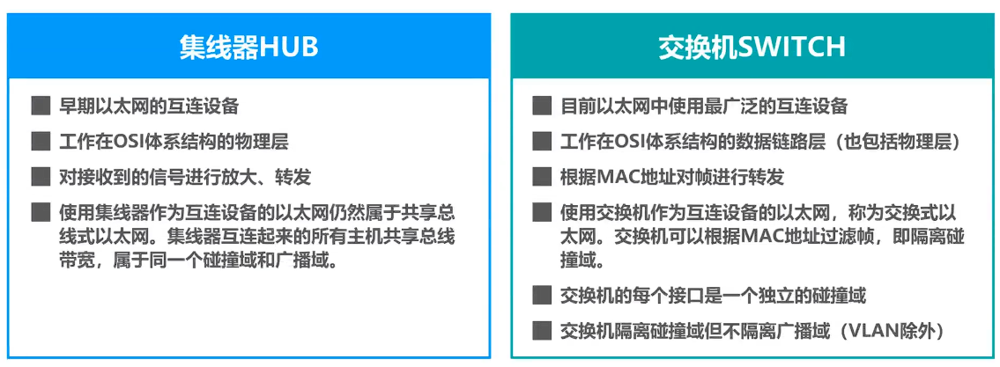


# 4. 数据链路层交换

## 4.1 交换原理

用网桥/交换机扩充网络——分隔冲突域。

MAC地址表的构建：
* 逆向学习源地址
* 记录帧到达时间，设定一个老化时间。当表项到期后会被清除（若图中有新帧来了会刷新其对应计时）


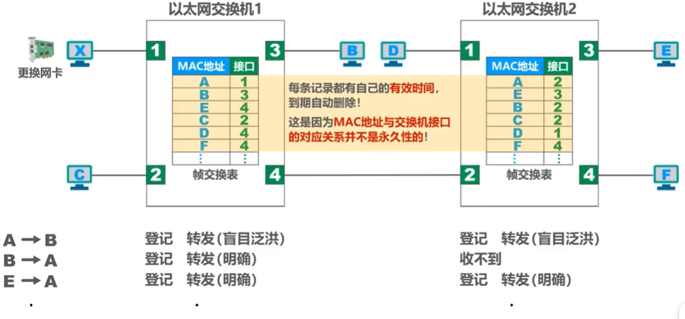

* forwarding：根据表项对应端口转发
* flooding：当帧交换表中没有所需信息时，向所有端口转发的行为；或是把广播帧发给所有人的行为
* filter：把目的端口=入境端口的帧（同一冲突域内）丢弃。上例中，由G发给A的帧是从接口1进入交换机的，所以他不会再从1发出去给A，直接丢弃

summary：


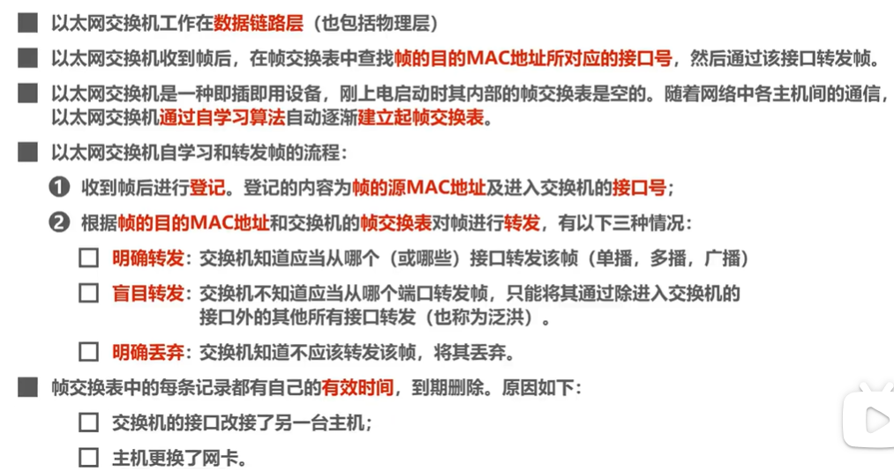


## 4.2 链路层交换机

从带宽的角度，交换机可分为：
* 对称交换：所有端口带宽相同（从而转发时出入带宽相同）
* 非对称交换：交换机上有多种速率端口

从转发时机的角度，交换模式可分为：
* 存储转发模式：接收整个帧并进行校验。延迟大
* 直通模式：一接收到Dest addr，就开始转发。因此其不支持非对称转发，延迟最小
* 无碎片模式：接收完帧的前64B就开始转发。相对于直通的特点是其过滤了冲突导致的碎片（小于64B的）。其延迟介于以上二者之间

## 4.3 生成树协议STP

添加冗余链路可以提高以太网可靠性，但形成网络环路会带来问题：
* 广播风暴：不断收到别的交换机的广播帧，反复按顺时针/逆时针兜圈。
  * 浪费网络资源；帧重复
  * 交换机的帧交换表震荡，如下图


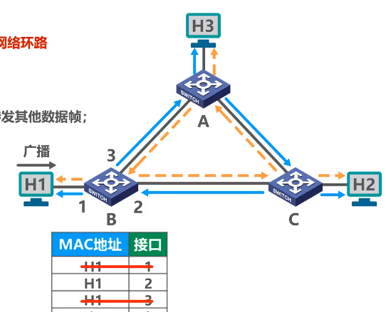

* H1的MAC地址将在后面两个错误地址之间反复震荡（一直收到A和C转发来的广播帧。此帧的src地址是H1）

STP保证无论物理连接如何，交换机会自动构建一个树形网络（无环）：
* 交换机会阻塞一些自己的端口
* 首次链接/物理拓扑变化时，树都会重新计算，从而交换机会改变自己的端口状态


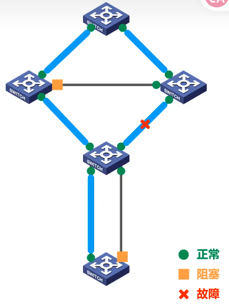


## 4.4 虚拟局域网VLAN

广播域过大带来的问题：
* 广播风暴：如ARP时，会非常浪费网络资源。（网络中会经常出现广播，ARP,RIP等

所以我们希望把广播域分割成小块。分割方法：
* 使用路由器：路由器默认不转发广播包。但其成本较高
* 使用VLAN：将局域网内的设备划分成与其物理位置无关的多个逻辑组，从而隔离他们的广播域


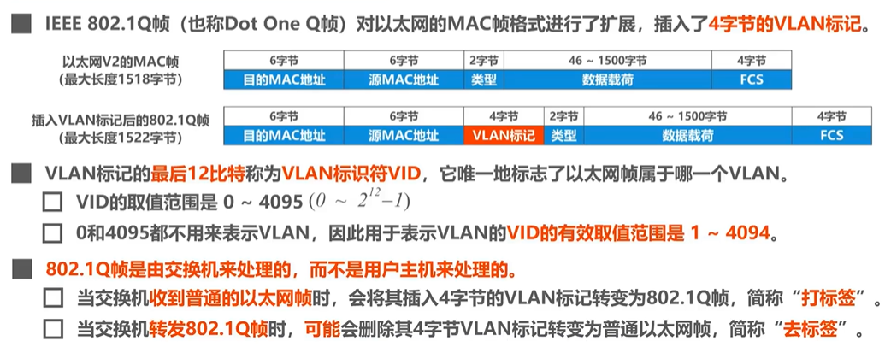

* 主机发出的是普通帧，而交换机的端口上配置了VLAN信息，交换机会封装为.1Q帧并转发；
* 然后接收端那边的交换机会转发给同VLAN的端口。
* 末尾那个交换机会把这个帧变回普通以太网帧并发给目的主机
* 交换机的缺省VLAN ID=端口所属VLAN ID。（default值为1）

端口分类：access，trunk，hybrid

### access端口

接收：根据接收端口PVID给帧打标签

发送：转发到PVID与帧的VID相同的端口（并去标签）

### trunk端口

可以属于多个VLAN。一般用来连接交换机，或连接交换机和路由器。其默认PVID=1

发送：
* 对VID=PVID的帧，去标签转发
* 对VID≠PVID的帧，保留标签转发

接收：
* 接收无标签帧，并根据自己的端口PVID给帧打标签
* 接收有标签的帧

下面对应两种帧VID情况：

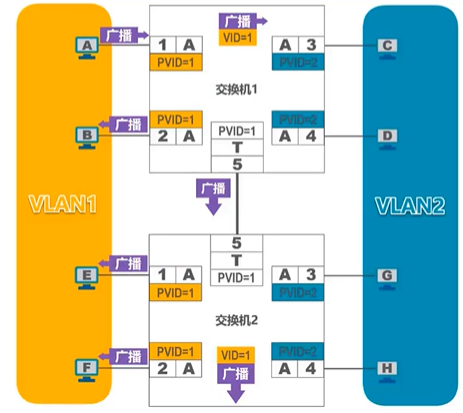

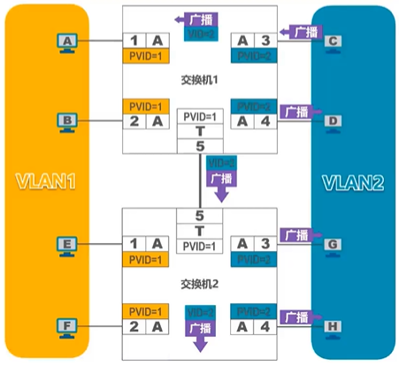


互联的trunk端口PVID不等的情况：

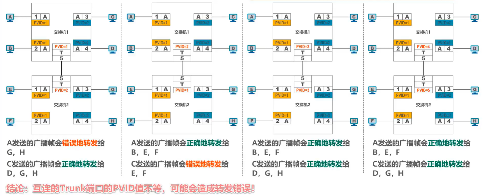


### hybrid端口

跟trunk的不同：发送处理方法
* 查看帧的VID是否在本端口配置的去标签列表中
  * 存在，则去标签转发
  * 不存在，则直接转发（此时转发给主机的话，主机识别不了.1Q帧，会直接丢弃）

简单理解，当此端口连接交换机之间/交换机与路由器之间时，其等价于trunk端口；当其连接交换机与主机时，其又等价于access端口。

# 5. 无限局域网