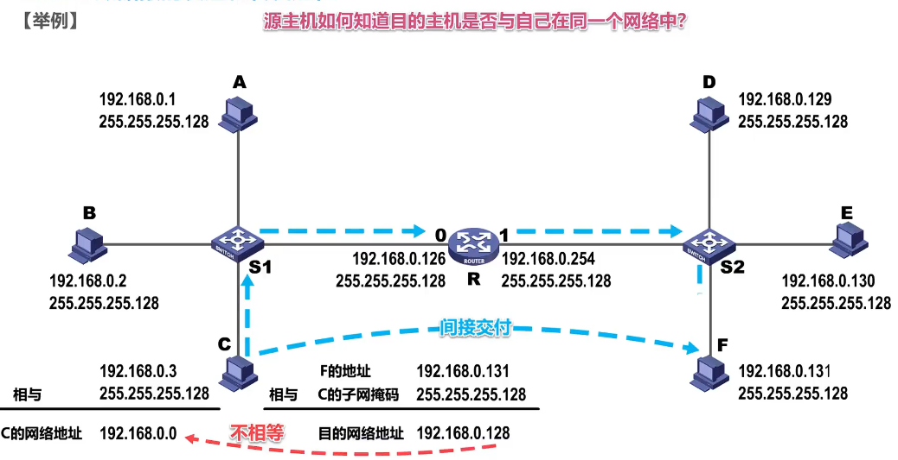
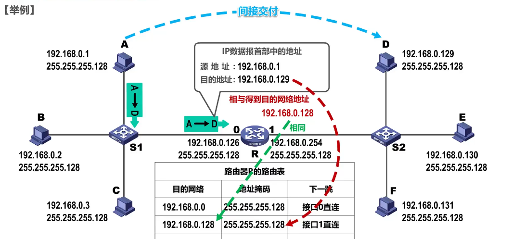
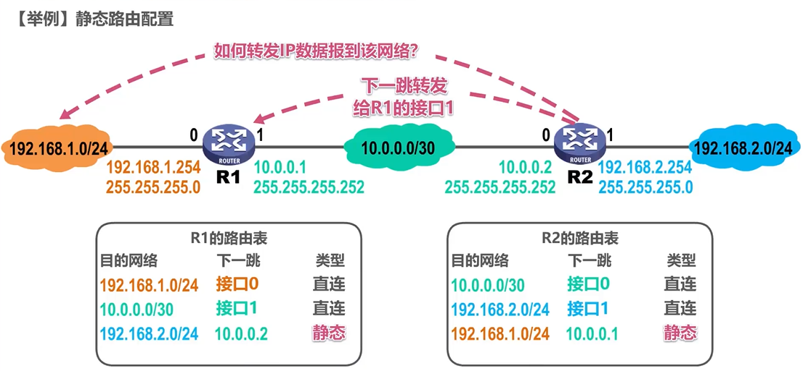
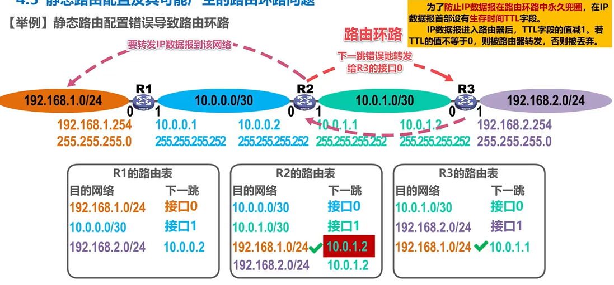
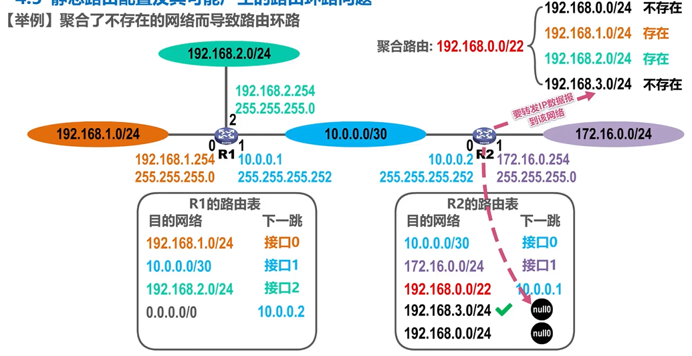
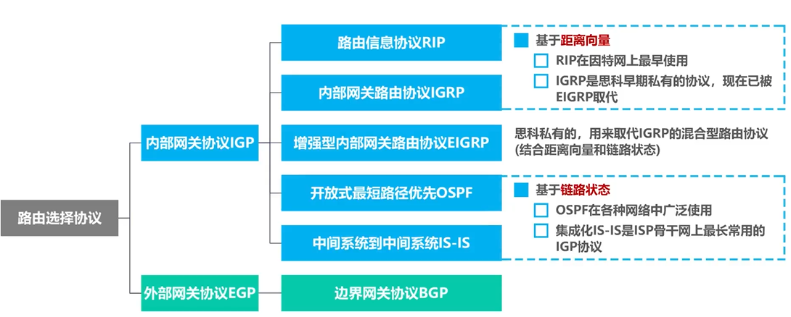

# 1. 概述





## 1.1 服务

1. 面向连接的虚电路服务
   * 虚电路VC：网络层的逻辑连接
   * 目的主机地址仅在建立连接时使用，后续发送的分组首部仅含VC的编号（VC的每一段链路都有一个VC编号）
2. 无连接的数据报服务
   * 是不可靠服务。可靠性由用户主机保证

# 2. IPv4

IPv4地址：给因特网上的每一台主机（或路由器）的每一个接口分配一个世界上唯一的32bit标识

表示方法：点分十进制。每8bit为一组，写成十进制

IPv4地址三个阶段：分类编址、划分子网、无分类编址

## 2.1 三种编址

### 分类编址

* 只有ABC类可分给主机/路由器的接口
* 主机号全0的是网络地址，主机号全1的是广播地址。都不分配给单机使用

A类：

B类：

C类：

一些特殊的IP地址（可能会考能否作为源/目的地址）

节约IP地址：分配一个能容纳下接口数的、剩余IP地址最少的网络号。（如：一个只有2个接口的网络，给它分配A类，就浪费了$(2^{24}-2)-2$个IP地址）

### 划分子网

想法：如果想将一个大网络划分为多个子网，申请新的网络号会浪费原有网络号中剩余的IP地址，路由信息也会复杂化。所以我们希望能从主机号借一部分作为子网号

使用子网掩码来标记主机号哪些部分被用作子网号。构成及划分细节如下图：

默认子网掩码：未划分子网的情况下使用的子网掩码（就是网络号那些bit全取1，主机号的bit全取0）

### 无分类编址

无分类域间路由选择CIDR：即在IPv4地址后加上后缀“/x”，表示网络前缀占用x比特，剩下的32-x为主机编号

从而，将前缀相同的连续的IP地址划入一个**CIDR地址块**中。下面探讨CIDR地址块的一些信息：

* 其中，地址数量包含网络/广播地址，这里问的不是可分配。
* 聚合C类网数量是指：这个块相当于几个C类网。直接算IP地址是C类的几倍就行

路由聚合：

* 展开最前的不同字节，然后找共同前缀即可。后面的全部设为0

## 2.2 划分方法

### 定长子网掩码FLSM

* 只能划分出2^n个子网（n是从主机号借用的bit数）
* IP地址浪费

### 变长子网掩码VLSM

* 地址块划分为子块时，每个子块的起点应选为块大小的整数倍（IP地址最后8bit是块大小的整数倍）
  * 不然可能会一个子网块装不下，如把N2的起点设为218.75.230.16
* 且要从大的块（/x最小的）开始分配，防止碎片化

## 2.3 发送和转发

默认网关：为主机指定的，当其需要与其他网络中主机通信时使用的路由器。
* 把路由器的对应接口IP地址指定给主机们即可

路由器转发IP数据包：
1. 检查首部是否出错。若出错则丢弃并通告源PC
2. 根据dst在路由表中查找并转发给next hop。若找不到则丢弃并通告src PC
   * 只是会通告，该丢还是丢。并不是可靠传输

* 实际研发中，路由表的数据结构更高级，查找更快
* 路由器是隔离广播域的，即使是255.255.255.255这个广播地址，其也不会转发
* 直连：路由器的该端口IP地址直接属于那个目的网络

## 2.4 静态路由配置

人为用命令配置路由表。不灵活且容易出错

* 例中，第三条静态都是由于路由器不知道目的网络的存在，而人工加上的

默认路由：比如一个边缘路由器，其要转发给包含众多网络的因特网时，如果一条条配就太繁琐了。故设置一个默认路由
* 目的地址和掩码都是0.0.0.0

特定主机路由：目的地址填主机的具体IP地址。直接用/32
* 最长匹配原则：若有多条路由可选，选前缀最长的那个（它最具体

静态路由的一些问题：

* 配置错误导致的环路：设置TTL

* 聚合了不存在的网络导致的环路：上图中，如果没有null0接口，R2转发给R1后，R1又走默认路由发给R2，形成了环路。
* 当某网络故障而不可达时，也会发生此情况。也用null0来做黑洞路由即可。

# 3. 路由选择协议

可分为静态/动态路由选择：静态就是人工配置，开销小；动态是根据协议自学习，开销大但灵活。

因特网采用的路由选择协议的特点：
1. 自适应：动态选择，灵活
2. 分布式：路由器之间交换信息，共同完成维护
3. 分层次：将整个Internet划分为许多小自治系统AS(Autonomous System)

AS之间的协议类统称为外部网关协议EGP(External Gateway Protocol)，AS内部使用的统称为内部网关协议IGP(Internal)。

>AS内部各自使用啥与别人无关

常见协议：

路由器结构：
* 路由选择部分：路由选择处理机，根据使用的选择协议，周期性的与同僚交互路由信息，以更新路由表
* 一般讨论时，不区分路由表和转发表。

## 3.1 RIP，路由信息协议

