# 1. 概述


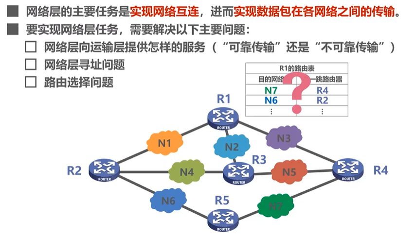

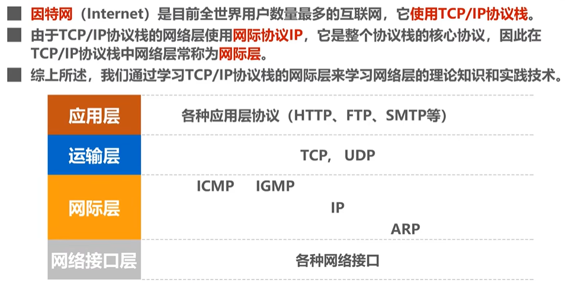


## 1.1 服务

1. 面向连接的虚电路服务
   * 虚电路VC：网络层的逻辑连接
   * 目的主机地址仅在建立连接时使用，后续发送的分组首部仅含VC的编号（VC的每一段链路都有一个VC编号）
2. 无连接的数据报服务
   * 是不可靠服务。可靠性由用户主机保证

# 2. IPv4

IPv4地址：给因特网上的每一台主机（或路由器）的每一个接口分配一个世界上唯一的32bit标识

表示方法：点分十进制。每8bit为一组，写成十进制

IPv4地址三个阶段：分类编址、划分子网、无分类编址

## 2.1 三种编址

### 分类编址

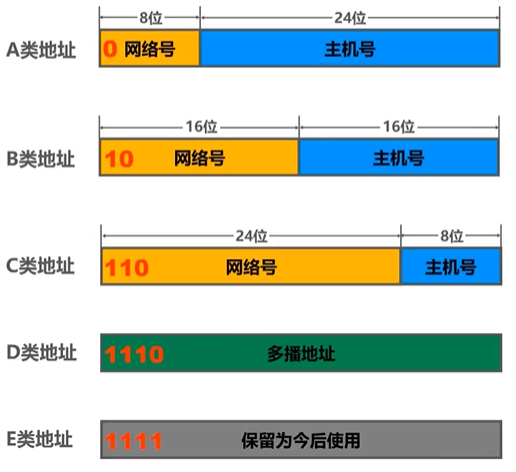
* 只有ABC类可分给主机/路由器的接口
* 主机号全0的是网络地址，主机号全1的是广播地址。都不分配给单机使用

A类：
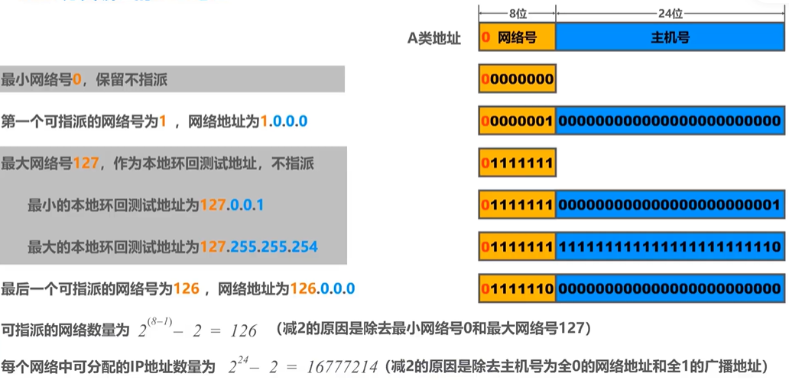

B类：
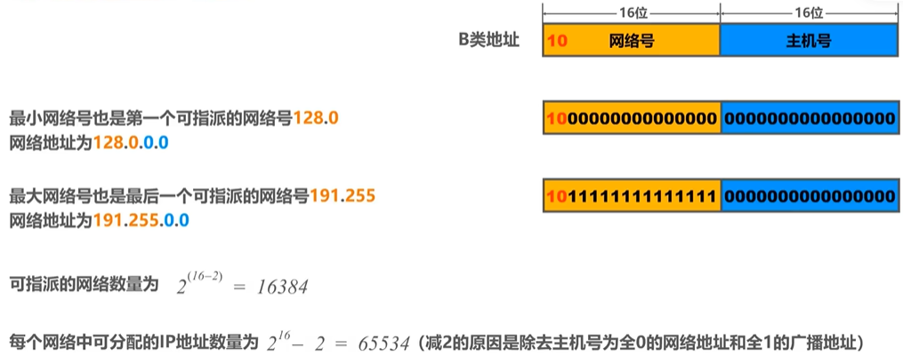

C类：
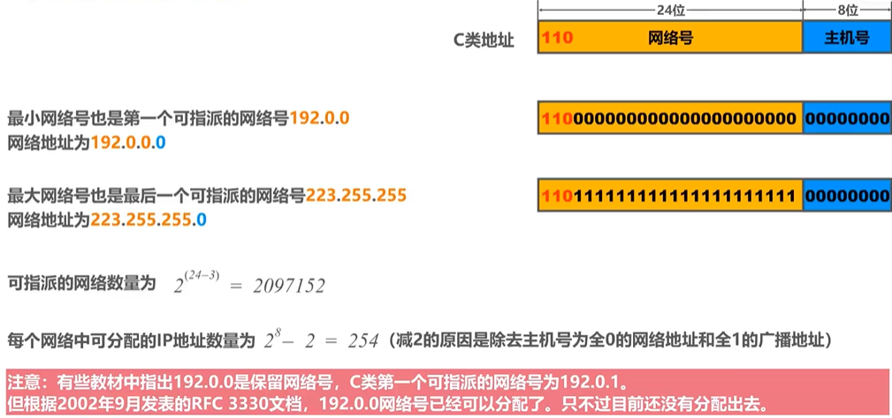

一些特殊的IP地址（可能会考能否作为源/目的地址）
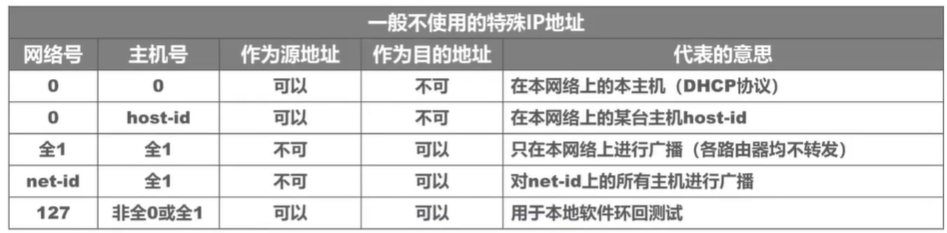

节约IP地址：分配一个能容纳下接口数的、剩余IP地址最少的网络号。（如：一个只有2个接口的网络，给它分配A类，就浪费了$(2^{24}-2)-2$个IP地址）

### 划分子网

想法：如果想将一个大网络划分为多个子网，申请新的网络号会浪费原有网络号中剩余的IP地址，路由信息也会复杂化。所以我们希望能从主机号借一部分作为子网号

使用子网掩码来标记主机号哪些部分被用作子网号。构成及划分细节如下图：
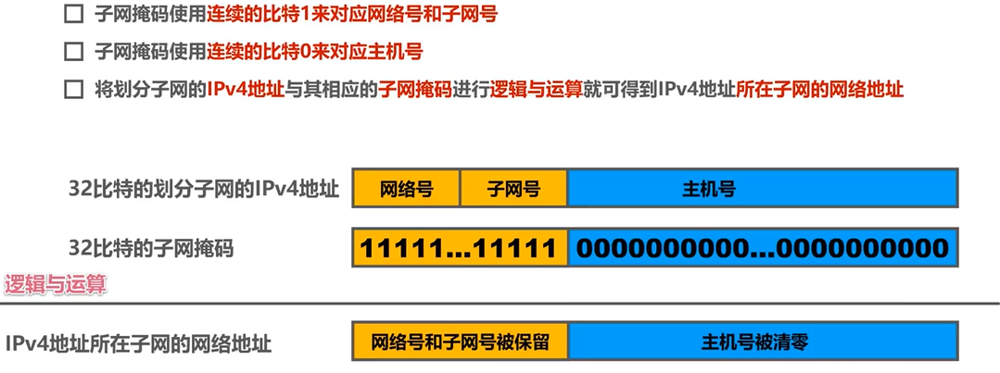

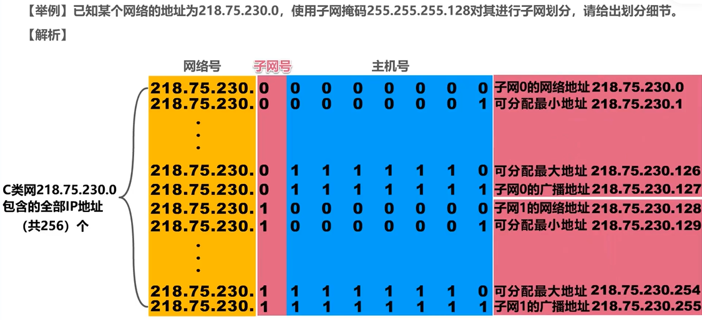

默认子网掩码：未划分子网的情况下使用的子网掩码（就是网络号那些bit全取1，主机号的bit全取0）

### 无分类编址

无分类域间路由选择CIDR：即在IPv4地址后加上后缀“/x”，表示网络前缀占用x比特，剩下的32-x为主机编号

从而，将前缀相同的连续的IP地址划入一个**CIDR地址块**中。下面探讨CIDR地址块的一些信息：

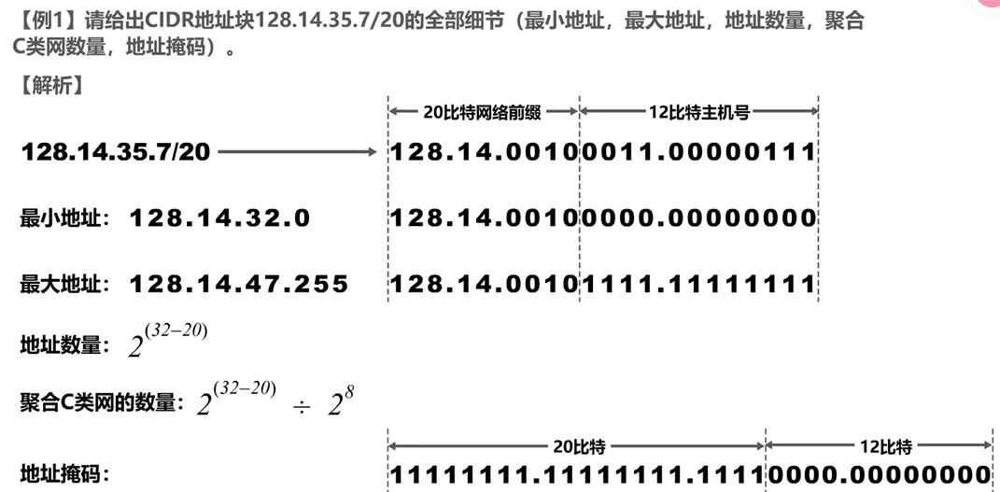
* 其中，地址数量包含网络/广播地址，这里问的不是可分配。
* 聚合C类网数量是指：这个块相当于几个C类网。直接算IP地址是C类的几倍就行

路由聚合：
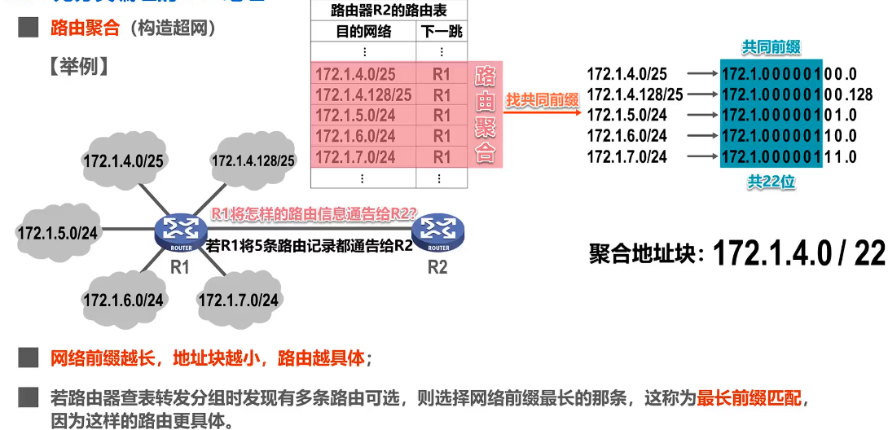
* 展开最前的不同字节，然后找共同前缀即可。后面的全部设为0

## 2.2 划分方法

### 定长子网掩码FLSM

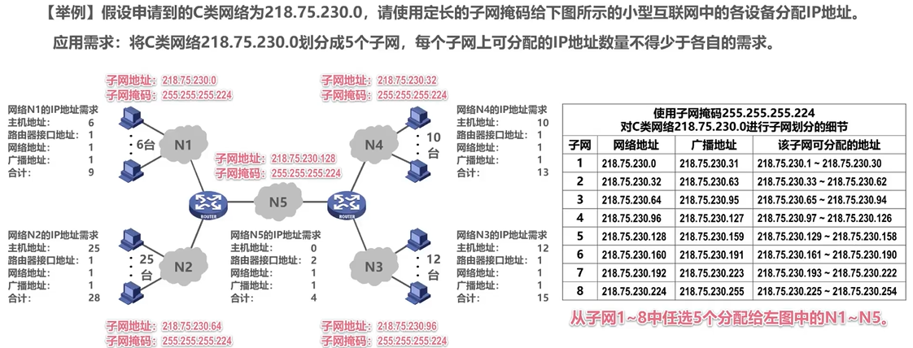
* 只能划分出2^n个子网（n是从主机号借用的bit数）
* IP地址浪费

### 变长子网掩码VLSM

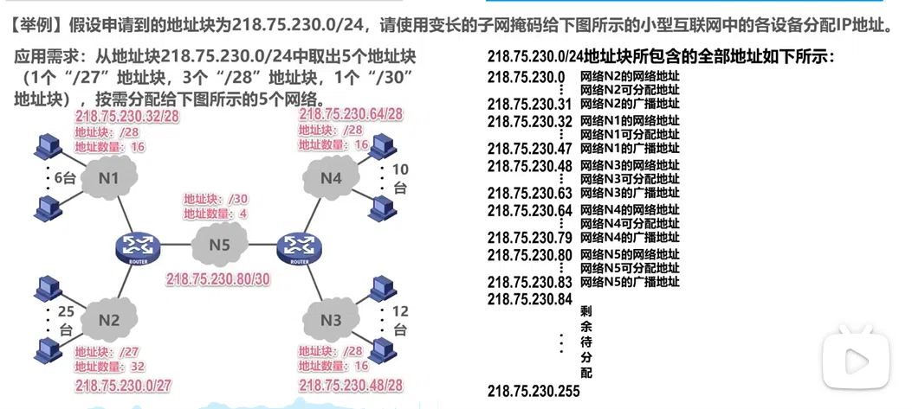

* 地址块划分为子块时，每个子块的起点应选为块大小的整数倍（IP地址最后8bit是块大小的整数倍）
  * 不然可能会一个子网块装不下，如把N2的起点设为218.75.230.16
* 且要从大的块（/x最小的）开始分配，防止碎片化
