# 1. 网络层概述


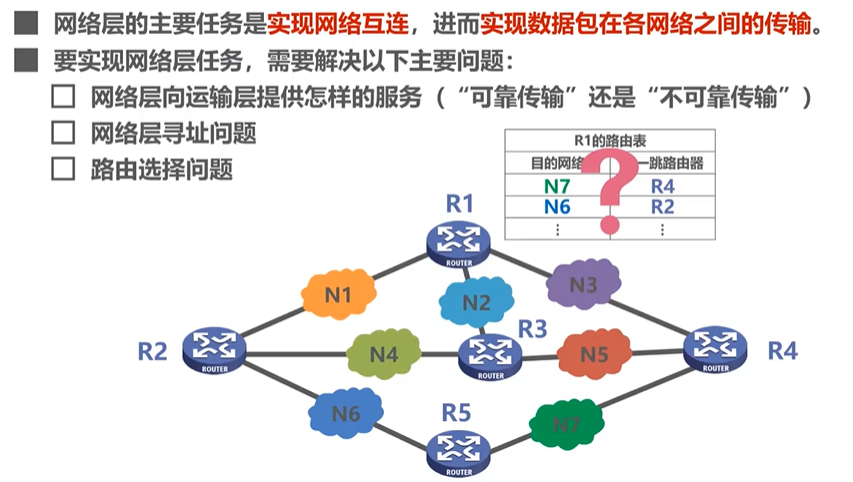

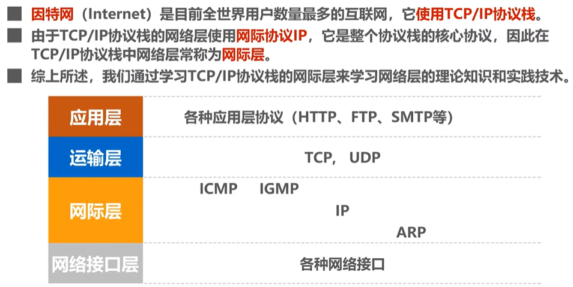


## 1.1 虚电路与数据报服务

**1. 面向连接的虚电路服务**
   * 虚电路VC（Virtual Circuit）：网络层的逻辑连接
   * 目的主机地址仅在建立连接时使用，后续发送的分组首部仅含VC的编号（VC的每一段链路都有一个VC编号，这个VC号其实就对应下面说的那个五元组）
   * VC有两种：
     * SVC,Switch VC：交换虚电路，也叫临时虚电路。交换完数据就释放
     * PVC,Permanent VC：永久虚电路，预先配置好的，不用动态建立和释放
   * 建立连接的过程中就建立好了路由关系，见下图
  
  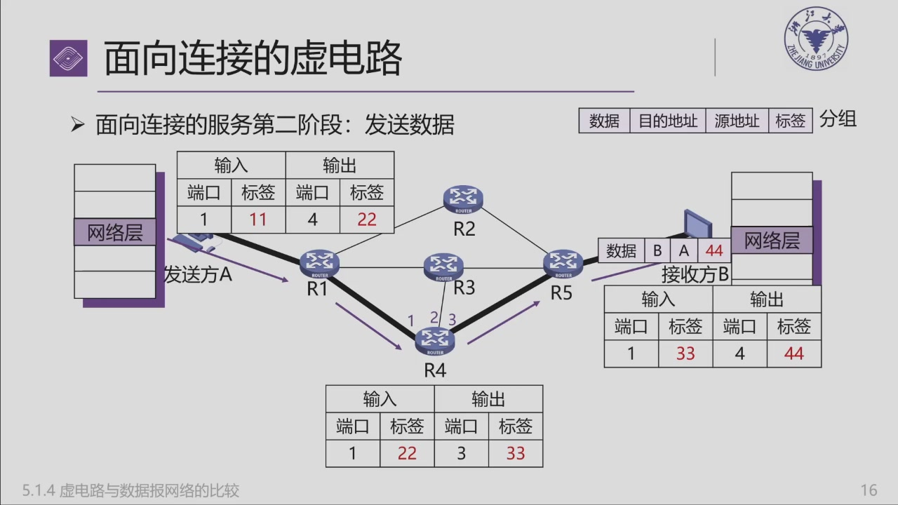
  
**2. 无连接的数据报服务：** 不可靠服务。可靠性由端系统（用户PC）保证


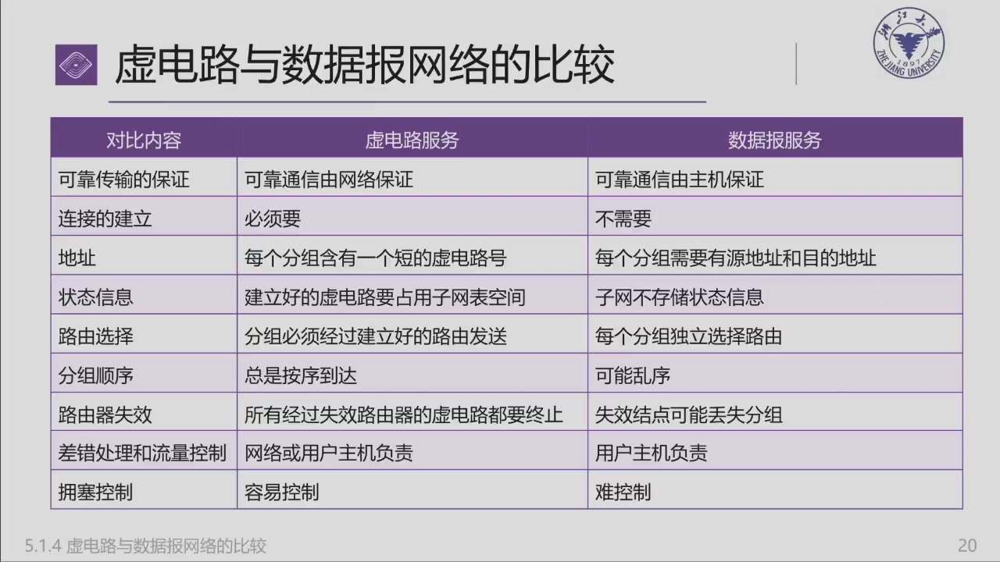
* VC网络：网络知道哪些数据包属于哪条VC，因此可以在网络内部实施差错控制和流量控制
* 数据报网络：每个数据报单独处理，网络不知道连接状态，因此发送负反馈啥的得交给端系统


>注意，路由器只处理到网络层，交换机只处理到链路层（以上的层次都没有）

>Data Flow（流）：数据在网络中的传输过程。通过这样的五元组进行区别——{srcIP,dstIP,srcPort,dstPort,Protocol}
>无故障的情况下，同一个流一般沿同一条路由路径走



* 无状态的话每次请求都要携带足够信息
* 但是无状态不代表不能存储数据，只是说处理时不依赖之前请求的会话状态


## 1.2 转发与路由选择

* 路由（控制面）
* 转发（数据面）

# 2. IPv4 编址与主机入网

IPv4地址：给因特网上的每一台主机（或路由器）的每一个接口分配一个世界上唯一的32bit标识
* 由于网络号跟网段是绑定的，所以IP地址不能带着到处跑

表示方法：点分十进制。每8bit为一组，写成十进制

IPv4地址三个阶段：分类编址、划分子网、无分类编址

## 2.1 IPv4 编址方式

### 2.1.1 分类编址


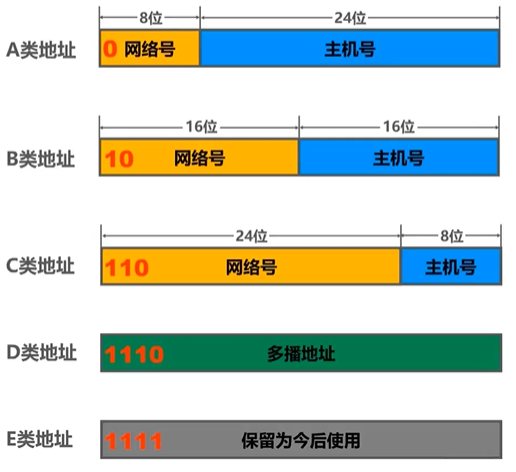

* 只有ABC类可分给主机/路由器的接口
* 主机号全0的是网络地址，主机号全1的是广播地址。都不分配给单机使用




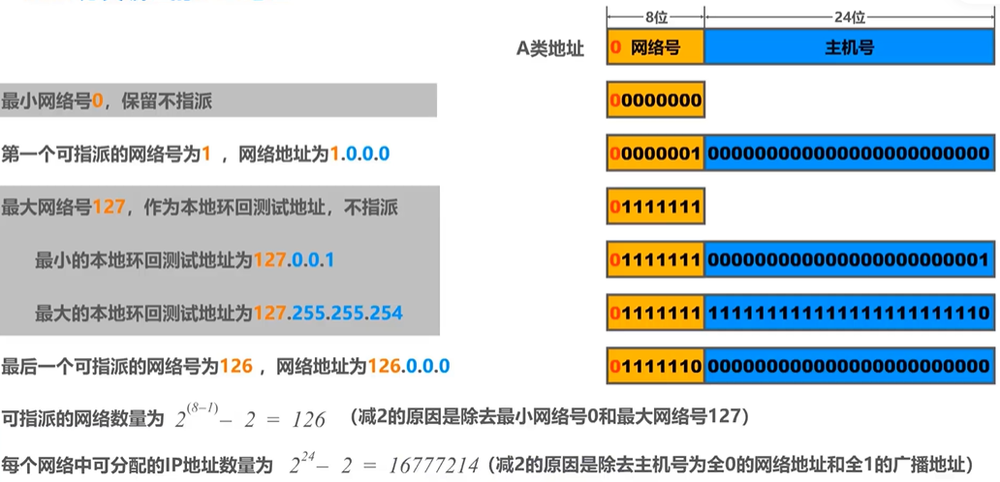


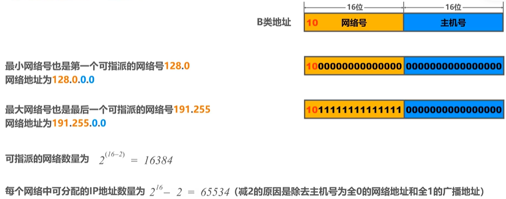


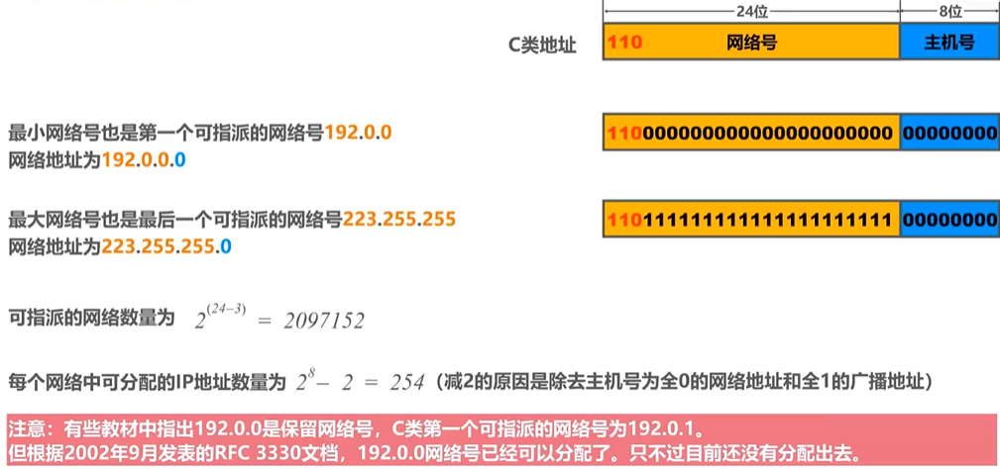


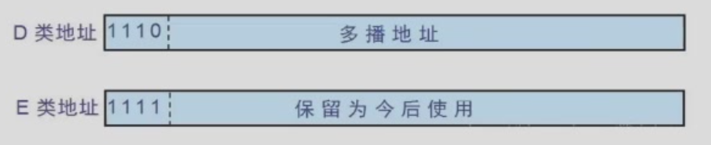
* 然而并没怎么使用





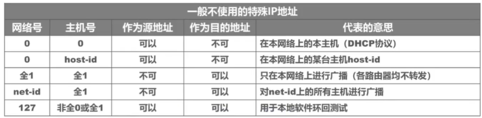
* 可能会考能否作为源/目的地址
* 注意，255.255.255.255是受限广播地址，只在本网络广播；而{特定网络号，主机号全1}这种是直接广播地址，是在指定的目标网络上广播


节约IP地址：分配一个能容纳下接口数的、剩余IP地址最少的网络号。（如：一个只有2个接口的网络，给它分配A类，就浪费了$(2^{24}-2)-2$个IP地址）

### 2.1.2 划分子网

想法：如果想将一个大网络划分为多个子网，申请新的网络号会浪费原有网络号中剩余的IP地址，路由信息也会复杂化。**所以我们希望能从主机号借一部分作为子网号**

使用子网掩码来标记主机号哪些部分被用作子网号。构成及划分细节如下图：

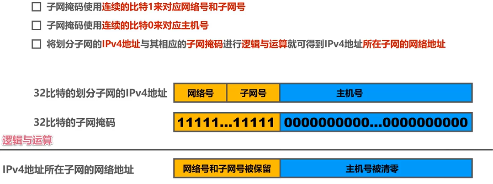

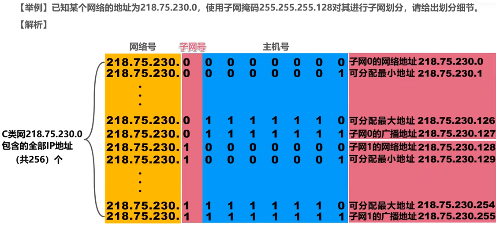


默认子网掩码：未划分子网的情况下使用的子网掩码（就是网络号那些bit全取1，主机号的bit全取0）

划分子网的路由：
* 先判断目的IP是否跟自己在同一子网
  * 若在，则直接交付：直接ARP获取MAC地址并发送（不经过路由器，走Switch
  * 若不在，则间接交付：ARP获取默认网关的MAC地址，发给路由器

### 2.1.3 无分类编址

CIDR,Classless Inter-Domain Routing：无分类域间路由，即在IPv4地址后加上后缀“/x”，表示网络前缀占用x比特，剩下的32-x为主机编号

从而，将前缀相同的连续的IP地址划入一个**CIDR地址块**中。下面探讨CIDR地址块的一些信息：


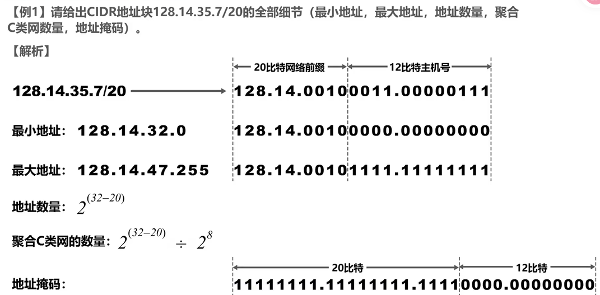

* 其中，地址数量包含网络/广播地址，这里问的不是可分配。
* 聚合C类网数量是指：这个块相当于几个C类网。直接算IP地址是C类的几倍就行

路由聚合：

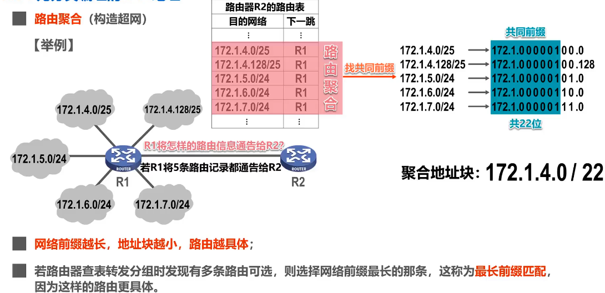

* 展开最前的不同字节，然后找共同前缀即可。后面的全部设为0
* 注意这里讲的最长匹配原则。

## 2.2 子网划分方法

### 2.2.1 定长子网掩码FLSM


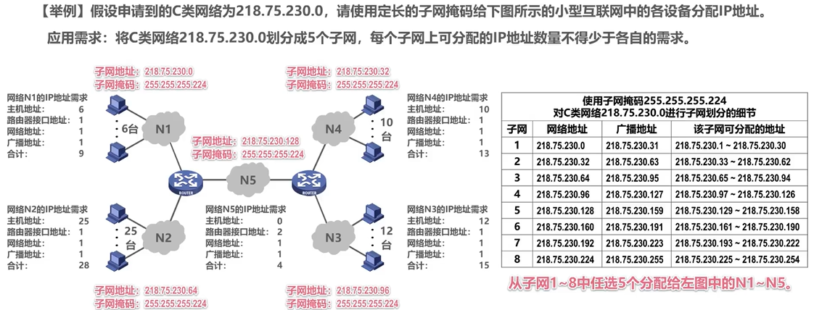

* 只能划分出2^n个子网（n是从主机号借用的bit数）
* IP地址浪费

### 2.2.2 变长子网掩码VLSM


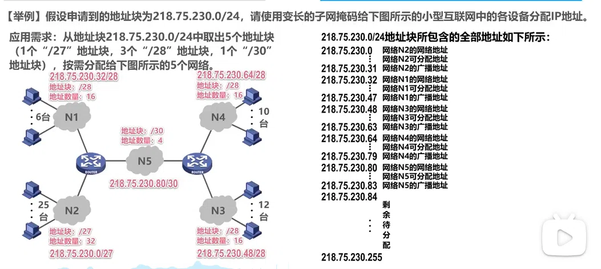


* 地址块划分为子块时，每个子块的起点应选为块大小的整数倍（IP地址最后8bit是块大小的整数倍）
  * 不然可能会一个子网块装不下，如把N2的起点设为218.75.230.16
* 且要从大的块（/x最小的）开始分配，防止碎片化

## 2.3 DHCP，动态主机配置协议

- Dynamic Host Configuration Protocol，给主机动态分配IP地址，允许主机**加入新的网络、自动获取IP地址**而不用手工参与
  - 从而，更方便移动主机的IP获取
  - DHCP是应用层的基于UDP的协议：因为TCP是面向连接的，而客户一开始连IP都没有，当然无法建立连接

- 一台主机要加入互联网，需要的配置有：
  - IP地址
  - 子网掩码
  - 默认网关（的IP地址）
  - 域名服务器（的IP地址）
- 使用Client/Server模型
  - 发现报文：广播寻找DHCP服务器
  - 提供报文：DHCP的回答信息


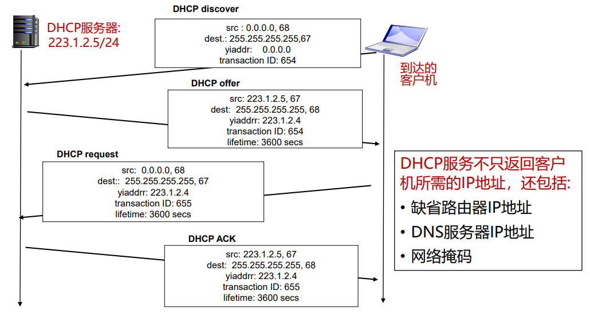

- 工作流程：

| 报文 | 说明 |
| --- | --- |
| DHCPdiscover | 客户**广播**DHCP发现消息，找到（可能多个）服务器 |
| DHCPoffer | 服务器收到DHCP发现消息后，**单播/广播**DHCP提供消息，其中包含分配给客户的IP地址 |
| DHCPrequest | 客户收到（可能多个）提供消息后，若接受此地址，则**广播**DHCP请求消息 |
| DHCPack | 服务器收到后，**单播/广播**DHCP确认消息，将此IP分配给客户 |

- 租用期：客户可使用分配到的IP的期限


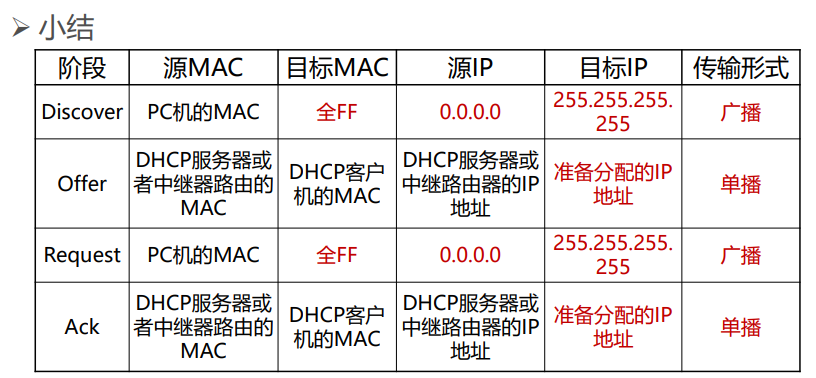


>考试还是按课件来吧。受限广播地址无法转发给本局域网以外的地址，因此若server在别的网段，就要用DHCP Relay（中继器）。但这个没讲，估计不是很重要

# 3. IPv4 数据报与转发

## 3.1 IPv4 数据报首部与分片

首部格式：

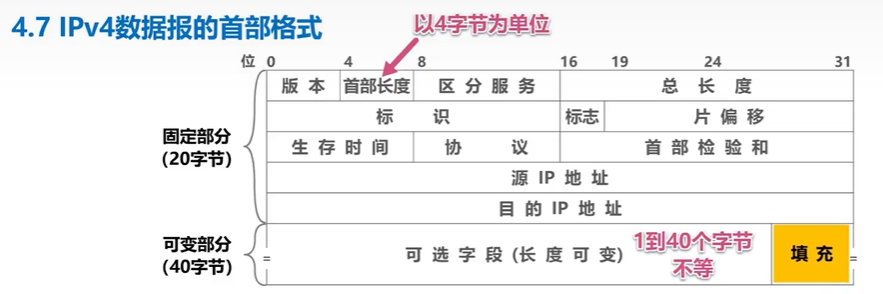

* LINE 1
  * 首部长度：以4B为单位。如取5时，代表首部长度为5x4=20B
  * 填充字段：用来保证首部长度是4的整数倍
  * 总长度：整个IP数据报（首部+载荷）的长度。没有首部长度那么麻烦，值是多少，总长就是多少B
* LINE2：用于IP数据报分片（以防其超过链路层的最大帧长）。下面是用法和示例
  
  
  
  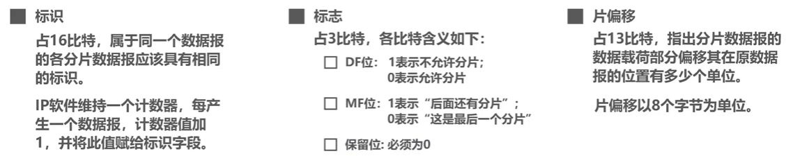
  
  
  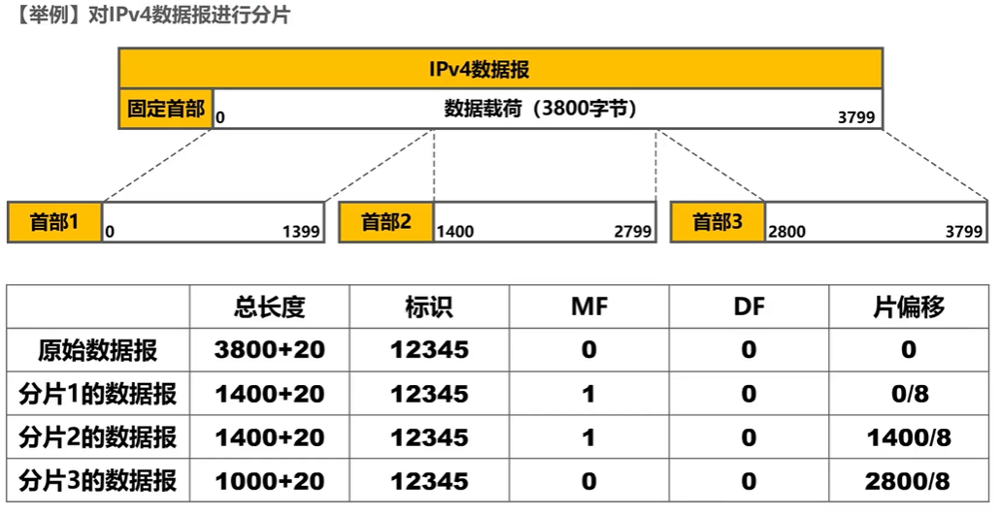
  
  
  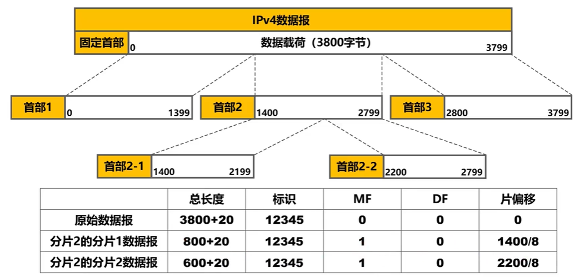
  * 注意这里，分了两次，原IP数据报也还是最开始那个。填写偏移量时要注意
  
  * 注意片偏移是以8B为一个单位，要注意都/8
  
  
   * MTU（Maximum Transmission Unit）是IP数据报最大总长度（包括首部和数据）
     * 允许途中分片（根据next hop链路的MTU来分，小于MTU即可）；一般不允许途中重组（开销太大）。
* LINE3：
  * TTL：每经过一跳，TTL-1，防止数据报永久兜圈
    * TTL是限制数据报的跳数，为0时被丢弃；而RIP中距离为16时表示不可达。它俩只是都用了“跳数”这个衡量概念
  * 协议：表示载荷部分用的协议
  * 首部检验和：检验首部是否出错，比CRC简单，但每经过一跳都要重新计算
    * 计算方法：
      * 先把检验和置0，把整个首部按16bit划分为多个段，然后全部进行反码求和，结果再取反后写入检验和字段
        * 反码加法：普通二进制加法 + 最高位进位回卷
      * 接收方也按此方法进行反码加法，结果取反后得到全0.则说明没有出错

## 3.2 主机发送与路由器转发


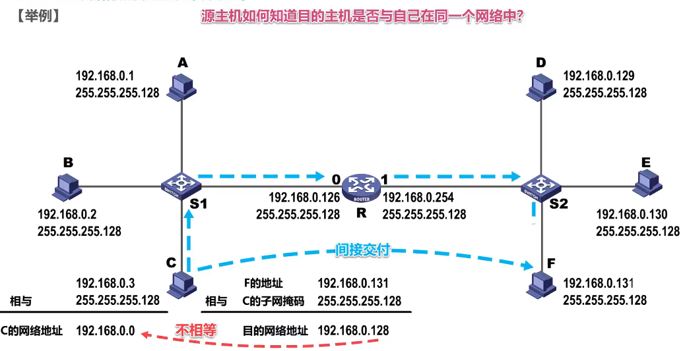


默认网关：为主机指定的，当其需要与其他网络中主机通信时使用的路由器。
* 把路由器的对应接口IP地址指定给主机们即可

路由器转发IP数据包：
1. 检查首部是否出错。若出错则丢弃并通告源PC
2. 根据dst在路由表中查找并转发给next hop。若找不到则丢弃并通告src PC
   * 只是会通告，该丢还是丢。并不是可靠传输


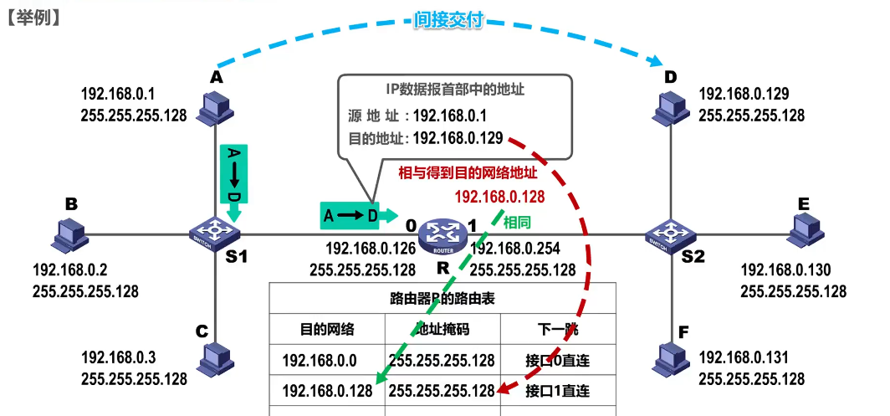

* 实际研发中，路由表的数据结构更高级，查找更快
* 路由器是隔离广播域的
* 直连：路由器的该端口IP地址直接属于那个目的网络

## 3.3 NAT，网络地址转换

将私网IP地址转换成公网IP再发向外网：


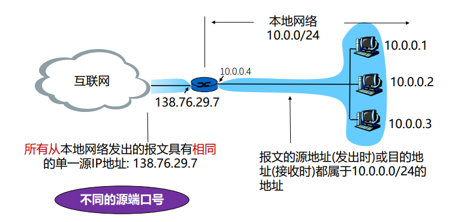

* NAT边界路由器要维护NAT转换表，表项为公网IP+端口--私网IP+端口的映射
* 端口是用来区分不同主机的连接。（外网向公网IP回复时，要带这个端口号来区分此IP对应的不同私有IP）

**三个私有地址段：**

类别|范围|CIDR块
-|-|-
A|10.0.0.0 ～ 10.255.255.255|10.0.0.0/8
B|172.16.0.0 ～ 172.31.255.255	|172.16.0.0/12
C|192.168.0.0 ～ 192.168.255.255	|192.168.0.0/16

- 公网不允许出现；路由器默认不会路由私有地址
- 私有地址段共用一个公网地址（NAT转换），用来作为路由地址
- 这样是为了在不同的公网内复用同一套IP地址（以缓解IP不足），并保证安全性

# 4. 路由选择

## 4.1 概述 

可分为静态/动态路由选择：静态就是人工配置，开销小；动态是根据协议自学习，开销大但灵活。

因特网采用的路由选择协议的特点：
1. 自适应：动态选择，灵活
2. 分布式：路由器之间交换信息，共同完成维护
3. 分层次：将整个Internet划分为许多小自治系统AS(Autonomous System)

AS之间的协议类统称为外部网关协议EGP(External Gateway Protocol)，AS内部使用的统称为内部网关协议IGP(Internal)。

>AS内部各自使用啥与别人无关

常见协议：

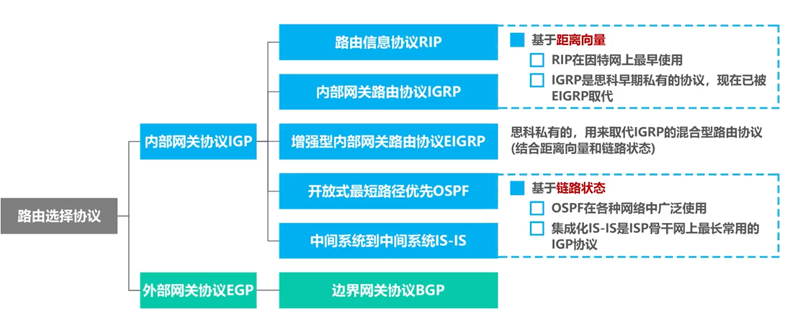


路由器结构：
* 路由选择部分：路由选择处理机，根据使用的选择协议，周期性的与同僚交互路由信息，以更新路由表
* 一般讨论时，不区分路由表和转发表。

## 4.2 静态路由配置

人为用命令配置路由表。不灵活且容易出错


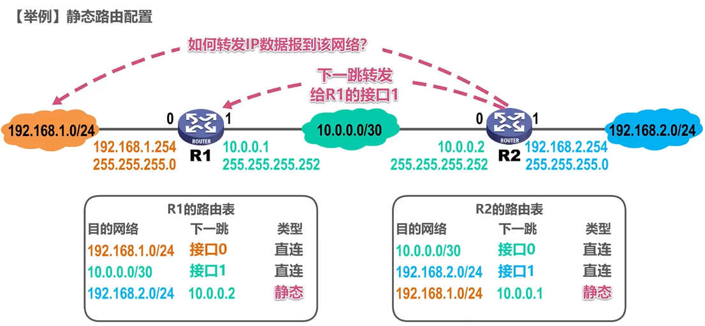

* 例中，第三条静态都是由于路由器不知道目的网络的存在，而人工加上的

* 默认路由：比如一个边缘路由器，其要转发给包含众多网络的因特网时，如果一条条配就太繁琐了。故设置一个默认路由
  * 目的地址和掩码都是0.0.0.0，也就是0.0.0.0/0（没有具体逐条网络设置路由，就直接用0.0.0.0来指代那些网络了）
  * /0显然是最短匹配，因此只在没有更具体的匹配项时才会用
* 最长匹配原则：若有多条路由可选，选前缀最长的那个（它最具体

静态路由的一些问题：

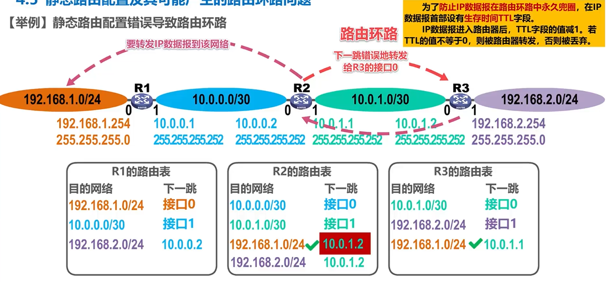

* 配置错误导致的环路：设置TTL


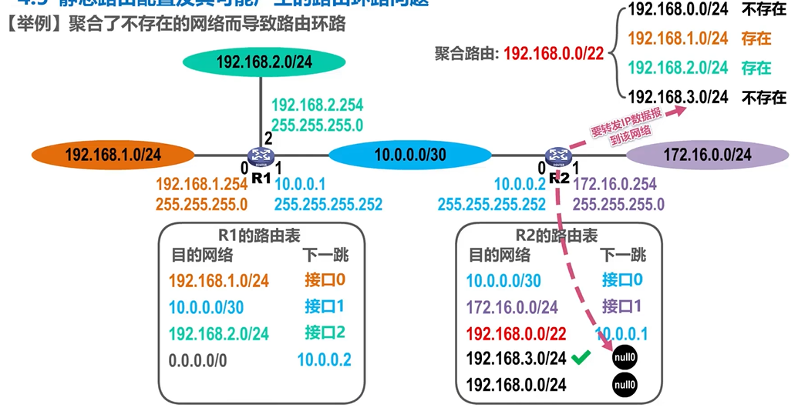

* 聚合了不存在的网络导致的环路：上图中，如果没有null0接口，R2转发给R1后，R1又走默认路由发给R2，形成了环路。
* 当某网络故障而不可达时，也会发生此情况。也用null0来做黑洞路由即可。

## 4.3 动态路由协议

### RIP，路由信息协议

是一种基于距离向量（DV,Distance Vector）的算法


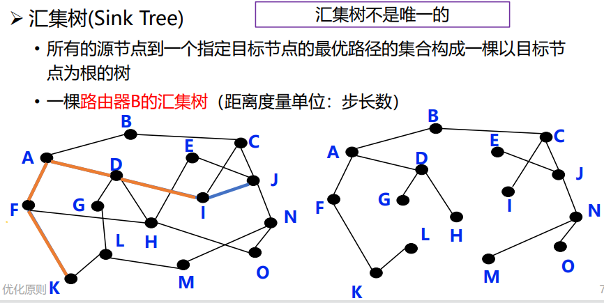

- 汇集树就是针对某个特定目的节点，把全网到达该节点的最优转发路径组织成一棵树，方便理解和实现路由转发


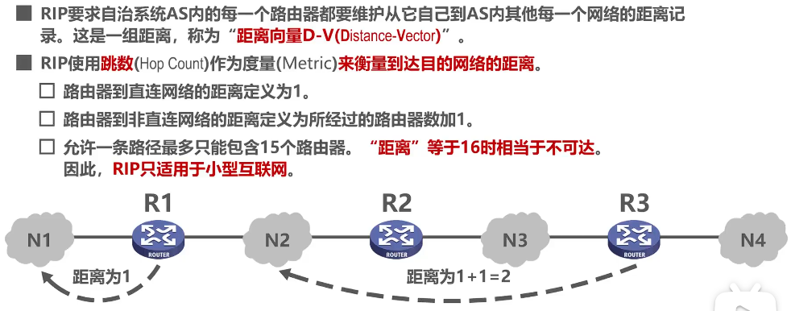
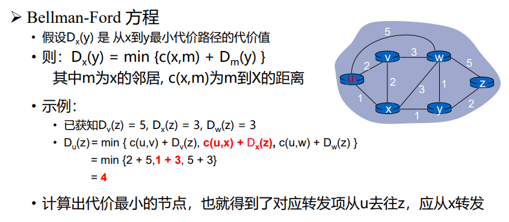

* RIP认为，跳数越少，路由越好。
* 当距离相等时，可以进行等价负载均衡（将信息均分到多条等价路由发送）
* 周期性和相邻路由器交换路由表信息
* 注意距离>=16就表示不可达

工作过程：
* 初始状态，各路由器仅知道自己到直连网络的距离为1
* 周期性和邻居交换并更新路由表
* 收敛：最后，每个路由器都知道自己到达本AS内各网络的最短距离和next hop

更新规则：

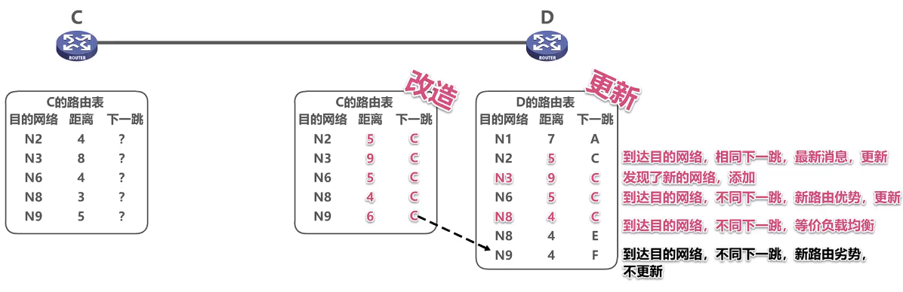

* 这里的改造是指，把C的路由表翻译成相对于D的路由信息
* 然后与自己已有的路由比对。新增的网络/更短的路由就加进来，更劣的路由就不采用 

RIP更新时序会影响其效果。见下图：（路由环路/距离无穷计数）

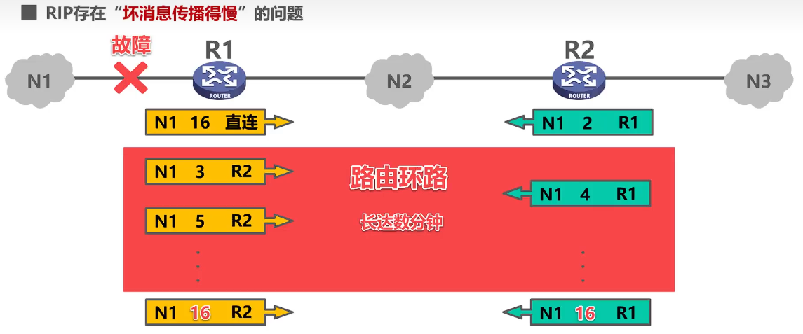

* 这里假设R2的路由信息先到达R1，然后R1才把disable N1的信息发到R2。（若R2先收到disable消息，就把自己的也设成16，此时不会发生环路）
* 应对方法：
  * 当路由表发生变化时即异步触发报文发送
  * 让路由器记住收到某特定路由的接口，不让它再沿这个接口反方向发回去（水平分割）

### OSPF(Open Shortest Path First)，开放最短路径优先

>是一种链路状态（LS,Link State）路由

>开放只是说它是公开发表的。SPF表示使用了Dijktra最短路径算法

>RIP比较好出题，可能考得多一点。OSPF不太好出。


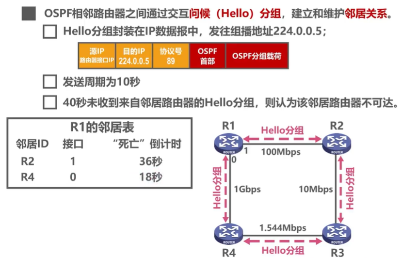

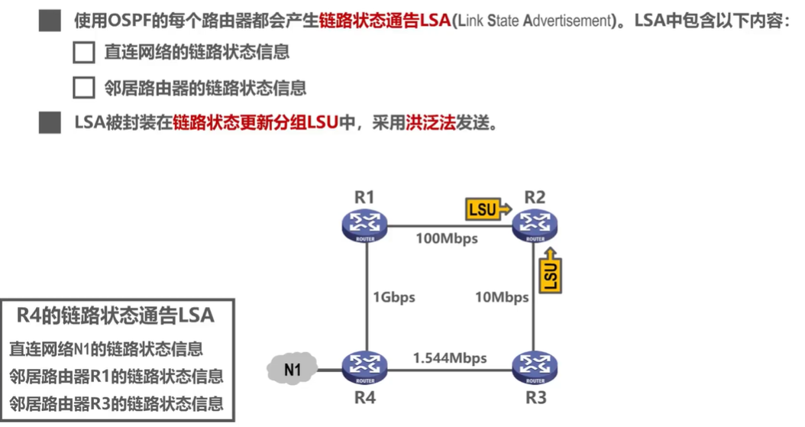

* 链路状态：本路由器跟哪些路由器相邻，以及响应的链路代价（代价计算由具体题目给）
* OSPF的路由器各自有一个链路状态数据库LSDB，用于存储LSA。
* 各路由器泛洪发送自己的LSA，最终所有路由器的LSDB达到一致。
* 邻居关系和邻接关系：
  * 邻居是物理上相邻，用hello可以发现
  * 邻接关系：会进行LSA交换的关系


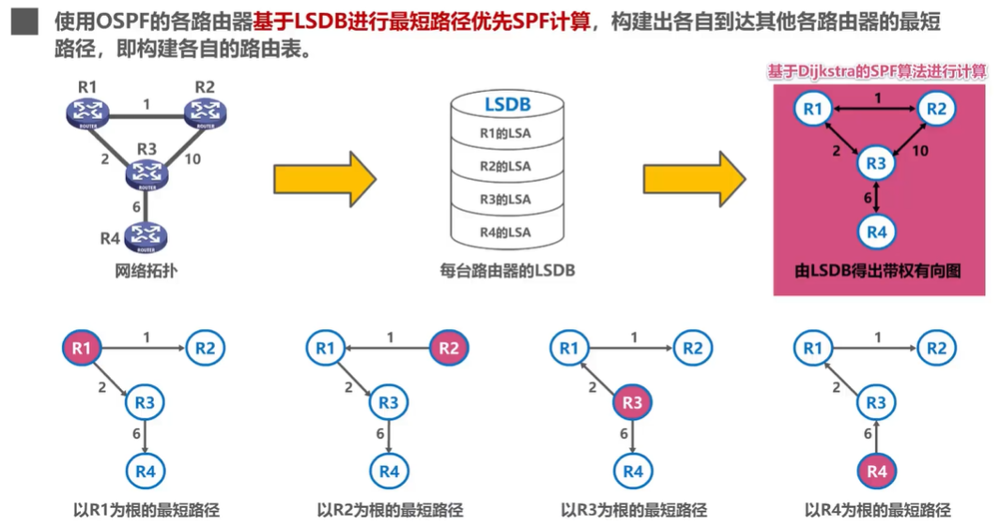

* 其实LSDB就是一个图，每个路由器计算时就把自己当成src vertex.

OSPF的分组类型：

| 分组类型 | 说明 |
| --- | --- |
| hello | 发现和维护邻居的可达性 |
| db description | 给邻居发送自己的LSDB中所有状态项目的摘要 |
| link state request | 请求邻居给自己发某些链路状态信息（阅读description后发现自己缺少某些信息，这时就可以问要） |
| link state update | 洪泛发送自己的LSA |
| link state ack | 对别人发来的update分组的确认 |


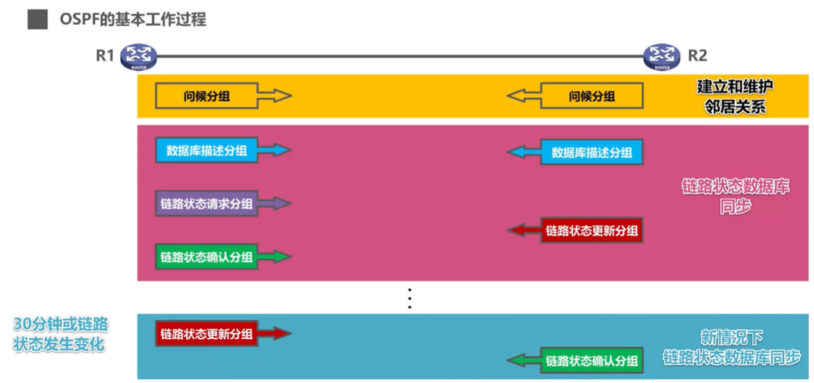


为了防止类似于多点接入的路由器拓扑中两两相邻，而导致发送大量hello浪费带宽的情况，引入两个characters：
* 指定路由器DR(Designated Router)，班长
* 备用指定路由器(Backup DR)，备用班长

其他同学只需要与这俩建立邻接关系即可。（他俩相互也要）同学之间无法直接交换信息，全部通过这俩来


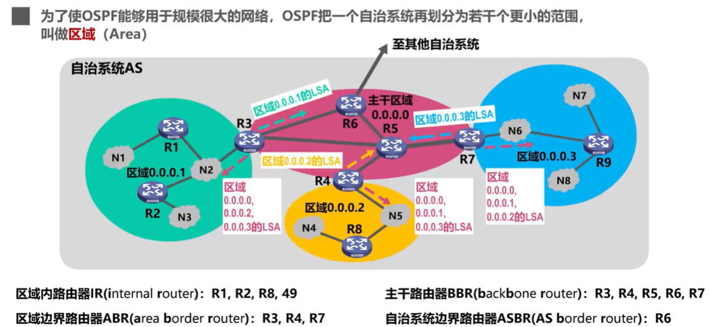

* 这样划分，使得每个区域内交换路由信息量大大减少。

### BGP，边界网关协议

>属于外部网关协议。由于不同AS内可能用不同的量作为代价，所以跨AS无法用代价来作为度量

BGP只能是尽量找一条能到且较好的路由（不兜圈子）


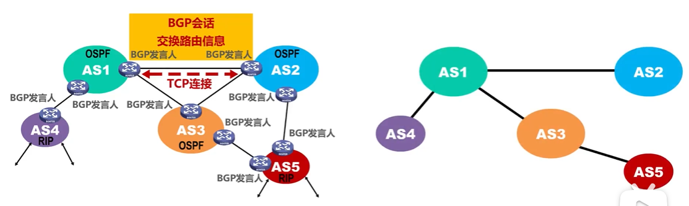

* 每个AS至少选出一个路由器作为BGP发言人
* 发言人之间交换路由信息：
  * 先建立TCP连接，端口为179
  * 直接用TCP通话的两个BGP发言人互称邻站/对等站
  * BGP-4报文被封装在TCP报文中传输

路径向量示例：

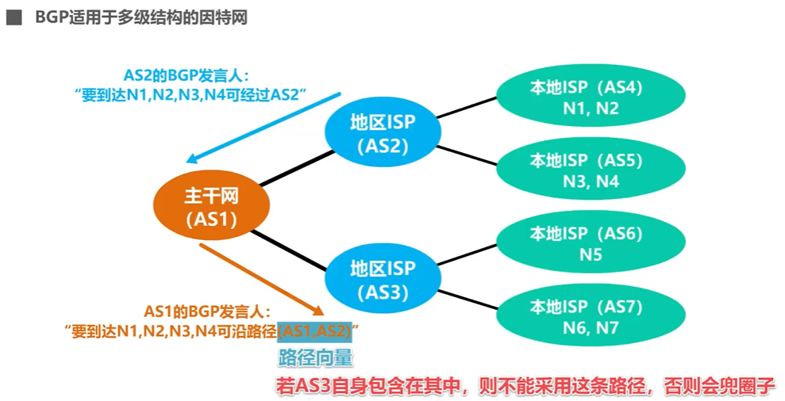


BGP-4报文类别：
* OPEN：与邻站建立邻居关系
* UPDATE：通告路由信息（刚开始会发整个表，后续只发修改的路由信息）
* KEEPALIVE：周期性，确认邻居尚能联通
* NOTIFICATION：发送检测到的差错

RIP，OSPF，BGP与IP的封装关系：

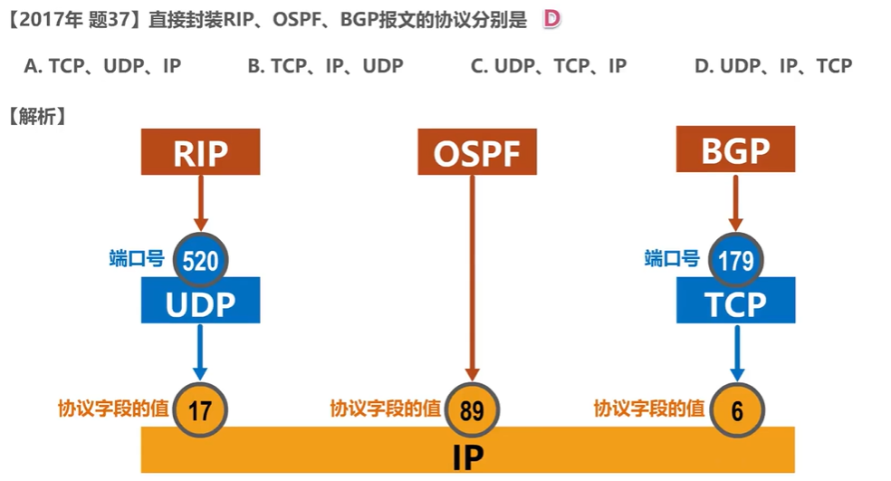


# 5. ICMP 与网络诊断

>ICMP,Internet Control Message Protocol

PC和路由器用ICMP来发送差错报告和询问

## 5.1 报文分类

差错报告报文：



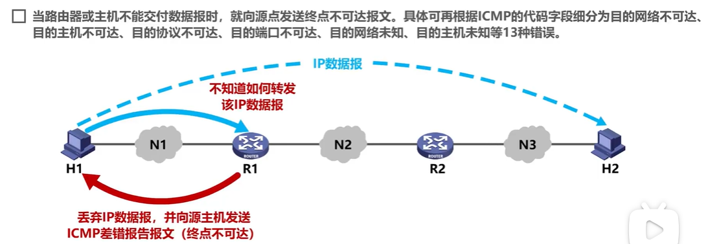
* R1中默认路由、N3路由、H2路由全无，就会这样


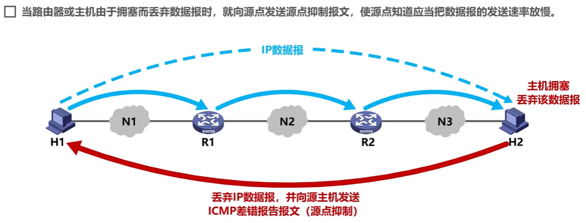



* 注意是先-1再判断是否为0


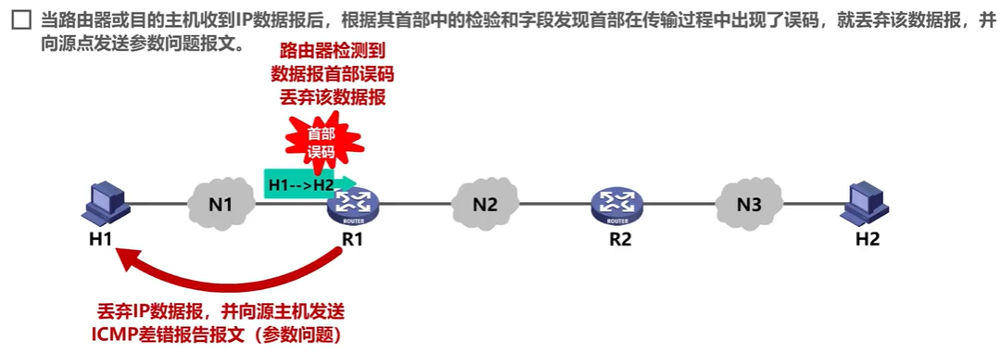


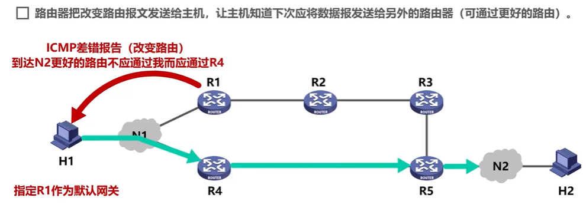




询问报文：
* 回送请求/回送回答：测试目的站是否可达及了解有关状态
* 时间戳请求/回答：时钟同步

## 5.2 网络诊断

### ping

测试连通性。使用ICMP回送请求及回答

### traceroute

测试IP数据报从src到dst经过哪些路由器。

原理：

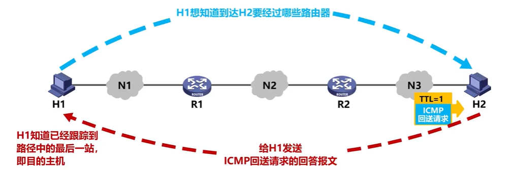

* 先发TTL=1的ICMP回送请求，R1收到会回一个超时差错报告。这样，就知道第一个路由器是R1
* 后面以此类推，增加TTL。最后收到回送回答就是到达目的主机了。

# 6. SDN,Software Define Network

>王道P130

将数据面和控制面解耦：
* 平面的功能：数据面负责转发；控制面负责路由选择
* 设计一个逻辑上的远程控制器负责统筹路由；而网络中具体的路由器只需要进行无脑查表转发，无须维护路由表
* 远程通过Openflow协议将算好的路由表（此处也称流表）下发给路由器（此处也称Openflow交换机）

几个概念：

| 接口 | 说明 |
| --- | --- |
| 北向接口 | SDN提供给用户的编程接口 |
| 南向接口 | SDN控制器和Openflow交换机之间建立双向会话的接口 |
| 东西向接口 | SDN控制器在集群内部控制器之间的通信接口 |

优缺点：
* 优点：
  * 利于全局优化和高效转发
  * 灵活可编程
  * 成本降低：因为路由器的功能简化，所以造价降低
* 缺点：
  * 安全性：控制器受攻击则全员性能下降
  * 控制器可能成为性能瓶颈

# 7. 例题

结论：
- 地址块大小=256-掩码最后一字节
  - 注意，主机数要用地址块大小-2
- 其实可以总结出一些数量关系。因为划分子网本质上就是借几位主机号来当子网号，（分割不同子网号的地址块）所以可以根据这些位数来算。见下表


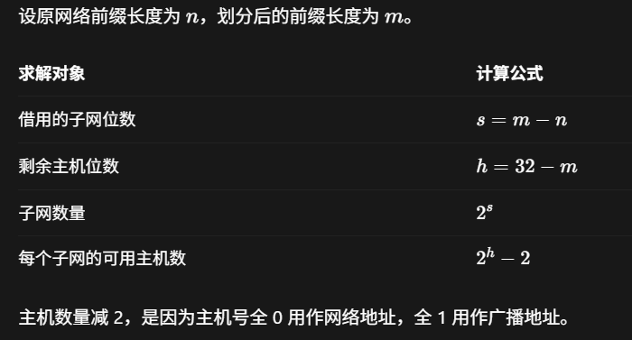



{}

快速得出划分后各个子网的地址（而不用展开成二进制来换算）：**块大小法**
- 根据主机号位数可算出每个子网地址块的大小
- 然后就可以知道每个子网段的起始与结束地址，从而给出特定的地址，也能知道它落在哪个范围内了。

{}
{}

1.（王道）一个网段的网络号为198.90.10.0/27，最多可以分成多少个子网？此网段划分成若干子网后，每个子网最多有多少个可分配的IP地址？

- 若只留1位主机号，则只有网络和广播地址，没有有效IP地址；因此最少留2位主机号，那就剩3位子网号，可以划分为8个子网
- IP最多则要求留5位做主机号（即只有一个子网），共有2^5-2=30个可分配地址

{}
{}

2.（GPT）192.168.1.77/27 所在子网的广播地址是什么？

答：
- 其地址块大小为2^5=32，77落在64-95之间，是第二个子网。这个子网的网络地址为`192.168.1.64`，广播地址为`192.168.1.95`.
  - 由于这里不涉及子网个数的问题，（同样，涉及子网范围的全都是）因此无需在意这是从何原网络划分出来的子网

{}
{}

3.huffman tree相关，王道P153题40

{}
{}

4.计算分片数量和分片长度。注意每片的数据长度都得是8的倍数（片偏移以8B为单位

{}
{}


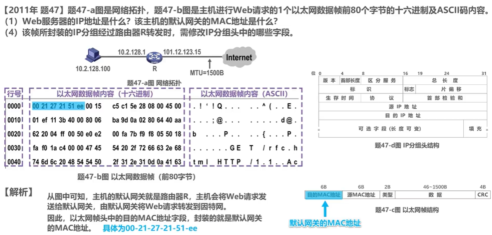
* 最左边的行号也是16进制，增量为16，表示一行是16B


{}
{}
