# 1. 概述





## 1.1 服务

1. 面向连接的虚电路服务
   * 虚电路VC：网络层的逻辑连接
   * 目的主机地址仅在建立连接时使用，后续发送的分组首部仅含VC的编号（VC的每一段链路都有一个VC编号）
2. 无连接的数据报服务
   * 是不可靠服务。可靠性由用户主机保证

# 2. IPv4

IPv4地址：给因特网上的每一台主机（或路由器）的每一个接口分配一个世界上唯一的32bit标识

表示方法：点分十进制。每8bit为一组，写成十进制

IPv4地址三个阶段：分类编址、划分子网、无分类编址

## 2.1 三种编址

### 分类编址




* 只有ABC类可分给主机/路由器的接口
* 主机号全0的是网络地址，主机号全1的是广播地址。都不分配给单机使用

A类：




B类：




C类：




一些特殊的IP地址（可能会考能否作为源/目的地址）




节约IP地址：分配一个能容纳下接口数的、剩余IP地址最少的网络号。（如：一个只有2个接口的网络，给它分配A类，就浪费了$(2^{24}-2)-2$个IP地址）

### 划分子网

想法：如果想将一个大网络划分为多个子网，申请新的网络号会浪费原有网络号中剩余的IP地址，路由信息也会复杂化。所以我们希望能从主机号借一部分作为子网号

使用子网掩码来标记主机号哪些部分被用作子网号。构成及划分细节如下图：




默认子网掩码：未划分子网的情况下使用的子网掩码（就是网络号那些bit全取1，主机号的bit全取0）

### 无分类编址

无分类域间路由选择CIDR：即在IPv4地址后加上后缀“/x”，表示网络前缀占用x比特，剩下的32-x为主机编号

从而，将前缀相同的连续的IP地址划入一个**CIDR地址块**中。下面探讨CIDR地址块的一些信息：




* 其中，地址数量包含网络/广播地址，这里问的不是可分配。
* 聚合C类网数量是指：这个块相当于几个C类网。直接算IP地址是C类的几倍就行

路由聚合：



* 展开最前的不同字节，然后找共同前缀即可。后面的全部设为0

## 2.2 划分方法

### 定长子网掩码FLSM




* 只能划分出2^n个子网（n是从主机号借用的bit数）
* IP地址浪费

### 变长子网掩码VLSM





* 地址块划分为子块时，每个子块的起点应选为块大小的整数倍（IP地址最后8bit是块大小的整数倍）
  * 不然可能会一个子网块装不下，如把N2的起点设为218.75.230.16
* 且要从大的块（/x最小的）开始分配，防止碎片化

## 2.3 发送和转发





默认网关：为主机指定的，当其需要与其他网络中主机通信时使用的路由器。
* 把路由器的对应接口IP地址指定给主机们即可

路由器转发IP数据包：
1. 检查首部是否出错。若出错则丢弃并通告源PC
2. 根据dst在路由表中查找并转发给next hop。若找不到则丢弃并通告src PC
   * 只是会通告，该丢还是丢。并不是可靠传输




* 实际研发中，路由表的数据结构更高级，查找更快
* 路由器是隔离广播域的，即使是255.255.255.255这个广播地址，其也不会转发
* 直连：路由器的该端口IP地址直接属于那个目的网络

## 2.4 静态路由配置

人为用命令配置路由表。不灵活且容易出错




* 例中，第三条静态都是由于路由器不知道目的网络的存在，而人工加上的

默认路由：比如一个边缘路由器，其要转发给包含众多网络的因特网时，如果一条条配就太繁琐了。故设置一个默认路由
* 目的地址和掩码都是0.0.0.0

特定主机路由：目的地址填主机的具体IP地址。直接用/32
* 最长匹配原则：若有多条路由可选，选前缀最长的那个（它最具体

静态路由的一些问题：



* 配置错误导致的环路：设置TTL




* 聚合了不存在的网络导致的环路：上图中，如果没有null0接口，R2转发给R1后，R1又走默认路由发给R2，形成了环路。
* 当某网络故障而不可达时，也会发生此情况。也用null0来做黑洞路由即可。

## 2.5 IPv4数据报

首部格式：

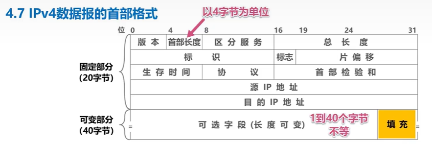

* LINE 1
  * 首部长度：以4B为单位。如取5时，代表首部长度为5x4=20B
  * 填充字段：用来保证首部长度是4的整数倍
  * 总长度：整个IP数据报（首部+载荷）的长度。没有首部长度那么麻烦，值是多少，总长就是多少B
* LINE2：用于IP数据报分片（以防其超过链路层的最大帧长）。下面是用法和示例
  
  
  
  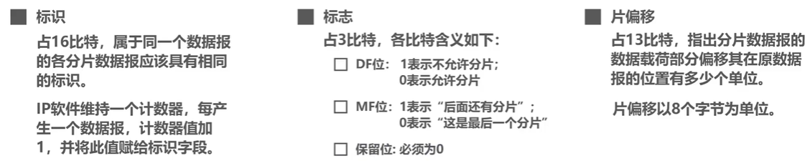
  
  
  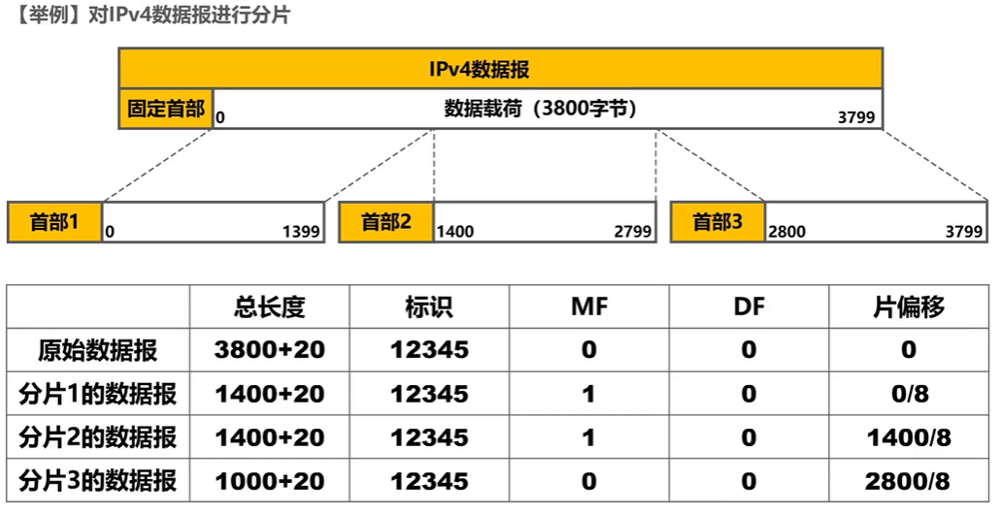
  
  
  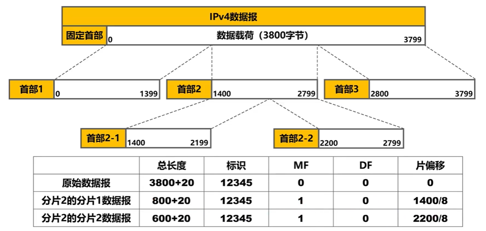
  
  
  
   * 注意这里，分了两次，原IP数据报也还是最开始那个。填写偏移量时要注意
   * MTU是IP数据报最大总长度（包括首部和数据）
* LINE3：TTL和RIP距离向量的关系？
  * TTL：每经过一跳，TTL-1.防止数据报永久兜圈
  * 协议：表示载荷部分用的协议
  * 首部检验和：检验首部是否出错，比CRC简单，但每经过一跳都要重新计算

例题：

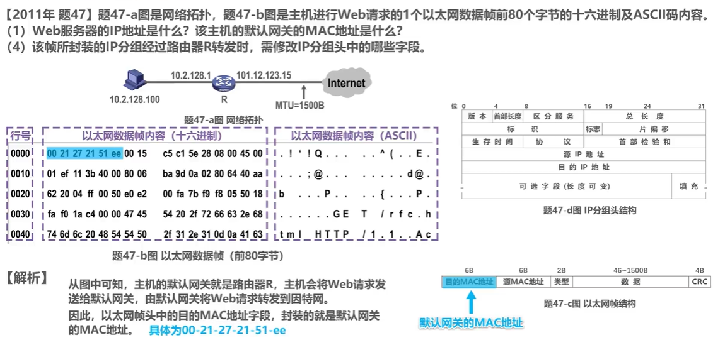

* 最左边的行号也是16进制，增量为16，表示一行是16B

# 3. 路由选择协议

可分为静态/动态路由选择：静态就是人工配置，开销小；动态是根据协议自学习，开销大但灵活。

因特网采用的路由选择协议的特点：
1. 自适应：动态选择，灵活
2. 分布式：路由器之间交换信息，共同完成维护
3. 分层次：将整个Internet划分为许多小自治系统AS(Autonomous System)

AS之间的协议类统称为外部网关协议EGP(External Gateway Protocol)，AS内部使用的统称为内部网关协议IGP(Internal)。

>AS内部各自使用啥与别人无关

常见协议：




路由器结构：
* 路由选择部分：路由选择处理机，根据使用的选择协议，周期性的与同僚交互路由信息，以更新路由表
* 一般讨论时，不区分路由表和转发表。

## 3.1 RIP，路由信息协议


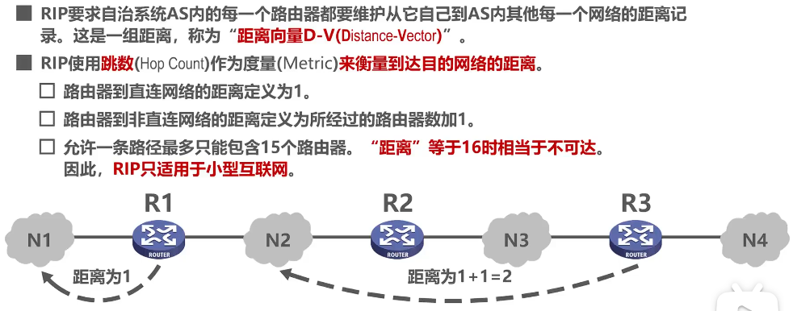

* RIP认为，跳数越少，路由越好。
* 当距离相等时，可以进行等价负载均衡（将信息均分到多条等价路由发送）
* 周期性和相邻路由器交换路由表信息
* 注意距离>=16就表示不可达

工作过程：
* 初始状态，各路由器仅知道自己到直连网络的距离为1
* 周期性和邻居交换并更新路由表
* 收敛：最后，每个路由器都知道自己到达本AS内各网络的最短距离和next hop

更新规则：

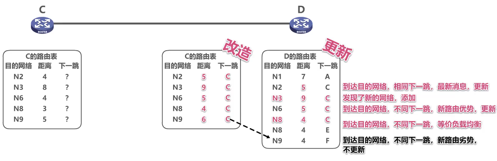

* 这里的改造是指，把C的路由表翻译成相对于D的路由信息
* 然后与自己已有的路由比对。新增的网络/更短的路由就加进来，更劣的路由就不采用 

RIP更新时序会影响其效果。见下图：（路由环路/距离无穷计数）

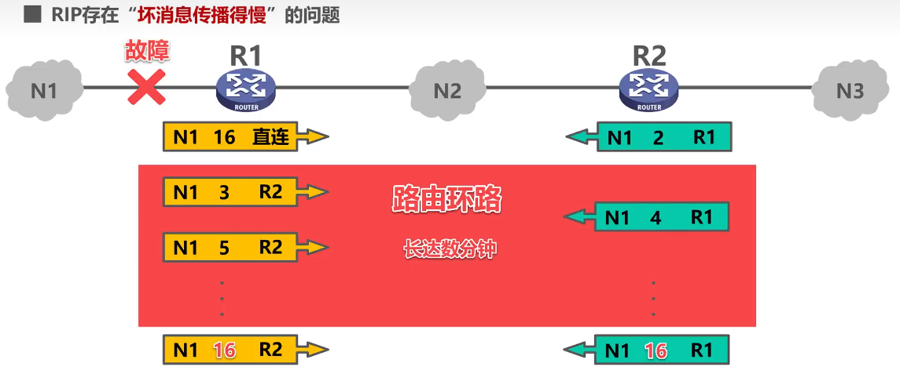

* 这里假设R2的路由信息先到达R1，然后R1才把disable N1的信息发到R2
* 应对方法：
  * 当路由表发生变化时即异步触发报文发送
  * 让路由器记住收到某特定路由的接口，不让它再沿这个接口反方向发回去（水平分割）

## 3.2 OSPF(Open Shortest Path First)，开放最短路径优先

>开放只是说它是公开发表的。SPF表示使用了Dijktra最短路径算法


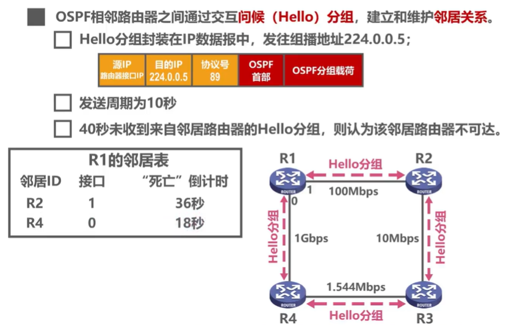

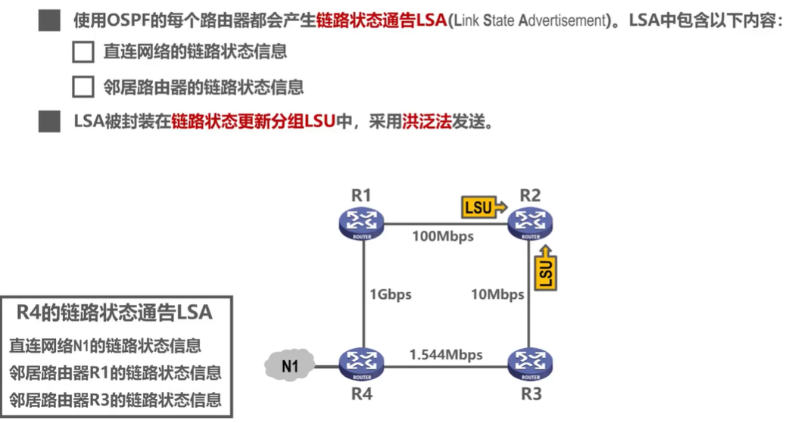

* 链路状态：本路由器跟哪些路由器相邻，以及响应的链路代价（代价计算由具体题目给）
* OSPF的路由器各自有一个链路状态数据库LSDB，用于存储LSA。
* 各路由器泛洪发送自己的LSA，最终所有路由器的LSDB达到一致。


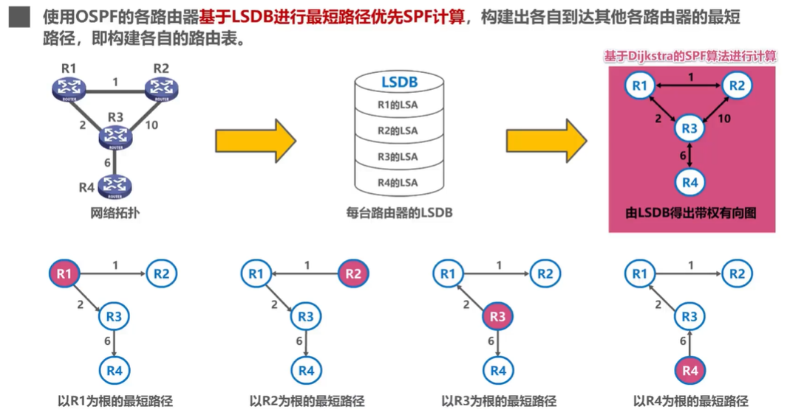

* 其实LSDB就是一个图，每个路由器计算时就把自己当成src vertex.

OSPF的分组类型：
1. hello：发现和维护邻居的可达性
2. db description：给邻居发送自己的LSDB中所有状态项目的摘要
3. link state request：请求邻居给自己发某些链路状态信息（阅读description后发现自己缺少某些信息，这时就可以问要）
4. link state update：洪泛发送自己的LSA
5. link state ack：对别人发来的update分组的确认


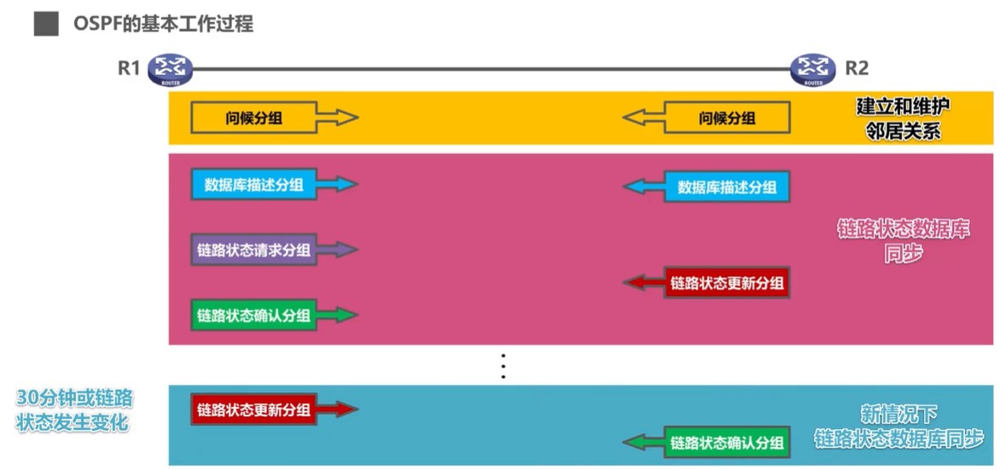


为了防止类似于多点接入的路由器拓扑中两两相邻，而导致发送大量hello浪费带宽的情况，引入两个characters：
* 指定路由器DR(Designated Router)，班长
* 备用指定路由器(Backup DR)，备用班长

其他同学只需要与这俩建立邻居关系即可。（他俩相互也要）同学之间无法直接交换信息，全部通过这俩来


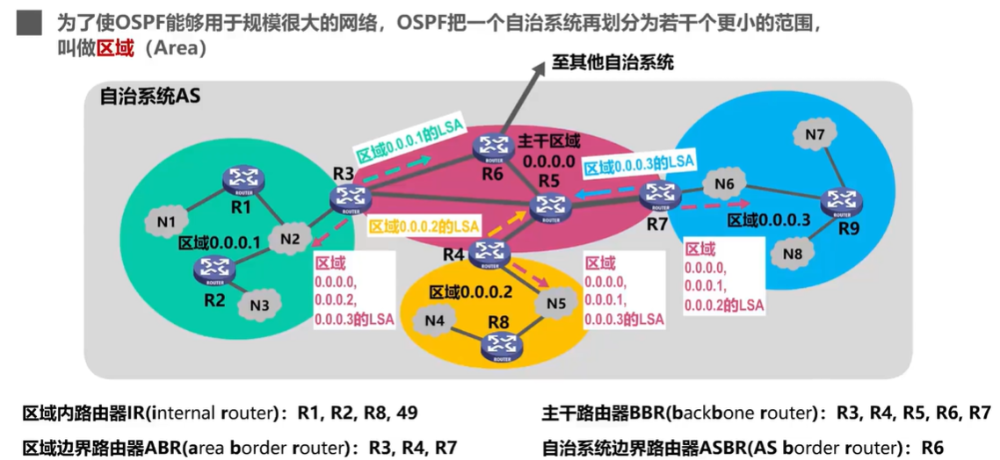

* 这样划分，使得每个区域内交换路由信息量大大减少。

## 3.3 BGP，边界网关协议

>属于外部网关协议。由于不同AS内可能用不同的量作为代价，所以跨AS无法用代价来作为度量

BGP只能是尽量找一条能到且较好的路由（不兜圈子）


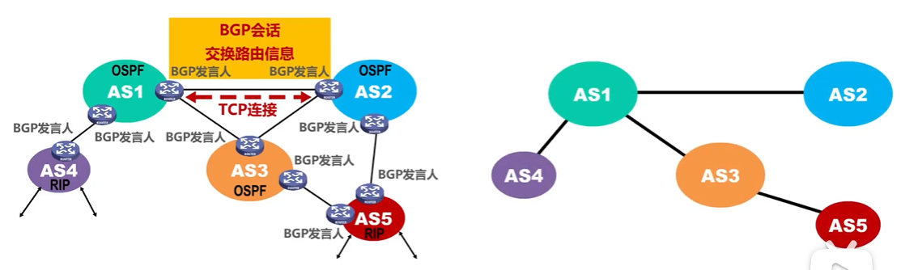

* 每个AS至少选出一个路由器作为BGP发言人
* 发言人之间交换路由信息：
  * 先建立TCP连接，端口为179
  * 直接用TCP通话的两个BGP发言人互称邻站/对等站
  * BGP-4报文被封装在TCP报文中传输

路径向量示例：

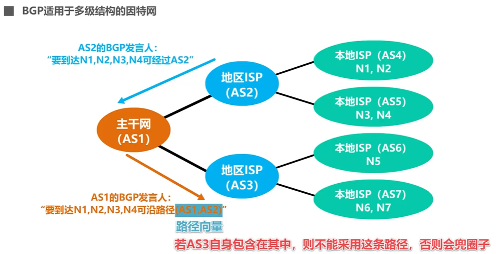


BGP-4报文类别：
* OPEN：与邻站建立邻居关系
* UPDATE：通告路由信息（刚开始会发整个表，后续只发修改的路由信息）
* KEEPALIVE：周期性，确认邻居尚能联通
* NOTIFICATION：发送检测到的差错

RIP，OSPF，BGP与IP的封装关系：

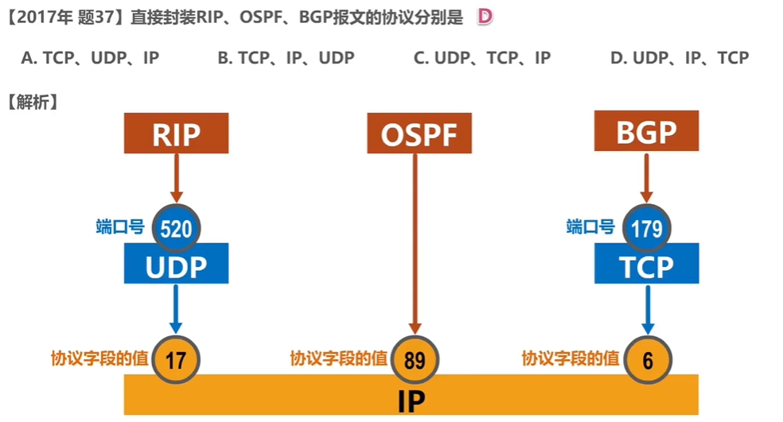


# 4. ICMP，网际控制报文协议

>ICMP,Internet Control Message Protocol

PC和路由器用ICMP来发送差错报告和询问

## 4.1 分类

差错报告报文：



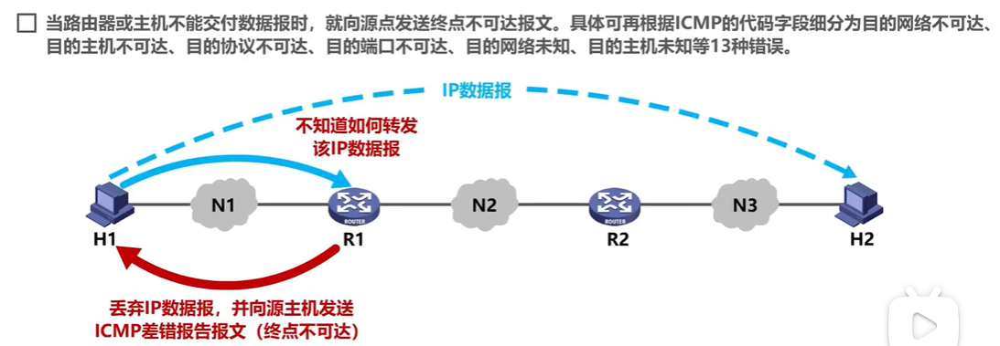
* R1中默认路由、N3路由、H2路由全无，就会这样


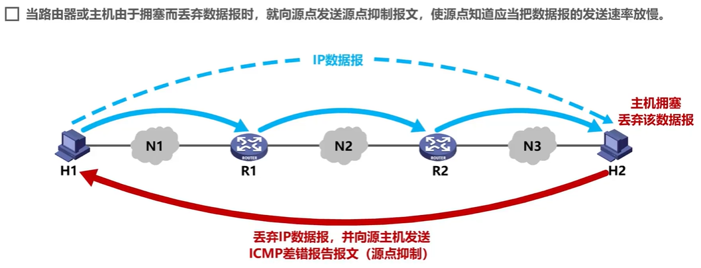



* 注意是先-1再判断是否为0


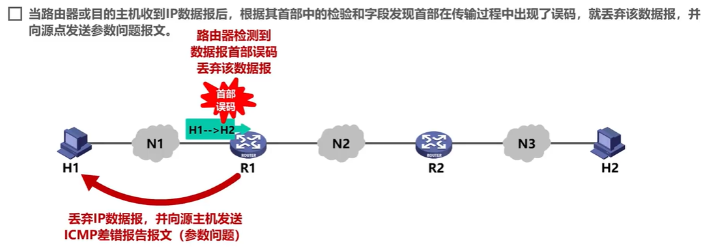


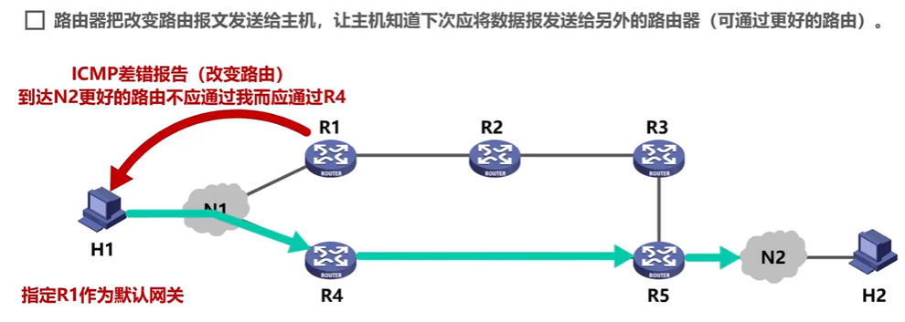




询问报文：
* 回送请求/回送回答：测试目的站是否可达及了解有关状态
* 时间戳请求/回答：时钟同步

## 4.2 应用

### ping

测试连通性。使用ICMP回送请求及回答

### traceroute

测试IP数据报从src到dst经过哪些路由器。

原理：

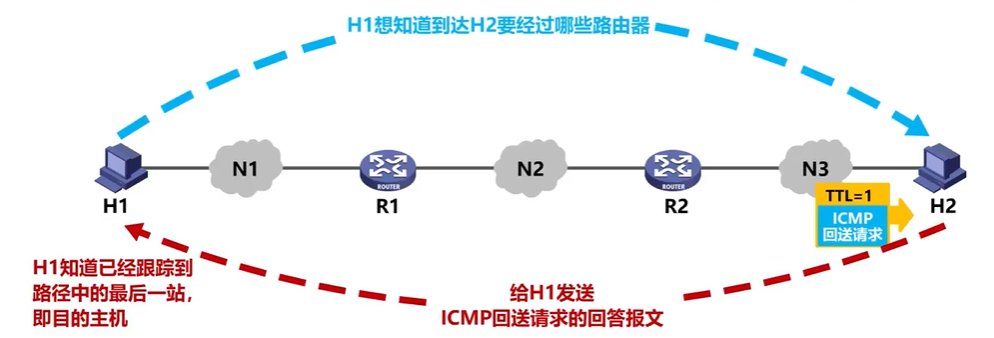

* 先发TTL=1的ICMP回送请求，R1收到会回一个超时差错报告。这样，就知道第一个路由器是R1
* 后面以此类推，增加TTL。最后收到回送回答就是到达目的主机了。

# 5. 