# 1. 概述

运输层任务：为不同主机上的进程提供通信服务。（端到端）

运输层中不同的端口对应不同的应用进程。示意图如下：

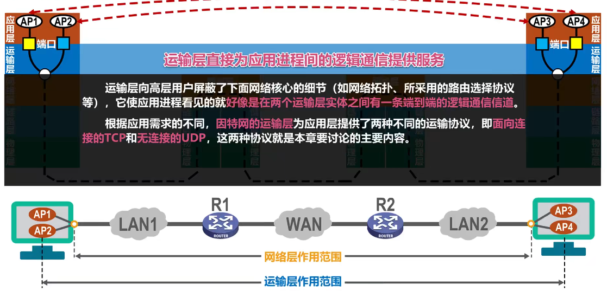

## 1.1 运输层端口

不同OS的进程标识符不同。需要规定一个统一标识——端口号

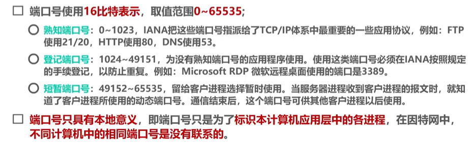

* 发送方复用：
  * 指的是应用层不同进程（或不同协议）的应用报文，可以封装到UDP或TCP报文中；
  * 然后不管是哪种，又可以都封装为IP数据报
* 接收方分用：
  * 根据协议字段分用为UDP或TCP
  * 再根据端口号分发给不同的进程

常用的熟知端口号：
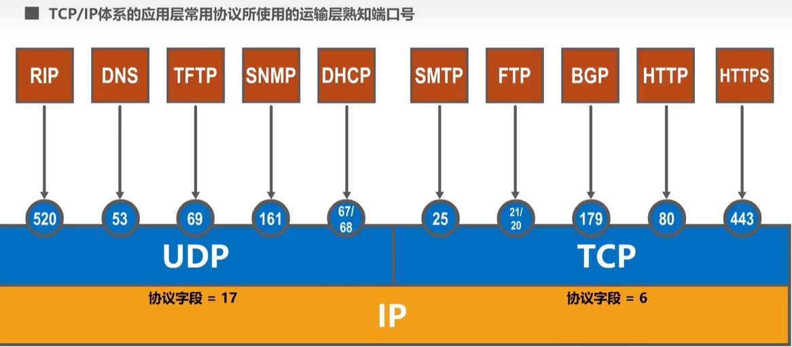

## 1.2 TCP和UDP的对比

UDP,User Datagram Protocol
- 无连接，随时传输数据
- 支持单播/多播/广播
- 面向应用报文，即保留报文边界并封装
- 不可靠服务：检查出错误后仅丢弃
  - 因此适用于实时应用，如视频会议

TCP,Transmission Control Protocol
- 面向连接，三报文握手+四报文挥手
- 仅单播
- 面向字节流：仅将字节编号并保存在自己的缓存中，之后提取一定数量的字节来封装并发送；接收方跟此对称
  - 因此，应用层必须有能力还原原数据
- 可靠服务

首部对比：
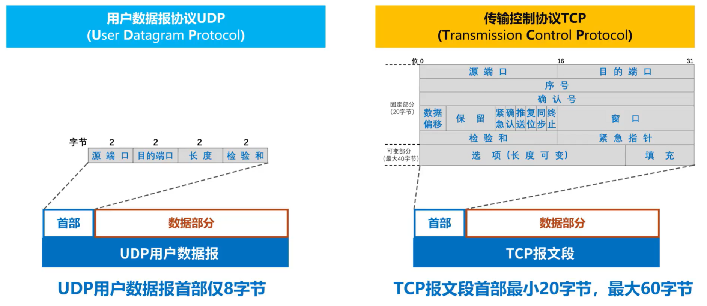
- UDP首部中那个长度指的是整个UDP数据报的长度。（因为首部长度是固定8字节，不用额外说明之

# 2. TCP

## 2.1 流量控制

- 控制发送方发送速率，以防接收方来不及处理
- 使用滑动窗口
  - 流量控制
    - 若接收缓存空间不足，就会在回复ACK的同时带上一个信息rwnd=xx，表示把接收窗口调整为xx大小，发送方也跟着调成xx大小。必要时xx=0，发送方直接阻塞
  - 累积确认+超时重传
- 持续计时器：为了防止rwnd信号丢失，以至于把发送窗口关闭后，双方一直互相等待，形成死锁
  - 发送方收到置0信号后，启动一个计时器；超时后发送一个零窗口探测报文（1字节）；
  - 接收方再发一个rwnd信号过来。若仍为0则刷新计时器
  - 注意，这个零窗口探测也有超时计时器，会超时重传
- 注意，即使接收窗口为0，也必须接受0窗口探测、ACK报文

流程示意：
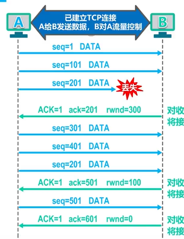

例题：
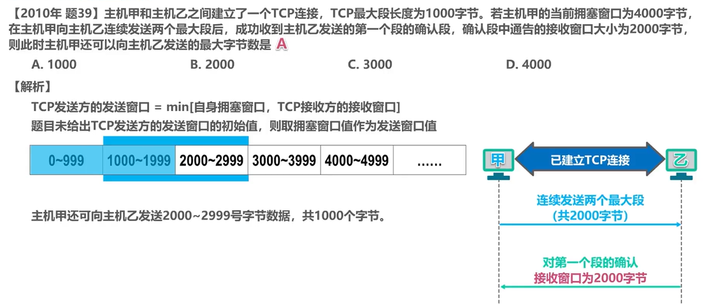
- 记住是先根据ack中的累积确认信息移动发送窗口，再根据rwnd来调整窗口大小。

## 2.2 拥塞控制

拥塞def：某段时间内，对网络中的某一资源的需求超过了其可用量，网络性能就会变坏的情况
- 不控制拥塞，则吞吐量将随着输入负载增大而下降

性能示意：

TCP的拥塞控制：
- slow-start
- congestion avoidance
- fast retransmit
- fast recovery

假定条件：

重要变量：

发送过程：

- 传输轮次：发送方将当前允许的全部报文段连续发出并收到最后一报文的ACK，为一轮
- 慢开始：顾名思义，就是给发送窗口swnd设置一个较小的初值，并逐步增大。慢开始阶段按指数增长。
- 当cwnd达到ssthresh后，开始使用拥塞避免策略，每轮+1，变为线性增长
- 若发生拥塞，则修改ssthresh（注意是置为当前cwnd的一半），并重新慢开始。

但这里有个问题，有时丢失并不是因为拥塞，可能只是丢失个别报文，错误地启动慢开始会降低传输效率。

从而，提出了快重传和快恢复
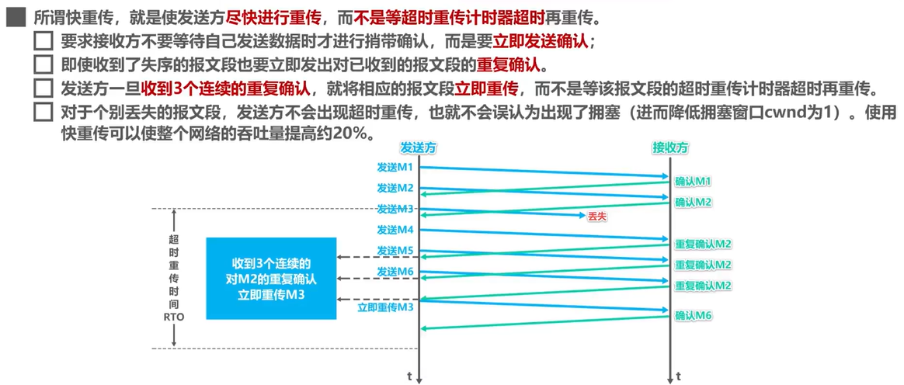
- 快重传：主要是降低重传等待时间
  - 这里，回复对M6的确认，就表示3456都正确接收了。

- 快恢复：连续收到3个重复ACK，说明只是丢失了个别数据包，不是真的发生了拥塞（毕竟还能正常收到后续报文呢）
- 所以不像慢开始一样从头开始，而是从一个较大的窗口开始走

总之，有快重传之后，筛掉了一些非拥塞导致的丢包。而这样了还超时的话，就说明可能是真的拥塞了，要用慢开始。

四种算法控制过程示意：
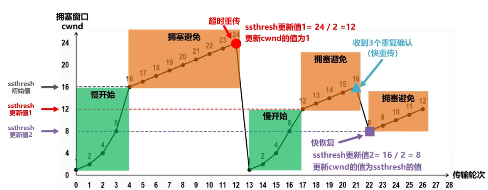

例题
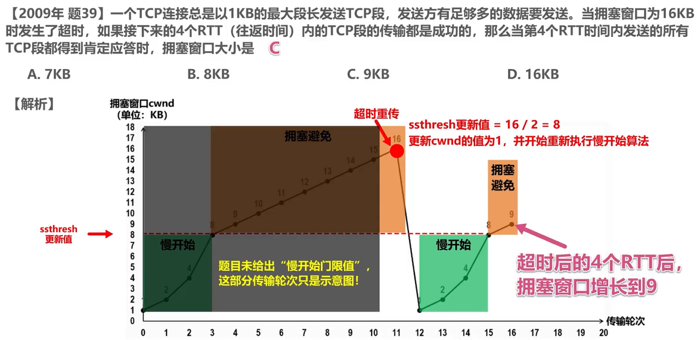

## 2.3 TCP重传时间的选择

由于底层网络路径的复杂性，每次RTT可能不同。因此重传时间RTO的选择会变得复杂。

所以我们应该使用多个RTT样本来计算一个加权RTT_s，这样，RTO设置为略大于RTTs的值即可

RTO计算公式：

- 有点像标准差那意思

然而，RTT的测量比较复杂：

- Karn算法：出现重传时，此轮的RTT不参与RTTs的计算
  - 存在问题：若因为某些因素，实际RTT增大并一直保持这种时延，在原来的RTO下必然引起重传，从而此增大的RTT不被纳入计算。这样。RTO就无法被更新，出现许多不必要的重传
    - 解决方法：每重传一次，就把RTO增大一些。一般是扩大一倍

计算示例：
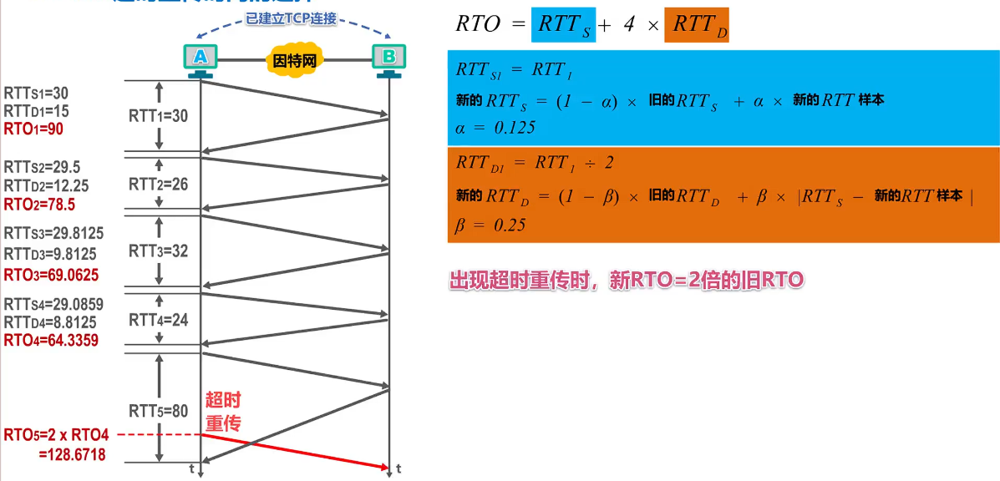

## 2.4 TCP可靠传输的实现

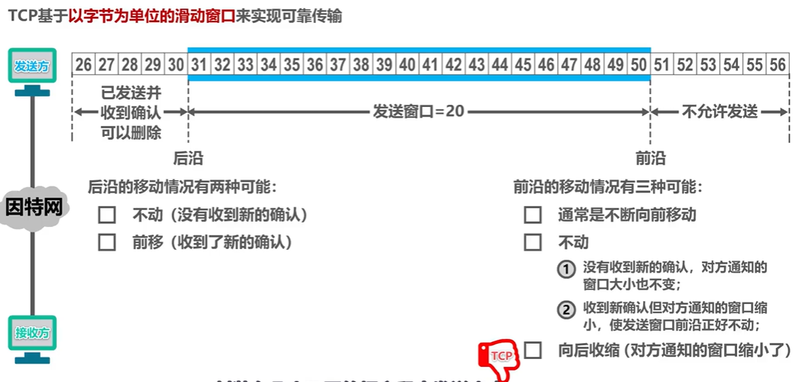
- 不建议前沿后退，因为若收到收缩信号前已发送了后续数据，而它们超出新窗口前沿，就会产生bug

如何维护窗口状态？

发送窗口的描述：
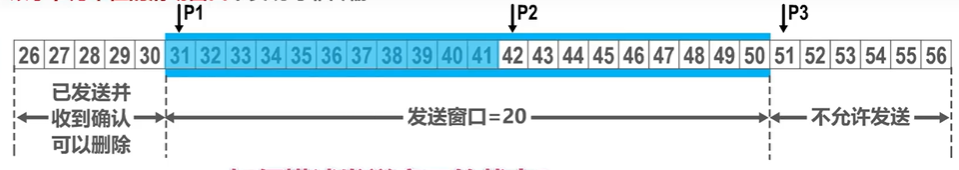
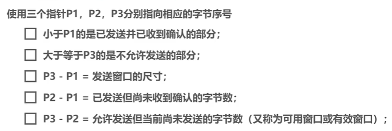

一些tips：
- 发送方的发送窗口根据接收方的接收窗口设置，但同一时刻两者不一定相等。
  - 窗口信息传输存在时间滞后，且滞后时间不确定。
  - 发送方可能根据网络拥塞情况适当缩小发送窗口。
- 失序到达的数据：
  - 先暂存，待缺失的字节到达后，再按序交付给上层应用程序
- 确认机制：
  - 累积确认
    - 但不能过分推迟
  - 捎带确认：接收方有数据要发送时，可以将确认信息附带在数据报文段中
- TCP是全双工通信，双方都有自己的发送+接收窗口

## 2.5 TCP运输连接管理

### 概述

连接三阶段
  - 建立连接：3报文握手
  - 数据传输
  - 释放连接：4报文挥手

### 连接建立

要考虑的问题：
  - 双方能确知对方存在
  - 协商参数
  - 分配运输实体资源

两报文的隐患：
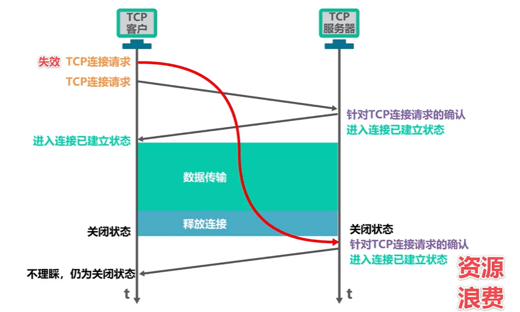
  - 已失效的连接请求又到达服务器，打开了其连接状态并空等

三报文握手过程：
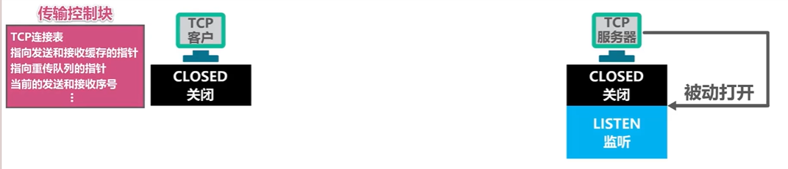
- 服务端被动打开连接：服务器创建传输控制块，进入LISTEN状态，等待连接请求
- 客户端主动打开连接：也是先创建传输控制块，然后发送请求

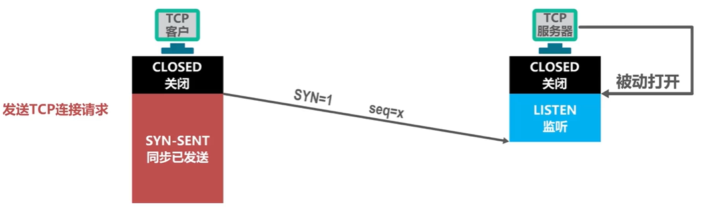
- SYN表示这是连接请求报文段。SYN=1的报文不能携带数据，但要消耗1个序号
- 序号x在这只是个代数，由客户随意指定

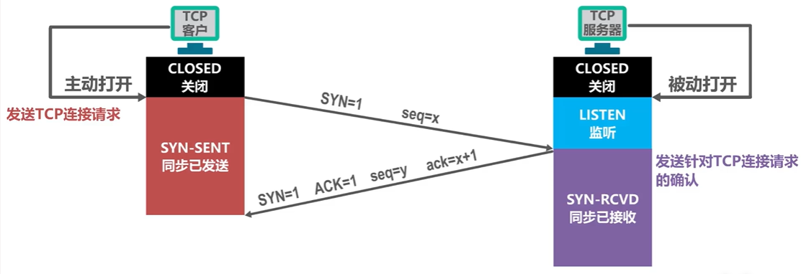
- ack=x+1表示是对客户进程初始序号的确认
- 同样不能携带数据

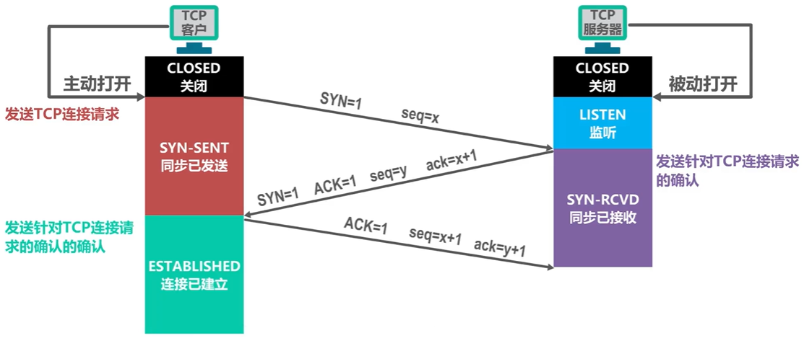
- 客户端第二个报文，序号为它自己第一个报文+1.
- 这是普通的确认报文段，可以携带数据。不携带数据时不消耗序号（则下一发送的报文序号仍为x+1）
- ack=y+1表示是对服务器那个seq=y的报文的确认

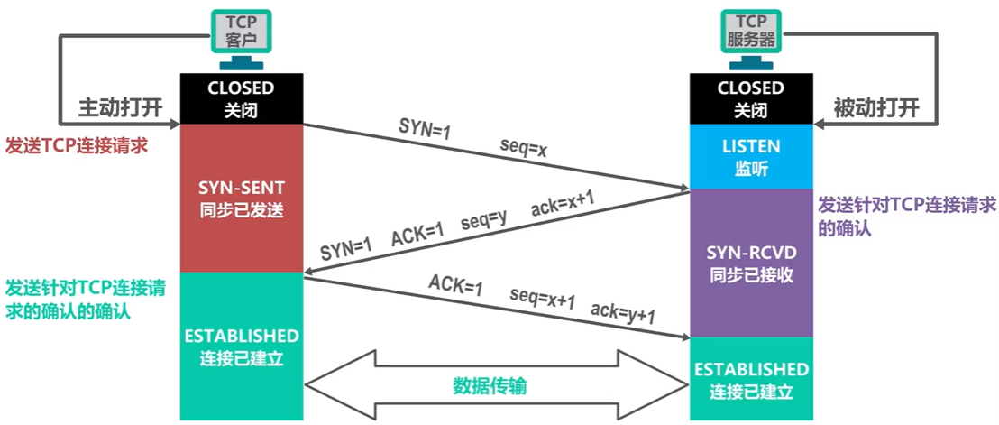
- 接下来可以进行数据传输了。

### 连接释放

双方都可以主动释放连接。过程如下

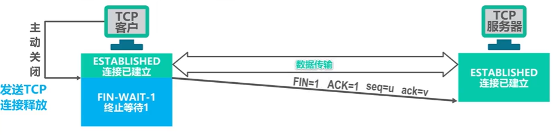
- FIN=1,ACK=1，表明这是连接释放报文段
- seq=u，是发完的最后一个字节的序号+1.
- FIN=1的报文，即使不带数据也要消耗一个序号
- ack=v，是收到的最后一个字节的序号+1

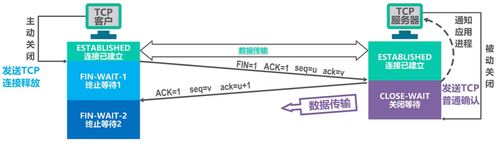
- 值含义同上
- 现在客户->服务器方向的连接已关闭，但若服务器还有话要说，客户端还是要接收的

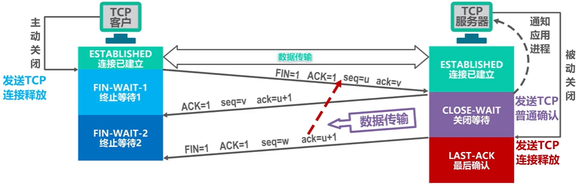
- 应用进程没话说了，通知服务器释放连接
- 这里seq=w是CLOSE-WAIT发送的最后一字节序号+1

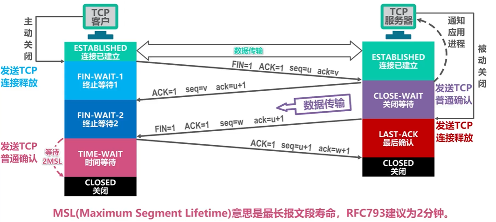

为何要TIME-WAIT？防止服务器无法正常关闭：
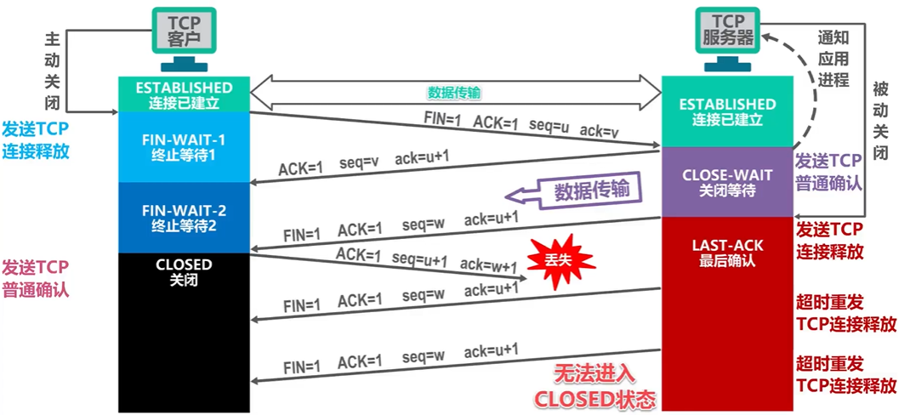
- 以及等2MSL可以让网络中本次连接的报文段都走光，不会因其滞留而影响别的连接

保活计时器：防止客户端故障，无法正常释放连接而把服务端拖死
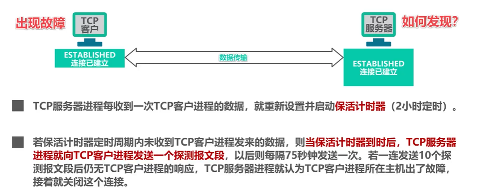