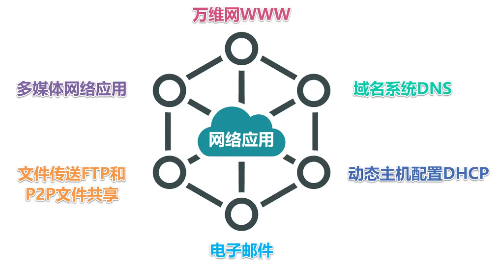
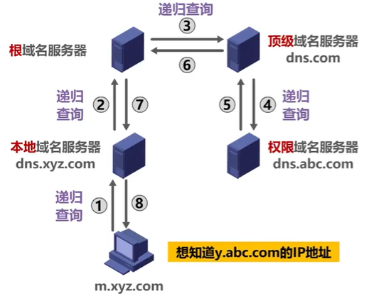
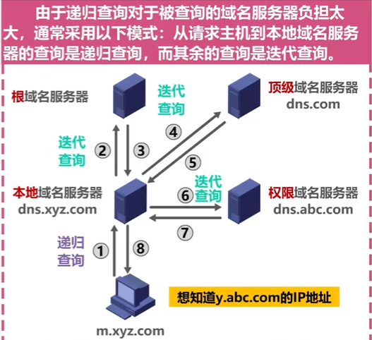
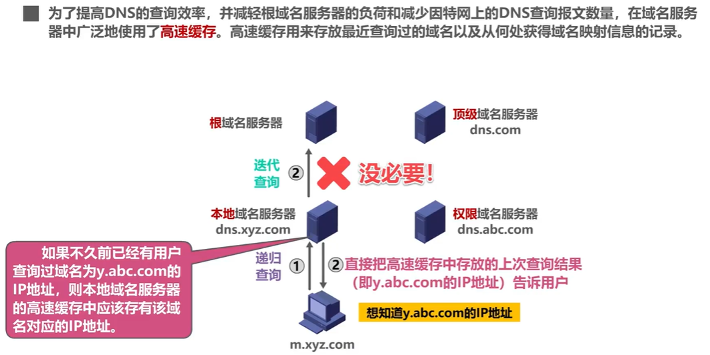

# 1. 概述

功能：解决通过应用进程的交互来实现特定网络应用的问题

常见应用：

# 2. 网络应用的组织方式

## 2.1 C/S，Client/Server方式

- 客户和服务器指的是通信中涉及的两个进程。
  - 有时也把进程对应的PC直接称为客户和服务器
- 服务器具有固定端口号，对应的主机有固定的IP地址
- C/S是服务集中型的：即服务集中在少量服务器的情况

## 2.2 P2P(Peer-to-Peer)，对等方式

- 各应用进程对等，称为对等方。他们之间直接通信
- 每个对等方既是服务请求者，又是服务提供者
- 服务分散型。服务分散在大量对等方中。
  - 扩展性好，因为增加对等方同时增加了服务的请求者和提供者，不会造成拥塞而性能降低

# 3. DHCP，动态主机配置协议

>在网络层讲过。这里带过一下吧

# 4. 域名系统DNS

访问某域名时：
- 用户PC先在自己的cache中根据域名找IP
- 若找不到，则向DNS服务器求助。
  - DNS服务器中有**域名-IP地址**的映射表

## 4.1 域名结构

- 顶级域名TLD(Top Level Domain)，有三类
  - 国家顶级域名nTLD
  - 通用顶级域名gTLD
  - 反向域arpa：用于IP地址反向解析为域名
- 二级域名：
  - 在nTLD下的二级域名由国家自行确定
  - 我国：
    - 类别域名
    - 行政区域名

## 4.2 域名服务器

类型：
  - **根域名服务器：** 通常不直接对域名解析，而是返回其所属顶级域名的服务器的IP
  - **顶级域名服务器：** 管理在其下注册的所有二级域名服务器。查询结果可能是解析出的IP，也可能是下一级的权限域名服务器的IP
  - **权限域名服务器：** 管理某个区的域名。
    - 可以有多级，一个权限域名服务器下面可以划分子域给多个服务器。有点像划分子网
  - **本地（默认）域名服务器：** 负责将DNS请求报文转发给上述等级结构中的域名服务器
    - 要将本地域名服务器的IP配置到每台主机中

## 4.3 域名解析过程

### 两种查询方式

递归查询：

迭代查询：

- 本地的服务器多做一点事没关系，尽量煎炒占用高级服务器

### 高速缓存

- 域名-IP的映射不是固定的。因此，域名服务器们会为自己的Entries设置超时计时器
- 主机也会设置域名映射cache，并设置计时器。